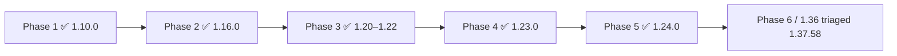

# Delight wishlist

This is the **delight roadmap** — what would please the people (and agents) who actually use Projectionist. It is not a backlog dump and not shipping status.

Shipping status lives in [CHANGELOG.md](../CHANGELOG.md) and the living product map [PRODUCT.md](PRODUCT.md). Knowledge mechanics live in [MEDIA_INTELLIGENCE.md](MEDIA_INTELLIGENCE.md). MCP contract lives in [MCP.md](MCP.md).

Baseline: Automat / `main` at **1.37.59+** (Native Live, media intelligence R1–R4, For you first rail, Library health Monday pass, Play buffering + hold-to-2x, For you junk-copy refuse). Do not list those as future work. Do not reopen parked Phase 6 leftovers or Tunarr-era doors — they sit in the [Archive](#archive).

Jump to: [Personas now](#personas-now) · [Roadmap by persona](#roadmap-by-persona) · [Cross-cutting](#cross-cutting-opportunities) · [Archive](#archive)

---

## How to read an item

Each bet names **who** it delights, the **feeling** it should create, **why it is possible now** on 1.37.59+ substrate, and an **honesty gate**. Empty is better than junk — the For you lesson (`specific_plot_link` / `watched_bridge` refuse Wikipedia glue). Promotion into a delivery plan remains an owner decision.

Horizons:

| Horizon | Means |
|---------|--------|
| **Now** | The substrate is already in product; the remaining work is to *feel* it in the room or at the MCP mouth |
| **Next** | Near-term wrap of shipped intelligence (same graph, same refusal) — not a new engine |
| **Later** | Worth wanting once Now/Next land; not a rewrite, not a parked resurrection |

**Hard non-goals** (same locks as [PRODUCT.md](PRODUCT.md)): no Projectionist-managed Plex HDHomeRun / tuner rebuild; no Tunarr; no IdleScheduler rewrite; no Postgres/Redis; no “on Netflix”; no gift queue / trust diary / Admin House seasonal veto; no 2× on Live TV; no Lobby kiosk campaign unless the house actually relies on `:8791`.

---

## Top bets

Five bets that pay off for more than one persona. Detail lives under the personas.

1. **One mouth.** For you, chat, inbox, newsletter, and MCP tonight all cite a named `watched_bridge` / collection / crew link — or they stay quiet.
2. **MCP tonight that tells the truth.** `what_to_watch_tonight` today is a full-mode library dump. Delight is the same honesty as Explore For you, not a new tool.
3. **Live as a station, not a loop.** Cycle rebuild (1.37.53) and flex filler (1.37.58) already exist; the grazer should feel a channel with personality in the pad, not *Heat* again.
4. **Play as the calm couch control.** Buffering OSD, hold-to-2× (Live excluded), one caption layer, iPad Safari rate honesty — keep that contract, don’t add chrome.
5. **Monday pass that moves.** Named kinship % on titles people actually opened; `kinship_miss` already prefers idle catch-up. The owner should see the shelf they emptied Sunday fill by Monday.

---

## Personas now

Human and agent, including MCP consumers as first-class. In-app curator voices (The Professor, Spark, The Steward, The Host) already shipped their Phase 5 votes — they are **how the household curator speaks**, not a separate backlog. Household accounts today are **owner** or **member** (Youth is a flag). Legacy guest rows map to member; there is no public tour.

| Persona | Where they live | What they already have |
|---------|-----------------|------------------------|
| **Household viewer** | iPad Safari / phone / laptop on Explore, Chat, Play, Inbox | For you first rail, Continue Watching, Play `/watch`, youth fail-closed gate |
| **Youth member** | Distinct big-poster shell | Rating gate (unrated hidden), Pick for me, youth-safe Live |
| **Curator / admin / maintainer** | Automat LAN `:8788`, Admin → Health / Ops / Newsletters / Live Channels | Monday pass, Named kinship %, house letter, weekly newsletter + YIR generate |
| **Theater / Lobby kiosk** | LAN `:8791` lightbox | Now-playing from Plex sessions; idle recently-added / released / trending |
| **Live TV grazer** | `/live` Guide / Watch / Weather | Native lineup (`live_lineup.json`), cycle rebuild, flex filler + lower-third, Weather Channel |
| **Cursor / repo agent** | This git repo + Automat LAN reads | [AGENTS.md](../AGENTS.md), codegraph, [PRODUCT.md](PRODUCT.md), Interactive UI QA on `:8792` |
| **Household librarian (MCP)** | Claude Desktop / ChatGPT over **privacy** MCP | `library_query`, facets, TV helpers, `library_title_detail`, `sample_owned_library`, `discover_missing_titles`, `search_tmdb_proxy`, `upcoming_premieres` |
| **Tonight concierge (MCP)** | Claude Desktop / ChatGPT over **full** MCP (watch-adjacent tools) | `what_to_watch_tonight`, `recommend_hidden_gems`, `list_watchlist_pins`, `analyze_watch_patterns` |
| **Homelab fleet agent (MCP)** | n8n / trusted LAN automation with **full** key | `propose_add_radarr` / `propose_add_sonarr` / `propose_remove_arr` + `confirm_pending_action` (H3 confirm scope) |
| **Newsletter / YIR writer (MCP)** | Owner’s Claude Desktop or a scheduled agent hitting **full** MCP | `analyze_watch_patterns`, `library_overview_tool`, `upcoming_premieres`, `list_watchlist_pins` — same index the in-app letter uses |
| **Library-health / ops agent (MCP)** | Trusted full MCP on the Automat box | `library_overview_tool`, `suggest_purge_candidates_tool`, `library_aggregate` |
| **Live programming assistant (MCP)** | Owner chat in Claude Desktop (privacy or full) | Today: `library_query` / facets to pick what a station *could* air. Near-term: read the native lineup the same way Admin already does |

MCP has **tools only** (no resources). Dual keys: privacy = read-only public schema; full = internal fields + confirm-gated *arr. Private user memory never leaves either plane. Chat-agent graph tools (`find_similar_titles`, `list_relations`, `walk_relations`, `titles_by_person`) are **in-process**, not MCP yet — wrapping them is Next, inventing a parallel graph is not.

---

## Roadmap by persona

### Household viewer

Couch, iPad Safari, “what should we watch.” Night path is Explore → For you / Continue Watching → Play.

#### Now

**For you that makes sense on the first scroll**
- **Who:** whoever opens Explore tonight
- **Feeling:** someone in this house remembered what we finished
- **Why now:** For you is the first rail (1.37.59); `watched_bridge` + episode-plot overlay (1.37.55/58); junk-copy refuse on `main`
- **Honesty:** empty copy stays “no named link to something you finished” — never a cosine guess, never “an ordinary people”

**Play that does not fight the living room**
- **Who:** iPad on the couch; phone shrink-onto-page
- **Feeling:** the picture is in charge; chrome is quiet
- **Why now:** one caption layer + offset (1.37.58); buffering OSD + hold-to-2× with iPad rate honesty (1.37.59 / #148)
- **Honesty:** no fake 2× chip when Safari leaves `playbackRate` at 1; Live stays 1×

**Chat that cites the same why as the rail**
- **Who:** adult asking “more like last night”
- **Feeling:** the curator and Explore agree
- **Why now:** in-app `find_similar_titles` / relations already refuse cosine-only peers; inbox nudges already use `watched_bridge`
- **Honesty:** if More Like This is empty, say the graph is still catching up — do not invent a plot link

#### Next

**A short “because you finished *X*” line on the poster, not only in For you**
- **Feeling:** every card that got there via a bridge can prove it
- **Why now:** shared explanation shape `{kind, sentence, terms, evidence}` already on neighbors / relations / inbox
- **Honesty:** no line when `kind` is missing; do not fall back to similarity score

**Continue Watching → Play → shrink without losing the night**
- **Feeling:** lock the iPad, come back, same title and spot
- **Why now:** `pagehide` resume (1.37.58); shrink survives reload (1.37.42+)
- **Honesty:** Close means close; do not resurrect a player the member dismissed

#### Later

**Household “watch together” that still isn’t a live session poll**
- **Feeling:** a note in Inbox that names the title and the why
- **Why now:** Watch together / inbox already exist; live Plex now-watching stays out of scope
- **Honesty:** never claim someone is in the other room unless a Plex session is already on Lobby

---

### Youth member

Same house, narrower door. Distinct layout already shipped (1.23.0). Do not build a guest tour — invite-only join is the current household door.

#### Now

**For you and Live fail closed the same way browse does**
- **Feeling:** nothing unrated or over the owner max appears, including “because you watched”
- **Why now:** youth rating gate is on feeds, chat cards, and Live; For you is just another feed
- **Honesty:** empty For you for a youth account is success when the only bridges are adult titles

#### Next

**Pick for me that can say why in one youth-safe sentence**
- **Feeling:** a surprise with a reason a kid can understand
- **Why now:** mood chips + quick-pick already exist; explanation objects can be filtered for rating
- **Honesty:** skip the pick rather than cite a title they cannot open

#### Later

**A youth Year in Review that only uses their tracked finishes**
- **Feeling:** “my year,” not the household Plex total
- **Why now:** YIR is already per-member watch-tracker, opt-in
- **Honesty:** no reel from empty coverage; no owner-visible adult memory mixed in

---

### Curator / admin / maintainer

Automat LAN is truth (`http://10.10.1.202:8788`). Monday ritual, Ops newsletters, Investigate / rematch, Native Live craft. VIP / tunnels are not version truth.

#### Now

**Monday pass that feels like care, not a dashboard**
- **Who:** owner with twenty minutes
- **Feeling:** the library is more itself than last week
- **Why now:** Admin Library health (1.37.58) + Monday-pass copy (1.37.59) already sequence Named kinship → issues → purge pressure → Scheduled Tasks
- **Honesty:** Named kinship % is the number; Similar cache % is not “useful relatedness.” Hash-fallback embeddings stay labeled.

**Newsletters and YIR that cite household seeds**
- **Feeling:** the weekly note sounds like the curator, and the titles are ones this house could play
- **Why now:** R2 wired nudges / whispers / weekly notes through `watched_bridge`; Admin → Ops → Newsletters can push / generate
- **Honesty:** no “because you watched” without a seed; in-library Play only when a rating key exists

**Investigate / rematch as Good News, not JSON**
- **Feeling:** the file on disk is the episode the guide names
- **Why now:** shipped in 1.36; still the honesty layer for wrong files
- **Honesty:** runtime-only Likely stays unchecked; Identify does not pick season/episode

#### Next

**Miss queue as a human list**
- **Feeling:** “these are the titles someone opened to an empty shelf”
- **Why now:** `kinship_miss` telemetry already prioritizes idle batches (1.37.57)
- **Honesty:** hit counts are demand, not a grade; do not auto-promote into staged augmentations (that is MEDIA_INTELLIGENCE later)

**Seasonal shelves that stay the Explore rail**
- **Feeling:** the holiday wall is a staff pick, not a keyword dump
- **Why now:** Live Channels seasonal shelves + professor curate already write the same store Explore reads
- **Honesty:** if the professor cannot answer, the button says so — do not keep a junk note

#### Later

**Closed-loop from miss → enrichment → shelf, still on SQLite**
- **Feeling:** Sunday’s empty More Like This is Monday’s named peer
- **Why now:** miss + idle prefer already exist; full closed-loop promote is the documented next horizon
- **Honesty:** not an IdleScheduler rewrite; not Postgres

Parked on purpose: gift queue, trust diary, Admin House seasonal veto. Seasonal editing lives on Live Channels. Care history lives on Health and Tasks.

---

### Theater / Lobby kiosk

LAN-only `:8791`. PRODUCT parks kiosk polish unless the house relies on it. Delight here is *not* a campaign — it is “the wall does not lie.”

#### Now

**Idle carousel from the library you actually have**
- **Feeling:** the lobby looks like this house
- **Why now:** recently added / released / trending feeds already exist; now-playing from Plex sessions
- **Honesty:** never show a title that is not in the index; never expose `:8791` off LAN

#### Next *(only if the house uses the wall)*

**Idle feed that can be For you-honest**
- **Feeling:** the posters are “because we finished *X*,” or they are simply recently added
- **Why now:** same `list_linked_unwatched` path as Explore
- **Honesty:** empty For you → fall back to the named idle feed, never cosine filler on a ten-foot UI

#### Later

Lobby chrome, newspaper EPG, and kiosk-only motion work stay parked.

---

### Live TV grazer

Cable-box from the native lineup. Antenna / Plex Live TV is the owner’s Plex gear — Projectionist does not run that tuner.

#### Now

**A channel that is not the same movie looping**
- **Feeling:** this station has a library
- **Why now:** 1.37.53 rebuilds one-title cycles from the station recipe (show / collection / theme); a library that truly has one playable item may still repeat it
- **Honesty:** say so when the pool is one title; do not pretend variety

**Flex as personality, not a black frame**
- **Feeling:** between shows is still *this* channel
- **Why now:** 1.37.58 plays the continuity asset; lower-third names what’s up next
- **Honesty:** pad is pad — do not label filler as a programme title

#### Next

**Guide “up next” that a grazer can trust after a pause**
- **Feeling:** Rejoin live vs Finish this is a clear choice
- **Why now:** that prompt already exists; week-long named guide already exists
- **Honesty:** finishing a paused file stretches the clock on purpose — copy should keep saying that

**Weather as the last channel, not a broken movie grid**
- **Feeling:** local forecast, optional music, no pretend listings
- **Why now:** Weather Channel already shipped
- **Honesty:** missing music folder → forecast without a fake soundtrack

#### Later

2× on Live stays **parked** (linear clock is 1×). No HDHomeRun attach, no Tunarr orchestration, no newspaper EPG.

---

### Cursor / repo agent

Operators of the product who also change it. They already have AGENTS.md, codegraph, Automat rules, and Interactive UI QA. Delight them as *operators*, not as a second docs dump.

#### Now

**Surfaces that match PRODUCT.md**
- **Feeling:** the agent does not resurrect Tunarr, guest tour, or Phase 6 gift queue
- **Why now:** PRODUCT / HELP / MEDIA_INTELLIGENCE already tell the 1.37.59 story; this file no longer presents Phases 3–6 as current
- **Honesty:** LAN `:8788` is version truth; `projectionist.automat.vip` is not

**For you copy tests as a contract**
- **Feeling:** a UI-string change cannot ship “an ordinary people”
- **Why now:** junk-copy refuse is on `main`; unit coverage exists
- **Honesty:** empty shelf tests are as load-bearing as happy-path rails

#### Next

**The same explanation object in chat tools, feeds, and MCP**
- **Feeling:** an agent asked “why is For you empty?” gets the refusal, not a cosine dump
- **Why now:** `_why_payload` / `specific_plot_link` / `watched_bridge` are one shape
- **Honesty:** do not add MCP tools that bypass `explainable_only`

#### Later

IdleScheduler rewrite, Postgres, and “more agent personas in chat” stay parked or already shipped. New in-app voices are not a delight program.

---

### Household librarian (MCP)

A household ChatGPT or Claude Desktop session on the **privacy** key. They should feel like a careful member who can see titles and metadata, not Plex internals.

Current tools: `library_query`, `library_aggregate`, `library_facet_catalog_tool`, `library_tv_episodes`, `library_tv_progress`, `library_overview_tool`, `library_title_detail` (no `rating_key`), `sample_owned_library`, `discover_missing_titles`, `search_tmdb_proxy`, `upcoming_premieres`.

#### Now

**Answers grounded in owned inventory**
- **Feeling:** “we have it” vs “we don’t” is never guessed
- **Why now:** query/aggregate/detail already hit SQLite; `discover_missing_titles` is real TMDB gaps (`in_library=false`)
- **Honesty:** `sample_owned_library` is **not** gap discovery (the old `find_collection_gaps` alias). Privacy mode never invents watch history.

**Title talk that does not leak the stack**
- **Feeling:** posters and overviews, not rating keys or file sizes
- **Why now:** sanitize + TMDB CDN allowlist
- **Honesty:** no `rating_key` lookup in privacy mode; no tokenized Plex thumbs

#### Next

**“More like this” over MCP that uses named kinship**
- **Feeling:** the librarian can walk a franchise or a director the way Related titles does
- **Why now:** in-app `list_relations` / `walk_relations` / `titles_by_person` already exist; wrap the same functions, do not fork
- **Honesty:** empty neighbors = cache not ready, not “nothing is related”; cosine-only rows stay out

#### Later

A read-only `research_title` MCP tool wrapping the sanitized in-app service (already called out in MCP.md). Provenance required; no Plex paths.

---

### Tonight concierge (MCP)

“What should we watch tonight?” from Claude Desktop or ChatGPT on a **full** key. This is the persona `what_to_watch_tonight` was named for — and the honesty hole.

Today that tool runs a library browse with `query="watch tonight"`. It is **not** For you.

#### Now

**Consumers treat tonight as a browse, not a recommendation**
- **Feeling:** the model does not pretend a dump is a shortlist with reasons
- **Why now:** full-mode `list_watchlist_pins` + `analyze_watch_patterns` already exist for “what we started”
- **Honesty:** do not narrate `what_to_watch_tonight` hits as “because you watched” until the tool says so

#### Next

**Tonight = For you over MCP**
- **Feeling:** three finishable titles, each with a named link to something this house finished or pinned — or an honest empty
- **Why now:** `list_linked_unwatched` / `watched_bridge` / episode overlay are the Explore path
- **Honesty:** same refuse as For you (no Wikipedia glue, no cosine filler). Runtime caps (“under two hours”) filter the bridge list; they do not invent substitutes. Privacy-mode clients do not get a fake tonight from public metadata.

**In-progress TV as “finish this” not “start something new”**
- **Feeling:** the concierge knows the show on deck
- **Why now:** `library_tv_progress` / `analyze_watch_patterns` already return in-progress
- **Honesty:** progress is not a completion; don’t mark it watched

#### Later

Mood chips over MCP (Companion’s one-shot `mood=` quick-pick). One-shot only; never overwrite taste.

---

### Homelab fleet agent (MCP)

n8n or a trusted LAN bot with a **full** key. Propose → human or scoped confirm. Not a silent downloader.

#### Now

**Confirm-gated adds that name what is already here**
- **Feeling:** the bot never double-adds, never re-adds an exclusion
- **Why now:** `propose_add_*` already short-circuit on exists / acquisition exclusion; H3 confirm scope
- **Honesty:** without active-curation scope, return `requires_human_confirmation` and leave the token — do not retry-confirm in a loop

#### Next

**Propose only titles that are real gaps**
- **Feeling:** the queue is things this house is missing, with a why
- **Why now:** `discover_missing_titles` shares agent gap filters
- **Honesty:** do not propose from cosine “similar to what you own”; do not confirm on the privacy key

#### Later

Self-confirming keys stay rare (trusted in-stack only). No Seerr replacement for member media requests.

---

### Newsletter / YIR writer (MCP)

An owner’s desktop agent, or a scheduled job, drafting the weekly note or a Year in Review beat from **full** MCP. In-app generate/send stays canonical; MCP is a second mouth for the same facts.

#### Now

**Drafts that only use owned, dated evidence**
- **Feeling:** a thoughtful household member wrote this
- **Why now:** `analyze_watch_patterns`, `upcoming_premieres`, `library_overview_tool`, `list_watchlist_pins`
- **Honesty:** recently added ≠ premiered; overview counts are not “you watched.” YIR in-app is tracked finishes — do not substitute Plex `view_count`.

#### Next

**Each recommended title carries a `watched_bridge` sentence or is omitted**
- **Feeling:** “you finished *Show — Episode*; *Y* shares museum exhibits”
- **Why now:** R2 already does this for in-app weekly notes
- **Honesty:** no seed → no recommendation paragraph; availability is in-library or requestable, never Netflix

#### Later

MCP does not need to send mail. SMTP / Resend / Apprise stay owner-configured transports. The agent drafts; Admin → Newsletters sends.

---

### Library-health / ops agent (MCP)

A trusted agent that helps the Monday pass — purge pressure, composition, catch-up — without opening Admin.

#### Now

**Overview and purge as review lists, not actions**
- **Feeling:** “here is dead weight; you decide”
- **Why now:** `library_overview_tool`, `suggest_purge_candidates_tool`, `library_aggregate`
- **Honesty:** purge candidates are suggestions; `propose_remove_arr` still needs confirm. Never delete files from a chatty model.

#### Next

**Named kinship and miss demand over MCP**
- **Feeling:** the agent can say “More Like This is empty for titles people opened”
- **Why now:** coverage payload already splits Similar cache vs Named kinship; `kinship_miss` is in telemetry
- **Honesty:** hash-fallback embeddings labeled; do not report 100% kinship as a goal (KPI is opened titles)

#### Later

No fleet mutation from the ops agent unless it is a separate full key with confirm scope. Snapshot / backup stay in Admin.

---

### Live programming assistant (MCP)

Owner asking Claude Desktop to help program a station from the library they own. No Live MCP tools today — delight is still possible with inventory tools.

#### Now

**Build a channel recipe from owned titles**
- **Feeling:** “Chaos Night is *these* movies, and they are actually here”
- **Why now:** `library_query` filters (genre, decade, rating, unwatched) match Live Channels fine-tune
- **Honesty:** do not schedule a TMDB gap title; `discover_missing_titles` is a shopping list, not a lineup

#### Next

**Read the native guide the household already published**
- **Feeling:** “what’s on 101 at 8” without opening `/live`
- **Why now:** `DATA_DIR/live_lineup.json` is the Live engine; Admin already reads it
- **Honesty:** lineup missing → say so (`lineup_missing`); do not invent Unknown Airing as a real title. Do not attach or rebuild a Plex tuner.

#### Later

MCP that *publishes* a channel still goes through owner confirm (same as *arr). Shuffle/rebuild stays Admin. 2× / tuner / Tunarr stay parked.

---

## Cross-cutting opportunities

These please several personas at once. Prefer them over persona-specific chrome.

| Opportunity | Who feels it | Substrate | Honesty |
|-------------|--------------|-----------|---------|
| **Explainable graph as the why** | Viewer, youth, librarian, concierge, programming assistant | `item_neighbors.explainable`, `title_relations`, `specific_plot_link`, person edges | No named link → empty shelf |
| **For you honesty as a house rule** | Viewer, newsletter writer, tonight concierge, repo agent | `watched_bridge`, episode overlay, junk-copy refuse | Empty better than “an ordinary people” |
| **Live filler as personality** | Grazer, Lobby (if on-now), programming assistant | Flex asset + lower-third; cycle rebuild | Pad is not a programme; one-title pools admit it |
| **Play as calm living-room control** | Viewer, grazer (same player), youth | `/watch` HLS, captions one layer, buffering, hold-2× | No fake 2×; Live clock stays 1× |
| **MCP as a second mouth for the same truth** | All MCP consumers + in-app chat | Dual keys, sanitize, confirm-gated *arr | Same explanation objects; no parallel “smart” ranking |
| **Monday miss → Monday shelf** | Owner, ops agent, viewer (More Like This) | `kinship_miss` idle prefer | Demand is not a grade; no scheduler rewrite |

---

## Archive

Historical delight program. **Do not schedule from this section.** Living bets are above. Shipping truth is CHANGELOG / PRODUCT.

Status vocabulary: **Shipped** = in product; **Superseded** = shipped then replaced by a later path; **Parked** = explicitly not on the 1.37 roadmap.

### Roadmap at a glance (historical)

| Phase | Focus | Who it delighted | Status |
| ----- | ----- | ---------------- | ------ |
| **1** | Curator memory — cited knowledge, follow-ups, fail-closed per-user memory | Scholar, Concierge, Companion | **Shipped** 1.10.0 |
| **2** | Owner tools — health hero, grooming undo, collections/courses, Youth review, weekly digest | Owner / Curator | **Shipped** 1.16.0 |
| **3** | Adult everyday — where-to-watch, synced lists, continue-watching, inbox + mail, taste/weekly rail, engagement substrate | Adult household (+ owner mail) | **Shipped** P3a 1.20.0; P3b 1.21.0; P3c 1.22.0 |
| **4** | Distinct youth + guest doors | Youth members, guests | **Shipped** 1.23.0; guest tour **superseded** (invite-only join; guest role folded to member) |
| **5** | Curator depth — Enthusiast nudge, Scholar syllabus, Concierge acquire path, Companion mood + callbacks | Four in-app archetypes | **Shipped** 1.24.0 (live now-watching dropped) |
| **6** | Honesty, evening, owner story, scholar, craft | Owner + adult + Scholar / Concierge / Companion | **Triaged 1.37.58** — core **shipped** in 1.36; leftovers **parked** |

**Out of scope for Phases 3–6 (still locked):** external streaming “on Netflix/Max”; live Plex session / now-watching polling; replacing Seerr for post-member *media* acquisition (Projectionist owns *account* access requests only); public pages; Postgres/Redis rewrite; yanking `CURATORX_*` without a CA note.

Historical spec for Phase 6: [2026-09-24-delight-phase-6.md](superpowers/specs/2026-09-24-delight-phase-6.md). Tunarr dual-watch leftovers: [live-channels-deferred](superpowers/plans/2026-07-29-live-channels-deferred.md).

### Locked decisions (Phases 3–5)

Resolved from the Phase 3–5 planning re-survey. Still true unless PRODUCT says otherwise.

| Topic | Decision |
| ----- | -------- |
| **Where-to-watch v1** | In-library + Seerr only. No external streaming-service availability. |
| **Notifications** | RecommendationsInbox (now `/inbox`) + optional owner-configured mail. Weekly newsletter opt-in, personalized. Owner monthly collection-curation digest. Per-user email + channel prefs. |
| **Mail v1** | SMTP **and** Resend behind one owner mail settings UI; secrets `0600`. Apprise later joined the same transport family. |
| **Youth unrated titles** | **Fail-closed** — hide when `content_rating` is empty (and hide ratings above the owner max). |
| **Youth / guest UI** | Distinct layouts. Guest tour later **superseded** by invite-only join; household roles are owner / member. |
| **Engagement** | Substrate in Phase 3; youth-safe presets in Phase 4. |
| **Now-watching / Plex sessions** | **Out of the delight program.** Enthusiast nudge is Must; react to *recently* watched is Love. Lobby may show Plex now-playing; that is not member now-watching. |
| **Guest request-access** | Projectionist-owned invite/request queue → owner inbox (+ email). Seerr remains for *media* requests after membership. |

### Phase 1 — Curator memory — **Shipped 1.10.0**

- Durable cited knowledge (`research_*`, `recall_repo_memory`, `save_repo_insight`)
- Per-user `follow_up` / `watch_intention` notes
- Fail-closed long-term memory (`user_memory_notes` / `UserMemoryService`; owner review limited to Youth-flagged accounts)

### Phase 2 — Owner tools — **Shipped 1.16.0**

- Library-health hero; Admin open-issues badge; one-click grooming; **Undo last grooming run**
- Published collections/courses; weekly “This week in your library” digest; Youth-account moderation dashboard

### Phase 3 — Adult everyday — **Shipped 1.20.0–1.22.0**

**P3a 1.20.0** — availability line (In your library / Requestable / Not here yet); optimistic watchlist + Plex Discover reconcile; Continue Watching from Plex on-deck (not live sessions).

**P3b 1.21.0** — inbox + unread badge; SMTP + Resend; weekly member newsletter; owner monthly collection-curation digest; arrival notifications.

**P3c 1.22.0** — persona-voiced weekly rail (`member_weekly_rail`; later **superseded** as an Explore hub rail — weekly notes remain for chat/newsletter; Explore For you is the 1.37.58+ shelf); Chat about these; Settings → Taste; engagement substrate (badges, streaks, courses).

Like items from P3c: shareable saved pages (share substrate 1.9.0); mood-tuned surprise (handed to Phase 5); watch-party flourishes.

### Phase 4 — Youth + guest doors — **Shipped 1.23.0** (guest UX **superseded**)

**Youth — shipped:** fail-closed rating gate; moderated memory; friendly youth persona; distinct big-poster layout; youth-safe engagement presets; ask-the-curator guardrails; Pick for me spinner; taste quiz.

**Guest — shipped then superseded:** sanitized browse, sign-in route, request-access queue. Public guest tour / `/tour` is **not** in product (HELP: `/tour` returns to sign-in). Legacy guest rows map to member.

### Phase 5 — Curator depth — **Shipped 1.24.0**

**Enthusiast:** opt-in nudge (`enthusiast_nudge`) over Phase 3b transport; recently-watched context. **Parked Like:** GIF/clip in chat.

**Scholar:** durable cited knowledge (Phase 1); multi-session syllabus; footnote-style citations in chat.

**Concierge:** follow-ups (Phase 1); `propose_acquire_path`; weekend/holiday via `anniversary_scanner`.

**Companion:** fail-closed memory (Phase 1); one-shot mood chips on Surprise Me; consented `kind=callback` notes.

### Phase 6 / 1.36 — honesty, evening, owner, scholar, craft — **Triaged 1.37.58**

Not in flight. Do not invent a new Phase 6.

| MUST | Disposition |
|------|-------------|
| Episode investigation (stills, OSHash, runtime, vision fusion) | **Shipped** 1.36.0 (+ 1.36.1–2 container/path honesty) |
| ACRCloud Identification API (not Broadcast Monitoring / Custom File Scan) | **Shipped** 1.36.0 / 1.36.1 |
| Rematch studio + repair-the-miss + Good News | **Shipped** 1.36.0 |
| Afterglow, unfinished (≠ Revisit These), whisper inbox | **Shipped** 1.36.0 |
| Tonight’s table | **Shipped** 1.36.0, then **superseded** — removed from Explore in 1.37.38; For you is the honest shelf |
| Phone Play + pinned composer | **Shipped** as `plex://` in 1.36.5, then **superseded** by in-app `/watch` in 1.37.0 |
| Owner letter | **Shipped** 1.36.0; surviving house-story surface (Admin → Newsletters) |
| Scholar footnotes, village “they have not called back,” syllabus resume, walks | **Shipped** 1.36.0 |
| Seasonal preview/veto on Admin → House | **Parked** — House extras removed 1.37.24; seasonal editing lives on **Live Channels** |
| Gift queue | **Parked** — removed with Admin → House (1.37.24) |
| Trust diary | **Parked** — rematch / Investigate / job cards remain the audit trail |

### Parked inventory (do not resurrect as the plan)

From Phase 6 leftovers, Tunarr-era doors, and craft locks. A new delight framing would have to appear in the living section above — none of these qualify on their own.

| Item | Origin | Notes |
|------|--------|-------|
| Gift queue | Phase 6 / Admin → House | Removed 1.37.24 |
| Trust diary | Phase 6 / Admin → House | Removed 1.37.24 |
| Admin House seasonal preview/veto as a page | Phase 6 | Seasonal shelves: **Admin → Live Channels** |
| Enthusiast GIF/clip in chat | Phase 5 Like | Still deferred |
| Projectionist-managed Plex HDHomeRun / XMLTV attach / tuner rebuild | Tunarr dual-watch | Native Live 1.37.51+; never Repair Plex |
| Tunarr Docker orchestration / admin auth / image pin | Tunarr dual-watch | Engine removed from running path |
| Daypart / Chaos schedule-slots via Tunarr OpenAPI | Tunarr dual-watch | |
| Newspaper EPG / re-run starter pack against Tunarr | Tunarr dual-watch | |
| IdleScheduler rewrite / global priority across all trickle tasks | Craft / MEDIA_INTELLIGENCE horizon | Miss queue prefer in 1.37.57 is enough |
| Postgres / Redis | Craft lock | SQLite WAL stays |
| External “on Netflix” where-to-watch | Phases 3–6 lock | In-library + Seerr only |
| Lobby kiosk polish campaign | PRODUCT parked | Unless the house relies on `:8791` |
| 2× on Live TV | Play 1.37.59 explicitly excluded | Linear clock stays 1× |
| Public pages | Phase 6 lock | |
| Live Plex session polling as a member feature | Enthusiast re-rank | Lobby now-playing is a kiosk feed, not this |
| Yank `CURATORX_*` without a CA note | 1.34.0 / Phase 6 craft | Compose-layer map only |

### Historical persona votes (source of Phases 3–5)

Kept so the roadmap and the votes never silently diverge. All Must/Love items below shipped unless marked parked.

**Owner / Curator** — health hero, undo, collections/courses, weekly digest, Youth review (1.16.0); mail + monthly digest (3b); seasonal rails (later Live Channels); engagement analytics still a Like.

**Adult household** — where-to-watch, watchlist, continue-watching, inbox, email, weekly rail, taste, arrivals, engagement (Phase 3). Weekly Explore rail **superseded** by For you.

**Youth** — rating gate, moderated memory, distinct layout, presets, Pick for me (Phase 4).

**Guest / visitor** — sanitized browse + request-access (Phase 4). Tour shell **superseded**.

**Enthusiast / Scholar / Concierge / Companion** — see Phase 5. GIF/clip remains the only parked Like.

Older Cursor plans `persona_delight_top_10_a8ebd6a0` and `unified_gaps_and_delight_b1cef49d` are historical.

---

## See also

- [PRODUCT.md](PRODUCT.md) — positioning, surface map, SWOT, parked Tunarr-era non-goals
- [MEDIA_INTELLIGENCE.md](MEDIA_INTELLIGENCE.md) — explainable kinship, `watched_bridge`, `kinship_miss`
- [MCP.md](MCP.md) — dual keys, tool list, H3 confirm scope
- [HELP.md](HELP.md) — household + owner how-to
- [DESIGN.md](DESIGN.md) — product principles
- [docs/ops/AUTOMAT.md](ops/AUTOMAT.md) — prod `:8788`, smartmap `:8790`, QA `:8792`
