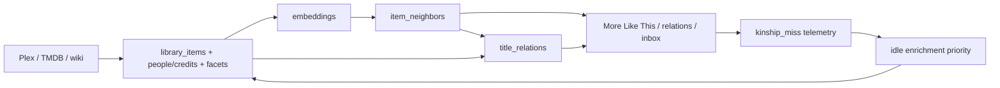

# Media intelligence

Living map of how Projectionist turns library text and watch evidence into **honest** relatedness. Cosine similarity alone is not a reason to recommend a title.

Related: [CURATOR_KNOWLEDGE.md](CURATOR_KNOWLEDGE.md) · [DATA_MODEL.md](DATA_MODEL.md) · [ARCHITECTURE.md](ARCHITECTURE.md)

---

## North star

Recommendations and discovery must cite a **concrete link** to something this household watched, saved, or cares about — a named plot subject, shared director/writer, or shared collection. Empty shelves mean “no named link,” not a silent embedding miss.

---

## System map (baseline)

| Layer | Store | Idle / sync |
|-------|--------|-------------|
| Identity + plot text | `library_items` | sync + `metadata_enrichment` / synopsis |
| Credits | `people` / `credits` | TMDB enrichment |
| Lexical facets | `library_facets` (`genre`, `motif`, `keyword`, `theme`, …) | sync facets + `summary_motifs` |
| Vectors | `embeddings` | `semantic_embeddings` |
| Similarity cache | `item_neighbors` (`score`, `surprise_score`, **`explainable`**, **`plot_link_json`**) | `plot_neighbors` |
| Graph edges | `title_relations` (`collection`, `neighbor`, `shared_crew`, `directed_by`, `written_by`) | `title_relations_refresh` |
| Demand queue | `telemetry_events` (`event_type=kinship_miss`) | prefer on enrichment batches |

Watch ledger (`watch_completions` / `watch_sessions` / terminal `watch_events`) plus `watchlist_pins` seed inbox bridges (Release 2).

---

## Critical tensions

1. **Coverage over-counts.** Raw `with_neighbors_pct` counts any cosine peer. Owners used to read that as “useful relatedness.” Release 1 splits **Similar cache** vs **Named kinship** (`with_explainable_neighbors_pct`). Release 4 promotes Named kinship in the Admin health hero.
2. **Cosine ≠ why.** `_why_payload` / `specific_plot_link` already refused generic neighbor labels at read time; Release 1 **materializes** that gate on `item_neighbors` so feeds never surface cosine-only peers.
3. **Genre facets.** Sync emits `facet_type='genre'` from `library_items.genres` (Release 3); JSON on the item row remains the source of truth and a query fallback.
4. **Motif budget.** Each title keeps at most **18** motifs (`MAX_MOTIFS_PER_ITEM` = 12 rare + 6 keyword-bonus), not the historical 8-slot hard cap.
5. **Schema location.** Ordered migrations live in `projectionist/library/db/migrations.py`; migration bodies in `projectionist/library/db/_schema.py` (and a few inline helpers in `migrations.py`). Primary DB file: `{DATA_DIR}/projectionist.db` (legacy `curatorx.db` still opened if present).

---

## Release series

| Release | Theme | Status |
|---------|--------|--------|
| **1** | Explainable kinship — materialize `explainable` + explanation objects; coverage split; `MEDIA_INTELLIGENCE.md` | Done (1.37.54) |
| **2** | Household bridges — inbox/whisper/weekly cite watch/watchlist seeds with named links | Done (1.37.55) |
| **3** | Catalog graph — genre facets, person-centric edges, keyword-first Related titles | Done (1.37.56) |
| **4** | Owner demand catch-up — miss signals → idle priority; Admin promotes explainable % | Done (1.37.57) — **series complete** |

### Release 1 notes

- Shared explanation shape: `{kind, sentence, seed_ids?, peer_id?, terms[], evidence}` for `plot_link` | `shared_crew` | `collection` | `watched_bridge`. Built next to `specific_plot_link` / `_why_payload`.
- `item_neighbors.explainable` + `plot_link_json` filled on neighbor build (and a cheap annotate pass for legacy rows).
- Relations mirror and More Like This read **explainable** rows only.
- Admin / Explore coverage shows raw neighbor % and explainable %.

### Release 2 notes

- **Seeds** prefer `watch_completions`, then recent `watch_sessions`, then terminal `watch_events`, plus `watchlist_pins`. Library `view_count` / `last_viewed_at` is a last resort only when the ledger is empty. Episode watches still resolve to the **show** library row, then overlay `library_episodes.summary` (Plex episode plot) onto that seed’s plot blob.
- **Bridge builder** (`recommendation_reasons.bridge_between`) finds peers via explainable neighbors, shared crew, collection, or a bounded episode-plot phrase match, and emits `kind=watched_bridge` (“You finished *Show — Episode*; *Y* — …”). No seed → no fake “because you watched.”
- **Nudges, whispers, and weekly member newsletters** pick through the same path. When `multi_user_enabled`, prefer the acting member’s evidence, then fall back to the household.
- Cosine-only neighbors stay excluded from candidate discovery (`explainable_only=True`).

### Release 3 notes

- **Genre facets** — `_collect_facet_rows` / `rebuild_library_facets` emit `facet_type='genre'`; catalog + ensure-backfill treat genre like country/language.
- **Person-centric edges** — `directed_by` / `written_by` for solo auteur pairs (capped per title); multi-person overlap stays `shared_crew` (`min_shared=2`). Why labels name the person.
- **Keywords as first-class why** — Related titles carry `shared_keywords` on every why payload; Plot Lab Why? merges facet + item JSON keywords into `match_layers`.
- **Softer empty walls** — Plot Lab default remains multi-signal (`hybrid` AND). `plot_match_mode=any` is ranked OR across tokens when a strict AND would miss keyword/plot hits.

### Release 4 notes

- **Miss signals** — empty More Like This, empty Related titles (for an embedded seed), or a recommendation bridge with zero peers write `telemetry_events` rows with `event_type=kinship_miss` (soft queue cap; hit_count bumps still allowed).
- **Idle priority** — `metadata_enrichment`, `long_synopsis_enrichment`, `summary_motifs`, and `plot_neighbors` prefer that backlog on a bounded batch before cold catch-up.
- **Admin** — knowledge hero quotes **Named kinship on opened titles** (`with_explainable_neighbors_opened_pct` from `kinship_miss` keys), not Similar cache. Coverage payloads include `embedding_model` / `embedding_is_hash_fallback` so hash vectors are never implied as a remote model. Owner `GET /api/library/kinship-miss` lists title, why queued, `hit_count`, last miss — demand, not a grade, and not auto-repair. Full MCP wraps: `knowledge_coverage_tool`, `kinship_miss_list`.
- **After overnight idle** — re-curl `GET /api/library/knowledge-coverage` and watch `with_explainable_neighbors_opened_pct`. Global Similar cache can stay high while opened Named kinship is the Monday number. Idle `plot_neighbors` still annotates remaining cosine-only neighbors (`plot_link_json` NULL) without a full graph rebuild. Primary DB file: `{DATA_DIR}/projectionist.db`.
- **Episode-aware TV seeds (1.37.58).** Completing an episode overlays that episode’s Plex plot (or title) onto the show seed before `watched_bridge` / For you / inbox peers are built. Bounded phrase search finds peers that share the episode’s story; cosine-only show neighbors stay refused. This is **not** an episode knowledge graph — no per-episode embeddings or `item_neighbors`.

---

## Success signals

| Release | Signal |
|---------|--------|
| R1 | Explainable neighbor % visible; More Like This never shows cosine-only peers |
| R2 | New inbox/whisper rows cite a watched/pinned seed + named link |
| R3 | Genre facet filter works; solo-director shelves where credits exist |
| R4 | Missed titles show accelerated enrichment in task metrics / Admin |

---

## Consumed by Explore For you

Explore’s **For you** rail (`feed_for_you` / hub `for_you`) lists unwatched titles through the same `list_linked_unwatched` → `watched_bridge` path as inbox nudges. Weekly persona rails remain a separate taste feature; they are not a cosine fallback for this shelf.

The named link is a plot subject a person would recognize (`museum exhibits`, `amateur bakers`), shared crew, or a collection. Wikipedia/TMDB glue (`ordinary people`, `drama television`, `which premiered`, `tropical climates`) is refused — empty is better than junk grammar.

After a TV episode finish, that path uses the **episode plot** (when Plex stored one) so Live / next-like-this peers match the episode you actually watched, not a generic show blurb or a cosine movie neighbor.

## Next horizon (out of this series)

- Full closed-loop promote from kinship_miss into staged augmentations (not just idle priority).
- Deeper episode knowledge graph (per-episode embeddings / neighbors) if show+episode overlay is still too coarse.
- IdleScheduler rewrite for global priority across all trickle tasks.
