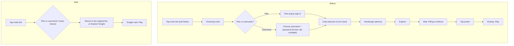
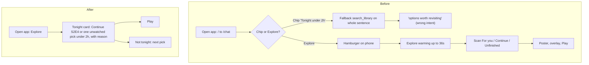
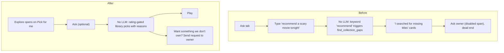

# 02 — UX & Experience review (360 run 2026-10-28-2)

**Reviewer:** Director of UX, independent 360 board
**Commit reviewed:** `origin/main` **`94fcd3f`**. Health reports `1.37.72`. All line numbers below come from `git show 94fcd3f:<path>` (exported to a scratch tree). They are **not** from the laptop working tree, which is 36 commits behind and differs in 515 frontend files. One example: the platform map cites `frontend/src/lib/primaryNav.js`, which exists only in the dirty tree. At `94fcd3f` the file is `primaryNav.ts`.
**Live target:** QA sidecar `http://10.10.1.202:8792` only. Signed-in Play/Live walk on 2026-10-29 as `qa-youth` then `qa-owner` (Interactive UI QA env; never prod `:8788`, never smartmap `:8790`). Public-route curl and Batch 1 screenshots remain. New stills: `ux_youth_r_thread_1440.png`, `ux_youth_explore_1440.png`, `ux_youth_watch_mister_rogers_1440.png`, `ux_owner_watch_endcard_1440.png`.
**Lens:** Can each persona finish their goal quickly, confidently, and pleasantly? This review covers structure and behavior. Visual craft belongs to Design, and WCAG mechanics belong to Accessibility, except where they overlap with UX. Each weakness names the Nielsen heuristic it violates.

---

# Part A — Executive

## 1. Bottom line

**Grade: C.** Projectionist has unusually honest parts: named-kinship "why" lines (UX-002), careful destructive-action safety (UX-003), role gating from one source of truth (UX-001), and a real in-app theater: youth Play of Mister Rogers reached a blob HLS stream with Resume / Start over, and the youth rating gate refused `/watch/84250` with a human sentence (UX-041). The shell around that theater still assumes a fully wired install. With the LLM unset, `/` → `/chat` is a keyword router that sends "recommend…" to missing-title cards (UX-010). After a movie actually ends, the end card says "That's the last episode in your library," offers Back to title / Back to Explore, and never asks for a rating (UX-012, UX-043). Live Off tells the signed-in owner to ask the owner (UX-017), and at 390px the same page stuck on "The guide did not finish loading" (UX-045).
**Single most important fix:** UX-010. Make the first session produce a playable library title without an LLM. **Single most important protect:** UX-002 (kinship) and UX-041 (youth Play refusal).

## 2. Key conclusions

**The product's front door is its most fragile surface.** `/` redirects to `/chat` (`frontend/src/AppRoutes.tsx:83`). Chat is the one surface that degrades hardest without a BYO LLM. `curator.py:383` sets `provider=None` when no key is set. The fallback (`curator.py:385-414`) matches substrings. "Recommend" or "genre" runs `find_collection_gaps`, which returns titles the household **does not own**. "Watch" or "tonight" runs a raw `search_library` on the whole sentence. The youth screenshot shows exactly this: "Recommend an R-rated horror movie for me tonight" was answered with "I searched for missing titles…" (`qa_youth_nav_1440.png`). The launcher chips (`chatLauncherChips.ts:2-29`) promise "Tonight under 2h" and "Continue watching", and the fallback can't honor either. Meanwhile Explore already has deterministic For you, Continue Watching and a youth-only "Pick for me". The good no-LLM experience exists; it just isn't where people land (UX-010, UX-031).

**Onboarding is two wizards that disagree about what is optional.** `/setup` has three steps (Environment → Connections → Owner). Its "Connections" step has no input fields. It runs `testPlex({})` and `testTmdb({})` against empty settings (`SetupWizardPage.tsx:63-78`), then sets `onboarding_complete=False` (`setup_mode.py:302`). Admin then forces a second "First-run setup" wizard (`ConfigPage.tsx:411,507,1961-1975`). That wizard's Next button needs LLM, Plex, Radarr and Sonarr all verified (`ConfigPage.tsx:355-362`), and it offers no Skip. A Plex-only household, which the README and AGENTS.md call fully supported, cannot finish. While the wizard is up, Members, Seerr and Live Channels stay hidden (`ConfigPage.tsx:1836,1857,1874`). The admin chrome is hidden too (`AdminLayout.tsx:141-144`), so Access/invites are reachable only by typing a URL (UX-009, UX-013).

**Sign-in is a hard reset, and on a shared device it can show the previous person.** The auth gate redirects to a bare `/login` (`lib/authGate.ts:139`). Every login path calls `navigate("/chat")` (`LoginPage.tsx:97,144,162`; `JoinPage.tsx:96,153`). Newsletter links, inbox letters, `/year-in-review/:year`, title links shared in a family chat, and `/live` all land on chat after sign-in (UX-011). Settings → Sign out does not clear the in-memory auth snapshot that the account menu does. On QA, signing out as `qa-owner` from Profile and signing in as `qa-youth` left the header as "QA qa-owner" with Chat, Explore, and Admin until the next full navigation (UX-039).

**At phone and iPad-portrait widths, the primary navigation disappears.** At `max-width: 900px`, every toolbar peer, including the **Inbox unread badge**, is hidden (`styles/02-nav-chrome.css:265-273`). The drawer shows badges only for admin open issues (`AppNav.tsx:72-116`). Explore, Search and Inbox each take two taps behind a hamburger, and unread mail has no indicator at all. The returning-consumer persona uses "TV-adjacent phone / iPad" (platform map), so the main use is the worst-served layout (UX-014).

**The vocabulary for "things I saved" and "find a title" is incoherent.** Adults see Watchlist; youth see "My list". Library tabs are Shelves / Watchlist / Collections / Browse (`libraryTabs.ts:6-13`). Settings has separate "Watchlist" and "Lists" pages (`settingsNav.ts:3-10`), and "Saved curator responses" is a third kind of save. Youth label Explore as **"Browse"** (`primaryNav.ts:38`), which collides with Library → **Browse**. Search (`/search`), the Explore search bar (`/library?tab=browse&q=`, `ExplorePage.tsx:536-540`) and Library → Browse all render one component (`SearchPage.tsx:1-5`) at two URLs. The toolbar's Search state only lights up for one of them. Library itself has no toolbar slot, but My Journey does (UX-015, UX-019).

**Ratings, the taste engine's fuel, have no natural moment.** QA shows **0% rated**. A live owner Play of Don't Look Up (`/watch/84250`) autoplayed, then the end card read **"THAT'S THE REEL / That's the last episode in your library"** with **Back to title** and **Back to Explore** and no stars (`ux_owner_watch_endcard_1440.png`; UX-012 Confirmed, UX-043). Rating is a secondary title CTA labelled "Review". Thumbs on chat replies rate the *reply*, not the film. Until a rating takes one tap at the end of a film, "learns from how you rate" isn't true (UX-012, UX-038).

**The owner's weekly ritual is in the wrong room.** `/admin` opens on Overview → "Household health" with Plex, Indexed, Unwatched, Rated and Live tiles (`lib/householdHealth.ts:85-120`). There is **no LLM, TMDB or Mail tile**, even though the LLM is the integration currently degrading every chat. The "Monday pass" hero is on Platform → Health (`DashboardPage.tsx:672`, `lib/ownerHealth.ts:93`). Owner Help documents the ritual with `curl http://10.10.1.202:8788/...` (`docs/HELP.md:369-370`), which is the maintainer's LAN address, shipped to every owner (UX-016, UX-018).

**Safety and honesty are the craft to build on.** Library delete needs typed confirmation and defaults to index-only removal (`BulkLibraryDeleteDialog.tsx:19,75`). Member removal uses a danger confirm (`ConfigPage.tsx:774-785`). Deleting a chat thread can be undone (`ChatWorkspace.tsx:386-394`). Owner-only "fix this" CTAs appear only on true empty states, and members get the note without the admin link (`ExplorePage.tsx:98-147`). Zero-result searches show "Beyond your collection" prominently (`lib/beyondSearch.ts:32-40`). The fixes in this review should extend these patterns, not replace them (UX-003, UX-004, UX-006).

## 3. Foundations challenged

| # | Sacred cow (platform map) | Ruling | Why (evidence) | Finding |
|---|---|---|---|---|
| 1 | Chat is the primary product | **Change** | Chat stays a first-class peer and the place for deep conversations. The **default landing** should be Explore's For you / Tonight (or the last-used surface). Chat without an LLM is a keyword router (`curator.py:385-414`), and the deterministic picks already live on Explore. | UX-010, UX-031 |
| 9 | Youth is a flag, not a role | **Keep** (data model) / **Change** (UX) | A flag is fine for storage. The UX problem is that youth config is spread over Members table, Members max rating, System → Youth and the Access invite checkbox (`HouseholdSection.tsx:271-279,346-373`; `AccessRequestsPage.tsx:62`), and youth labels collide ("Browse"). | UX-015, UX-027 |
| 22 | About ships the entire CHANGELOG into the DOM | **Change** | `/release-notes.json` is **613 KB / 270 releases** (curl, QA). About renders all of it with a version combobox (`AboutPage.tsx:110-136`; `qa_about_1440.png`). Show the last 5 releases' Highlights and link to GitHub for the rest. | UX-020 |
| 21 | What's New modal on version bump (even on `/login`) | **Change** | Mounted globally (`main.tsx:19`). It fetches the same 613 KB payload on any bump for any role (`WhatsNewGate.tsx:40-47`). Do not show it before sign-in, or to members unless a release has member-facing Highlights. | UX-020 |
| 18 | Help/Privacy are first-class in-app docs | **Keep** | Role-aware rendering is real (`HelpPage.tsx:143-162`). Fix the jump nav, the guest "Back to chat", and the maintainer IP in owner Help. | UX-007, UX-018 |
| 20 | Play and Live share one TheaterPlayer shell | **Keep** | Live Play: youth Resume gate + OSD (skip 15/30, CC, Close, More) on `/watch/182044`; owner autoplay + same OSD on `/watch/84250`; youth 403 uses the same recovery panel ("Try again"). Live Off is a different page, not a broken player. Do not split the shell. | UX-005, UX-041 |
| 19 | Invite-only join as the household default | **Keep** | The right default for a private household. Fix the dead-end `/join` states (`JoinPage.tsx:43-46,166-176`). | UX-022 |
| 16 | For you must never fill with cosine | **Keep** | This is the trust anchor (`qa_owner_explore_1440.png`: "adam McKay worked on both"). | UX-002 |
| 17 | Owner Monday pass as the stewardship ritual | **Change** | Keep the ritual. Move it to `/admin` Overview as a checklist with completion state, and remove CLI-only steps from Help. | UX-016 |
| 4 | Confirm before *arr/Seerr writes | **Keep** | The confirm pattern is consistent. Members on the `arr` path can still Add (`addActions.ts:57-75`); that is a Trust question, listed in Open questions. | UX-006 |
| 25 | Guest is not a household role | **Keep** | Public pages still say "Back to chat" to signed-out guests (`HelpPage.tsx:205`, `AboutPage.tsx:77`). Cosmetic, but it costs trust. | UX-018 |
| 8 | Multi-user is opt-in | **Keep** | Single-owner mode is low friction. No change. | — |

## 4. If we built it today

**Principle:** *A household can get from "I opened it" to "it's playing" in under 60 seconds and four taps, on a phone, with no LLM configured.* Chat makes things richer. It doesn't gate them.

### 4.1 Sitemap per role — current vs proposed

**Current (all signed-in roles share one shell):**

- `/` → `/chat`
- Toolbar (≥901px): Search · Chat · Explore · [Live if ready] · Inbox · [Admin owner] · My Journey · Settings (`primaryNav.ts:18-80`)
- Drawer "More" (adults): Related titles · Tags · Library · Help · Privacy · About (`appNavItems.ts:17-52`)
- Drawer "More" (youth): My list · Help
- Chat → "More from home" disclosure → Whisper inbox link (`ChatWorkspace.tsx:441-471`)
- Library hub: Shelves (default) · Watchlist · Collections · Browse; "Saved curator responses" link (`LibraryHubPage.tsx:32-50`)
- Settings rail: Profile · Voice & persona · Taste preferences · Notifications · Watchlist · Lists
- Admin (18 links / 5 groups): Setup (Overview, Connections, Libraries, Persona, Members) · Experience (Live Channels, Lobby, Holidays, Seerr) · Platform (Tasks, Library knowledge, Health) · Communications (Mail, Newsletters) · System (Access, Youth, Advanced, Logs) (`adminNav.ts:10-39`)

**Proposed:**

- `/` → last-used primary surface, defaulting to **Explore** (For you → Tonight pick first)
- One vocabulary for every role: **Explore**, **Ask**, **Search**, **Library**, **Live**, **Inbox**. Youth get the same labels, and youth mode changes content, not the vocabulary.
- **Library** is a primary peer. Tabs: **My list** (watchlist pins) · **Shelves** (lists + published collections, one tab with a "Published by owner" filter) · **Saved replies**. The Browse tab is removed (Search owns it).
- **Search** is the only "find by title/plot/filter" surface. The Explore search bar submits to `/search?q=`.
- **Inbox** has one mailbox with tabs **All · Letters · Whispers**. The `/whisper` route redirects into the Whispers tab.
- The avatar menu holds: My Journey · Settings · Help · Privacy · About · Sign out.

### 4.2 Navigation trees per role (before → after)

**Owner — before**

- Toolbar: Search, Chat, Explore, Inbox, Admin, My Journey, Settings
- Drawer Navigate: same 7
- Drawer More: Related titles, Tags, Library, Help, Privacy, About
- Drawer Admin (only on `/admin/*`): Setup ▸ 5 · Experience ▸ 4 · Platform ▸ 3 · Communications ▸ 2 · System ▸ 4
- Account menu: Settings, Help, About, Sign out

**Owner — after**

- Toolbar: Explore, Ask, Search, Library, Live\*, Inbox (badge) │ Admin │ Avatar
  - Explore sub-nav: For you · Related titles · Tags · Movies · TV
  - Avatar: My Journey, Settings, Help, Privacy, About, Sign out
- Admin rail
  - **Home**: Overview (setup checklist + Monday pass + household health incl. LLM/TMDB/Mail)
  - **People**: Members (users · invites · access requests · youth rules & moderation tabs)
  - **Connections**: Plex · Language model · Metadata (TMDB, TVDB, Fanart) · Radarr/Sonarr · Seerr · Mail transport
  - **Library**: Libraries · Library knowledge · Tasks · Health (Sync · Issues · Usage)
  - **Living room**: Live Channels · Lobby · Holidays
  - **Curator & comms**: Persona · Newsletters
  - **System**: Advanced (Disk paths · Sync schedule · MCP keys) · Logs

**Member — before:** Toolbar: Search, Chat, Explore, Inbox, My Journey, Settings · More: Related titles, Tags, Library, Help, Privacy, About (`qa_member_nav_1440.png`)
**Member — after:** Toolbar: Explore, Ask, Search, Library, Live\*, Inbox │ Avatar (My Journey, Settings, Help, Privacy, About, Sign out)

**Youth — before:** Toolbar: Search, Ask, Browse, Inbox, My Journey, Settings · More: My list, Help (`qa_youth_nav_1440.png`; Privacy/About omitted, `appNavItems.ts:38-45`)
**Youth — after:** Toolbar: Explore (opens on **Pick for me**), Ask, Search, My list, Inbox │ Avatar (My Journey, Settings, Help, Privacy, Sign out). Privacy returns because the youth is a data subject too.

**All roles ≤900px — after:** bottom tab bar **Explore · Ask · Search · Library · Inbox(badge)**. Live and Admin go in the hamburger. The conversations drawer stays a chat-only control.

### 4.3 Top journeys — before/after

Step = screen change; Click = tap or click; Decision = a choice the user must think about.

| Journey | Persona | Before (steps / clicks / decisions) | Grade | After target | Findings |
|---|---|---|---|---|---|
| First household member sign-in → first play | First-time member | Plex path: 7 / 9 / 3 (join → Plex popup → chat → hamburger → Explore → wait → poster → overlay → Play). Local path adds a username and an unstated 8-char password. Lands on chat, not on the link they followed. | **3** | 4 / 5 / 1 | UX-011, UX-022, UX-014 |
| Returning "tonight's title" | Returning consumer | Desktop 4 / 4 / 3; phone 5 / 6 / 3 + Explore warming (up to 36 s). Via chat chip with no LLM: generic search, wrong intent. | **2** | 2 / 2 / 1 | UX-010, UX-021, UX-031 |
| Owner Monday pass | Established owner | ≈ 5 pages / 12+ clicks / 4 decisions (Overview → drawer → Health → Library knowledge → back → Issues tab → purge → Tasks). No completion state. Help uses curl to a LAN IP. | **2** | 1 page / 6 clicks / 4 decisions, with completion state | UX-016, UX-018 |
| Youth Ask | Youth | 3 / 3 / 1 to send, then wrong-intent "missing titles" cards with a disabled "Ask owner" span. R-rated threads still open (`ux_youth_r_thread_1440.png`). | **1** | 3 / 3 / 1 → rating-gated, playable library picks | UX-010, UX-026 |
| Youth Play (allowed vs R) | Youth | Continue Watching Play on Mister Rogers → `/watch/182044` Resume gate → playing blob stream (**4**). Direct `/watch/84250` (R) → "above your youth rating limit" + Try again (**5** for the refusal, **2** for Try again). Search "Don't Look Up" returned 0 library rows. Continue Watching still listed South Park. | **3** | Allowed titles Play; over-ceiling titles never appear on Continue Watching; blocked Play offers Back to Browse, not Try again | UX-041, UX-044 |
| Owner Play → rate | Returning consumer / owner | Explore/title → `/watch/84250` autoplay → idle OSD (Close hidden, Escape stays on `/watch`) → seek to end → end card with episode copy and **no rating**. Back to Explore works. | **2** | Play → watch → one-tap rate on end card → leave via Escape or Close | UX-012, UX-042, UX-043 |
| Owner Live while Off | Owner | Desktop `/live`: "Not on the air yet / Ask the household owner…" (**1**). Admin `/admin/live-channels` has the real CTA **Turn on Live**. Phone 390×844 `/live` stuck on "The guide did not finish loading / Guide is warming up / No stations yet." | **1** | Owner `/live` Off → "Turn on Live Channels" → `/admin/live-channels`. Phone uses the same off-state, not a stall. | UX-017, UX-045 |
| First-time installer → first value | Installer | `/setup` 3 steps (no fields) → recovery key → chat banner → Admin wizard that needs 4 services → **blocked** for Plex-only. | **1** | 1 wizard, 4 steps, Plex required, others skippable | UX-009, UX-013, UX-036 |

### 4.4 Journey flowcharts

**J1 — First household member sign-in**

**J2 — Returning "tonight's title"**

**J3 — Owner Monday pass**

```mermaid
flowchart TD
  subgraph Before
    E1["/admin Overview: Household health"] --> E2["Drawer: Platform, Health"]
    E2 --> E3["Monday pass hero tiles"] --> E4["Named kinship: Library knowledge"]
    E4 --> E5["Back: Issues tab"] --> E6["Purge pressure page"] --> E7["Tasks catch-up"]
    E7 --> E8["Help says: curl 10.10.1.202:8788"]
  end
  subgraph After
    F1["/admin Overview: Monday pass checklist (4 rows, last done date)"]
    F1 --> F2["Row opens side panel inline"] --> F3["Act / Snooze"] --> F4["Row ticks; Mark pass done"]
  end
```

**J4 — Youth Ask**

### 4.5 Onboarding and time to first value (LLM unset, Live Off)

| Persona | Current time to first value | Blocking step | Proposed |
|---|---|---|---|
| Installer, Plex only | **∞**. The Admin wizard Next stays disabled without Radarr + Sonarr + LLM (`ConfigPage.tsx:355-362`) | UX-009 | One wizard: Owner → Plex (required) → Libraries → Optional: LLM, TMDB, Radarr/Sonarr, Seerr (each "Skip for now") → "Open Explore". Target < 10 min including first sync. |
| Installer, full stack | ~2 wizards, ≈ 20+ interactions | UX-013 | Same single wizard. Target ≤ 12 interactions. |
| First member | 9 clicks to first Play, landing on chat | UX-011 | 5 clicks, landing on the deep link or Explore Tonight |
| Youth | No playable outcome from Ask | UX-010 | Pick for me first; Ask fallback = gated library picks |

### 4.6 Proposed settings structure (member)

| Section (rail label = page title) | Controls | Save model |
|---|---|---|
| **Profile** | Preferred name, photo, weather place | Auto-save on blur + "Saved" inline + Undo 5 s |
| **Appearance** | Theme (Lights Down / Lights Up / System), Text size (S/M/L), **Reduce motion** (Follow system / On / Off, *add*), **Poster density** (Comfortable / Compact, *add*) | Instant apply + auto-save. Remove the topbar sun icon *or* make it write the same preference. |
| **Playback** (*new*) | Pause when backgrounded (*move from Profile*), **Autoplay next episode** (*add*), **Subtitles by default** (Off / On / SDH, *add*; youth SDH stays), **Preferred audio & subtitle language** (*add*) | Instant; device-only rows tagged "This device" (no localStorage key in copy) |
| **Curator** (rename "Voice & persona") | Persona choice, Voice input, Speak replies | Instant |
| **Taste** | Quick quiz, clusters with lock, **Your ratings** list (*add*) | Explicit "Save taste" (multi-field weights) |
| **Notifications** | Delivery (inbox / email / Apprise), Weekly newsletter, Nudges, Year in Review | Auto-save per toggle |
| **My list & shelves** (merge Watchlist + Lists) | Plex Discover sync, list rename/delete | Inline |

Remove: the raw localStorage key in help text (`ProfilePage.tsx:394`). **Do not add** UI language selection until strings are externalized. That is a Localization decision, listed in Open questions.

## 5. Findings by surface

### Public (`/login`, `/join`, `/setup`, `/help`, `/about`, `/privacy`) — **C-**

Login works and the request-access path is thoughtful (honeypot, clear success copy). The problems are the dead-end `/join` (UX-022), a setup wizard whose "Connections" step collects nothing (UX-013), and the gated Admin wizard right after it (UX-009). About's 613 KB changelog payload and What's New on any page also hurt here (UX-020). There are small mismatches: About says members "sign in with Plex" on a local-only install, and the error message refers to a "Configuration" label that doesn't exist (UX-028). Guest Help/About/Privacy say "Back to chat" and Help's jump nav repeats an item (UX-018). Strength: Help is role-aware (UX-007).

### Consumer (member, youth, power consumer) — **C**

Explore's named kinship (UX-002), resume progress and session caching (UX-008) are best in class for this category. They are undercut by: a chat landing that misroutes without an LLM (UX-010, **Critical**); deep links dropped at sign-in (UX-011); phone/iPad navigation hidden behind one hamburger with no unread badge (UX-014); a fragmented save/search vocabulary (UX-015, UX-019); no rating moment (UX-012); 36-second warming with no retry button (UX-021); Inbox "Dismiss all" with no undo (UX-024); "Ask owner" as a disabled span (UX-026); an inconsistent settings save model (UX-023); and wrong-role Live empty CTAs (UX-017). Opportunities: Tonight pick (UX-031), reason tags everywhere (UX-032), taste seeding (UX-038).

### Owner (stewardship: health, people, Monday pass) — **C-**

Strengths are safety (UX-003) and owner-only empty-state CTAs (UX-004). Weaknesses: the Monday pass lives on Health, not the landing; Overview omits LLM/TMDB/Mail (UX-016); owner Help ships a maintainer LAN IP (UX-018); people management is split across Members, Access and Youth (UX-027); and there are no global shortcuts or command palette (UX-035). Opportunity: a setup and stewardship checklist (UX-036).

### Admin (configuration) — **D+**

The forced first-run wizard (UX-009, **Critical**) and duplicate wizards (UX-013) dominate. Connections has no visible Save; the LLM persists only on a successful Test (UX-025). "Advanced — Integrations & keys" actually holds disk paths, sync schedule and MCP (UX-027). The Search page puts owner bulk Delete next to a member's everyday query (UX-029).

## 6. Findings by theme

- **Degrade gracefully without optional integrations.** UX-009, UX-010, UX-013, UX-016, UX-017, UX-025. The product calls integrations optional, but the UX treats them as required or quietly misbehaves without them.
- **Information architecture and vocabulary.** UX-015, UX-019, UX-024 (two inboxes), UX-027. Too many nouns for "saved" and "find", and labels that change by role.
- **Continuity: keep the user's place.** UX-011 (deep link), UX-021 (warming), UX-030 (empty threads).
- **Feedback loops that teach the system.** UX-012, UX-038 (ratings), UX-032 and UX-033 (reasons and inspectable taste).
- **Mobile parity.** UX-014. The member 390 chat (`qa_member_chat_390.png`) shows only ≡, conversations, brand and avatar.
- **Save model and error recovery.** UX-022, UX-023, UX-024, UX-025.
- **Copy accuracy and audience.** UX-018, UX-020, UX-028. Owner copy shown to members, maintainer details shown to owners, developer changelogs shown to households.

## 7. Stop doing

1. **Stop sending "recommend" asks to acquisition** when the LLM is off (`curator.py:395-409`). It answers a "what should I watch" question with "what you don't have".
2. **Stop showing owner-remedy copy to members and youth** ("Configure an LLM provider…", "Open Admin" on `/live`).
3. **Stop gating onboarding on integrations the product calls optional** (Radarr, Sonarr, LLM in `canAdvance`).
4. **Stop hard-coding `/chat` as the post-login destination.**
5. **Stop shipping the full CHANGELOG to every device** for About and What's New.
6. **Stop adding new "saved" nouns** (Shelves / Lists / Collections / Saved responses / Watchlist / My list) until they are consolidated.
7. **Stop putting maintainer-specific hosts and CLI-only steps in in-app owner Help.**
8. **Stop hiding Inbox unread state below 900px.**

## 8. Strengths worth protecting

- **UX-002 Named-kinship reasons on For you** (`qa_owner_explore_1440.png`). This is the product's core trust differentiator, at Vanguarr/Diskovarr level.
- **UX-003 Destructive-action safety**: typed confirm, index-only default, thread Undo.
- **UX-001 One source of truth for role-gated nav**, so the toolbar and drawer cannot drift (`primaryNav.ts:1-12,166-175`).
- **UX-004 Role-aware empty states**: owner CTA vs member note.
- **UX-006 Beyond-your-collection on zero results with confirm-before-write**. Jellyseerr-grade request clarity.
- **UX-005 Player recovery**: Try again + Open in Plex, resume/start over (live: Mister Rogers Resume gate; youth 403 panel).
- **UX-041 Youth Play rating gate**: over-ceiling `/watch` fails closed with human copy.
- **UX-007 Role-aware Help and in-app Privacy.**
- **UX-008 Explore stale-while-revalidate** session cache and live Continue Watching splice.

## 9. Risks of inaction (6–12 months)

- **Install-to-churn.** New CA installers who lack Radarr/Sonarr or an LLM hit UX-009 and leave before seeing Explore. With no telemetry (by design), the project won't see it happen; only GitHub issues will.
- **Members stop opening it.** Invited members land on a chat that says "Configure an LLM provider" (UX-010) and lose their deep link (UX-011). Rare-frequency personas don't come back after two bad sessions.
- **The taste engine stays cold.** At 0% rated (UX-012) with no seeding (UX-038), For you depends on watch history alone, and personalization claims weaken.
- **The youth trust incident gets a UX amplifier.** Wrong-intent fallbacks and visible R-rated history (`qa_youth_nav_1440.png`) are a Trust issue, but the UX makes a single screenshot look like a policy failure.
- **Mobile drift.** iPad/phone usage grows (the living-room persona), while the navigation stays desktop-first.
- **Payload creep.** The release-notes JSON grows with every patch (270 releases today). Low-bandwidth members pay that on every version bump.

## 10. Recommended direction and 90-day indicators

**Direction:** "Library-first, curator-enhanced." Explore's deterministic, explainable picks become the front door. Chat becomes the enrichment layer that gets better when an LLM is present. Onboarding needs only Plex, and everything else is a checklist item. Sign-in preserves the user's place, and phones get a real tab bar.

**Sequencing:** Now: UX-009, UX-010, UX-011, UX-017, UX-018, UX-028. Next: UX-012, UX-013, UX-014, UX-016, UX-020, UX-021, UX-022, UX-023, UX-024. Later: UX-015, UX-019, UX-026, UX-027, plus opportunities.

| Indicator (local-first; measure via opt-in QA scripts and owner-visible counters, not SaaS telemetry) | Today | 90-day target |
|---|---|---|
| Plex-only install reaches Explore with posters (scripted QA) | Blocked (UX-009) | ✅ in < 10 min |
| Clicks from cold open to Play, returning member, 390px | 6 (+ warming) | ≤ 3 |
| Deep link survives sign-in (e2e: `/year-in-review/2026`, `/title/movie/:id`, `/live`) | 0 / 3 | 3 / 3 |
| Share of chat fallback replies that return **library** titles for "recommend/tonight" asks with LLM off | ~0% for "recommend" | 100% |
| Household % rated (Overview tile) on QA after a scripted 5-title watch session | 0% | ≥ 1 rating per completed play when prompted |
| Release-notes bytes fetched on a member's first page after a bump | 613 KB | ≤ 20 KB |
| Inbox unread visible at 390px | No | Yes |

## 11. Scorecard (1–5)

| Surface | IA | Task success | Feedback | Mobile | Owner efficiency |
|---|---|---|---|---|---|
| Public | 3 | 2 | 3 | 3 (Suspected; guest 390 not captured) | — |
| Consumer | 2 | 2 | 3 | 2 | — |
| Owner | 2 | 3 | 3 | 2 (Suspected) | 2 |
| Admin | 2 | 1 (fresh install) / 3 (configured) | 3 | 2 (Suspected) | 2 |

---

# Part B — Detail

## 12. Scope & method

- **Code:** `git archive 94fcd3f` of `frontend/src`, `projectionist/web`, `docs/HELP.md`, `docs/DESIGN.md`, plus targeted `git show 94fcd3f:` reads of `projectionist/agent/curator.py`, `projectionist/web/setup*.py` and `projectionist/persona/presets.py`.
- **Live (QA `:8792`, unauthenticated curl only):** `GET /api/health` → `{"status":"ok","version":"1.37.72"}`. `/login`, `/about`, `/join`, `/privacy`, `/help`, `/setup` and `/chat` all return the 2.6 KB SPA shell (200). **`/release-notes.json` = 613,415 bytes, 270 releases**, fetched in 0.58 s on LAN. `/api/release-notes` → 401.
- **Screenshots (Batch 1, cited by filename):** `qa_login_local_1440.png`, `qa_owner_chat_1440.png`, `qa_owner_explore_1440.png`, `qa_owner_admin_nav_1440.png`, `qa_owner_admin_overview_1440.png`, `qa_member_nav_1440.png`, `qa_member_chat_390.png`, `qa_member_settings_1440.png`, `qa_youth_nav_1440.png`, `qa_help_guest_1440.png`, `qa_about_1440.png`, `qa_join_empty_1440.png`.
- **Heuristics:** Nielsen's 10 (H1 Visibility of system status · H2 Match between system and real world · H3 User control & freedom · H4 Consistency & standards · H5 Error prevention · H6 Recognition over recall · H7 Flexibility & efficiency · H8 Aesthetic & minimalist design · H9 Help users recognize, diagnose, recover from errors · H10 Help & documentation).
- **Could not click live** in the first department pass: rating modal, guest at 390px, Privacy layout, `/setup` on a fresh volume, the Admin first-run wizard on a fresh volume, a successful `/join` redeem, and the What's New modal. The Admin wizard gate (UX-009) is **Confirmed in code**; QA already has `onboarding_complete=true`.
- **Signed-in Play/Live walk (2026-10-29, this batch), QA `:8792` only:**
  - Youth: R-rated thread still open (`ux_youth_r_thread_1440.png`). Explore For you empty; Continue Watching letter tiles (`ux_youth_explore_1440.png`). Play Mister Rogers `/watch/182044` → Resume/Start over → blob stream, Space pauses, Escape **stays** on `/watch`. Direct `/watch/84250` → "This title is above your youth rating limit, or it doesn't have a rating we can allow." + Try again. Search `Don't Look Up` → 0 library rows + Beyond your collection.
  - Owner: `/watch/84250` autoplayed; end card as UX-012/UX-043 (`ux_owner_watch_endcard_1440.png`); Back to Explore → `/explore`. `/live` desktop: "Not on the air yet / Ask the household owner…" (UX-017). `/admin/live-channels`: **Turn on Live** (not clicked). `/live` at 390×844 stuck on `LIVE_GUIDE_STALL_MESSAGE` (UX-045).
  - Did **not** turn Live on, did **not** Rebuild Plex, did **not** stop `:8788` / `:8790`.
- **Parent walk (same host, earlier):** `/library` Shelves blank (UX-040); Settings sign-out vs youth login chrome (UX-039).
- **Did not read:** other department docs or `docs/reviews/2026-10-28/`.

## 13. Strengths

### UX-001: Keep one source of truth for role-gated navigation

| Field | Value |
|---|---|
| Type | Strength |
| Surface | Cross-cutting |
| Persona(s) | All signed-in roles; keyboard-only |
| Category | Navigation |
| Severity | High |
| Impact | 4 |
| Effort | XS |
| Confidence | Confirmed |
| Priority score | 12.00 |
| Verdict | Protect |
| Dependencies | UX-014, UX-015 (any nav change must go through this model) |
| Labels | nav, roles, consistency |

**Evidence:** `frontend/src/lib/primaryNav.ts:1-12` (doc), `:18-80` (items), `:86` (public peers painted before auth), `:99-126` (Admin added only after auth settles, never for youth), `:166-175` (drawer built from the same items). `appNavItems.ts:37-52`. Screenshots `qa_owner_admin_nav_1440.png`, `qa_member_nav_1440.png`, `qa_youth_nav_1440.png` match the model.
**Current state:** The toolbar and drawer can't drift. Admin never flashes for members while `/api/auth/me` is in flight.
**Root cause:** A deliberate design decision.
**Recommendation:** Keep it. When UX-014 adds a bottom tab bar, derive it from `buildPrimaryNavItems` with a `surface: "tabbar"` option rather than writing a third list.
**Rationale:** Role-gating drift is a classic multi-surface bug. Here it's prevented by construction.
**User story:** As a member, I never see a door I can't open.
**Acceptance criteria:**
- [ ] Any new nav surface imports `buildPrimaryNavItems`
- [ ] `primaryNav.test.mjs` covers the tab-bar surface
**Success metric:** 0 role-leak bugs in nav after the UX-014 ship.
**Validation:** Unit tests plus role screenshots at 1440 and 390.

### UX-002: Protect named-kinship reasons on For you

| Field | Value |
|---|---|
| Type | Strength |
| Surface | Consumer |
| Persona(s) | Returning consumer, power consumer, established owner |
| Category | States |
| Severity | High |
| Impact | 5 |
| Effort | XS |
| Confidence | Confirmed |
| Priority score | 15.00 |
| Verdict | Protect |
| Dependencies | Sacred cow #16 |
| Labels | explainability, taste, trust |

**Evidence:** `qa_owner_explore_1440.png` and the platform map: "You watched Don't Look Up (2021); Ant-Man (2015) — adam McKay worked on both." `ExplorePage.tsx:609-633` renders `posterWhyLine(item)` as card meta. `lib/exploreFeeds.ts:22` treats "no named links from what you've watched" as an honest empty note, not a cosine fill.
**Current state:** Every For you card says why it's there, in household terms.
**Root cause:** The product principle "For you must never fill with cosine".
**Recommendation:** Keep it. Extend the same reason line to Search results, chat cards and Inbox picks (UX-032). Fix the casing of person names ("adam McKay") as a data-display bug (Design/Engineering).
**Rationale:** This is Diskovarr's "reason tag" and Vanguarr's "inspectable taste" in one line, and it's the clearest differentiator against Plex Home rows.
**User story:** As a returning consumer, I trust a pick because I can see where it came from.
**Acceptance criteria:**
- [ ] For you never renders a card without a reason
- [ ] An empty For you shows the honest note and, for owners only, the CTA
**Success metric:** 100% of For you cards carry a why-line (unit test on the feed normalizer).
**Validation:** Explore e2e asserts a why-line per card.

### UX-003: Protect destructive-action safety (typed confirm, index default, undo)

| Field | Value |
|---|---|
| Type | Strength |
| Surface | Owner / Consumer |
| Persona(s) | Established owner, member |
| Category | Feedback |
| Severity | High |
| Impact | 4 |
| Effort | XS |
| Confidence | Confirmed |
| Priority score | 12.00 |
| Verdict | Protect |
| Dependencies | UX-024 should copy this pattern |
| Labels | destructive, undo, confirm |

**Evidence:** `components/BulkLibraryDeleteDialog.tsx:19` ("Hard-confirm dialog"), `:75` (`libraryRemovalNeedsTypedDelete`), `:138-165` (index vs full, default index). `pages/ConfigPage.tsx:774-785` (danger confirm "This cannot be undone."). `components/ChatWorkspace.tsx:386-394` (thread delete Undo toast). 55 confirm usages across pages and components.
**Current state:** High-cost actions get friction that matches their cost. Reversible ones get Undo.
**Root cause:** A consistent confirm-modal hook (`hooks/useConfirmModal.tsx`).
**Recommendation:** Keep it. Apply Undo to Inbox dismiss (UX-024) and settings auto-save (UX-023).
**Rationale:** H3/H5 done right.
**User story:** As an owner, I can't wipe files from Plex by accident.
**Acceptance criteria:**
- [ ] Full remove requires typed confirmation
- [ ] Index-only stays the default mode
**Success metric:** 0 accidental full-remove reports.
**Validation:** Existing unit tests; add an e2e test for the typed confirm.

### UX-004: Keep role-aware empty states (owner CTA, member note)

| Field | Value |
|---|---|
| Type | Strength |
| Surface | Consumer / Owner |
| Persona(s) | New owner, member |
| Category | States |
| Severity | Medium |
| Impact | 3 |
| Effort | XS |
| Confidence | Confirmed |
| Priority score | 6.00 |
| Verdict | Protect |
| Dependencies | UX-010, UX-017 should follow this rule |
| Labels | empty-state, roles |

**Evidence:** `ExplorePage.tsx:98-100` ("Owner task CTAs only for true empties"), `:143-147` (`OwnerEmptyStateCta`). `lib/exploreFeeds.ts:30-32` ("Members/guests get the note only — no admin deep link").
**Current state:** Owners get a "fix it" link and members get an explanation.
**Root cause:** A deliberate helper.
**Recommendation:** Keep it, and make it the rule for chat fallback copy (UX-010) and Live empty states (UX-017), which currently break it.
**Rationale:** H2 / H9.
**User story:** As a member, I'm not sent to pages I can't use.
**Acceptance criteria:**
- [ ] Any empty/blocked state that names an owner action routes through a role-aware helper
**Success metric:** 0 member-visible "Open Admin" CTAs.
**Validation:** Grep test for `ROUTES.admin` in member-reachable empty-state copy.

### UX-005: Keep player recovery and end-card continuity

| Field | Value |
|---|---|
| Type | Strength |
| Surface | Consumer |
| Persona(s) | Returning consumer, low-bandwidth mobile |
| Category | States |
| Severity | Medium |
| Impact | 4 |
| Effort | XS |
| Confidence | Likely |
| Priority score | 6.40 |
| Verdict | Protect |
| Dependencies | UX-012 adds rating to the end card |
| Labels | play, recovery |

**Evidence:** `components/theater/LibraryPlayer.tsx:446` ("Playback stalled. Try Resume, refresh, or Open in Plex."), `:1484-1510` (error panel with Try again + Open in Plex), `:1419` (Start over), `:1425-1482` (end card: Next episode / Back to title / Back to Explore). Parent walk on QA opened `/watch/84250` from the title page; the video reached `readyState` 4 and was then paused. The error panel and end card were not forced.
**Current state:** The player always offers a next action.
**Root cause:** The shared TheaterPlayer shell (sacred cow #20).
**Recommendation:** Keep it. Add the one-tap rating (UX-012). Change the "Back to Explore" label to "Back to where I was" when the user didn't come from Explore (`runEndCardBackToExplore`), or route back to the origin.
**Rationale:** H9 done well.
**User story:** When playback fails, I can try again or hand off to Plex.
**Acceptance criteria:**
- [ ] The error state always shows Try again; Open in Plex appears when `plexHref` exists
**Success metric:** No dead-end player states in Interactive UI QA.
**Validation:** Interactive UI QA on `:8792` with a forced stream error.

### UX-006: Keep "Beyond your collection" on zero results with confirm-before-write

| Field | Value |
|---|---|
| Type | Strength |
| Surface | Consumer |
| Persona(s) | Power consumer, member (Seerr), owner |
| Category | Search |
| Severity | Medium |
| Impact | 3 |
| Effort | XS |
| Confidence | Confirmed |
| Priority score | 6.00 |
| Verdict | Protect |
| Dependencies | Sacred cow #4 |
| Labels | search, acquisition |

**Evidence:** `lib/beyondSearch.ts:32-40` (shown when there's a query; prominent at zero results), `:90` (honest unavailable note). `LibraryBrowsePage.tsx:525-612`. `app.py:2462-2510` (propose creates a pending action; existing-in-Radarr is detected).
**Current state:** "No library titles match X" is followed by an obvious next step.
**Root cause:** Jellyseerr-style request clarity.
**Recommendation:** Keep it. The *intent* of this path ("titles we don't have") is exactly what the chat fallback wrongly uses for "recommend" asks (UX-010).
**Rationale:** H9; the benchmark is Jellyseerr.
**User story:** When we don't own it, I can ask for it in one step.
**Acceptance criteria:**
- [ ] Zero results always show the Beyond affordance when TMDB is available
**Success metric:** Search abandonment at zero results (QA script) goes down.
**Validation:** e2e search for a non-owned title.

### UX-007: Keep role-aware in-app Help and Privacy

| Field | Value |
|---|---|
| Type | Strength |
| Surface | Public |
| Persona(s) | Member, older/low vision, owner |
| Category | Onboarding |
| Severity | Medium |
| Impact | 3 |
| Effort | XS |
| Confidence | Confirmed |
| Priority score | 6.00 |
| Verdict | Protect |
| Dependencies | UX-018 |
| Labels | help, docs |

**Evidence:** `pages/HelpPage.tsx:143-162` (`markdownForRole` drops owner sections), `:209-213` ("Viewing as Guest — … Ask the server owner…"). `qa_help_guest_1440.png`. `docs/HELP.md:316` (`## For owners` split).
**Current state:** Members aren't shown owner API depth.
**Root cause:** The docs-style rule and render split.
**Recommendation:** Keep it. Fix navigation and content leaks (UX-018).
**Rationale:** H10.
**User story:** As a member, Help talks to me, not to the sysadmin.
**Acceptance criteria:**
- [ ] Member Help contains no `curl`, IPs or settings keys
**Success metric:** Grep test on member-rendered Help markdown.
**Validation:** Unit test on `markdownForRole` output.

### UX-008: Keep Explore's stale-while-revalidate cache and live Continue Watching splice

| Field | Value |
|---|---|
| Type | Strength |
| Surface | Consumer |
| Persona(s) | Returning consumer, low-bandwidth mobile |
| Category | States |
| Severity | Medium |
| Impact | 3 |
| Effort | XS |
| Confidence | Confirmed |
| Priority score | 6.00 |
| Verdict | Protect |
| Dependencies | UX-021 |
| Labels | performance, continuity |

**Evidence:** `ExplorePage.tsx:233-240` (hydrate from `sessionStorage` cache), `:288-297` (Continue Watching refresh keeps posters on failure), `:337-345` + `lib/exploreHubCache.ts:379-383` ("Showing shelves from the last successful load.").
**Current state:** A second visit paints instantly. Errors keep prior content.
**Root cause:** A deliberate cache layer.
**Recommendation:** Keep it. Move the cache from `sessionStorage` to `localStorage` (TTL 6 h) so a *new tab or next evening* also paints instantly. That is the returning-consumer case.
**Rationale:** H1.
**User story:** When I come back tonight, my shelves are already there.
**Acceptance criteria:**
- [ ] A cold open within 6 h paints cached rails within 300 ms
**Success metric:** Time to first poster at the 390px cold open.
**Validation:** Playwright trace.

## 14. Weaknesses (sorted by priority score)

| ID | Title | Severity | Score |
|---|---|---|---|
| UX-039 | Clear the previous member from the shell on sign-out | High | 7.50 |
| UX-009 | Unblock the Admin first-run wizard | Critical | 6.67 |
| UX-010 | Make chat useful (and honest) without an LLM | Critical | 6.67 |
| UX-011 | Return users to where they were going after sign-in | High | 6.00 |
| UX-040 | Tell people when Library Shelves is empty | Medium | 6.00 |
| UX-012 | Ask for a rating at the end of a film | High | 6.00 |
| UX-013 | Merge the two setup wizards into one that collects connections | High | 4.00 |
| UX-014 | Give phones and iPads a real primary nav with an unread badge | High | 4.00 |
| UX-015 | Use one vocabulary for saving and one door for searching | High | 4.00 |
| UX-016 | Put integration health and the Monday pass on Admin Overview | Medium | 4.00 |
| UX-017 | Fix Live empty-state CTAs per role | Medium | 4.00 |
| UX-018 | Fix Help navigation and remove maintainer details from owner Help | Medium | 4.00 |
| UX-019 | Promote Library to a primary peer; demote My Journey | Medium | 3.00 |
| UX-020 | Stop shipping the full changelog for About and What's New | Medium | 3.00 |
| UX-021 | Bound Explore warming and give a Retry | Medium | 3.00 |
| UX-022 | Give `/join` failures a way forward | Medium | 3.00 |
| UX-023 | Use one save model in Settings | Medium | 3.00 |
| UX-024 | Make Inbox dismissal undoable and fold Whispers into Inbox | Medium | 3.00 |
| UX-025 | Give Admin Connections an explicit save that doesn't depend on Test | Medium | 2.40 |
| UX-026 | Turn "Ask owner" from a disabled label into a request | Medium | 2.00 |
| UX-027 | Consolidate people and youth admin; rename Advanced | Medium | 2.00 |
| UX-028 | Correct login and About copy to match the install | Low | 2.00 |
| UX-029 | Hide bulk actions on Search until selection mode | Low | 1.00 |
| UX-030 | Don't persist empty "New conversation" threads | Low | 0.80 |

### UX-039: Clear the previous member from the shell on sign-out

| Field | Value |
|---|---|
| Type | Weakness |
| Surface | Cross-cutting |
| Persona(s) | Returning consumer, youth, owner on a shared iPad |
| Category | Feedback |
| Severity | High |
| Impact | 5 |
| Effort | S |
| Confidence | Confirmed |
| Priority score | 7.50 |
| Verdict | Fix |
| Dependencies | none |
| Labels | auth, shared-device, nav |

**Evidence:** On QA `:8792`, Settings → Sign out (`data-testid="settings-sign-out"`) returned to `/login`. Signing in as `qa-youth` made `GET /api/auth/me` return `display_name: qa-youth`, `role: member`, `is_youth: true`. The shell still showed the account chip "QA qa-owner" and nav labels Search, Chat, Explore, Inbox, Admin, My Journey, Settings. A full navigation to `/chat` then showed Ask, Browse, `qa-youth`, no Admin, and `data-theme="lights-down"`. `94fcd3f:frontend/src/pages/settings/ProfilePage.tsx:197-203` `handleSignOut` calls `logout()` and `navigate("/login")` and does not call `clearAuthSnapshot()`. `94fcd3f:frontend/src/components/UserMenu.tsx:35-42` does call `clearAuthSnapshot()` before navigating.

**Current state:** The account menu and the Settings button sign out differently. On a shared living-room device the next person can see the previous member's name and the owner nav, including an Admin link, until something forces the shell to reload.

**Root cause:** Profile sign-out leaves the in-memory auth snapshot (`peekAuthSnapshot` in `authGate.ts:232-237`) that `useAuthGate` seeds from. The menu path clears it. The shell keeps the seeded owner view across the login that follows.

**Recommendation:** Call `clearAuthSnapshot()` in `ProfilePage.handleSignOut` before `navigate("/login")`, the same as `UserMenu.handleLogout`. Key the signed-in shell on `user.id` so a new session cannot render the previous user's nav. After login, do not paint primary nav until `loadAuthSnapshot()` resolves for the new user.

**Rationale:** Violates **H1 (Visibility of system status)** and **H5 (Error prevention)**. A household iPad is the normal device. Showing Admin and another person's name after a sign-in is a trust failure even when the API would reject an admin call. The alternative of "always full-reload on login" works but throws away SPA state the deep-link fix (UX-011) needs.

**User story:** As a youth signing in after a parent, I want the screen to be mine immediately so that I don't see their account or Admin.

**Acceptance criteria:**
- [ ] Settings → Sign out then sign in as a different user shows that user's display name and role nav before any further click.
- [ ] A youth session never shows an Admin link, including in the first paint after login.
- [ ] `ProfilePage.handleSignOut` and `UserMenu.handleLogout` both call `clearAuthSnapshot()`.

**Success metric:** Zero mismatched account-chip vs `/api/auth/me` pairs in a two-account switch test.

**Validation:** On `:8792`, sign in as `qa-owner`, sign out from Settings, sign in as `qa-youth`, and read the account chip and nav labels before navigating. Repeat from the account menu.

### UX-040: Tell people when Library Shelves is empty

| Field | Value |
|---|---|
| Type | Weakness |
| Surface | Consumer |
| Persona(s) | Returning consumer, new owner |
| Category | States |
| Severity | Medium |
| Impact | 3 |
| Effort | XS |
| Confidence | Confirmed |
| Priority score | 6.00 |
| Verdict | Fix |
| Dependencies | UX-015 |
| Labels | library, empty-state |

**Evidence:** Owner on QA `:8792` opened `/library` (Shelves selected). The page text ended at the tabs Shelves / Watchlist / Collections / Browse. No shelf, no empty sentence. Screenshot `ux_owner_library_1440.png`. `/library?tab=browse` then showed "Page 1 of 113 · 5391 titles". `94fcd3f:frontend/src/pages/LibraryHubPage.tsx:47` embeds `ListsPage`. `94fcd3f:frontend/src/pages/ListsPage.tsx:124` renders `state.lists.map(...)` inside `.curated-list-grid` with no branch for an empty array. The embedded path also skips the hero (`:112`).

**Current state:** The default Library tab, on a house with 5,391 titles and no curated lists, is a blank panel under the tabs.

**Root cause:** Empty is treated as "render nothing" for the list index. The empty copy that does exist (`:167`) is for a list that has no titles, not for a house that has no lists.

**Recommendation:** When `!listId && !state.loading && state.lists.length === 0`, render one sentence and one action. Owner: "No shelves yet. A shelf is a short list you can play together." Button: "New shelf". Member: the same sentence without the button, plus "Ask the owner for a shelf, or use Browse." Do not leave the panel blank.

**Rationale:** Violates **H1** and **H9**. A blank tab reads as a broken page. Browse, one tab away, has the whole library, so the failure is the empty state, not the data.

**User story:** As a member opening Library, I want the first tab to tell me what a shelf is so that I don't think the library failed to load.

**Acceptance criteria:**
- [ ] With zero curated lists, Shelves shows the sentence and the role-correct action.
- [ ] With one list, the grid still renders that list and not the empty sentence.

**Success metric:** No signed-in Library view whose main panel has zero text nodes.

**Validation:** On `:8792` as `qa-owner`, open `/library` and confirm the empty copy. Create a list and confirm the grid replaces it.

### UX-041: Keep the youth Play rating gate

| Field | Value |
|---|---|
| Type | Strength |
| Surface | Consumer |
| Persona(s) | Youth |
| Category | Feedback |
| Severity | High |
| Impact | 5 |
| Effort | XS |
| Confidence | Confirmed |
| Priority score | 15.00 |
| Verdict | Protect |
| Dependencies | UX-044 (Continue Watching still lists over-ceiling titles) |
| Labels | youth, play, gating |

**Evidence:** As `qa-youth` on `:8792`, `GET /watch/84250` (Don't Look Up, used by the owner Play) rendered **"This title is above your youth rating limit, or it doesn't have a rating we can allow."** with a **Try again** button. No `video.currentSrc`. The same session Played Mister Rogers `/watch/182044` through the Resume gate to a same-origin blob URL (`readyState` 4). Search for "Don't Look Up" returned zero library rows and "Beyond your collection".

**Current state:** Direct Play of an over-ceiling title fails closed with human copy. Allowed titles Play in Projectionist, not Plex.

**Root cause:** Playback authorization is server-side (`projectionist/library/playback.py` youth ceiling), and the theater recovery panel surfaces the 403.

**Recommendation:** Keep the fail-closed Play path. Change **Try again** on a rating refusal to **Back to Browse** (it cannot succeed). Keep Continue Watching and search in the same gate (UX-044).

**Rationale:** H9 done well on the watch URL. A household product that lets youth Play R-rated titles from a typed URL would fail the youth flag entirely.

**User story:** As a youth, I want over-ceiling titles to refuse Play in plain language so that a shared-device link cannot start them.

**Acceptance criteria:**
- [ ] Over-ceiling `/watch/:id` never attaches a media URL
- [ ] The refusal copy names the rating limit; the primary action leaves `/watch`
- [ ] An allowed title still reaches in-app Play

**Success metric:** 0 youth sessions with a `video.currentSrc` on an over-ceiling rating key in QA.

**Validation:** Interactive UI QA `watch.youth-gate` on `:8792`.

### UX-042: Let Escape and Close leave Play when the OSD idles

| Field | Value |
|---|---|
| Type | Weakness |
| Surface | Consumer |
| Persona(s) | Returning consumer, keyboard-only |
| Category | Feedback |
| Severity | High |
| Impact | 4 |
| Effort | S |
| Confidence | Confirmed |
| Priority score | 6.00 |
| Verdict | Fix |
| Dependencies | none |
| Labels | play, keyboard, H3 |

**Evidence:** Youth `/watch/182044` and owner `/watch/84250` on `:8792`. After chrome idled, `document.querySelector('.theater-osd')` was `visibility: hidden` and `aria-hidden="true"`. The accessibility tree collapsed to one generic. **Escape** left the URL at `/watch/…`. Close exists only while the OSD is visible. Space still paused. Checklist `watch.fullscreen-popout` says Escape should leave `/watch`.

**Current state:** A living-room Play session has no obvious way out once the chrome hides, except clicking the darkened stage to resurrect Close.

**Root cause:** OSD hide also hides Close and marks the chrome `aria-hidden`, and Escape is not wired to `navigate` off `/watch` when no menu is open (`TheaterPlayer` / `LibraryPlayer`).

**Recommendation:** Escape pops: open menu → OSD → leave `/watch` to the previous route (title, Explore, or Continue Watching). Keep Close in the accessibility tree while the video is playing (`:focus-within` or a always-in-tree icon). Do not `aria-hidden` a control the user may need to stop playback.

**Rationale:** Violates **H3 (User control and freedom)**. Fullscreen video without a reliable exit is a kiosk trap on a shared iPad.

**User story:** As a keyboard user, I want Escape to take me off Play so that I am not stuck in a black rectangle.

**Acceptance criteria:**
- [ ] With OSD hidden, Escape leaves `/watch` for the previous in-app route
- [ ] Close remains reachable (visible or in the a11y tree) while media is playing
- [ ] Space still play/pauses and does not leave the route

**Success metric:** Interactive UI QA `watch.fullscreen-popout` Escape path PASS on `:8792`.

**Validation:** Play Mister Rogers, wait for chrome hide, press Escape; URL is not `/watch/*`.

### UX-043: Stop calling a movie the last episode

| Field | Value |
|---|---|
| Type | Weakness |
| Surface | Consumer |
| Persona(s) | Returning consumer |
| Category | Feedback |
| Severity | Medium |
| Impact | 3 |
| Effort | XS |
| Confidence | Confirmed |
| Priority score | 6.00 |
| Verdict | Fix |
| Dependencies | UX-012 |
| Labels | play, copy, H2 |

**Evidence:** Owner end card on Don't Look Up (`ux_owner_watch_endcard_1440.png`): heading "That's the reel", body **"That's the last episode in your library."** `theaterPlayer.ts:727-745` `NEXT_EPISODE_MISSING_MESSAGE` is returned whenever `nextEpisodeEndCardAction` has no next `rating_key`, including movies. `LibraryPlayer.tsx:1215,1432-1438` paints that string on the end card.

**Current state:** Finishing a feature film reads as if a series ran out of episodes.

**Root cause:** One next-episode helper is reused as the movie end-card body.

**Recommendation:** If `media_type === "movie"` (or no `next` episode object), body copy is omitted or becomes "That's the film." Keep the episode sentence only when the just-played item is an episode and no later episode exists. Gold primary stays Back to title until UX-012 adds Rate.

**Rationale:** Violates **H2 (Match between system and real world)**. Wrong noun on the last screen of Play teaches people the player is confused.

**User story:** When a movie ends, I want the card to talk about the film so that I trust the next action.

**Acceptance criteria:**
- [ ] Movie end card never contains the word "episode"
- [ ] Episode with no successor still uses `NEXT_EPISODE_MISSING_MESSAGE`
- [ ] Unit test covers movie vs episode in `nextEpisodeEndCardAction`

**Success metric:** 0 movie end cards with "episode" in copy in Playwright.

**Validation:** Replay Don't Look Up to end on `:8792`; screenshot the card.

### UX-044: Gate Continue Watching the same way as Play

| Field | Value |
|---|---|
| Type | Weakness |
| Surface | Consumer |
| Persona(s) | Youth |
| Category | Navigation |
| Severity | High |
| Impact | 4 |
| Effort | S |
| Confidence | Confirmed |
| Priority score | 6.00 |
| Verdict | Fix |
| Dependencies | UX-041, Trust batch |
| Labels | youth, play, explore |

**Evidence:** Youth Explore Continue Watching listed **South Park**, Family Guy, House, Elvira's Movie Macabre, plus Mister Rogers (`ux_youth_explore_1440.png` letter tiles). Search for "Don't Look Up" as the same user returned **0** library rows. Direct Play of `/watch/84250` was refused (UX-041). For you was empty ("No named link to something you finished — not a cosine guess.").

**Current state:** Discovery rails can offer titles Play will refuse. Search is stricter than Continue Watching.

**Root cause:** Continue Watching is built from watch history (household or account) without the youth ceiling applied at feed time. Play enforces the ceiling only at stream start.

**Recommendation:** Apply the youth max-rating filter to Continue Watching, Unfinished, For you, and Pick for me the same as Play. Do not show a Play glyph on a card the user cannot start. Empty For you copy can stay honest.

**Rationale:** Violates **H5** and **H6**. A youth who can see South Park on the first rail will try Play; the 403 then feels like a broken button.

**User story:** As a youth, I want Continue Watching to only show titles I can actually start so that Play always works from the first rail.

**Acceptance criteria:**
- [ ] Youth Continue Watching contains no item whose Play 403s on rating
- [ ] Over-ceiling titles remain in owner Continue Watching
- [ ] Youth search and Explore rails use the same ceiling

**Success metric:** Scripted youth Explore has 0 Play links that 403 for rating.

**Validation:** `watch.youth-gate` plus youth Explore Continue Watching on `:8792`.

### UX-045: Don't stall Live Off as "guide warming" on a phone

| Field | Value |
|---|---|
| Type | Weakness |
| Surface | Consumer |
| Persona(s) | Owner, returning consumer (phone) |
| Category | States |
| Severity | Medium |
| Impact | 3 |
| Effort | S |
| Confidence | Confirmed |
| Priority score | 3.00 |
| Verdict | Fix |
| Dependencies | UX-017 |
| Labels | live, empty-state, mobile |

**Evidence:** Owner desktop `/live` settled to **Not on the air yet / Ask the household owner to enable Live Channels in Admin** (`liveChannelsCopy.ts:15-16`). The same session at **390×844** stayed on **"The guide did not finish loading."** + **"Guide is warming up" / "No stations yet."** (`liveGuidePaint.ts:9` `LIVE_GUIDE_STALL_MESSAGE`) after >5 s. Admin `/admin/live-channels` already has **Turn on Live** (not clicked; Live stayed Off).

**Current state:** Phone Live looks broken. Desktop Live looks like a policy. Neither sends the owner to the Turn on Live button.

**Root cause:** The guide fetch stalls (or the stall timeout fires) on the narrow viewport before the disabled-state copy is chosen. `liveUserEmptyCopy` still has no `isOwner` (UX-017).

**Recommendation:** If Live is **Off**, skip guide fetch and render the role-aware off-state immediately (UX-017). Stall copy is only for Live **On** when the guide request fails. Phone and desktop must agree.

**Rationale:** Violates **H1** and **H9**. A phone is the living-room remote. "Did not finish loading" on a feature that is off is a lie.

**User story:** As an owner on my phone, I want Live Off to say it's off and offer Turn on, so that I don't think the guide is broken.

**Acceptance criteria:**
- [ ] Live Off at 390px and 1440px shows the same off-state, not `LIVE_GUIDE_STALL_MESSAGE`
- [ ] Owner CTA goes to `/admin/live-channels`
- [ ] Stall copy appears only when Live is enabled and the guide request fails

**Success metric:** 0 Live Off screenshots whose heading is `LIVE_GUIDE_STALL_MESSAGE`.

**Validation:** Owner `/live` at 390×844 and 1440 on `:8792` with Live Off.

### UX-009: Unblock the Admin first-run wizard

| Field | Value |
|---|---|
| Type | Weakness |
| Surface | Admin |
| Persona(s) | First-time installer, new owner |
| Category | Onboarding |
| Severity | Critical |
| Impact | 5 |
| Effort | M |
| Confidence | Confirmed |
| Priority score | 6.67 |
| Verdict | Fix |
| Dependencies | UX-013, UX-036 |
| Labels | onboarding, wizard, optional-integrations, blocker |

**Evidence:**
- `projectionist/web/setup_mode.py:302`: `/api/setup/commit` sets `settings.onboarding_complete = False`.
- `frontend/src/pages/ConfigPage.tsx:411` defaults `showWizard` to true, and `:507` sets `setShowWizard(!wizardData.onboarding_complete)`.
- `ConfigPage.tsx:355-362` (`canAdvance`): step 2 needs `verification.llm && plex && radarr && sonarr`. `:364-371` (`onboardingReady`) needs the same plus sections.
- `ConfigPage.tsx:1246-1253`, Finish error: "Connect your language model, Plex, Radarr, and Sonarr, and choose movie and TV libraries before finishing."
- `ConfigPage.tsx:1961-1975`: header "First-run setup"; the only exit is "Back to chat".
- `ConfigPage.tsx:1836,1857,1874`: Members (household), Seerr and Live Channels render only when `!showWizard`.
- `layouts/AdminLayout.tsx:141-144`: `wizardMode` hides PrimaryTopbar and the admin rail.
- `projectionist/web/setup.py:451-500`: the server-side definition of "infrastructure complete" also needs all four.
- No "skip" or "later" control exists (grep in `ConfigPage.tsx`).
- `OverviewSection.tsx:97-99`: "Re-run setup" puts an *established* owner back into the same gated wizard.
- Not reproduced live: QA already has `onboarding_complete=true`.

**Current state:** A Plex-only owner, or an owner who hasn't picked an LLM yet, opens `/admin` and gets a wizard they cannot finish or leave except to chat. Invites (System → Access) are only reachable by typing `/admin/access`.
**Root cause:** The wizard's completion gate was written for the maintainer's full stack. "Optional" in the docs never became "skippable" in the UI.
**Recommendation:**
1. Required: **Owner name/persona** and **Plex + libraries**. Everything else (LLM, TMDB, Radarr, Sonarr, Seerr, Mail) is a checklist row with **Test** and **Skip for now**.
2. Change `canAdvance(1)` to `verification.plex`, and `onboardingReady` to `identity && plex && sections`.
3. Never hide the admin rail. In wizard mode, show it with a "Setup in progress — 2 of 4" pill at the top.
4. Add a persistent **"Finish later"** button that sets `onboarding_complete=true` and moves the remaining rows to the Overview checklist (UX-036).
5. "Re-run setup" opens the checklist, not a modal wizard.

**Rationale:** Violates **H3 (User control & freedom)** with no exit and no skip, and **H5 (Error prevention)**, since it blocks valid configurations. The business risk is install churn that a no-telemetry product can't see. An alternative was rejected: "keep the gate but add Skip per row" still hides the rail. The rail must stay.
**User story:** As a new owner with only Plex, I can finish setup and invite my family today, and add an LLM later.
**Acceptance criteria:**
- [ ] On a fresh volume with only Plex configured, the owner reaches the `/admin/overview` dashboard in ≤ 4 wizard screens
- [ ] The admin rail is visible on every `/admin/*` route, including during setup
- [ ] LLM, Radarr, Sonarr and TMDB each have "Skip for now"; skipped rows appear on the Overview checklist
- [ ] `/admin/household`, `/admin/seerr` and `/admin/live-channels` render while setup is incomplete
**Success metric:** Scripted fresh-install QA (Plex only) reaches Explore posters in < 10 min.
**Validation:** New Playwright e2e against the `:8799` temp server with a mocked Plex-only config, plus a Path B QA pass on a clean `/config`.

### UX-010: Make chat useful (and honest) without an LLM

| Field | Value |
|---|---|
| Type | Weakness |
| Surface | Consumer |
| Persona(s) | First-time member, returning consumer, youth, new owner |
| Category | States |
| Severity | Critical |
| Impact | 5 |
| Effort | M |
| Confidence | Confirmed |
| Priority score | 6.67 |
| Verdict | Rethink |
| Dependencies | UX-031, UX-004; Trust batch (youth gating) |
| Labels | chat, no-llm, fallback, youth, first-value |

**Evidence:**
- `frontend/src/AppRoutes.tsx:83`: `/` → `/chat`.
- `projectionist/agent/curator.py:383`: `provider = … if settings.llm_api_key or provider == "ollama" else None`.
- `curator.py:385-414`, the fallback router:
  - "purge/remove/space/delete" → purge candidates
  - **"add/missing/gap/recommend/gem/70s/80s/genre" → `find_collection_gaps`** → "I searched for missing titles…"
  - "watch/tonight" → `search_library` on the whole sentence → "options worth revisiting tonight"
  - anything else → search + "Configure an LLM provider for richer conversation."
- `lib/chatLauncherChips.ts:2-29`: "Tonight under 2h" sends "Suggest something unwatched … under two hours". It matches "watch" (via "unwatched"), so it becomes a sentence-as-query search with "revisiting" copy. "Continue watching" goes the same way, not to in-progress items.
- Screenshots:
  - `qa_youth_nav_1440.png`: youth "Recommend an R-rated horror movie for me tonight" → "I searched for missing titles…".
  - `qa_member_chat_390.png` and `qa_owner_chat_1440.png`: "Configure an LLM provider…" shown to a member.
- The frontend has no LLM-ready flag. The only `llm` reference in chat chrome is the setup banner (`ChatWorkspace.tsx:331-335`).

**Current state:** The landing surface gives wrong-intent answers, offers owner-only remedies to members and youth, and its chips advertise capabilities it lacks.
**Root cause:** The fallback was built as a developer stub. The frontend never learns that it's in degraded mode, so it can't change the chips or copy.
**Recommendation:**
1. Expose `features.llm_ready` (bool) in `/api/features`.
2. When it's false, chat runs in **Library mode**:
   - Welcome line: "I'm in library mode — I can pull picks from what you own. Ask the owner to connect a language model for conversation." For owners the last sentence becomes a link: "Connect a language model in Admin → Connections."
   - Chips map to deterministic feeds, not the keyword router:
     - "Tonight under 2h" → `GET explore feed: unwatched, runtime ≤ 120, For you order`, 6 cards
     - "Continue watching" → the Continue Watching feed
     - "Something like…" → the Related titles picker
     - "Surprise me" → one For you pick
   - Free text: `search_library` with extracted keywords. Never `find_collection_gaps` unless the text contains "missing", "don't have" or "add".
   - Youth: all results pass the rating gate, and acquisition is never triggered.
3. Remove "Configure an LLM provider…" from member and youth replies.

**Rationale:** Violates **H2 (Match with the real world)**, because "recommend" means "from what we have", and **H1 (Visibility of system status)**, because nothing says the curator is degraded. It also breaks UX-004's own role rule. The alternative of "redirect to Explore when there's no LLM" was rejected: it breaks chat deep links and threads.
**User story:** As a member on a house without an LLM, tapping "Tonight under 2h" gives me six unwatched films under two hours that I can play.
**Acceptance criteria:**
- [ ] With `llm_ready=false`, "Tonight under 2h" returns only `view_count=0`, `runtime≤120` library items
- [ ] "Recommend …" free text never returns non-library cards with the LLM off
- [ ] Members and youth never see the string "Configure an LLM provider"
- [ ] Youth fallback results never exceed the youth max rating
- [ ] The welcome panel shows a "Library mode" notice whose copy depends on role
**Success metric:** 100% of LLM-off "recommend/tonight" fallback replies contain only owned titles (unit test over the router).
**Validation:** `tests/` unit tests for `_fallback_run`, plus Interactive UI QA on `:8792` (which is LLM-off today) as member and youth.

### UX-011: Return users to where they were going after sign-in

| Field | Value |
|---|---|
| Type | Weakness |
| Surface | Public |
| Persona(s) | First-time member, returning consumer, owner (email links) |
| Category | Journey |
| Severity | High |
| Impact | 4 |
| Effort | S |
| Confidence | Confirmed |
| Priority score | 6.00 |
| Verdict | Fix |
| Dependencies | Security review of open-redirect handling |
| Labels | auth, deep-link, continuity |

**Evidence:** `lib/authGate.ts:136-140`: `needsLogin` → `navigateTo: "/login"`, with no `next`. `pages/LoginPage.tsx:97` (Plex PIN success), `:144` (token), `:162` (local) all call `navigate("/chat")`. `pages/JoinPage.tsx:96,153` do the same. Routes that commonly arrive by link: `/year-in-review/:year`, `/title/:mediaType/:itemId`, `/inbox`, `/live` (`AppRoutes.tsx:88,150,86,98`). The platform map's "Known from code" notes a chat-shell flash before the redirect.
**Current state:** Every deep link collapses to chat after sign-in.
**Root cause:** The gate and the login page don't pass a destination.
**Recommendation:**
- The gate redirects to `/login?next=<encoded path+search+hash>`.
- Login and Join read `next` and accept only same-origin relative paths that start with `/` and not `//`. Anything else falls back to the role default (UX-019 / §4.1).
- When `next` exists, show "Sign in to continue to *Year in Review 2026*" as the lede.
- Render nothing until the gate resolves on protected routes. This removes the chat-shell flash.
**Rationale:** Violates **H3 (User control & freedom)** and **H6 (Recognition over recall)**: the user has to remember and re-find where they were going.
**User story:** As a member tapping a newsletter link, I land on that page right after signing in.
**Acceptance criteria:**
- [ ] Signed out, visiting `/year-in-review/2026` → `/login?next=%2Fyear-in-review%2F2026` → after login, lands on `/year-in-review/2026`
- [ ] `next=https://evil.example` and `next=//evil` are ignored
- [ ] The Join flow honors `next` when present
- [ ] No chat UI paints before redirect on protected routes
**Success metric:** 3/3 deep-link e2e cases pass.
**Validation:** Playwright e2e on `:8799`.

### UX-012: Ask for a rating at the end of a film

| Field | Value |
|---|---|
| Type | Weakness |
| Surface | Consumer |
| Persona(s) | Returning consumer, power consumer |
| Category | Feedback |
| Severity | High |
| Impact | 4 |
| Effort | S |
| Confidence | Confirmed |
| Priority score | 6.00 |
| Verdict | Add |
| Dependencies | UX-005, UX-038, UX-043 |
| Labels | rating, taste-loop, play |

**Evidence:** `qa_owner_admin_overview_1440.png`: **0% Rated**. Live owner Play of Don't Look Up on `:8792` `/watch/84250` autoplayed (`readyState` 4, blob `currentSrc`). After seek to end, the end card was **"THAT'S THE REEL" / "That's the last episode in your library."** with **Back to title** (gold) and **Back to Explore** (ghost) and **no stars** (`ux_owner_watch_endcard_1440.png`). `LibraryPlayer.tsx:1425-1482` has no rate/review/star. `lib/titleCta.ts:42`: rating CTA labelled "Review". Chat thumbs rate the reply, not the title (`qa_member_chat_390.png`).
**Current state:** Rating takes a deliberate detour, and the most natural moment (credits) is skipped.
**Root cause:** The rating UI lives in Title detail and chat, not in the player.
**Recommendation:**
- End card for movies, and for a show's season finale: a row "How was *Title*?" with 5 stars as buttons (one tap saves) and a "Skip" link. After save: "Saved 4★ · Add a note" (opens the existing modal).
- Rename the title CTA from "Review" to **"Rate"** (tooltip "Rate or review").
- Add `aria-label`s to chat-reply thumbs: "This reply was helpful" / "not helpful".
**Rationale:** Violates **H7 (Flexibility & efficiency)** and **H1**: the system learns from ratings but doesn't ask at the right time. Alternatives rejected: an auto-popup modal mid-credits (interrupts), and inbox nags only (too late).
**User story:** When a film ends, I rate it with one tap and the curator learns.
**Acceptance criteria:**
- [ ] The movie end card shows 5 tappable stars + Skip
- [ ] One tap persists via `saveReview` and shows "Saved N★"
- [ ] Existing `user_stars` pre-select
- [ ] The Title CTA reads "Rate"
**Success metric:** Household % rated rises from 0% on QA after a scripted session. Target: ≥ 50% of completed plays get rated when the prompt is shown.
**Validation:** Interactive UI QA (Play → seek to end), plus a unit test for the end-card render.

### UX-013: Merge the two setup wizards into one that collects connections

| Field | Value |
|---|---|
| Type | Weakness |
| Surface | Public / Admin |
| Persona(s) | First-time installer |
| Category | Onboarding |
| Severity | High |
| Impact | 4 |
| Effort | M |
| Confidence | Confirmed |
| Priority score | 4.00 |
| Verdict | Rethink |
| Dependencies | UX-009 |
| Labels | onboarding, setup |

**Evidence:**
- `pages/SetupWizardPage.tsx:140-144`: steps "1 Environment · 2 Connections · 3 Owner".
- `:239-265`: "Connection checks are optional", with a "Check Plex and TMDB" button and no inputs. `:63-78` calls `testPlex({})` and `testTmdb({})`.
- `:220-231`: "Advanced network & topology" shows `peer class` / `classification` jargon.
- `:101-123`: the recovery key is shown once as plain text, with no Copy or Download and no "I saved it" confirmation. Then `navigate("/chat")` (`:118`).
- `ChatWorkspace.tsx:331-335`: banner "Finish setup in Admin…".
- `ConfigPage.tsx` then runs a second wizard (identity_seed / infrastructure / dropdown_mapping, `api/client.ts:1457`).

**Current state:** The installer meets two wizards, three or four step vocabularies, and a "Connections" step that can't connect anything.
**Root cause:** The security handshake (`/setup`) and product configuration (Admin) were built separately.
**Recommendation:** One wizard at `/setup`, with 5 screens:
1. **Household**: Private/Public profile + invite-only. The topology readout stays under Advanced, worded "How this server is reached: LAN (good)".
2. **Owner account**: username/password with the rule shown ("8+ characters").
3. **Recovery key**: **Copy**, **Download .txt** and a required checkbox "I saved this key" before Continue.
4. **Plex**: URL + token or Plex sign-in, then library pickers (required).
5. **Optional connections**: LLM, TMDB, Radarr/Sonarr, Seerr, each Test + Skip.

Then land on **Explore** with the Overview checklist (UX-036) linked from a dismissible banner.
**Rationale:** Violates **H4 (Consistency & standards)** and **H2**: "Connections" doesn't connect. The recovery key without Copy/confirm violates **H5**.
**User story:** As an installer, one wizard takes me from blank volume to posters.
**Acceptance criteria:**
- [ ] `/setup` collects Plex credentials and library selection
- [ ] The recovery key screen has Copy, Download, and a required "I saved this key" checkbox
- [ ] After `/setup`, `/admin` doesn't show a second wizard
**Success metric:** ≤ 12 interactions from blank to Explore with Plex only.
**Validation:** Fresh-volume QA walkthrough on `:8792` (Path B).

### UX-014: Give phones and iPads a real primary nav with an unread badge

| Field | Value |
|---|---|
| Type | Weakness |
| Surface | Consumer |
| Persona(s) | Returning consumer, low-bandwidth mobile, first-time member, older/low vision |
| Category | Responsive |
| Severity | High |
| Impact | 4 |
| Effort | M |
| Confidence | Confirmed |
| Priority score | 4.00 |
| Verdict | Fix |
| Dependencies | UX-001, UX-019 |
| Labels | mobile, nav, inbox |

**Evidence:** `styles/02-nav-chrome.css:265-273`: `@media (max-width: 900px) { .primary-topbar .app-topbar-peers { display: none; } }`, plus the same `@container` rule. `PrimaryTopbar.tsx:132-137`: the Inbox badge renders only inside the hidden peers. `AppNav.tsx:72-116`: drawer badges only for admin items (`openIssues`). `qa_member_chat_390.png`: the toolbar shows only ≡, conversations, brand and avatar. The stacked repeated headers in that PNG look like a full-page capture artifact (Investigate).
**Current state:** At ≤ 900px, which includes iPad portrait at 768–834, every destination is two taps away and unread mail isn't shown.
**Root cause:** Desktop-first toolbar with a hide-all breakpoint.
**Recommendation:**
- At ≤ 900px, render a fixed **bottom tab bar** with 5 items, 56px tall plus the safe-area inset: **Explore · Ask · Search · Library · Inbox** (badge with count, `99+` cap). Youth: Explore · Ask · Search · My list · Inbox.
- Active state: filled icon + label, `aria-current="page"`.
- Live (when ready), Admin, My Journey and Settings go in the hamburger.
- Hide the bar while the theater/player or the on-screen keyboard is open.
- The hamburger icon gets a dot when Inbox has unread items, as a fallback.
**Rationale:** Violates **H1 (Visibility of system status)** for unread, and **H6 (Recognition over recall)** for hidden destinations. The primary living-room device is a phone or iPad.
**User story:** On my phone, I can reach Explore or Inbox in one tap and see when something new arrived.
**Acceptance criteria:**
- [ ] At 390×844 and 820×1180, the bottom bar shows 5 role-correct items from `buildPrimaryNavItems`
- [ ] The Inbox badge reflects `inboxUnreadCount`
- [ ] The bar is hidden on `/watch/*`, `/live/watch` and while the composer is focused on iOS
- [ ] Tap targets ≥ 44×44
**Success metric:** Clicks from cold open to Explore at 390 go from 2 to 1.
**Validation:** Playwright at 390 and 820, plus Interactive UI QA member/youth at 390.

### UX-015: Use one vocabulary for saving and one door for searching

| Field | Value |
|---|---|
| Type | Weakness |
| Surface | Consumer |
| Persona(s) | All consumers, non-native language, youth |
| Category | IA |
| Severity | High |
| Impact | 4 |
| Effort | M |
| Confidence | Confirmed |
| Priority score | 4.00 |
| Verdict | Rethink |
| Dependencies | UX-019, UX-001 |
| Labels | ia, vocabulary, search, youth |

**Evidence:**
- Saving:
  - `lib/libraryTabs.ts:6-13`: Shelves (default) / Watchlist / Collections / Browse.
  - `LibraryHubPage.tsx:37`: "Saved curator responses".
  - `lib/settingsNav.ts:3-10`: "Watchlist" and "Lists" pages.
  - `appNavItems.ts:28-35`: youth "My list".
  - `WatchlistPanel.tsx:16`: "Watchlist (n)" in the chat sidebar.
- Searching:
  - `SearchPage.tsx:1-5`: Search *is* `LibraryBrowsePage`.
  - `ExplorePage.tsx:536-540`: the Explore search bar goes to `/library?tab=browse&q=`, not `/search`. The Explore hub links "Movies"/"TV" go to Library Browse (`:567-583`).
  - `primaryNav.ts:193-195`: Search is active only on `/search`.
- Youth:
  - `primaryNav.ts:30,38`: "Ask" / "Browse". "Browse" is also a Library tab name.

**Current state:** Six nouns for saving, three routes to one search component, and labels that change by role.
**Root cause:** Features were added incrementally, each with its own name.
**Recommendation:**
- **Saving:** "**My list**" for everyone (replaces Watchlist and youth My list). "**Shelves**" covers user lists plus owner-published collections; collections get a "From the owner" badge, not a separate tab. "**Saved replies**" replaces "Saved curator responses". Library tabs: My list · Shelves · Saved replies. Settings: one "My list & shelves" page.
- **Searching:** `/search` is the only search URL. The Explore search bar and Movies/TV links navigate to `/search?q=` and `/search?media_type=movie`. `/library?tab=browse` redirects to `/search` (keep the query string).
- **Labels:** "Ask" and "Explore" for all roles (drop youth "Browse").
**Rationale:** Violates **H4 (Consistency & standards)** and **H6**. A non-native or older user has to learn synonyms. Jellyseerr and Plex each use one "Watchlist" noun.
**User story:** I always know where my saved titles are and where to search.
**Acceptance criteria:**
- [ ] No UI string reads "Watchlist", "Collections" (as a tab) or "Saved curator responses"
- [ ] The Explore search submit lands on `/search?q=…` and Search shows as active
- [ ] Youth nav labels equal adult labels
**Success metric:** Card-sort / first-click test: ≥ 80% of 5 household testers find "my saved titles" on the first click.
**Validation:** First-click test with household members, plus a string grep in CI.

### UX-016: Put integration health and the Monday pass on Admin Overview

| Field | Value |
|---|---|
| Type | Weakness |
| Surface | Owner |
| Persona(s) | Established owner, new owner |
| Category | Owner efficiency |
| Severity | Medium |
| Impact | 4 |
| Effort | S |
| Confidence | Confirmed |
| Priority score | 4.00 |
| Verdict | Fix |
| Dependencies | UX-036, UX-018 |
| Labels | admin, monday-pass, health |

**Evidence:** `lib/householdHealth.ts:85-120`: tiles are Plex, Indexed, Unwatched, Rated, Live. There's no LLM, TMDB or Mail tile, and "Rated" links to `/admin/health?tab=sync`, not to an action. `OverviewSection.tsx:85-121`. `qa_owner_admin_overview_1440.png` (LLM unset, not shown). The Monday pass hero is mounted only in `DashboardPage.tsx:672` (Health). `docs/HELP.md:355-371` describes "Admin Dashboard leads with a Monday pass".
**Current state:** The owner's landing doesn't show the integration that's currently degrading every chat. The weekly ritual sits two levels deep.
**Root cause:** Overview and Health grew separately.
**Recommendation:** `/admin/overview` = three blocks in order:
1. **Needs attention**: one row per failing or missing integration ("Language model — not connected · chat is in library mode · Connect"). Rows: LLM, TMDB, Plex, Mail, Radarr/Sonarr, Seerr (skipped items muted).
2. **Monday pass**: 4 rows (Named kinship %, Open issues, Purge pressure, Tasks catch-up), each with value, delta since last pass, an action button, and **"Mark pass done"**, which stores a timestamp ("Last pass: Mon Oct 26").
3. **Household health**: the existing tiles. "Rated 0%" links to "Invite household to rate (inbox nudge)".

Health keeps the deep dashboards.
**Rationale:** Violates **H1** and **H7 (Flexibility & efficiency)**.
**User story:** Monday morning, I open Admin and finish the pass from one page.
**Acceptance criteria:**
- [ ] The LLM tile shows "Not connected" on QA `:8792`
- [ ] The Monday pass block renders on Overview with "Mark pass done" persisted
- [ ] Each row deep-links to its page
**Success metric:** Monday pass clicks go from ≈ 12 to ≤ 6.
**Validation:** Owner Interactive UI QA timing.

### UX-017: Fix Live empty-state CTAs per role

| Field | Value |
|---|---|
| Type | Weakness |
| Surface | Consumer / Owner |
| Persona(s) | Member, youth, owner |
| Category | States |
| Severity | Medium |
| Impact | 2 |
| Effort | XS |
| Confidence | Confirmed |
| Priority score | 4.00 |
| Verdict | Fix |
| Dependencies | UX-004 |
| Labels | live, empty-state, roles |

**Evidence:** `lib/liveChannelsCopy.ts:11-32`: the disabled state says "Ask the household owner to enable Live Channels in Admin." *to everyone, including the owner*. The warming state offers **"Open Admin"** to everyone. `LivePage.tsx:291-304` routes `ctaTo: "admin"` regardless of role. A member opening `/admin` is redirected to `/settings/profile` (`qa_member_settings_1440.png`).
**Current state:** The owner is told to ask the owner. Members get a CTA that silently bounces.
**Root cause:** `liveUserEmptyCopy` takes no role argument.
**Recommendation:** Add `isOwner` to `liveUserEmptyCopy`:
- Owner, disabled: "Live is off · Turn on Live Channels" → `/admin/live-channels`.
- Owner, warming: "Channels are warming · Open Live Channels" → `/admin/live-channels`.
- Member, either state: "Live isn't on yet. We'll show channels here when the owner turns it on." CTA "Back to Explore".
**Rationale:** Violates **H2** and **H9**.
**User story:** As a member, an empty Live page doesn't send me somewhere I can't go.
**Acceptance criteria:**
- [ ] Member `/live` with Live Off shows no Admin link
- [ ] Owner `/live` with Live Off links to `/admin/live-channels`
**Success metric:** 0 member-visible Admin CTAs (grep test).
**Validation:** Unit test on `liveUserEmptyCopy`.

### UX-018: Fix Help navigation and remove maintainer details from owner Help

| Field | Value |
|---|---|
| Type | Weakness |
| Surface | Public / Owner |
| Persona(s) | Guest, member, new owner, older/low vision |
| Category | Navigation |
| Severity | Medium |
| Impact | 2 |
| Effort | XS |
| Confidence | Confirmed |
| Priority score | 4.00 |
| Verdict | Fix |
| Dependencies | UX-007 |
| Labels | help, docs, copy |

**Evidence:** `HelpPage.tsx:215-250`: the jump nav mixes in-page anchors (Start, Chat, Related titles, Plot knowledge) with route links (Related titles **again**, About, Privacy, an external Knowledge guide). Only 4 of ~20 member sections get anchors (`docs/HELP.md` §36–303). `qa_help_guest_1440.png` shows the duplicate. `HelpPage.tsx:205`, `AboutPage.tsx:77`, `PrivacyPage.tsx:130`: "Back to chat" shown to signed-out guests. `docs/HELP.md:369-370`: owner Help includes `curl -s http://10.10.1.202:8788/...` (the maintainer's LAN, "Automat LAN (authoritative)"). `HelpPage.tsx:231-233`: the owner link label "Dashboard" points at a legacy route that redirects to Health. `PrivacyPage.tsx:133-140`: a "Login" link even when signed in.
**Current state:** Help is hard to scan, and owner Help points at someone else's server.
**Root cause:** Jump links were added ad hoc. Help doubles as maintainer notes.
**Recommendation:**
- Jump nav = in-page anchors only, generated from H3 headings in the rendered (role-filtered) markdown, shown as a sticky left TOC at ≥ 1100px and a "Jump to…" `<select>` below that.
- Route links move to a footer "Related pages: About · Privacy · Knowledge guide".
- Replace `10.10.1.202:8788` with `http://<your-server>:8788`, and add a UI path ("Admin → Health → Monday pass") before any curl.
- Rename "Dashboard" to "Health".
- BackLink label: "Back" for signed-out users, falling back to `/login`.
- Privacy: hide "Login" when authenticated.
**Rationale:** Violates **H10 (Help & documentation)** and **H4**.
**User story:** I can find the Help section I need in two taps.
**Acceptance criteria:**
- [ ] No duplicate labels in the Help nav
- [ ] Rendered Help contains no `10.10.1.202`
- [ ] A guest never sees "Back to chat"
**Success metric:** Help TOC covers 100% of H3s for the viewer's role.
**Validation:** Unit test on the TOC generator, plus a `docs/` grep in CI.

### UX-019: Promote Library to a primary peer; demote My Journey

| Field | Value |
|---|---|
| Type | Weakness |
| Surface | Consumer |
| Persona(s) | Returning consumer, power consumer |
| Category | Navigation |
| Severity | Medium |
| Impact | 3 |
| Effort | S |
| Confidence | Confirmed |
| Priority score | 3.00 |
| Verdict | Fix |
| Dependencies | UX-015, UX-014 |
| Labels | nav, frequency |

**Evidence:** `primaryNav.ts:66-72`: My Journey has a toolbar slot. `appNavItems.ts:17-26`: Library is in drawer "More" only. The chat sidebar has a "Watchlist" button (`ChatWorkspace.tsx:403-405`), so the main way to reach saved titles is from chat.
**Current state:** A weekly-at-most engagement page outranks the daily "my list" destination.
**Root cause:** Nav order follows feature history, not task frequency.
**Recommendation:** Toolbar order **Explore · Ask · Search · Library · Live\* · Inbox │ Admin │ Avatar**. My Journey moves to the avatar menu and to an Inbox entry when a badge is earned. Settings moves to the avatar menu (the gear icon goes).
**Rationale:** Violates **H7** and **H8 (Minimalist design)**, with 7–8 toolbar peers.
**User story:** I reach My list from anywhere in one click.
**Acceptance criteria:**
- [ ] Library is a toolbar peer for every role (youth: "My list")
- [ ] The toolbar has ≤ 6 peers plus avatar
**Success metric:** Toolbar peer count goes from 7–8 to 6.
**Validation:** `primaryNav.test.mjs` order assertions.

### UX-020: Stop shipping the full changelog for About and What's New

| Field | Value |
|---|---|
| Type | Weakness |
| Surface | Public / Consumer |
| Persona(s) | Low-bandwidth mobile, member, youth |
| Category | States |
| Severity | Medium |
| Impact | 3 |
| Effort | S |
| Confidence | Confirmed |
| Priority score | 3.00 |
| Verdict | Rethink |
| Dependencies | Release tooling (`CHANGELOG.md` Highlights) |
| Labels | about, whats-new, payload |

**Evidence:** curl `http://10.10.1.202:8792/release-notes.json` returns **613,415 bytes, 270 releases** (538 KB of release objects). `AboutPage.tsx:110-136`: "Full history from CHANGELOG — newest first", with a jump combobox (`qa_about_1440.png`). `components/WhatsNewGate.tsx:40-47` fetches the same file on any version bump. It's mounted globally (`main.tsx:19`), so it runs on `/login` and for every role. `AboutPage.tsx:95-98` lists "Household members sign in with Plex".
**Current state:** A member on cellular downloads 0.6 MB of developer release notes after each patch bump. With 72 patches in 1.37, that happens often.
**Root cause:** One artifact serves both developer history and household news.
**Recommendation:**
- Generate `/release-notes/latest.json` (last 5 releases, Highlights only, ≤ 20 KB) and `/release-notes/v/<version>.json`.
- About shows "What's new" (last 5 Highlights) plus "Full history on GitHub →".
- What's New: never on public routes. Members and youth see it only when a release's Highlights carry `audience: household`. Owners see owner Highlights. Throttle to once per minor version (1.37 → 1.38), not per patch.
**Rationale:** Violates **H8 (Aesthetic & minimalist design)** and **H2**: technical bullets aren't household language.
**User story:** I hear about new things that matter to me, without a heavy download.
**Acceptance criteria:**
- [ ] The first page after a bump fetches ≤ 20 KB of release data
- [ ] No What's New modal on `/login`, `/join`, `/setup`
- [ ] A patch-only bump with no household Highlights shows no modal to members
**Success metric:** Bytes fetched go from 613 KB to ≤ 20 KB.
**Validation:** Network trace in Playwright.

### UX-021: Bound Explore warming and give a Retry

| Field | Value |
|---|---|
| Type | Weakness |
| Surface | Consumer |
| Persona(s) | Returning consumer, low-bandwidth mobile |
| Category | States |
| Severity | Medium |
| Impact | 3 |
| Effort | S |
| Confidence | Confirmed |
| Priority score | 3.00 |
| Verdict | Fix |
| Dependencies | UX-008 |
| Labels | explore, loading |

**Evidence:** `lib/exploreHubCache.ts:370-373`: poll every 1200 ms up to 30 attempts (≈ 36 s), then "Explore is still warming — some shelves may be incomplete. Refresh to try again." (no button). `ExplorePage.tsx:599-607` ("Filling in shelves…"), `:167-181` (each rail shows a `PosterRailLoader` "Loading titles…"). The platform map observed a long "Loading titles…" before For you filled.
**Current state:** Up to ~12 rails show skeletons for up to 36 s, with no sense of progress. The final state asks for a manual browser refresh.
**Root cause:** Hub-wide warming flag; rails without data just show a loader.
**Recommendation:**
- Order the critical path: For you and Continue Watching render as soon as *their* data lands; the other rails stay collapsed ("More shelves loading…") instead of 10 skeletons.
- After 8 s, the status reads "Still filling 6 shelves…".
- At the stall, show a **Retry** button that re-runs `fetchHub(0)`.
- Rails that are still empty at the stall are hidden, not left on loaders.
**Rationale:** Violates **H1 (Visibility of system status)** and **H9**.
**User story:** Explore shows me something useful within a couple of seconds, and tells me honestly if it's still working.
**Acceptance criteria:**
- [ ] With the hub warming, ≤ 2 skeleton rails show at once
- [ ] A Retry button appears at the stall and works without a reload
- [ ] Progress copy includes the remaining shelf count after 8 s
**Success metric:** Time to first For you poster (QA cold) is reported in the Interactive UI QA log.
**Validation:** Playwright with a mocked warming hub.

### UX-022: Give `/join` failures a way forward

| Field | Value |
|---|---|
| Type | Weakness |
| Surface | Public |
| Persona(s) | First-time member, older/low vision |
| Category | Forms |
| Severity | Medium |
| Impact | 3 |
| Effort | S |
| Confidence | Confirmed |
| Priority score | 3.00 |
| Verdict | Fix |
| Dependencies | Access-request feature flag |
| Labels | join, invite, error-recovery, forms |

**Evidence:** `JoinPage.tsx:43-46`: "This join link is missing a token." `:56-58`: invalid → error. `:166-171`: the lede reads "This invite is not available." (`qa_join_empty_1440.png`). The only action is "Already a member? Sign in" (`:172-176`). The valid-invite lede says "Sign in with Plex to join…" even when the invite only allows local (`:169` vs `:73-75`). Local form (`:224-252`): `minLength={8}` with no visible rule, a Submit that stays disabled with no explanation (`:250`), no `autoComplete="username"`/`"new-password"`, and no show-password toggle.
**Current state:** A mistyped or expired link is a dead end. The password rule is a silent gate.
**Root cause:** The error state wasn't designed. The form relies on native constraints.
**Recommendation:**
- Error card: title "This invite link didn't work". Body by cause: missing token → "The link looks cut off — open the full link from your message."; expired/used → "This link was already used or has expired." Actions: **Request access** (opens the same form as `/login` when access requests are on), **Paste a link** (input that extracts `token=`), and **Sign in**.
- Lede built from `invite.allowed_methods`.
- Local form helper text "At least 8 characters", inline validation on blur, `autoComplete` attributes, and a show/hide password button.
**Rationale:** Violates **H9 (Help users recover from errors)** and **H5**.
**User story:** If my invite link is broken, I can still ask to join without texting the owner.
**Acceptance criteria:**
- [ ] `/join` without a token shows Request access when `access_requests_enabled`
- [ ] Password rule text is visible before typing
- [ ] The lede never mentions Plex when the invite doesn't allow Plex
**Success metric:** 0 dead-end states in the Join QA checklist.
**Validation:** Playwright: `/join`, `/join?token=bad`, a local-only invite.

### UX-023: Use one save model in Settings

| Field | Value |
|---|---|
| Type | Weakness |
| Surface | Consumer |
| Persona(s) | Member, older/low vision, keyboard-only |
| Category | Settings |
| Severity | Medium |
| Impact | 3 |
| Effort | S |
| Confidence | Confirmed |
| Priority score | 3.00 |
| Verdict | Fix |
| Dependencies | §4.6 structure |
| Labels | settings, save-model, copy |

**Evidence:** `pages/settings/ProfilePage.tsx:337-339,365-367`: theme and text size apply instantly. `:399-401`: they persist only on "Save profile". `:380-395`: in the *same form*, "Pause when backgrounded" saves instantly to localStorage, with help text that exposes the key `projectionist.pause_when_backgrounded` (`:394`). `VoicePage.tsx:16`: instant, device-only. `NotificationsSettingsPage.tsx:350` and `TasteSettingsPage.tsx:280`: explicit Save. Labels don't match: the rail says "Voice & persona" / "Taste preferences" (`settingsNav.ts:5-6`), but the headers say "Voice" / "Taste" (`VoicePage.tsx:25`, `TasteSettingsPage.tsx:127`). Voice has no persona control. No unsaved-changes guard (only Taste references "dirty").
**Current state:** Users can't tell which changes stick. Leaving Profile after picking Lights Up keeps it until reload, then it reverts.
**Root cause:** Pages were built independently.
**Recommendation:** Adopt the §4.6 model:
- Single-value controls auto-save with an inline "Saved ✓" toast (2 s) and Undo.
- Multi-field forms (Taste weights) keep an explicit Save plus a `beforeunload`/route-leave guard.
- Device-only rows carry a "This device" chip; remove the storage key from copy.
- Rail label = page title.
**Rationale:** Violates **H4 (Consistency & standards)** and **H1**. Exposing an internal key violates DOCS_STYLE (member copy has no keys).
**User story:** When I change a setting, I know it's saved.
**Acceptance criteria:**
- [ ] Theme/text size persist without a Save click
- [ ] No member copy contains `projectionist.`
- [ ] Rail labels equal `SettingsPageHeader` titles
- [ ] Taste warns before leaving with unsaved weights
**Success metric:** 0 save-model inconsistencies in the Settings QA checklist.
**Validation:** Playwright: change theme → navigate → reload → still applied.

### UX-024: Make Inbox dismissal undoable and fold Whispers into Inbox

| Field | Value |
|---|---|
| Type | Weakness |
| Surface | Consumer |
| Persona(s) | Member, power consumer |
| Category | Feedback |
| Severity | Medium |
| Impact | 3 |
| Effort | S |
| Confidence | Confirmed |
| Priority score | 3.00 |
| Verdict | Fix |
| Dependencies | UX-003 pattern, UX-015 |
| Labels | inbox, undo, ia |

**Evidence:** `pages/InboxPage.tsx:166-174` (`dismissAll` marks all unread as seen) and `:352-354` (a "Dismiss all" button with no confirm and no undo). The per-row and selected Dismiss controls have no undo either (`:148-164`). `/whisper` is a separate mailbox (`AppRoutes.tsx:87`), linked only inside chat's collapsed "More from home" (`ChatWorkspace.tsx:445,456`). Inbox wasn't clicked live.
**Current state:** One misclick clears the household letters. Whispers are effectively undiscoverable.
**Root cause:** Inbox and Whispers shipped separately. The Undo pattern from threads wasn't reused.
**Recommendation:**
- Dismiss actions show the existing `UndoToast` ("12 notes dismissed · Undo", 6 s) and only commit after it times out.
- Rename "Dismiss all" to "Clear unread".
- Inbox gets tabs **All · Letters · Whispers** (Whispers tab shows its count). `/whisper` redirects to `/inbox?tab=whispers`.
**Rationale:** Violates **H3 (User control & freedom)** and **H6**.
**User story:** If I clear my inbox by mistake, I can undo it, and I find whispers in my inbox.
**Acceptance criteria:**
- [ ] Every dismiss action has Undo
- [ ] `/whisper` redirects to the Inbox Whispers tab
- [ ] The Inbox badge includes unread whispers
**Success metric:** 0 irreversible one-click actions in Inbox.
**Validation:** Playwright: dismiss all → Undo → items restored.

### UX-025: Give Admin Connections an explicit save that doesn't depend on Test

| Field | Value |
|---|---|
| Type | Weakness |
| Surface | Admin |
| Persona(s) | New owner |
| Category | Forms |
| Severity | Medium |
| Impact | 3 |
| Effort | S |
| Confidence | Likely |
| Priority score | 2.40 |
| Verdict | Fix |
| Dependencies | UX-009 |
| Labels | admin, save-model, connections |

**Evidence:** `ConfigPage.tsx:667-669`: `updateSettings` only changes local state. `:1185-1206`: LLM settings persist only *after a successful Test* (`persistLlmSettings`). `ConnectionsSection.tsx:147-148,187-188,290-291`: Test buttons and no Save button. `handleSaveSettings` (`:1268-1276`) is wired only to Advanced "Save paths & sync" (`:1932`). Library pickers auto-save on change (`:1137-1149`). Plex/Radarr test results are recorded server-side (`setup_routes.py:334-346`), but whether the form fields persist without Test wasn't proven live, so this is Likely.
**Current state:** An owner who pastes a key while the provider is down can't save it. Navigating away may drop edits silently.
**Root cause:** Save is a side effect of verification.
**Recommendation:** Each connection card gets the states **Not set / Saved (unverified) / Verified ✓ / Failed ✕ (message)**, with **Save** and **Save & test** buttons. Add a route-leave guard when a card has unsaved edits. The Mail page's sticky save bar (runbook) becomes the shared pattern for all multi-field Admin forms.
**Rationale:** Violates **H1** and **H5**.
**User story:** I can save a key now and test it when the provider is back.
**Acceptance criteria:**
- [ ] Each connection card has Save independent of Test
- [ ] Leaving with unsaved edits prompts
- [ ] Card status shows Saved vs Verified distinctly
**Success metric:** 0 lost-edit reports.
**Validation:** Playwright with a mocked failing LLM test.

### UX-026: Turn "Ask owner" from a disabled label into a request

| Field | Value |
|---|---|
| Type | Weakness |
| Surface | Consumer |
| Persona(s) | Member, youth |
| Category | Journey |
| Severity | Medium |
| Impact | 3 |
| Effort | M |
| Confidence | Confirmed |
| Priority score | 2.00 |
| Verdict | Add |
| Dependencies | UX-034; Trust (member *arr policy) |
| Labels | request, member, dead-end |

**Evidence:** `TitleCtaBar.tsx:289-297`: `askOwner` renders a `` with a lock icon and tooltip "Ask the owner to request or add this title". The same copy appears in `TitleCard.tsx:312-318` and `TitleDetailContent.tsx:380-383`. There's no click handler.
**Current state:** The UI tells the member to ask, then provides no way to do it.
**Root cause:** No member → owner request channel when Seerr is off.
**Recommendation:** Replace the span with a button **"Ask the owner"**. It opens a sheet with an optional note (140 chars) and **Send**, and creates an owner inbox item "Mia asked for *Title (Year)*", with Add/Request and Decline. The member sees "Asked · we'll let you know" and gets an inbox note on the decision.
**Rationale:** Violates **H3** and **H2**. Benchmark: Jellyseerr's request status clarity.
**User story:** As a member, I can ask for a missing title in two taps and hear back.
**Acceptance criteria:**
- [ ] "Ask the owner" is a focusable button that sends a request
- [ ] The owner receives an inbox item with actions
- [ ] The member sees the request state on the card
**Success metric:** Member request → owner decision loop exists end to end.
**Validation:** Interactive UI QA member → owner.

### UX-027: Consolidate people and youth admin; rename Advanced

| Field | Value |
|---|---|
| Type | Weakness |
| Surface | Owner / Admin |
| Persona(s) | New owner, support agent (owner) |
| Category | IA |
| Severity | Medium |
| Impact | 3 |
| Effort | M |
| Confidence | Confirmed |
| Priority score | 2.00 |
| Verdict | Rethink |
| Dependencies | §4.2 owner tree |
| Labels | admin, ia, youth, invites |

**Evidence:**
- `adminNav.ts:10-39`: 18 links in 5 groups. Members is under Setup; Access (invites + requests) and Youth are under System.
- `HouseholdSection.tsx:56-60,173`: "Create links under **Admin → Access**". `:271-279`: Youth toggle per user. `:346-373`: Youth max rating.
- `AccessRequestsPage.tsx:62,209-234`: Youth checkbox on invite. `YouthReviewPage.tsx:68`: "Youth moderation".
- `adminNav.ts:36`: Advanced subtitle "Integrations & keys". The actual contents are Disk paths, Sync schedule and MCP (`AdvancedSettings.tsx:186,211,269`); integrations are in Connections (`ConnectionsSection.tsx:68,164`).
- `qa_owner_admin_nav_1440.png`: rotated group labels clipped ("MUNICATIONS").

**Current state:** "Invite my kid" touches Members, Access and Youth across two groups.
**Root cause:** Pages were added per feature, not per job.
**Recommendation:** Use the §4.2 Admin rail. Specifically, a **People** page with tabs **Members · Invites · Requests · Youth** (rules + moderation). "Invite someone" is a primary button on every tab and opens a form with role, Youth toggle and sign-in methods. Advanced is renamed "**System settings**" with subtitle "Disk paths, sync schedule, MCP keys". Group labels are horizontal (Design detail).
**Rationale:** Violates **H4** and **H7**.
**User story:** As an owner, I invite my kid in Youth mode from one page.
**Acceptance criteria:**
- [ ] Invite with Youth mode in ≤ 4 clicks from `/admin`
- [ ] Advanced's subtitle matches its contents
**Success metric:** Invite task clicks drop from ≈ 7 to ≤ 4.
**Validation:** Owner Interactive UI QA timing.

### UX-028: Correct login and About copy to match the install

| Field | Value |
|---|---|
| Type | Weakness |
| Surface | Public |
| Persona(s) | First-time member, non-native language |
| Category | Forms |
| Severity | Low |
| Impact | 2 |
| Effort | XS |
| Confidence | Confirmed |
| Priority score | 2.00 |
| Verdict | Fix |
| Dependencies | — |
| Labels | copy, login |

**Evidence:** `LoginPage.tsx:230`: "Ask the owner to check Configuration." No "Configuration" label exists; the nav says Admin. `:324-334`: the placeholder "Username" duplicates the label (`qa_login_local_1440.png`). `:190,333`: inputs are disabled while features load ("Loading sign-in options…"), so autofill can land in disabled fields. `AboutPage.tsx:95-98`: "Household members sign in with Plex", while QA is local-only. `HouseholdSection.tsx:216` has the same Plex assumption.
**Current state:** Small mismatches between copy and reality.
**Root cause:** Static copy written for the Plex-first default.
**Recommendation:** "Ask the owner to check Admin → Access." Drop the duplicate placeholder (keep the label). Keep inputs enabled while loading and disable only Submit. Make the About sentence "Household members sign in with the method the owner chose — Plex, SSO, or a username."
**Rationale:** Violates **H4** and **H2**.
**User story:** What the screen says matches what I can do.
**Acceptance criteria:**
- [ ] No "Configuration" in member-facing copy
- [ ] Login inputs are typeable while methods load
**Success metric:** Copy grep passes.
**Validation:** Unit and string tests.

### UX-029: Hide bulk actions on Search until selection mode

| Field | Value |
|---|---|
| Type | Weakness |
| Surface | Consumer / Owner |
| Persona(s) | Member, owner |
| Category | Search |
| Severity | Low |
| Impact | 2 |
| Effort | S |
| Confidence | Confirmed |
| Priority score | 1.00 |
| Verdict | Fix |
| Dependencies | UX-015 |
| Labels | search, bulk, cognitive-load |

**Evidence:** `LibraryBrowsePage.tsx:641-711`: the toolbar always renders Select page, Clear, Pin N to watchlist, and (owner) **Delete**, under every search, together with filters, sort, view toggle, columns and page size (`MediaBrowseControls.tsx:108-270`). `SearchPage.tsx:1-5` reuses it as the top-level Search.
**Current state:** An everyday search shows an admin-grade toolbar.
**Root cause:** Search reuses the Browse grid.
**Recommendation:** The default Search view shows the query bar, the filter row (Type · Unwatched · Genre · Year · Language · Sort) and results. A "**Select**" toggle reveals the bulk bar. Owners keep Delete inside selection mode only.
**Rationale:** Violates **H8**.
**User story:** Searching feels like searching.
**Acceptance criteria:**
- [ ] Bulk buttons are hidden until Select is on
**Success metric:** Visible controls above results drop from ≈ 12 to ≤ 7.
**Validation:** Visual QA at 1440 and 390.

### UX-030: Don't persist empty "New conversation" threads

| Field | Value |
|---|---|
| Type | Weakness |
| Surface | Consumer |
| Persona(s) | Power consumer, returning consumer |
| Category | States |
| Severity | Low |
| Impact | 2 |
| Effort | S |
| Confidence | Likely |
| Priority score | 0.80 |
| Verdict | Fix |
| Dependencies | — |
| Labels | chat, threads |

**Evidence:** `qa_owner_chat_1440.png`: two "New conversation · 70d ago" rows. `projectionist/library/db/_persona.py:489`: `DEFAULT_THREAD_TITLE = "New conversation"`. `curator.py:454,622` call `maybe_auto_title_thread` on the first message, so un-renamed threads are most likely empty.
**Current state:** "+" clutter accumulates as identical rows.
**Root cause:** Threads are created server-side on "+".
**Recommendation:** Create a thread only when the first message is sent. Until then "+" shows a draft composer. Server-side GC removes message-less threads older than 24 h.
**Rationale:** Violates **H8** and **H6**.
**User story:** My thread list shows only real conversations.
**Acceptance criteria:**
- [ ] Clicking "+" twice and leaving creates 0 threads
**Success metric:** 0 empty threads in the list.
**Validation:** Unit test on thread creation.

## 15. Opportunities

### UX-031: Give adults a one-tap "Tonight" pick (promote youth "Pick for me")

| Field | Value |
|---|---|
| Type | Opportunity |
| Surface | Consumer |
| Persona(s) | Returning consumer, first-time member, low-bandwidth mobile |
| Category | Journey |
| Severity | High |
| Impact | 5 |
| Effort | M |
| Confidence | Likely |
| Priority score | 4.00 |
| Verdict | Add |
| Dependencies | UX-010, UX-002 |
| Labels | tonight, explore, first-value |

**Evidence:** `ExplorePage.tsx:687-715`: "Pick for me" renders only `isYouth`. The persona goal is "Tonight's title without thinking" (platform map).
**Current state:** Adults have to scan 10+ rails.
**Root cause:** Decision support was built for youth only.
**Recommendation:** A **Tonight card** at the top of Explore for all roles. It holds one large pick: Continue Watching if something is under 90% complete with progress in the last 7 days; otherwise For you's top unwatched pick, runtime ≤ the user's typical evening length (default 120 min). It shows a reason line and buttons **Play** · **Not tonight** (cycles to the next of 5) · **Save to My list**. Youth: the same card, rating-gated.
**Rationale:** Moves the returning-consumer journey from 4–6 clicks to 2.
**User story:** I open the app and press Play.
**Acceptance criteria:**
- [ ] The Tonight card renders above For you for all roles
- [ ] "Not tonight" cycles through ≤ 5 picks without reload
**Success metric:** Cold open → Play in ≤ 2 clicks.
**Validation:** Interactive UI QA timing.

### UX-032: Put reason tags on every card (Diskovarr pattern)

| Field | Value |
|---|---|
| Type | Opportunity |
| Surface | Consumer |
| Persona(s) | Power consumer, returning consumer |
| Category | Search |
| Severity | Medium |
| Impact | 4 |
| Effort | M |
| Confidence | Likely |
| Priority score | 2.13 |
| Verdict | Add |
| Dependencies | UX-002 |
| Labels | explainability |

**Evidence:** For you shows reasons (`ExplorePage.tsx:622`). Other rails use resume/anniversary/episode meta (`:196-200`). Search results show none.
**Current state:** Explanations appear on one rail.
**Root cause:** The why-line is scoped to For you.
**Recommendation:** One short reason chip per card on all rails, search and chat cards, from a fixed vocabulary: "Same director as *X*", "You rated *Y* ★★★★", "Unwatched · 1h 48m", "Added this week", "In progress 42%". Max 1 chip on posters; up to 3 in the overlay.
**Rationale:** Benchmark: Diskovarr reason tags. Builds trust (UX-002).
**User story:** Every suggestion tells me why it's there.
**Acceptance criteria:**
- [ ] ≥ 90% of cards across Explore, Search and chat carry a reason chip
**Success metric:** Coverage %.
**Validation:** Unit test on the card meta resolver.

### UX-033: Make taste inspectable and editable from any pick (Vanguarr pattern)

| Field | Value |
|---|---|
| Type | Opportunity |
| Surface | Consumer |
| Persona(s) | Power consumer |
| Category | Settings |
| Severity | Medium |
| Impact | 3 |
| Effort | M |
| Confidence | Suspected |
| Priority score | 1.00 |
| Verdict | Add |
| Dependencies | UX-032 |
| Labels | taste, transparency |

**Evidence:** `TasteSettingsPage.tsx:135-280`: quiz plus clusters with locks, reachable only via Settings → Taste preferences.
**Current state:** Taste is editable but disconnected from the picks it shapes.
**Root cause:** No "why this" entry point from cards.
**Recommendation:** The title overlay More menu gets "Why am I seeing this?". It opens a sheet with the contributing clusters and titles and "Less like this" / "More like this" buttons that adjust weights. It links to Settings → Taste.
**Rationale:** Benchmark: Vanguarr's editable manifest.
**User story:** I can tune my picks where I see them.
**Acceptance criteria:**
- [ ] The overlay offers "Why am I seeing this?" for For you items
**Success metric:** Taste edits per active user go up.
**Validation:** QA walkthrough.

### UX-034: Add a household request queue when Seerr is off (Jellyseerr pattern)

| Field | Value |
|---|---|
| Type | Opportunity |
| Surface | Owner |
| Persona(s) | Member, established owner |
| Category | Owner efficiency |
| Severity | Medium |
| Impact | 3 |
| Effort | M |
| Confidence | Likely |
| Priority score | 1.60 |
| Verdict | Add |
| Dependencies | UX-026 |
| Labels | requests, owner |

**Evidence:** No request path exists without Seerr (`addActions.ts:57-75`, `TitleCtaBar.tsx:289-297`). The access-request queue already provides an owner inbox model (`AccessRequestsPage.tsx`).
**Current state:** Requests happen out of band (texts).
**Root cause:** The request queue was scoped to Seerr.
**Recommendation:** Owner inbox filter "Requests". Each row shows requester, title, note and age, with **Add to Radarr/Sonarr** (confirm), **Decline (reason)** and bulk Approve. The Overview "Needs attention" block shows a count.
**Rationale:** Jellyseerr-level clarity for households that don't run Seerr.
**User story:** As an owner, I clear member requests in one place.
**Acceptance criteria:**
- [ ] Requests appear in the owner Inbox with actions
**Success metric:** Median request-to-decision time (local counter).
**Validation:** QA member → owner loop.

### UX-035: Add an owner command palette and admin shortcuts

| Field | Value |
|---|---|
| Type | Opportunity |
| Surface | Admin |
| Persona(s) | Established owner, keyboard-only |
| Category | Owner efficiency |
| Severity | Low |
| Impact | 3 |
| Effort | M |
| Confidence | Likely |
| Priority score | 0.80 |
| Verdict | Add |
| Dependencies | UX-027 |
| Labels | keyboard, efficiency |

**Evidence:** `hooks/useKeyboardShortcuts.ts:28-46` handles `?`, `/` and Esc, and is only used in `App.tsx:271` (chat). There are 18 admin links (`adminNav.ts:10-39`).
**Current state:** Owners click through the drawer for every section.
**Root cause:** Shortcuts are chat-only.
**Recommendation:** ⌘K / Ctrl+K anywhere opens a palette with fuzzy search over: admin sections, "Invite someone", "Run task: <name>", "Test connection: <service>", titles by name. `g a` → Admin, `g e` → Explore. Shortcut help (`?`) works on every page.
**Rationale:** H7 accelerators for the weekly ritual.
**User story:** I jump to any admin action by typing.
**Acceptance criteria:**
- [ ] ⌘K opens on all signed-in routes; Esc returns focus to the trigger
**Success metric:** Monday pass time drops (owner self-report).
**Validation:** Keyboard-only QA pass.

### UX-036: Replace "Re-run setup" with a persistent setup and stewardship checklist

| Field | Value |
|---|---|
| Type | Opportunity |
| Surface | Owner |
| Persona(s) | New owner, first-time installer |
| Category | Onboarding |
| Severity | High |
| Impact | 4 |
| Effort | S |
| Confidence | Likely |
| Priority score | 4.80 |
| Verdict | Add |
| Dependencies | UX-009, UX-016 |
| Labels | onboarding, checklist |

**Evidence:** `OverviewSection.tsx:97-99` ("Re-run setup" → modal wizard). `setup.py:465-482` already computes per-service verification.
**Current state:** Progress is binary (wizard or not).
**Root cause:** Onboarding is modeled as a gate, not a list.
**Recommendation:** The Overview checklist, in order:
1. Plex connected ✓
2. Libraries chosen ✓
3. First sync done ✓
4. Language model (optional) — Connect / Skip
5. TMDB (optional)
6. Invite a member
7. Radarr/Sonarr (optional)
8. Live Channels (optional)

Shown as "4 of 8", with each row expanding inline. It hides when all required rows are done and the optional ones are skipped or done. A "Show setup checklist" link stays on Overview.
**Rationale:** Converts the UX-009 blocker into visible, resumable progress (H1, H3).
**User story:** I always know what's left and can do it in any order.
**Acceptance criteria:**
- [ ] The checklist reflects server verification
- [ ] Skipped rows are restorable
**Success metric:** % of installs with ≥ 1 member invited within 7 days (local counter shown to the owner only).
**Validation:** Fresh-install QA.

### UX-037: Add language and playback preferences

| Field | Value |
|---|---|
| Type | Opportunity |
| Surface | Consumer |
| Persona(s) | Non-native language, older/low vision, youth |
| Category | Settings |
| Severity | Medium |
| Impact | 3 |
| Effort | S |
| Confidence | Suspected |
| Priority score | 1.50 |
| Verdict | Add |
| Dependencies | §4.6; Engineering (Plex stream selection) |
| Labels | settings, i18n, playback |

**Evidence:** `ProfilePage.tsx` has theme, text size and pause-when-backgrounded. There's no audio/subtitle language, autoplay or reduce-motion preference. Explore has language walls (platform map) but no saved preference. Youth SDH exists as a flag.
**Current state:** A non-native viewer re-picks subtitles per title (Suspected; Play not clicked).
**Root cause:** Playback prefs were never centralized.
**Recommendation:** Add the §4.6 Playback section: **Subtitles by default** (Off / On / SDH), **Preferred audio language**, **Preferred subtitle language** (ISO list, "Same as audio" default), **Autoplay next episode** (On, 10 s countdown / Off), **Reduce motion** (Follow system). Explore language walls default to the preferred language.
**Rationale:** Serves the non-native and older/low-vision personas.
**User story:** My subtitles and language are right every time I press Play.
**Acceptance criteria:**
- [ ] The player honors saved subtitle and audio preferences when the stream offers them
**Success metric:** Fewer subtitle-menu opens per play (local counter).
**Validation:** Play QA with a multi-track title.

### UX-038: Seed taste in the first session from watch history

| Field | Value |
|---|---|
| Type | Opportunity |
| Surface | Consumer |
| Persona(s) | First-time member, returning consumer |
| Category | Onboarding |
| Severity | High |
| Impact | 4 |
| Effort | S |
| Confidence | Likely |
| Priority score | 4.80 |
| Verdict | Add |
| Dependencies | UX-012 |
| Labels | taste, ratings, onboarding |

**Evidence:** 0% rated, 88% unwatched (`qa_owner_admin_overview_1440.png`). A watch-history ingest job exists (platform map, scheduler). `TasteSettingsPage.tsx:135` has a quiz buried in Settings.
**Current state:** New members start cold.
**Root cause:** No first-run taste step.
**Recommendation:** The first visit to Explore after joining shows a dismissible card: "Rate a few you've watched" with 8 posters from the member's Plex watch history (or popular in the library if empty). One tap per star row, "Done" after ≥ 3, and a "Skip" link. For you refreshes immediately.
**Rationale:** Ratings are the learning signal. Ask when the user's intent is fresh.
**User story:** In my first minute, I teach the curator what I like.
**Acceptance criteria:**
- [ ] The card appears once per user, rates via `saveReview`, and is dismissible
**Success metric:** ≥ 3 ratings per new member in the first session (QA script).
**Validation:** Interactive UI QA as a new member.

## 16. Remediation

### Now (next 2–4 weeks)

| ID | Action | Effort | Owner area |
|---|---|---|---|
| UX-009 | Wizard: Plex-only gate, Skip per row, rail always visible, "Finish later" | M | Frontend + `setup.py` |
| UX-010 | `llm_ready` flag; Library mode chips; fix the fallback router; role copy | M | Agent + Frontend |
| UX-011 | `?next=` through gate/login/join with same-origin validation | S | Frontend (+ Security review) |
| UX-017 | Role-aware Live empty copy | XS | Frontend |
| UX-043 | Movie end card must not say "episode" | XS | Frontend |
| UX-042 | Escape / Close leave `/watch` when OSD idles | S | Frontend |
| UX-044 | Youth Continue Watching uses the Play ceiling | S | Feeds + Frontend |
| UX-045 | Live Off skips guide fetch (phone = desktop) | S | Frontend |
| UX-018 | Help TOC from headings; remove LAN IP; guest Back label | XS | Docs + Frontend |
| UX-028 | Login/About copy fixes; enable inputs during load | XS | Frontend |

### Next (1–3 months)

| ID | Action | Effort |
|---|---|---|
| UX-012 | End-card one-tap rating; "Review" → "Rate" | S |
| UX-013 | Single `/setup` wizard with Plex + recovery-key Copy/confirm | M |
| UX-014 | Bottom tab bar ≤ 900px with Inbox badge | M |
| UX-016 | Overview: Needs attention + Monday pass + health | S |
| UX-020 | `latest.json` release notes; What's New audience + throttle | S |
| UX-021 | Warming: critical-path rails, Retry, progress count | S |
| UX-022 | `/join` recovery actions; visible password rules | S |
| UX-023 | Settings auto-save + Undo; label parity; remove storage key copy | S |
| UX-024 | Inbox Undo; Whispers tab | S |
| UX-025 | Connections Save vs Test; leave guard | S |
| UX-036 | Overview setup checklist | S |
| UX-038 | First-session taste seeding | S |

### Later (3–6 months)

| ID | Action | Effort |
|---|---|---|
| UX-015 | Vocabulary consolidation (My list / Shelves / Saved replies); single Search URL; unified role labels | M |
| UX-019 | Toolbar reorder with Library peer; My Journey/Settings to avatar | S |
| UX-026 / UX-034 | Member request → owner queue | M |
| UX-027 | People page; Advanced rename; Admin rail per §4.2 | M |
| UX-031 | Tonight card | M |
| UX-032 / UX-033 | Reason chips everywhere; "Why am I seeing this?" | M |
| UX-035 | ⌘K palette | M |
| UX-037 | Playback & language preferences | S |
| UX-029 / UX-030 | Search selection mode; draft threads | S |

## 17. Quick wins (XS–S)

1. **UX-017**: pass `isOwner` into `liveUserEmptyCopy`. Members get "Back to Explore"; owners get "Turn on Live Channels". (XS)
1b. **UX-043**: movie end card omits `NEXT_EPISODE_MISSING_MESSAGE`. (XS)
2. **UX-018**: replace `10.10.1.202:8788` in `docs/HELP.md:369-370` with `<your-server>`; drop the duplicate "Related titles" route link (`HelpPage.tsx:239`); BackLink label "Back" for guests. (XS)
3. **UX-028**: "Configuration" → "Admin → Access" (`LoginPage.tsx:230`); remove the duplicate placeholder (`:331`); fix the About Plex sentence (`AboutPage.tsx:95-98`). (XS)
4. **UX-010 (partial)**: strip "Configure an LLM provider…" from member/youth fallback replies, and stop routing "recommend" to `find_collection_gaps` (`curator.py:395`). (S)
5. **UX-011**: add `next` to the `/login` redirect and honor it in three `navigate("/chat")` calls. (S)
6. **UX-012 (partial)**: rename `TITLE_CTA_COPY.review.label` to "Rate" (`titleCta.ts:42`). (XS)
7. **UX-023 (partial)**: make the rail labels match the headers (`settingsNav.ts:5-6`) and remove the storage key from help text (`ProfilePage.tsx:394`). (XS)
8. **UX-024 (partial)**: wrap "Dismiss all" in the existing `UndoToast`. (S)
9. **UX-021 (partial)**: add a Retry button to the stall message (`exploreHubCache.ts:372-373`). (XS)
10. **UX-022 (partial)**: show "At least 8 characters" under the Join password field and add `autoComplete` attributes. (XS)

## 18. Open questions

1. **Members on the `arr` path can Add** (`addActions.ts:57-75` returns `canAdd: !useSeerr` for members). Is that intended policy? The platform map says "owners keep *arr". → Trust/Product.
2. **Youth history shows R-rated asks** (`qa_youth_nav_1440.png`). Should youth thread history be filtered or flagged, and does the LLM-off fallback honor the youth rating gate for `find_collection_gaps` cards? → Trust (UX-010 overlaps).
3. **Default landing**: Product needs to confirm the "Chat is primary" change (§3 #1) before UX-031/§4.1 ship.
4. **`qa_member_settings_1440.png`** renders content in about 600px with a white right half at 1440. Is that a capture artifact or a layout bug? → Design/QA to reproduce.
5. **`qa_member_chat_390.png`** repeats the header three times. Is it a full-page capture artifact or a sticky-header bug? → Re-capture at 390 in Interactive UI QA.
6. **Play/Live live walk is done** (UX-012 Confirmed, UX-041–045). Remaining: rating *modal* from the title CTA, `watch.skip-15` double-click chips, pop-out, landscape 390 Play, and Live **On** (not enabled on this sidecar). Youth R-rated *thread history* is still a Trust question.
7. **UI localization**: is it in scope? If yes, externalize strings before adding a language picker (§4.6).
8. **Does the Plex/Radarr Test persist credentials** server-side (`record_service_integration`)? This decides whether UX-025 is a data-loss risk or only a clarity issue.
9. **What's New audience tagging** needs a CHANGELOG convention (e.g. `### Highlights (household)`). → Release owner.

---

## Changelog

- 2026-10-30 (Chief Skeptic, Phase 4 red team): Changed the admin link count from 19 to 18 in §4.1, the UX-027 evidence, and the UX-035 evidence. `94fcd3f:frontend/src/lib/adminNav.ts:10-39` defines 18 destinations under 5 headings, which matches this document's own list and the platform map. No severity or grade changed.
