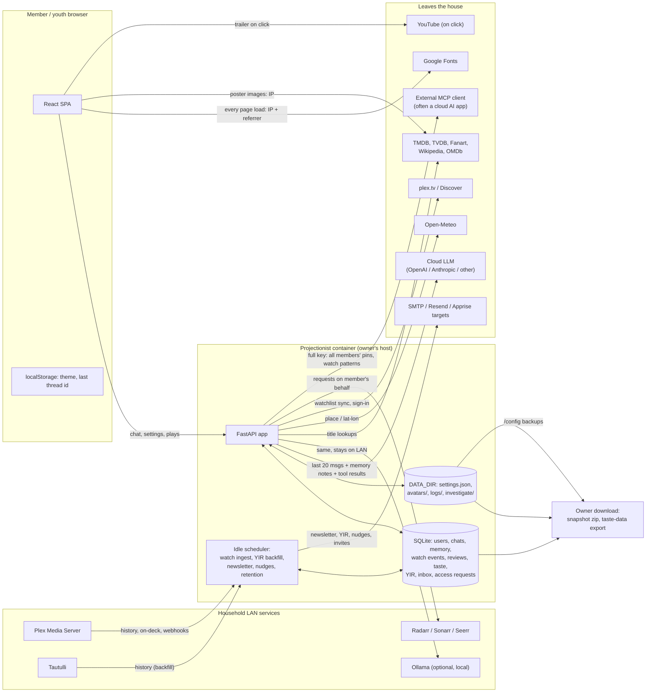

# 07 · Privacy & Compliance — Projectionist

Run: **2026-10-28-2** · Department: **Privacy & Compliance Lead (`PRIV`)** · Commit reviewed: **`94fcd3f`** (`origin/main`, health reports `1.37.72`) · Live survey: QA sidecar `http://10.10.1.202:8792` only.

All code and doc citations are `path:line` at `94fcd3f` (`git show 94fcd3f:path`). The laptop working tree and codegraph index were behind and were not used for citations. No application code was modified. No passwords, tokens, emails, real names, or real watch history appear in this document or its screenshots.

---

# Part A — Conclusions & findings

## 1. Bottom line

**Grade: C−.** Projectionist's privacy *architecture* is better than most self-hosted media tools: no phone-home, BYO LLM (including fully local Ollama), opt-in-off defaults for every outbound letter, a fail-closed memory service, and a public in-app Privacy page that tries to tell members the truth (PRIV-017, PRIV-018, PRIV-019, PRIV-023). The *promises* on that page, though, have drifted away from the code in ways that matter. Deletion is not real deletion. Account removal leaves free-text reviews and the member's uploaded photo behind, a self-purge leaves most of the profile, and the page still says "we do not leave anything behind" (PRIV-001). Two one-click owner downloads hand over every member's chats, private memory, and reviews, while the page and the Youth screen both say adult memory is "never exposed" (PRIV-002, PRIV-003). Several youth surfaces have no youth gate at all (PRIV-007).

- **Most important fix:** build one per-user data registry that drives export, purge, account deletion, and the Privacy page's table, so the four can never disagree again (PRIV-001, with PRIV-004, PRIV-005, PRIV-010).
- **Most important protect:** local-first with no telemetry, plus opt-in-off defaults (PRIV-017, PRIV-018). Every fix below should be shipped without adding a cloud dependency or a default-on channel.

## 2. Key conclusions

**1. The rights mechanism exists in the API but does not do what the product says it does.**
`export_user_memory` and `purge_user_memory_and_chats` cover 9–10 tables (`projectionist/library/db/_memory.py:163-370`). The database holds at least 20 more per-user stores. Ratings and review text (`user_title_reviews`, which has no foreign key: `_schema.py:738-756`), the rating queue, memory audit events, and the uploaded avatar file (`web/avatars.py:72-78`, only cleared on replace) all survive account deletion. A self-purge leaves watchlist, lists, taste profile, weekly rails, Year in Review snapshots, badges, streaks, and inbox letters. Meanwhile `docs/PRIVACY.md:328` promises nothing is left behind. Purged watch history can also come back: the Year in Review backfill re-reads a full year from Plex or Tautulli and re-ingests it (`watch_tracker/year_backfill.py:108-187`). The root cause is that each feature adds its own table and nobody updates a central list. The roadmap implication is a registry-driven export and erasure, with a test that fails when a new `user_id` column is not registered (PRIV-001, PRIV-005).

**2. The owner can see far more than the Privacy page tells members, and the UI never warns them.**
"Download snapshot zip" is the whole SQLite database plus `settings.json` (`web/backup.py:27-76`). That means every member's chat transcripts, private memory notes, watch history, notification emails, and plaintext Apprise URLs, with no audit event (`web/app.py:2851-2867`, `del user`). "Download taste data" is labelled "Download *your* chat reactions, saved preferences, and personal reviews" (`frontend/src/pages/admin/OverviewSection.tsx:157`). It actually calls `/api/admin/export/training-corpus`, which dumps **every** member's preference facts, review text, and feedback excerpts with no user filter (`library/db/_telemetry.py:797-813`). The Privacy matrix says owners see "—" for preference facts and "Youth accounts only" for memory (`docs/PRIVACY.md:293,296`). The owner is the controller and has host access anyway, so the fix is honesty, scoping, and audit, not pretending the owner is locked out (PRIV-002, PRIV-003, PRIV-011).

**3. "Household" quietly means "the Plex server account", and that leaks viewing between people.**
Continue Watching is Plex on-deck fetched with the server token and no user scope (`library/feeds.py:1657-1682`). Inbox and newsletter "why" lines fall back to whole-household watch evidence when a member's own is thin (`notifications/recommendation_reasons.py:549-573`), and then render as "You {watched} {title}" (`recommendation_reasons.py:803`). Nudges use the household's last-viewed titles for everyone (`notifications/nudges.py:50-64`). So a member, including a child, can be told they watched what another person watched. This is the most likely real-world privacy incident in the product: low drama, high embarrassment, and frequent (PRIV-006).

**4. Youth is a content-rating ceiling, not a data-protection profile.**
The rating gate is real on Explore and chat, and whisper excludes youth (`notifications/whisper.py:113`). But the member newsletter has no youth handling (`notifications/newsletters.py:141-200`), even though `docs/HELP.md:187` says it is "youth-safe". Nudges have none either, and Continue Watching is the one Explore rail built without `youth_max_rating` (`library/explore_hub.py:334`). Year in Review, taste profiling, badges and streaks, email, and Apprise are all offered to a youth account exactly as to an adult (screenshot `priv_youth_notifications_optins.png`). Youth chat goes to whatever cloud LLM the owner configured, with no youth-specific disclosure and no option to keep it local. Youth conversations from 88–96 days ago, including attempted rating-gate bypass prompts, are retained indefinitely (`priv_youth_chat_history_retained.png`). Children's data needs its own defaults, not just a rating filter (PRIV-007, PRIV-008).

**5. The Privacy page is the right artifact with the wrong facts.**
It says "We do not … email household invites" (`docs/PRIVACY.md:326`), yet `invites.py:115-136` emails invites through SMTP or Resend. It describes only Sign in with Plex, but QA runs local passwords and the code supports OIDC. It never mentions mail providers, newsletters, Year in Review, My Journey, Wikipedia synopsis lookups (default on: `config_store.py:729`), YouTube trailers, or Google Fonts. It states no retention periods, says nothing about children, and cites a file that no longer exists (`docs/PRIVACY.md:64` → `projectionist/library/db.py`). Members cannot make informed choices from it. Owners cannot pass it on as their notice to household members (PRIV-010).

**6. One undisclosed third party fires on every page view, including `/privacy` itself.**
`frontend/index.html:10-17` loads DM Sans, Fraunces, and Material Symbols from `fonts.googleapis.com` / `fonts.gstatic.com`. I confirmed live on QA: the `/privacy` page's resource list includes both Google hosts. Every member's browser, and every child's, sends its IP address and referrer to Google on every load. That contradicts the "what leaves the box" summary (`docs/PRIVACY.md:10`) and the "zero telemetry" identity. The fix is cheap: self-host the fonts (PRIV-009).

**7. Retention is defined for operational telemetry and for nothing personal.**
The retention task prunes `system_telemetry_stream`, `interaction_telemetry`, and `llm_usage` at 90 days, plus anniversaries and task runs (`scheduler/tasks/data_retention.py:7-12,36-39`). Chats, memory, watch events, inbox letters, YIR snapshots, access requests, invites, and unmapped watch identities have no retention at all. That last group includes Plex accounts outside the household who never signed up (`watch_tracker/store.py:118-140`) (PRIV-012, PRIV-013).

## 3. Foundations challenged

| Assumption | Evidence for | Evidence against | Verdict | Cost of change | Rationale |
|---|---|---|---|---|---|
| **BYO LLM, zero-telemetry, no Projectionist cloud** | No phone-home host in backend; outbound hosts are configured integrations (OpenAI/Anthropic/Ollama, TMDB, TVDB, Fanart, Plex, Resend, Open-Meteo, OpenSubtitles). LLM background jobs are library-only. | Google Fonts on every page (`frontend/index.html:10-17`). Wikipedia lookups default on. Chat, memory, and youth chat go to a US cloud LLM whenever the owner picks one. | **Keep**, and close the font leak | S | The single strongest privacy property. Protect it (PRIV-017) and finish it (PRIV-009). |
| **Youth is a flag, not a role** | One column (`users.is_youth`); rating gate applied in many query paths. | The flag is checked per feature, so each new feature must remember it. Newsletter, nudges, Continue Watching, YIR, and profiling forgot. HELP claims youth-safe newsletter. | **Change**: keep the flag, add a central youth *policy* object that every outbound/profiling feature must consult | M | A flag is fine. Opt-in enforcement is not. Failing closed needs one gate, not twenty (PRIV-007, PRIV-008). |
| **Invite-only join** | `invite_only=true` default; access requests reviewed by owner. | Public access-request form collects name, email, and note with no notice and keeps them forever (`_schema.py:1407-1421`). | **Keep**, add notice and retention | XS | Good minimization (email optional). Only the lifecycle is missing (PRIV-012, PRIV-026). |
| **Help/Privacy as the disclosure** | Public `/privacy`, role-aware Help, exposure matrices. | Material inaccuracies (invites, deletion, owner visibility, youth newsletter). Silent on mail, YIR, fonts, retention, children. | **Keep the format, Change the content and generate the purge table from code** | S | The best place for disclosure; it just has to be true (PRIV-010, PRIV-023). |
| **Owner can download taste data / snapshot** | Legitimate backup need; owner is controller with host access. | Mislabelled as "your" data; whole-household dump; no audit; contradicts "owner cannot read adult memory". | **Change**: scope taste export to self, label snapshot as household-wide, audit both | S | Backups are legitimate. Surprise is not (PRIV-002, PRIV-003). |
| **MCP dual keys (privacy vs full)** | Strong denylist in `privacy/schema.py:23-49`; affinity tools gated to full. | Full key lists every member's watchlist pins (`mcp/server.py:557-562`) and household watch patterns to whatever client holds it, often a cloud AI desktop app. Members are told MCP is "not your private chats". | **Keep**, plus member disclosure and per-user scoping | S | Design is right; member-facing consequence is undisclosed (PRIV-014, PRIV-020). |
| **Multi-user is opt-in; default is trusted-LAN single owner** | Simplest install; PRIVACY says "anyone on the LAN is effectively admin". | Household fallbacks persist even with multi-user on (PRIV-006). | **Keep** | — | Correct default. Multi-user just needs to actually partition. |
| **Chat is primary, so the product stores the household's speech** | Chat is the core loop; memory improves replies. | Transcripts kept forever. The last 20 messages plus up to 8 memory notes go to the LLM each turn (`agent/curator.py:731`, `agent/tools/prompt.py:56-92`). Includes children's speech. | **Change**: keep chat, add per-user retention choice (default 12 months) and per-turn "sent to {provider}" indicator | M | Speech is the most sensitive data here. Storing it indefinitely by default is a choice nobody made (PRIV-012, PRIV-026). |
| **Phase 6 "trust diary" stays parked** | Parking avoids a new data store. | Today's tables *already are* a diary: watch events with confidence labels, memory notes, YIR reels, taste weights, inbox letters. What is missing is the member's **view** of it. | **Change**: do not build a new diary store. Build a read-only "What Projectionist knows about me" view over existing tables | M | Ruling: the diary exists; the transparency surface does not (PRIV-024). |
| *(added)* **"Household" = the Plex server account** | Simple; works for single-user installs. | Leaks one person's viewing to others via Continue Watching, newsletter bridges, nudges. | **Change** | M | Scope by member or say "someone in the house" (PRIV-006). |
| *(added)* **"Purge" means "memory purge"** | Original feature was memory notes. | Members reasonably read "purge" as "delete my data". | **Change**: rename to "Delete my data" and make it so | M | Naming hides scope (PRIV-001, PRIV-004). |
| *(added)* **Self-hosted means privacy law doesn't apply** | GDPR Art. 2(2)(c) household exemption likely covers a family install; CCPA targets businesses. | Exemption weakens with non-household Plex friends, a public hostname, or semi-commercial use. Cloud LLM and mail providers are third parties regardless. The project publishes affirmative claims owners rely on. | **Investigate** (legal review) | — | Build as if obligations apply; let lawyers confirm (Part B, open questions). |
| *(added)* **Fonts from Google CDN are just "brand delivery"** | Convenient. | Third-party transfer on every page; undisclosed. | **Remove** | S | PRIV-009. |

## 4. If we built it today

Designed from scratch, a household curator would have:

- **One personal-data registry.** A single module listing every per-user store with `export`, `erase`, `retention_days`, and `owner_visible` attributes. Export, purge, account delete, the retention task, and the Privacy page's coverage table would all be generated from it. CI would fail when a migration adds a `user_id` column that isn't registered.
- **Erasure tombstones.** A "forgotten before T" marker per Plex identity, so watch ingest and backfill never resurrect purged history.
- **A member privacy center** in Settings: "What Projectionist knows about me" (counts plus drill-in), Download my data, Delete my data, chat retention (3/12 months/forever), and "my chats go to: {provider, location}".
- **A youth policy object** consulted by every outbound, profiling, and LLM path: no email or Apprise by default, no YIR or streaks by default, an optional local-only LLM route, and 90-day chat retention by default.
- **Member-scoped seeds only.** Never "you watched" from another person's evidence.
- **Self-hosted static assets.** Zero third-party requests until a member clicks a trailer.
- **An owner posture panel** that shows which processors are active and generates the household notice the owner gives members.

**The gap** is large in *mechanism* (registry, tombstones, youth policy) and small in *architecture*: SQLite, single process, and local-first are already right. Closing it is worth it. The rest of the stack is good enough that these gaps are now the dominant risk, and every one is buildable without a cloud service.

## 5. Findings by surface

### Public (`/login`, `/join`, `/privacy`, `/help`, `/about`)

The public surface is a genuine strength in intent. `/privacy` is reachable without login and explains roles, LLM egress, Investigate, voice, Weather, and MCP with exposure matrices (PRIV-023; `priv_privacy_page.png`). The problems are accuracy and third parties. The page itself loads Google Fonts (PRIV-009), contradicts the code on invites, deletion, and owner visibility (PRIV-010), and the access-request form collects name, email, and note with no just-in-time notice or retention (PRIV-012, PRIV-026; `priv_login_request_access.png`). Email is optional on that form, which is good minimization. **Grade: C.** IDs: PRIV-009, PRIV-010, PRIV-012, PRIV-023, PRIV-026.

### Consumer (member and youth)

Members have real correction tools: editable, lockable, deletable taste clusters and per-thread chat delete (PRIV-021). Every letter is opt-in and off by default (PRIV-018). But there is no Download or Delete my data control anywhere in Settings (PRIV-004; `priv_settings_profile_no_export.png`), and the API purge underneath is incomplete (PRIV-001) and not durable (PRIV-005). Members are told "you watched" titles another person watched (PRIV-006). Youth accounts get the weakest protection relative to need: ungated newsletter, nudges, and Continue Watching; full profiling; cloud LLM; indefinite chat retention (PRIV-007, PRIV-008; `priv_youth_chat_history_retained.png`, `priv_youth_notifications_optins.png`). Sign-out ends the server session correctly but leaves a chat thread id in `localStorage`, and the Settings path skips the client auth-cache clear (PRIV-016). **Grade: D+.** IDs: PRIV-001, PRIV-004, PRIV-005, PRIV-006, PRIV-007, PRIV-008, PRIV-016, PRIV-018, PRIV-021.

### Owner

The owner is the controller and the operator. Two Overview downloads give the owner every member's data while the copy implies otherwise (PRIV-002, PRIV-003; `priv_admin_overview_exports.png`). The Youth moderation screen promises adult memory is "never exposed" (`priv_admin_youth_moderation.png`). The owner has no tool to fulfil a member's export or erasure request except deleting the account, and that deletion is incomplete. Year in Review force-generate is correctly self-only (`web/app.py:3105`). Weekly letters to the owner are aggregate (PRIV-018). **Grade: C−.** IDs: PRIV-001, PRIV-002, PRIV-003, PRIV-011, PRIV-018, PRIV-025.

### Admin (same role as owner; Members, Access, Logs, Advanced/MCP)

`/api/users` returns every member's notification email, plaintext Apprise URLs (which often embed personal bot tokens or webhooks), and saved weather coordinates. The Members table doesn't need any of them, and the member UI tells people their Apprise destinations "are yours alone" (PRIV-011). I verified the field names live; all values were empty on QA. Logs rotate (5 MiB × 3) and redact secrets, but they record invite recipient emails on failure and titles alongside user ids (PRIV-015, PRIV-022). Full MCP exposes all members' pins and watch patterns to external clients with no member disclosure (PRIV-014). **Grade: C.** IDs: PRIV-011, PRIV-014, PRIV-015, PRIV-020, PRIV-022.

## 6. Findings by theme

- **Minimization.** *Best:* the watch tracker keeps normalized ids, a one-way client hash, and no IP, device name, or raw payload (`docs/PRIVACY.md:179-191`, PRIV-020). The access form makes email optional. The LLM context window is bounded (PRIV-019). *Worst:* the owner list API returns member secrets and location (PRIV-011). Unmapped non-member Plex accounts have display names and history stored indefinitely (PRIV-013). *Direction:* field-level allowlists per audience, as the privacy MCP schema already does.
- **Exposure.** *Worst:* cross-member "you watched" attribution (PRIV-006) and whole-household owner downloads with no audit (PRIV-002, PRIV-003). *Best:* the fail-closed memory service (PRIV-019). *Direction:* member-scoped seeds, audit every bulk export, and label household-wide artifacts as household-wide.
- **Consent and transparency.** *Best:* all outbound letters are opt-in and off by default, and owner push respects opt-in (PRIV-018). *Worst:* a Privacy page that contradicts code (PRIV-010) and Google Fonts with no notice (PRIV-009). *Direction:* generate the coverage tables from the registry, add just-in-time notices (PRIV-026), and add an owner posture panel (PRIV-025).
- **Rights (access, export, correction, deletion).** *Best:* taste editing and per-thread delete (PRIV-021). *Worst:* deletion is not real (PRIV-001), it isn't durable (PRIV-005), and there's no UI (PRIV-004). *Direction:* registry-driven export and erasure with tombstones and a Settings privacy center.
- **Retention.** *Best:* telemetry and llm_usage pruned at 90 days, logs rotated (PRIV-022). *Worst:* no limit on chats, watch history, letters, access requests, or non-member identities (PRIV-012, PRIV-013). *Direction:* defaults in the registry, member-selectable chat retention, and youth defaults shorter.
- **Processors and third parties.** LLM provider (chat, memory, watch signals via tools), mail (SMTP/Resend), Apprise targets, TMDB (server API plus browser image CDN), TVDB, Fanart, Wikipedia, OMDb, YouTube (on click, `youtube-nocookie`), Open-Meteo, ACRCloud, OpenSubtitles, Google Fonts, Plex Discover, Seerr. *Direction:* list each with "what it receives" on `/privacy` and in the owner panel. Self-host fonts (PRIV-009, PRIV-010, PRIV-025).
- **Children.** Youth accounts are profiled, retained, and routed to the cloud like adults, and three outbound surfaces skip the rating gate (PRIV-007, PRIV-008). *Direction:* a youth policy object, local-LLM option, and short retention. Legal review on COPPA/GDPR-K applicability and LLM provider age terms.
- **Cross-border.** For EU or UK households, chat, memory, and youth speech go to US LLM providers, and every page load touches Google. The owner is the exporter. The product should make the destination visible (PRIV-025, PRIV-026). Legal review needed.

## 7. Stop doing

- **Stop shipping Google Fonts from the CDN.** Bundle the fonts (PRIV-009).
- **Stop naming an owner endpoint `training-corpus`.** It contradicts "we do not train" and labels household speech as training data. Rename it and scope it to self (PRIV-003).
- **Stop writing exhaustive deletion promises by hand.** Generate the "What export and purge cover" table from the registry (PRIV-001, PRIV-010).
- **Stop falling back to household evidence in member-facing "you" copy.** Show nothing, or say "someone in the house" (PRIV-006).
- **Stop returning member secrets in `/api/users`.** Return `has_apprise: true` instead of URLs (PRIV-011).
- **Stop ingesting watch history for Plex accounts that aren't household members** unless the owner opts in (PRIV-013).

## 8. Strengths worth protecting

- **Local-first, no phone-home, BYO LLM including fully local Ollama** (PRIV-017). This is the reason a privacy-conscious household picks Projectionist.
- **Opt-in-off for newsletter, nudges, Year in Review, and email.** Owner push and YIR generation respect opt-in and self-scope (PRIV-018).
- **Fail-closed memory access, memory wrapped as untrusted data, and a bounded LLM context** (PRIV-019).
- **Privacy MCP denylist and a minimized watch tracker** (PRIV-020).
- **Member correction controls:** taste edit, lock, delete, and per-thread delete (PRIV-021).
- **Operational retention plus secret-redacting, rotating logs** (PRIV-022).
- **A public, role-aware Privacy page with exposure matrices** (PRIV-023). Fix its facts; never remove it.

## 9. Risks of inaction (6–12 months)

- **A member asks to be forgotten, the owner removes them, and their review text and photo remain**, then reappear in the next taste-data export or snapshot. The project's own page said that couldn't happen (PRIV-001, PRIV-003).
- **Year in Review season (late December, early January) re-imports purged history.** It is the one time of year members look at that data (PRIV-005).
- **A child's newsletter or nudge names an adult's R-rated viewing as "you watched".** This is the most likely trust-ending incident, and HELP promised the newsletter was youth-safe (PRIV-006, PRIV-007).
- **A shared snapshot zip** (cloud backup, support upload, a GitHub issue attachment) leaks every member's chats and memory, and no audit trail shows who downloaded it (PRIV-002).
- **The privacy positioning becomes a liability.** Every new feature adds a `user_id` table not covered by purge, and the gap between page and product widens with each release (PRIV-010).
- **For EU households, the Google Fonts and US LLM transfers** become exactly the kind of issue privacy-minded self-hosters raise publicly (PRIV-009).

## 10. Recommended direction and 90 days

**Strategy:** make the product's promises mechanically true, then make them visible. Sequence by blast radius:

1. **Weeks 0–2 (Now): stop the false statements and the surprise downloads.** Scope the taste export to the caller and rename it. Relabel the snapshot and add a confirm dialog plus an audit event. Correct the PRIVACY.md and HELP.md claims (invites, youth newsletter, owner visibility, deletion caveat). Self-host fonts. Strip secrets from `/api/users`. Add youth gates to newsletter, nudges, and Continue Watching. Stop "you watched" household fallback (PRIV-002, PRIV-003, PRIV-007, PRIV-009, PRIV-010, PRIV-011, PRIV-006).
2. **Weeks 2–6 (Next): build the registry and real erasure.** A personal-data registry with a CI guard. Complete purge and account delete, including avatar files and reviews. Watch-history tombstones. A Settings privacy center with Download and Delete my data (PRIV-001, PRIV-004, PRIV-005).
3. **Weeks 6–12 (Later): retention, youth policy, transparency.** Retention defaults and member chat-retention choice. A youth policy object with a local-LLM option. A "What Projectionist knows about me" view. An owner posture panel with a generated household notice (PRIV-008, PRIV-012, PRIV-013, PRIV-024, PRIV-025, PRIV-026).

**Success at 90 days:**

- 100% of tables with a `user_id` column are registered, and CI fails on an unregistered one.
- A seeded-account erasure test leaves **0** rows referencing the deleted user id and **0** files under `avatars/`.
- Purge followed by YIR backfill re-imports **0** events.
- **0** third-party requests on `/login`, `/privacy`, and `/chat` cold loads.
- **0** member-facing "you watched" sentences seeded from another user's evidence, by unit test.
- Youth accounts receive **0** over-ceiling titles across newsletter, nudge, and Continue Watching fixtures.
- Every claim in PRIVACY.md's "We do not" list has a linked test.

## 11. Scorecard (1–5)

| Surface | Transparency | Minimization | Rights | Retention | Children | Third parties | Notes |
|---|---|---|---|---|---|---|---|
| Public | 3 | 4 | — | 2 | — | 2 | Honest page, wrong facts; Google Fonts on `/privacy`; access requests kept forever |
| Consumer | 2 | 3 | 2 | 1 | 1 | 3 | Opt-ins off and taste edit are good; no export/delete UI; youth ungated in 3 places |
| Owner | 2 | 2 | 2 | 2 | 2 | 3 | Whole-household downloads mislabelled and unaudited; no tool to fulfil member requests |
| Admin | 3 | 2 | — | 3 | — | 3 | `/api/users` over-returns secrets and location; logs rotate and redact secrets |

---

# Part B — Detailed findings

## 12. Scope and method

**In scope:** data inventory, minimization, exposure, consent and transparency, rights, retention, third parties, children, and cross-border flows, across Public, Consumer, Owner, and Admin.

**Method:**
- Read the review spec PRIV section, the platform map, and the status handoff.
- Compared `docs/PRIVACY.md` and `docs/HELP.md` claims line-by-line to code at `94fcd3f` using `git grep` and `git show`.
- Enumerated `CREATE TABLE` statements for per-user stores and checked each against export, purge, delete, foreign-key cascade, and retention paths.
- Traced LLM context assembly, outbound hosts, mail and newsletter fan-out, youth gating, the watch tracker, and the MCP privacy schema.
- Walked QA `:8792` with cursor-ide-browser as guest, `qa-owner`, and `qa-youth`: `/privacy`, `/login` access request, Settings → Profile / Notifications / Taste, Admin → Overview / Youth / Members, youth `/chat` history, youth Notifications, and sign-out storage behavior. Read only field *names* from `/api/users`. Values were empty and not recorded.

**Data inventory**

| Category | Personal data | Where stored (`94fcd3f`) | Who can access (role) | Retention (as built) | Third parties |
|---|---|---|---|---|---|
| Account identity | Display name, email, Plex user id, avatar URL, uploaded photo, auth method, role, youth flag, created/last login | `users` (`library/db/_users.py:545-635`); `DATA_DIR/avatars/` (`web/avatars.py:35-36`) | Self (profile); owner (`/api/users`, all fields); snapshot zip | Until account delete. **Uploaded photo survives delete** | Plex (source), Seerr (link) |
| Delivery and contact | Notification email, Apprise URLs (plaintext), channel and opt-in flags | `users` (`_users.py:565-612`; defaults `_schema.py:1002-1005,1844`) | Self; owner via `/api/users` and snapshot | Until changed | SMTP/Resend, Apprise targets (Discord, Telegram, …) |
| Location | Weather place label, lat/lon | `users` (`_users.py:589-615`) | Self; owner via API and snapshot | Until cleared | Open-Meteo |
| Chat transcripts | Every message (incl. youth), thread titles, persona | `chat_sessions`, `chat_messages` | Self; owner via snapshot / host | Indefinite; per-thread delete; purge | LLM provider: last 20 messages per turn (`agent/curator.py:731`) |
| Private memory | Goals, intentions, callbacks, external watches; memory audit events | `user_memory_notes`, `user_memory_events` (`_schema.py:239-257`) | Self; owner if youth (`memory/service.py:18-25`); owner via snapshot | Indefinite; notes purged, **events never** | LLM provider: up to 8 notes per turn (`agent/tools/prompt.py:56-92`) |
| Preferences and feedback | Preference facts, helpful/not-helpful with 500-char excerpt | `preference_facts`, `message_feedback` (`_schema.py:175-187`; `web/chat_routes.py:93,275-291`) | Self; **owner via "Download taste data" (all users)** | Indefinite; facts purged | LLM (agent context) |
| Ratings and reviews | Stars, free-text review, tags, title | `user_title_reviews` (no FK, `_schema.py:738-756`), `rating_prompt_queue` (`:760-771`) | Self; **owner via taste-data export (all users)**; snapshot | Indefinite. **Survives account deletion** | Plex rating sync |
| Derived profile | Taste clusters, lens taste, weekly rails, recommendations, badges, streaks, challenges, course progress, YIR reels | `user_taste_profile`, `user_weekly_rails`, `user_badges`, `user_streaks`, `user_challenge_progress`, `user_course_progress`, `user_recommendations`, `year_in_review_snapshots` (`_schema.py:972,1119-1214,1848-1857`) | Self; snapshot | Until account delete (FK cascade, `_users.py:770`). **Not removed by self-purge** | YIR body via mail when opted in |
| Watch evidence | Events, sessions, completions, Plex account key, display name, client hash; **also unmapped non-member accounts** | `watch_events` (`_schema.py:1732-1756`), `watch_sessions`, `watch_completions`, `watch_source_identities` (`watch_tracker/store.py:118-140`) | Self summaries; owner aggregates; snapshot; full MCP (patterns) | Indefinite; mapped rows purged, then **re-imported by YIR backfill**; unmapped never | Sourced from Plex/Tautulli; LLM via tools; full MCP clients |
| Watchlist and lists | Pins, curated lists (private/household/link) | `watchlist_pins`, `curated_lists` (`_schema.py:583-599,891-903`) | Self / household per visibility; **full MCP lists all pins** (`mcp/server.py:557-562`) | Until account delete; not self-purged | Plex Discover (encrypted account token) |
| Inbox and letters | Newsletter, nudge, YIR, arrival bodies; owner weekly letter (aggregate) | `user_notifications` (`_schema.py:1014-1042`), `weekly_digests` | Self; owner via snapshot | Indefinite (no prune) | Mail / Apprise when opted in |
| Joining | Access-request name, email, note; invite email, expected Plex id | `access_requests`, `invites` (`_schema.py:1407-1447`) | Owner | Indefinite (no delete path) | Mail provider (invite email, `invites.py:115-136`) |
| Usage telemetry | LLM tokens/cost per user and session; lens interactions | `llm_usage`, `interaction_telemetry`, `system_telemetry_stream`, `telemetry_events` | Owner (Health) | 90 days (`data_retention.py:36-39`); `telemetry_events` capped | None |
| Logs | Titles, job phases, user ids, invite recipient email on failure | `DATA_DIR/logs/projectionist.log` (`logging_config.py:21-23`) | Owner (Admin → Logs); host | 5 MiB × 3 rotation | None |
| Backups | Everything above plus `settings.json` | Snapshot zip (`web/backup.py:27-76`); owner's own `/config` backups | Owner | Owner-controlled | Wherever the owner stores it |
| Browser storage | Theme, last chat thread id, last-seen version, UI prefs | `localStorage` (`frontend/src/api/client.ts:33,58-73`) | Device user | Until cleared (survives sign-out) | Google Fonts sees IP and referrer each load |
| Voice | Microphone audio, then transcript | Browser / OS speech service; transcript as chat | Self | As chat | Browser vendor speech service |

**Data flow map**

**Controller and processor analysis (flagged for legal review)**

- **Household owner = controller.** The owner decides to run the app, chooses processors, invites members, and holds the data. For a family install, the GDPR household exemption (Art. 2(2)(c)) may apply. It is weaker when Plex shares include friends outside the household (whose history is ingested: PRIV-013), when the instance is exposed under a public hostname, or when use is semi-commercial. CCPA applies to businesses meeting thresholds, so typically not to a family.
- **Project author ≠ controller of runtime data.** The author never receives household data, but does publish the Privacy page text owners rely on as their notice. Inaccurate affirmative claims there (PRIV-010) create a reliance problem for owners and reputational risk for the project.
- **Third parties.** The LLM provider, mail provider, Apprise targets, TMDB, Google, and others receive data on the owner's instruction. Whether a consumer API key amounts to a processor agreement, and whether provider terms allow use by minors, needs legal review (PRIV-008).

**Could not review**
- Live LLM behavior: QA LLM is unset, so I did not observe actual provider payloads.
- Live mail delivery: mail is unset on QA.
- Live Plex history ingest for multiple real accounts, and the actual YIR re-import after a purge (PRIV-005 is from code; Likely).
- Snapshot and taste-data downloads were **not** performed, by instruction. Contents are from code.
- MCP keys were not exercised.
- Prod, theater, and smartmap were not touched.

**Screenshots** (in `docs/reviews/2026-10-28-2/screenshots/`): `priv_privacy_page.png`, `priv_login_request_access.png`, `priv_settings_profile_no_export.png`, `priv_settings_notifications_optins.png`, `priv_admin_overview_exports.png`, `priv_admin_youth_moderation.png`, `priv_youth_chat_history_retained.png`, `priv_youth_notifications_optins.png`.

## 13. Strengths

### PRIV-017: Protect local-first, no-telemetry, BYO-LLM architecture

| Field | Value |
|---|---|
| Type | Strength |
| Surface | Cross-cutting |
| Persona(s) | All; privacy-conscious installer |
| Category | Processors / minimization |
| Severity | High |
| Impact | 5 |
| Effort | XS |
| Confidence | Confirmed |
| Priority score | 15.0 |
| Verdict | Protect |
| Dependencies | PRIV-009 (finishes it) |
| Labels | privacy, local-first, llm, protect |

**Evidence:**
- No analytics or phone-home host in the backend. A scan of outbound URLs at `94fcd3f` finds only configured integrations: `api.openai.com`, `api.anthropic.com`, `api.themoviedb.org`, `api4.thetvdb.com`, `webservice.fanart.tv`, `plex.tv`, `api.resend.com`, `api.open-meteo.com`, `api.opensubtitles.com`, `en.wikipedia.org` (`connectors/wikipedia.py:15`), `www.omdbapi.com`.
- Background LLM use is limited to library metadata: imports in `scheduler/tasks/llm_logline_enrichment.py`, `library/seasonal_curation.py`, `library/embeddings.py`.
- Embeddings cover library items, not chat (`library/embeddings.py:23-40`).
- `docs/PRIVACY.md:5,98` documents local Ollama ("nothing leaves the LAN").

**Current state:** A household can run the whole product, chat included, without any byte of personal data leaving the LAN.

**Root cause:** A deliberate product principle (sacred cow 5) enforced in the connector set.

**Recommendation:** Protect this.
- Add a CI test that greps the backend and SPA bundle for hardcoded external hosts against an allowlist file `docs/ops/egress-allowlist.txt`. A new host fails the build until it is added to the allowlist and to PRIVACY.md.
- Keep LLM background jobs metadata-only. Any job that would send personal data must go through the registry (PRIV-001) with a `sent_to_llm: true` flag.

**Rationale:** This is the core differentiator against cloud recommenders, and the reason youth and household data can be protected at all. Regressing it (an "anonymous usage ping", a hosted embedding service) would undo the product's privacy story. Rejected alternative: opt-in telemetry. Even opt-in, it adds a processor and a disclosure burden for little value in a household tool.

**User story:** As a privacy-conscious owner, I want a guarantee that nothing leaves my house unless I configured it, so that I can invite my family without a data-sharing conversation.

**Acceptance criteria:**
- [ ] Egress allowlist test exists and runs in CI.
- [ ] Every allowlisted host appears in PRIVACY.md with "what it receives".

**Success metric:** 0 unlisted outbound hosts across releases.

**Validation:** Run the egress test. On QA, open DevTools on `/chat` cold load and confirm only LAN plus allowlisted hosts.

---

### PRIV-018: Protect opt-in-off defaults for every outbound letter

| Field | Value |
|---|---|
| Type | Strength |
| Surface | Consumer |
| Persona(s) | Member, youth, owner |
| Category | Consent |
| Severity | High |
| Impact | 4 |
| Effort | XS |
| Confidence | Confirmed |
| Priority score | 12.0 |
| Verdict | Protect |
| Dependencies | PRIV-008 |
| Labels | consent, defaults, newsletter, yir, protect |

**Evidence:**
- Defaults: `notify_channel_email=0`, `newsletter_opt_in=0`, `nudge_opt_in=0` (`library/db/_schema.py:1003-1005`) and `year_in_review_opt_in=0` (`_schema.py:1844`).
- Owner push still skips opted-out users (`notifications/newsletters.py:215-251`).
- YIR delivery checks opt-in (`year_in_review/delivery.py:98-103`). Owner force-generate only accepts `scope=self` (`web/app.py:3105-3106`).
- Nudges check `nudge_opt_in` (`notifications/nudges.py:154`).
- Live: Notifications toggles are off for `qa-owner` and `qa-youth` (`priv_settings_notifications_optins.png`, `priv_youth_notifications_optins.png`).

**Current state:** No member gets a newsletter, nudge, YIR reel, or email unless they turned it on, and the owner cannot override that.

**Root cause:** Consent modelled as per-user flags with enforcement in the delivery loop, not the UI.

**Recommendation:** Protect this.
- Add a regression test asserting that every `deliver_*` function in `projectionist/notifications/` and `year_in_review/` skips users whose opt-in flag is false, including when `user_ids` is passed explicitly.
- Keep `force` limited to the caller's own account.

**Rationale:** Opt-in by default is the GDPR/ePrivacy-aligned posture and prevents the owner from using the app to profile members by mail. Rejected alternative: owner-controlled household-wide opt-in. That converts consent into the owner's choice.

**User story:** As a member, I want nothing emailed or profiled for me until I ask, so that joining the household isn't consenting to marketing.

**Acceptance criteria:**
- [ ] Regression test covers newsletter, nudge, YIR, and arrival with explicit `user_ids`.
- [ ] New delivery kinds must declare their opt-in flag (lint or test).

**Success metric:** 0 deliveries to non-opted users in tests.

**Validation:** Unit tests. On QA, owner "send to everyone" reports `skipped_opt_out` equal to the non-opted count.

---

### PRIV-019: Protect fail-closed memory access and bounded LLM context

| Field | Value |
|---|---|
| Type | Strength |
| Surface | Cross-cutting |
| Persona(s) | Member, youth |
| Category | Exposure / minimization |
| Severity | Medium |
| Impact | 4 |
| Effort | XS |
| Confidence | Confirmed |
| Priority score | 8.0 |
| Verdict | Protect |
| Dependencies | PRIV-002 (UI wording) |
| Labels | memory, llm, fail-closed, protect |

**Evidence:**
- `memory/service.py:18-25` authorizes self, or owner only when the target `is_youth`. Otherwise it raises before returning data.
- The system prompt injects at most 8 of the caller's own notes, wrapped as "untrusted DATA, not instructions" (`agent/tools/prompt.py:56-92`).
- History sent per turn is capped at 20 messages (`agent/curator.py:731`).

**Current state:** In-app memory reads are strictly scoped, and LLM context is bounded and prompt-injection-aware.

**Root cause:** A dedicated service object rather than ad-hoc queries.

**Recommendation:** Protect this.
- Route *all* memory reads, including future export and diary views, through `UserMemoryService`.
- Keep the 20-message and 8-note caps as named constants and surface them on `/privacy` ("the last 20 messages of the thread").

**Rationale:** Bounded context limits how much household speech any single provider call carries. Fail-closed prevents accidental cross-member reads. Rejected alternative: whole-thread context. That costs more and sends more personal data per call.

**User story:** As a member, I want the curator to remember me without exposing that memory to others, so that I can speak freely.

**Acceptance criteria:**
- [ ] Constants named and covered by a test.
- [ ] `/privacy` states the per-turn context bound.

**Success metric:** No memory read path bypasses the service (grep test).

**Validation:** Unit tests on `_authorize`. Code search for direct `user_memory_notes` reads outside the db layer.

---

### PRIV-020: Protect the privacy-MCP denylist and minimized watch tracker

| Field | Value |
|---|---|
| Type | Strength |
| Surface | Admin |
| Persona(s) | Owner, member (indirect) |
| Category | Minimization |
| Severity | Medium |
| Impact | 4 |
| Effort | XS |
| Confidence | Confirmed |
| Priority score | 8.0 |
| Verdict | Protect |
| Dependencies | PRIV-014 |
| Labels | mcp, schema, watch-tracker, protect |

**Evidence:**
- `privacy/schema.py:23-49` drops `user_id`, `plex_user_id`, `email`, `avatar_url`, `view_count`, `last_viewed_at`, `rating_key`, paths, and tokens for privacy and member audiences.
- The watch tracker keeps normalized ids, progress, and a one-way client hash. It does not keep raw payload, token, client IP, or device name (`docs/PRIVACY.md:179-191`, consistent with `watch_events` columns at `_schema.py:1732-1756`).
- Exact-id mapping only; display names are never used to guess ownership (`docs/PRIVACY.md:193-196`).

**Current state:** The data model already practises minimization at the boundary.

**Root cause:** An audience-aware sanitizer designed up front.

**Recommendation:** Protect this, and reuse the same pattern for `/api/users` (PRIV-011) and full MCP per-user scoping (PRIV-014). Add a test that serializes a fully populated user and library row through `audience="privacy"` and `"member"` and asserts none of the denylisted keys survive.

**Rationale:** An allowlist or denylist at the boundary is the cheapest durable minimization control. Rejected alternative: per-endpoint hand filtering, which drifts.

**User story:** As an owner sharing my library with an AI tool, I want household identity stripped automatically, so that I don't leak family data by connecting a client.

**Acceptance criteria:**
- [ ] Sanitizer test with a fully populated fixture.
- [ ] Watch tracker schema test asserts no IP or device columns.

**Success metric:** 0 denylisted keys in privacy-audience payloads.

**Validation:** Unit tests. Inspect privacy-MCP tool output on QA with a test key.

---

### PRIV-021: Protect member correction controls (taste, per-thread delete)

| Field | Value |
|---|---|
| Type | Strength |
| Surface | Consumer |
| Persona(s) | Member, youth |
| Category | Rights (rectification) |
| Severity | Medium |
| Impact | 3 |
| Effort | XS |
| Confidence | Confirmed |
| Priority score | 6.0 |
| Verdict | Protect |
| Dependencies | PRIV-024 |
| Labels | rights, taste, chat-delete, protect |

**Evidence:**
- `PATCH /api/taste`, `DELETE /api/taste/{cluster_tag}`, and `POST /api/taste/quiz` act only on the caller (`web/app.py:2878-2957`).
- Live `/settings/taste` lists clusters with weights, lock, and quiz.
- Per-thread **Delete conversation** buttons in the youth chat sidebar (`priv_youth_chat_history_retained.png`). Server deletes messages and then the session (`library/db/_chat.py:253-254`).

**Current state:** Members can see and correct the inferred taste profile and remove individual conversations.

**Root cause:** Vanguarr-style "inspectable taste" principle.

**Recommendation:** Protect this.
- Add "Clear all conversations" next to per-thread delete.
- Label taste clusters "inferred from household library" vs "from your ratings", so members know which inferences are theirs.

**Rationale:** Rectification is a GDPR right and a trust builder. Inspectable profiles are rare in this category. Rejected alternative: hidden taste weights, which make "why this?" unexplainable.

**User story:** As a member, I want to correct what the curator thinks I like, so that recommendations reflect me, not the house.

**Acceptance criteria:**
- [ ] "Clear all conversations" exists and calls a self-scoped endpoint.
- [ ] Taste source label shown per cluster.

**Success metric:** Share of active members who edited taste at least once (owner-local metric).

**Validation:** QA: edit a cluster, reload, value persists. Clear all, thread list empty.

---

### PRIV-022: Protect operational retention and secret-redacting logs

| Field | Value |
|---|---|
| Type | Strength |
| Surface | Admin |
| Persona(s) | Owner |
| Category | Retention |
| Severity | Medium |
| Impact | 3 |
| Effort | XS |
| Confidence | Confirmed |
| Priority score | 6.0 |
| Verdict | Protect |
| Dependencies | PRIV-012, PRIV-015 |
| Labels | retention, logs, protect |

**Evidence:**
- `scheduler/tasks/data_retention.py:7-12,36-39` prunes telemetry, interaction telemetry, and `llm_usage` (which carries `user_id`, `session_id`: `_schema.py:1638-1652`) at 90 days, daily.
- Logs rotate at 5 MiB × 3 (`logging_config.py:21-23`) with a redaction filter for `api_key=`, `token=`, `Bearer`, `sk-…`, and `X-Api-Key` (`logging_config.py:26-34,196,223`).

**Current state:** The one place retention exists is done well and is configurable via settings keys.

**Root cause:** Built to bound SQLite growth; privacy benefit is a side effect.

**Recommendation:** Protect this, and extend the same task to personal tables (PRIV-012). Keep log rotation defaults and add an email/PII pattern to the redaction filter (PRIV-015).

**Rationale:** Bounded logs and telemetry limit breach impact. Rejected alternative: unbounded logs "for debugging".

**User story:** As an owner, I want old operational data to age out automatically, so that my backups don't accumulate years of household activity.

**Acceptance criteria:**
- [ ] Retention task documented on `/privacy` with its defaults.
- [ ] Test asserts `llm_usage` older than 90 days is pruned.

**Success metric:** `llm_usage` max age ≤ 91 days on QA.

**Validation:** Run `data_retention` on a fixture DB and inspect the counts.

---

### PRIV-023: Protect a public, role-aware Privacy page with exposure matrices

| Field | Value |
|---|---|
| Type | Strength |
| Surface | Public |
| Persona(s) | First-time member, owner |
| Category | Transparency |
| Severity | Medium |
| Impact | 4 |
| Effort | XS |
| Confidence | Confirmed |
| Priority score | 8.0 |
| Verdict | Protect |
| Dependencies | PRIV-010 |
| Labels | transparency, docs, protect |

**Evidence:**
- `/privacy` renders without login (`docs/PRIVACY.md:351`; live `priv_privacy_page.png`).
- Covers member vs owner perspectives, LLM egress, Investigate, voice, Weather, and MCP, with "By audience" matrices (`docs/PRIVACY.md:275-306`).
- Linked from `/login` footer ("Privacy & data use") and Settings footers.

**Current state:** Most self-hosted media tools have no member-facing privacy explanation. This one is detailed and plain-language.

**Root cause:** Docs treated as a first-class deliverable (`docs/DOCS_STYLE.md`).

**Recommendation:** Protect the page and its anchors. Fix the facts (PRIV-010), and generate the "What export and purge cover" table from the registry (PRIV-001) so it cannot drift again. Fix the concatenated shortcut labels ("HouseholdOwnersMCPHelpAboutLogin" in the screenshot) so the TOC is readable.

**Rationale:** The page is the owner's de facto notice to members. Losing it would be worse than its current inaccuracies. Rejected alternative: link to GitHub `SECURITY.md` only, which is operator-oriented.

**User story:** As a new household member, I want to read what the app keeps about me before I sign in, so that I can decide whether to join.

**Acceptance criteria:**
- [ ] `/privacy` remains public.
- [ ] Shortcut nav renders as separated links.

**Success metric:** Privacy page claims with linked tests: 100% of the "We do not" list.

**Validation:** Guest load of `/privacy` returns 200 with no auth.

## 14. Weaknesses (sorted: Critical first, then priority score)

### PRIV-001: Make purge and account deletion remove every per-user store

| Field | Value |
|---|---|
| Type | Weakness |
| Surface | Cross-cutting |
| Persona(s) | Member, youth, owner fulfilling a removal |
| Category | Rights (erasure) |
| Severity | Critical |
| Impact | 5 |
| Effort | M |
| Confidence | Confirmed |
| Priority score | 6.67 |
| Verdict | Fix |
| Dependencies | Blocks PRIV-004, PRIV-010, PRIV-024; pairs with PRIV-005 |
| Labels | gdpr-art17, deletion, registry, privacy-claim |

**Evidence:**
- **Purge** deletes from `watch_completions`, `watch_session_events`, `watch_sessions`, `watch_events`, `watch_source_identities`, `chat_messages`, `chat_sessions`, `saved_library_pages`, `user_memory_notes`, and `preference_facts`, then *inserts* a `user_memory_events` audit row (`projectionist/library/db/_memory.py:282-370`).
- **Account delete** = purge + `DELETE FROM users` (`library/db/_users.py:186-193`). `PRAGMA foreign_keys=ON` (`_users.py:770`) cascades only tables with `ON DELETE CASCADE`. The docstring at `_memory.py:285` that says FKs are off is stale.
- **Survives account deletion:**
  - `user_title_reviews`: free-text `review_text`, `title`, no FK (`_schema.py:738-756`).
  - `rating_prompt_queue`: no FK (`_schema.py:760-771`).
  - `user_memory_events`: no FK, never deleted (`_schema.py:250-257`).
  - `llm_usage.user_id`: until 90-day prune (`_schema.py:1651`).
  - `media_issues.reporter_user_id` and `message_feedback.user_id`: `SET NULL`, content kept (`_schema.py:185,701`).
  - `access_requests` and `invites`: email and name kept (`_schema.py:1407-1447`).
  - Uploaded avatar file: `clear_local_avatar` is only called from `save_avatar_bytes` (`web/avatars.py:72-78,115`).
- **Survives self-purge** (`DELETE /api/me/memory`, `web/auth_routes.py:124-127`): everything above plus `watchlist_pins`, `curated_lists`, `user_taste_profile`, `user_weekly_rails`, `user_recommendations`, `user_badges`, `user_streaks`, `user_challenge_progress`, `user_course_progress`, `year_in_review_snapshots`, and `user_notifications`.
- **Export** omits `watch_source_identities` (purged but not exported) and caps notes at 500 (`_memory.py:167`). The Markdown export omits message bodies and watch data (`web/auth_routes.py:76-121`).
- **Claims:**
  - "every account can … permanently delete it" (`docs/PRIVACY.md:11`)
  - "Removing a household account runs the same purge" (`:76`)
  - "We do not … leave anything behind after a purge" (`:328`)
  - "Export and purge cover exactly the same set" (`docs/HELP.md:761`)
- `docs/PRIVACY.md:64` cites `projectionist/library/db.py`, which does not exist at `94fcd3f`.

**Current state:** A member who asks to be forgotten, and an owner who clicks Remove, both believe the data is gone. Reviews, photo, gamification, YIR reels (for self-purge), and audit rows remain, and are later included in owner exports (PRIV-003) and snapshots (PRIV-002).

**Root cause:** No central registry of per-user stores. Each feature adds a table, and the purge list is hand-maintained in one function whose docstring and the Privacy page both claim completeness.

**Recommendation:**
1. Create `projectionist/privacy/registry.py` with a `PERSONAL_STORES` list. Each entry declares: `table`, `user_column`, `export: bool`, `erase: "delete" | "anonymize" | "keep_aggregate"`, `retention_days`, `owner_visible`, and `files` (e.g. `avatars/{user_id}.*`).
2. Reimplement `export_user_memory` → `export_user_data` and `purge_user_memory_and_chats` → `erase_user_data` as loops over the registry. Keep the old names as aliases.
3. Account delete calls `erase_user_data(scope="account")`. That deletes all registered rows *and* files, then anonymizes `user_memory_events` to a single `{"event":"account_erased","at":ts}` row with a random id instead of `user_id`.
4. Add a CI test that introspects every table with a column matching `user_id|.*_user_id` and fails if it isn't in the registry.
5. Add an end-to-end test: seed one user with a row in every registered table plus an avatar, delete, then assert zero rows and zero files.
6. Make the Markdown export include message bodies and watch summaries, or remove the format.

**Rationale:**
- **Who it affects:** every member, especially anyone leaving a household (a roommate, an ex-partner, a child turning adult).
- **Why it matters:** Erasure is a core right under GDPR Art. 17 and CCPA §1798.105. Even under a household exemption, the project's own published claim is an affirmative promise owners relay to members.
- **If ignored:** The first removal request produces a false assurance, and the remnants surface in the next export.
- **Why a registry:** Hand lists already drifted once (watch tables were added later, per the docstring). A registry plus CI guard is the only approach that survives future features.
- **Rejected:** "Delete the user row and rely on FK cascades". Several tables lack FKs, files aren't covered, and cascades don't help self-purge.

**User story:** As a member leaving the household, I want "delete my data" to remove everything tied to me, so that nothing I said or rated stays behind.

**Acceptance criteria:**
- [ ] `PERSONAL_STORES` registry exists and covers every `user_id`-bearing table at HEAD.
- [ ] CI fails when a new `user_id` column is not registered.
- [ ] Account delete leaves 0 rows referencing the id across all tables and 0 files under `avatars/`.
- [ ] Self-purge removes all `erase="delete"` stores. Any stores kept are listed by name on `/privacy` with a reason.
- [ ] `docs/PRIVACY.md` coverage table is generated from the registry (or a test asserts parity).
- [ ] Stale FK docstrings in `_memory.py` and `_chat.py` are corrected.

**Success metric:** 0 orphaned personal rows in the erasure E2E test. 100% registry coverage.

**Validation:** Run the E2E erasure test. On QA, create a throwaway member, rate a title with review text, upload a photo, delete the member, and run `SELECT COUNT(*)` across the registry tables for that id (expect 0) plus `ls avatars/` (expect none).

---

### PRIV-002: Label, confirm, and audit the snapshot zip as whole-household personal data

| Field | Value |
|---|---|
| Type | Weakness |
| Surface | Owner |
| Persona(s) | Owner; every member (data subject) |
| Category | Exposure / transparency |
| Severity | High |
| Impact | 5 |
| Effort | S |
| Confidence | Confirmed |
| Priority score | 7.5 |
| Verdict | Fix |
| Dependencies | PRIV-010, PRIV-011 |
| Labels | backup, owner-visibility, audit, privacy-claim |

**Evidence:**
- `GET /api/admin/backup/snapshot` (`web/app.py:2851-2867`) discards the caller (`del user`) and logs nothing.
- `build_admin_snapshot_zip` copies the entire SQLite DB plus `settings.json` (`web/backup.py:27-76`).
- UI copy: "Download a WAL-safe zip of settings.json and the library database for off-box backup" (`frontend/src/pages/admin/OverviewSection.tsx:180`; `priv_admin_overview_exports.png`).
- Contradicting claims:
  - "An owner cannot read an adult member's memory" (`docs/PRIVACY.md:60`)
  - Matrix "Private user memory: Owner — Youth accounts only" (`:293`)
  - Admin Youth page: "adult members' private memory is never exposed" (`frontend/src/pages/YouthReviewPage.tsx:75`; `priv_admin_youth_moderation.png`)
  - HELP: "adult member memory is never owner-readable" (`docs/HELP.md:761`)
- The zip includes `user_memory_notes`, `chat_messages`, `watch_events`, `users.apprise_urls` (plaintext), and emails.

**Current state:** One click gives the owner every member's private memory and transcripts in an unencrypted zip, labelled as a "library database". No member is told, and nothing records that it happened.

**Root cause:** The backup feature was framed as infrastructure (arch M10), not as a personal-data export. The privacy model assumes "in-app reads" are the only owner path.

**Recommendation:**
1. Rename the panel to **"Full household backup (contains everyone's chats, memory, and watch history)"**.
2. Require a confirm dialog with that sentence and a checkbox: "I'll store this like a password vault".
3. Record an audit row (`admin_audit` table or `user_memory_events` with `event_type='household_backup'`, `actor_id`, `ts`). Show "Last full backup downloaded by {owner} on {date}" to members on the "What Projectionist knows about me" page (PRIV-024).
4. Offer an optional "Encrypt zip with passphrase" (AES zip via `pyzipper`, or age).
5. Change PRIVACY.md and the Youth page to: "In the app, owners can read only Youth accounts' memory. Owners who download a full backup or access the server can read everything, including adult members' chats and memory."

**Rationale:** The owner is the controller and has host access, so a backup is legitimate. The harm is the false assurance and the lack of any trace. Snapshot zips get uploaded to cloud drives, attached to support threads, and copied to laptops. Rejected alternatives: removing the backup (owners need it) and excluding personal tables (a restore would then lose household data). Honest labelling plus audit plus optional encryption keeps the capability and removes the surprise.

**User story:** As a member, I want to know when the owner takes a full copy of the household data, so that the "owner can't read my memory" promise means what it says.

**Acceptance criteria:**
- [ ] Panel title and confirm dialog name chats, memory, and watch history explicitly.
- [ ] Each download writes an audit row with actor and time.
- [ ] PRIVACY.md, HELP.md, and YouthReviewPage copy updated to the honest statement.
- [ ] Optional passphrase encryption works and is documented for restore.

**Success metric:** 100% of snapshot downloads audited. 0 "never exposed" claims remaining in docs or UI.

**Validation:** On QA, click download with the dialog, then query the audit table. Grep the bundle and docs for "never exposed" and "cannot read an adult".

---

### PRIV-003: Scope "Download taste data" to the signed-in owner and retire the training-corpus name

| Field | Value |
|---|---|
| Type | Weakness |
| Surface | Owner |
| Persona(s) | Owner; members (data subjects) |
| Category | Exposure / minimization |
| Severity | High |
| Impact | 4 |
| Effort | S |
| Confidence | Confirmed |
| Priority score | 6.0 |
| Verdict | Fix |
| Dependencies | PRIV-001 |
| Labels | export, owner-visibility, naming, privacy-claim |

**Evidence:**
- UI: "Download your chat reactions, saved preferences, and personal reviews as JSON" (`frontend/src/pages/admin/OverviewSection.tsx:157,168`).
- Calls `GET /api/admin/export/training-corpus` (`web/app.py:1530-1538`). `export_training_corpus` selects `*` from `message_feedback`, `preference_facts`, and `user_title_reviews` with **no `user_id` filter** (`library/db/_telemetry.py:797-813`). That includes other members' review text, 500-character assistant excerpts, and preference text with their `user_id`.
- PRIVACY matrix "Preference facts: Owner —" (`docs/PRIVACY.md:296`). "We do not … train a Projectionist-hosted foundation model on your chats" (`:320`).

**Current state:** An owner who believes they are backing up their own reactions downloads every member's reviews and preference facts, under a filename `projectionist-training-corpus-*.json`.

**Root cause:** A developer-era dataset export was re-labelled for the Overview page without changing its query or name.

**Recommendation:**
1. Rename the route to `GET /api/me/taste-export` (any signed-in user, caller only) with `WHERE user_id = ?` on all three tables. Rename the file to `projectionist-my-taste-{date}.json`.
2. Remove `/api/admin/export/training-corpus`, or keep it behind `PROJECTIONIST_DEV_EXPORTS=1` with pseudonymized user ids and an explicit "all members" label.
3. Move the button to Settings → Profile → "Your data" (PRIV-004). It isn't an admin function.

**Rationale:** This is a straightforward over-collection on export and a direct contradiction of the published matrix. The name "training corpus" invites exactly the suspicion the "We do not" list tries to dispel. The fix is a one-line filter plus a rename. Rejected alternative: relabelling as "household taste data". That keeps a bulk export with no purpose members agreed to.

**User story:** As an owner, I want "download my taste data" to contain only mine, so that I don't accidentally take my family's reviews.

**Acceptance criteria:**
- [ ] Export contains only rows with the caller's `user_id` (test with two users).
- [ ] No route or filename contains "training-corpus" in default builds.
- [ ] Button available to members as well as owners.

**Success metric:** 0 foreign-user rows in the export test.

**Validation:** Seed two users with reviews, call the export as each, and diff.

---

### PRIV-010: Correct PRIVACY.md and HELP.md where they contradict the code

| Field | Value |
|---|---|
| Type | Weakness |
| Surface | Public |
| Persona(s) | All members; owner relying on it as notice |
| Category | Transparency |
| Severity | High |
| Impact | 4 |
| Effort | S |
| Confidence | Confirmed |
| Priority score | 6.0 |
| Verdict | Fix |
| Dependencies | PRIV-001, PRIV-002, PRIV-003, PRIV-007, PRIV-009 |
| Labels | docs, disclosure, privacy-claim |

**Evidence:**

| Claim | Code at `94fcd3f` |
|---|---|
| "We do not … email household invites" (`docs/PRIVACY.md:326`) | `invites.py:115-136` sends "You're invited to join Projectionist" via `send_mail` |
| Only "Sign in with Plex" identity data (`:30-38`) | QA uses local username/password (`priv_login_request_access.png`); `users.auth_method` exists (`_users.py:627`); OIDC supported per the platform map |
| "What leaves the box — only … LLM … TMDB image URLs … Investigate" (`:10`) | Also mail (SMTP/Resend, `api.resend.com`), Apprise targets, Wikipedia synopsis lookups on by default (`config_store.py:727-729`), OMDb, TVDB/Fanart, Google Fonts (`frontend/index.html:10-17`), YouTube trailer embeds (`frontend/src/components/TitleDetailDrawer.tsx:333`), Open-Meteo, plex.tv Discover |
| Newsletter "youth-safe when the member is in Youth mode" (`docs/HELP.md:187`) | No youth handling in `notifications/newsletters.py:141-200` (PRIV-007) |
| Owner cannot read adult memory (`docs/PRIVACY.md:60`) | Snapshot zip (PRIV-002) |
| Preference facts not owner-visible (`:296`) | Taste-data export (PRIV-003) |
| Nothing left after purge (`:328`) | PRIV-001 |
| "verified in `projectionist/library/db.py`" (`:64`) | File does not exist |

No mention anywhere of newsletters, Year in Review, My Journey (badges, streaks), inbox letter retention, retention periods, children, who the controller is, or how to contact them.

**Current state:** The page is detailed, but materially wrong in places that change a member's decision.

**Root cause:** Hand-written doc with no test linkage. Features shipped with HELP updates but no PRIVACY updates.

**Recommendation:**
1. **Now:** fix each contradicted line above.
2. Add sections:
   - "Who is responsible for your data" (the owner of this server; how to contact them, using owner-configured `household_contact` text).
   - "Letters and reels" (newsletter, nudges, YIR, owner weekly letter: what each contains, opt-in, where stored, retention).
   - "Children and Youth mode" (what Youth changes and doesn't).
   - "Retention" (table from the registry).
   - "Third parties" (one row per host with "receives" and "when").
3. **Next:** add `tests/test_privacy_claims.py` that asserts each "We do not" bullet with a code check. Examples: there is no `send_mail` in `invites.py` unless the bullet is removed; the Google host is absent from `frontend/index.html`.

**Rationale:** The page is the owner's notice to members and the project's public stance. Inaccurate affirmative claims are the most damaging kind of privacy failure because they convert a gap into a broken promise. Rejected alternative: a generic legal-style policy. The plain-language style is a strength (PRIV-023); keep it.

**User story:** As a household member, I want the Privacy page to describe what actually happens, so that my choices are informed.

**Acceptance criteria:**
- [ ] All eight contradictions above resolved in docs or code.
- [ ] New sections added: controller, letters and reels, children, retention, third parties.
- [ ] Claims test exists and runs in CI.
- [ ] HELP.md:187 and HELP.md:761 updated to match.

**Success metric:** 0 known doc–code contradictions. Claims test green.

**Validation:** Re-run this review's comparison table against HEAD.

---

### PRIV-007: Apply the Youth gate to newsletter, nudges, and Continue Watching

| Field | Value |
|---|---|
| Type | Weakness |
| Surface | Consumer |
| Persona(s) | Youth member; owner/parent |
| Category | Children / exposure |
| Severity | High |
| Impact | 5 |
| Effort | M |
| Confidence | Confirmed |
| Priority score | 5.0 |
| Verdict | Fix |
| Dependencies | PRIV-006, PRIV-008 |
| Labels | youth, children, rating-gate, newsletter, nudge |

**Evidence:**
- `build_member_newsletter` (`notifications/newsletters.py:141-200`) uses household `new_this_week` titles and `watched_library_rows` seeds with no `youth_max_rating`. It calls `specific_bridge` directly, while the youth-aware variant `named_bridge_for_item` exists (`notifications/recommendation_reasons.py:932-952`).
- `docs/HELP.md:187` claims the newsletter is youth-safe.
- Nudges: `recently_watched_context` is household-wide `library_items.last_viewed_at` (`notifications/nudges.py:50-64,144`), with no youth check.
- Continue Watching: `feed_continue_watching(db, limit=capped, plex_client=plex)` is the only rail in the hub list built without `youth_max_rating` (`library/explore_hub.py:334`). It sources Plex on-deck via the server token (`library/feeds.py:1657-1682`).
- The Batch 2 handoff observed a youth Continue Watching rail listing a mature-rated series while Play correctly blocked it.
- Contrast: whisper excludes youth (`notifications/whisper.py:113`); badges are filtered to youth-safe (`engagement/__init__.py:54-70`).
- Live: youth Notifications offers Weekly newsletter, Curator nudges, and YIR (`priv_youth_notifications_optins.png`).

**Current state:** A youth who opts into the newsletter or nudges can receive over-ceiling titles, linked to an adult's viewing. Continue Watching shows the server account's in-progress titles regardless of rating.

**Root cause:** Youth is enforced per call site. New outbound features don't pass through a common gate.

**Recommendation:**
1. In `build_member_newsletter`, resolve `youth_max = resolve_youth_max_rating(settings)` when `user.is_youth`. Filter `titles` and seeds with `_youth_row_allowed`, or call `named_bridge_for_item(..., youth_max_rating=youth_max)`.
2. In `deliver_enthusiast_nudges`, skip youth (as whisper does) until a youth-safe nudge exists.
3. In `explore_hub`, pass `youth_max_rating` into `feed_continue_watching` and filter items. For youth, use only that member's own local progress, never server on-deck.
4. Add a shared test fixture with an R-rated title in every source (new arrivals, household watched, on-deck, recent) and assert none reach a youth across newsletter, nudge, Continue Watching, For you, chat, and search.

**Rationale:**
- **Why it matters:** Children's exposure to adult titles is the most visible youth failure. Exposure to *which adult watched what* is also a privacy leak.
- **If ignored:** HELP's explicit youth-safe promise is broken on the first newsletter.
- **Rejected:** "Youth can't opt in to letters". That's worth considering (PRIV-008) but doesn't fix Continue Watching.

**User story:** As a parent who set Youth mode, I want every surface my child sees, including letters, to respect the rating ceiling, so that I don't have to audit each feature.

**Acceptance criteria:**
- [ ] Newsletter, nudge, and Continue Watching filtered for youth (unit tests with an R-rated fixture).
- [ ] Youth Continue Watching uses only that user's own progress.
- [ ] HELP.md:187 is true (test-linked).

**Success metric:** 0 over-ceiling items in the cross-surface youth fixture.

**Validation:** On QA as `qa-youth`, opt in, use "Send to me now", and inspect the inbox. Check that Explore Continue Watching has no over-ceiling items.

---

### PRIV-009: Self-host fonts and disclose every browser-side third-party request

| Field | Value |
|---|---|
| Type | Weakness |
| Surface | Cross-cutting |
| Persona(s) | Every member including youth; guest on `/login` and `/privacy` |
| Category | Third parties / cross-border |
| Severity | High |
| Impact | 3 |
| Effort | S |
| Confidence | Confirmed |
| Priority score | 4.5 |
| Verdict | Remove |
| Dependencies | PRIV-010, PRIV-017 |
| Labels | google-fonts, third-party, gdpr, cross-border |

**Evidence:**
- `frontend/index.html:10-17`: `preconnect` and stylesheet links to `fonts.googleapis.com` and `fonts.gstatic.com` (DM Sans, Fraunces, Material Symbols).
- Live on QA `/privacy`: `performance.getEntriesByType('resource')` hosts = `fonts.googleapis.com`, `10.10.1.202:8792`, `fonts.gstatic.com`.
- Other browser-side third parties: TMDB image CDN for posters (`privacy/schema.py:16-17`), YouTube `youtube-nocookie` embeds on trailer click (`frontend/src/components/TitleDetailDrawer.tsx:333`, `TitleDetailPage.tsx:174`, `PosterOverlayControls.tsx:187`).
- None of Google Fonts, YouTube, or browser-side TMDB requests are listed as egress on `/privacy` (`docs/PRIVACY.md:10`). TMDB images are mentioned only as "URLs".

**Current state:** Every page view by every member sends the member's IP address and page referrer to Google, before any consent and on the Privacy page itself.

**Root cause:** Brand fonts added via the standard Google embed snippet. The no-telemetry principle was applied to the backend only.

**Recommendation:**
1. Add `@fontsource-variable/dm-sans`, `@fontsource-variable/fraunces`, and `material-symbols` (or a subsetted local woff2) to `frontend/package.json`.
2. Import them in `frontend/src/main.tsx` and remove `index.html:10-17`.
3. Add a CSP `font-src 'self'` and `style-src 'self' 'unsafe-inline'`, so a regression fails visibly.
4. On `/privacy`, add a "Your browser contacts" table: TMDB image CDN (poster loads: IP), YouTube (only when you press play on a trailer), Open-Meteo (server-side).
5. Optional: a household setting "Proxy poster images through Projectionist" to remove browser-to-TMDB calls.

**Rationale:**
- **Why it matters:** Undisclosed transfer of IP addresses to a US company on every load. A German court (LG München I, 2022) awarded damages for exactly this pattern.
- **Why now:** It contradicts the product's core promise, and the fix is small.
- **Rejected:** Disclosing and keeping the CDN. It's cheaper to remove than to explain, and fonts gain nothing from a CDN on a LAN app.

**User story:** As a member, I want opening Projectionist not to tell Google I'm using it, so that "nothing leaves the house unless the owner configured it" is true.

**Acceptance criteria:**
- [ ] No `fonts.googleapis.com` or `fonts.gstatic.com` in the built `index.html` or CSS.
- [ ] CSP `font-src 'self'` set.
- [ ] `/privacy` lists browser-side third parties.

**Success metric:** 0 third-party requests on cold load of `/login`, `/privacy`, `/chat`.

**Validation:** QA DevTools resource list, or the same `performance` query used in this review.

---

### PRIV-004: Ship "Download my data" and "Delete my data" in Settings

| Field | Value |
|---|---|
| Type | Weakness |
| Surface | Consumer |
| Persona(s) | Member, youth (with owner), owner (self) |
| Category | Rights (access / erasure) |
| Severity | High |
| Impact | 4 |
| Effort | M |
| Confidence | Confirmed |
| Priority score | 4.0 |
| Verdict | Fix |
| Dependencies | PRIV-001, PRIV-003 |
| Labels | rights, self-service, settings |

**Evidence:**
- No frontend reference to `/api/me/memory` at `94fcd3f` (`git grep "me/memory" -- frontend/src` returns nothing).
- Live Settings → Profile has identity, name, weather, appearance, playback, requests, Link Plex, and Sign out, but no data section (`priv_settings_profile_no_export.png`).
- `docs/PRIVACY.md:80` tells members to use the API or "ask your server owner, who can run it for your account". There is no owner endpoint to export or purge *another* user (`web/auth_routes.py:65-138`; only Youth notes review), and the HELP curl commands (`docs/HELP.md:750-758`) run as the signed-in caller.

**Current state:** Members on phones and tablets have no way to exercise the rights the page advertises. Owners cannot do it for them short of deleting the account.

**Root cause:** Rights shipped as API-first. The member-facing UI was deferred ("If your build doesn't surface a button…").

**Recommendation:** Add **Settings → Profile → Your data**:
- **Download my data** → `GET /api/me/export?format=json|md` (registry-driven, PRIV-001), returned as a single file.
- **Delete my data** → typed confirmation ("delete") → `DELETE /api/me/data`, which erases all `erase="delete"` stores and keeps the account. Copy: "This removes your chats, memory, ratings, watch history, lists, and reels. Your login stays."
- **Leave this household** (members only) → a request to the owner, which creates an owner inbox item with a one-click "Remove and erase".
- For Youth accounts: show the same controls, with the owner also able to run them from Admin → Youth.

**Rationale:** Rights without a UI are rights in name only, especially for the phone and tablet personas. Rejected alternative: owner-only tooling. Members should not have to ask the owner to see their own data.

**User story:** As a member, I want to download or delete my data from Settings, so that I don't need curl or the owner.

**Acceptance criteria:**
- [ ] "Your data" section on Profile for every role.
- [ ] Download returns all registry `export=true` stores for the caller.
- [ ] Delete requires typed confirmation and reports per-store counts.
- [ ] "Leave household" creates an owner inbox item.

**Success metric:** Rights requests completed without owner intervention: 100% for download and delete.

**Validation:** QA as `qa-member`: download, inspect keys, delete, re-download, and expect empty collections.

---

### PRIV-006: Stop attributing other people's viewing to "you"

| Field | Value |
|---|---|
| Type | Weakness |
| Surface | Consumer |
| Persona(s) | Member, youth |
| Category | Exposure |
| Severity | High |
| Impact | 4 |
| Effort | M |
| Confidence | Confirmed |
| Priority score | 4.0 |
| Verdict | Rethink |
| Dependencies | PRIV-007 |
| Labels | household-leak, recommendations, newsletter, continue-watching |

**Evidence:**
- `watched_library_rows` docstring: "When `multi_user_enabled`, prefer the acting member's evidence, then fall back to the whole household" (`notifications/recommendation_reasons.py:549-573`).
- The bridge sentence is `f"You {verb} {seed_label}; {candidate_label} — {clause}"` (`recommendation_reasons.py:803`). It's used by the newsletter body (`notifications/newsletters.py:181-198`) and For you / inbox ("same object as For you", `newsletters.py:185`).
- `tracker_watched_item_ids` is household-wide (`recommendation_reasons.py:856-861`).
- Nudges use household `last_viewed_at` (`notifications/nudges.py:50-64`).
- Continue Watching uses server-token on-deck (`library/feeds.py:1657-1676`).

**Current state:** With multi-user on, a member's For you, newsletter, or nudge can say "You watched X" where X was watched by someone else in the house. Continue Watching shows the server account holder's in-progress titles to everyone.

**Root cause:** The "household" concept equals the Plex server account's history, inherited from the single-owner default, and is used as a fallback in member-facing copy.

**Recommendation:**
1. In member-facing copy, never use household seeds with "You". When the seed isn't the member's own, either drop the item or render "Someone in the house watched {seed}" (owner setting `household_seed_disclosure: "hide" | "anonymous"`, default `hide`).
2. Pass `user_id` into Continue Watching. Use the member's own `watch_sessions` and local progress, and use Plex on-deck only for the account whose Plex id equals the server owner's.
3. Scope nudges to the member's own `watch_sessions` (last 14 days).
4. Unit test: two users, each with distinct watched titles. Assert member A's newsletter, For you, nudge, and Continue Watching never reference B's titles.

**Rationale:** Viewing history is sensitive (it reveals health, sexuality, relationships). Household members are exactly the audience people least want to see it. This is the most probable everyday privacy incident in the product. Rejected alternative: keeping the fallback for "cold start" quality. Thin but honest recommendations beat leaking a parent's or partner's viewing.

**User story:** As a member sharing a server, I want my recommendations and letters to be based on what *I* watched, so that I never see — or reveal — someone else's history.

**Acceptance criteria:**
- [ ] No member-facing string is seeded from another user's evidence (test).
- [ ] Continue Watching is per-member when multi-user is on.
- [ ] Owner setting documented on `/privacy`.

**Success metric:** 0 cross-user seeds in the two-user test.

**Validation:** QA: watch-mark different titles as `qa-member` and `qa-youth`, then compare For you, newsletter preview, and Continue Watching.

---

### PRIV-008: Give Youth accounts a data-protection profile, not only a rating ceiling

| Field | Value |
|---|---|
| Type | Weakness |
| Surface | Cross-cutting |
| Persona(s) | Youth member; owner/parent |
| Category | Children |
| Severity | High |
| Impact | 4 |
| Effort | M |
| Confidence | Confirmed |
| Priority score | 4.0 |
| Verdict | Rethink |
| Dependencies | PRIV-007, PRIV-012, PRIV-025 |
| Labels | youth, children, profiling, llm, retention, legal-review |

**Evidence:**
- Youth is a single `is_youth` boolean (`_users.py:563`). No age, no guardian link.
- Year in Review, taste profile, badges, streaks, challenges, newsletter, nudges, email, and Apprise are all available to youth (no `is_youth` checks in `year_in_review/`, `taste/`, `digest/`, `watch_tracker/`, `mail/`, or `scheduler/tasks/`). Live: `priv_youth_notifications_optins.png`.
- Youth chat uses the household LLM like any account. The system prompt receives `is_youth` (`agent/tools/prompt.py:101`) for tone, not routing.
- Youth threads 88–96 days old, including attempted rating-gate bypass prompts, are retained with no retention limit (`priv_youth_chat_history_retained.png`).
- Owner can read youth memory (`memory/service.py:22-24`). `docs/PRIVACY.md:60` frames this as moderation and "not a consent toggle".

**Current state:** A child's speech, taste profile, watch evidence, and year reel are collected, profiled, retained, and (with a cloud LLM) sent abroad exactly like an adult's. The only difference is the rating filter and a nav relabel.

**Root cause:** "Youth is a flag" was scoped to content safety. Data protection for minors was never modelled.

**Recommendation:** Add `projectionist/youth/policy.py` exposing `YouthPolicy` (owner-configurable under Admin → Youth). Defaults:
- `allow_email=False`, `allow_apprise=False` (youth gets inbox only).
- `allow_year_in_review=False`, `allow_streaks=False`, `allow_taste_profiling=True` (needed for recommendations, but shown to the parent).
- `chat_retention_days=90`.
- `llm_route="household" | "local_only" | "disabled"`, with the UI recommending `local_only` when Ollama is configured.

All delivery, profiling, and chat paths call `YouthPolicy.allows(user, capability)`. Admin → Youth shows a per-account "What we keep" card. Add a `/privacy` section "Children and Youth mode".

**Rationale:**
- **Why it matters:** Children's data carries heightened expectations under GDPR (Recital 38, Art. 8), the UK Age Appropriate Design Code, and US COPPA. Applicability to a household self-host needs legal review, but the design expectation (high privacy by default, no profiling by default, minimal retention) is clear.
- **Provider terms:** LLM providers' terms on minors vary and must be checked (legal review).
- **Rejected:** Disabling chat for youth entirely. Chat is the primary product; a local route is a better default.

**User story:** As a parent, I want my child's account to collect and keep less by default, so that Youth mode protects their data, not just their screen.

**Acceptance criteria:**
- [ ] `YouthPolicy` exists with the defaults above, enforced in tests for each capability.
- [ ] Youth chat respects `llm_route`. `local_only` never calls a cloud provider (test with a mock).
- [ ] Youth chat older than `chat_retention_days` is pruned by the retention task.
- [ ] `/privacy` has a Children section; Admin → Youth shows the per-account card.

**Success metric:** 0 youth email or Apprise deliveries by default. 0 youth chat rows older than the policy.

**Validation:** QA as `qa-youth`: email and YIR toggles are hidden or disabled. Retention task fixture.

---

### PRIV-005: Make watch-history erasure durable with tombstones

| Field | Value |
|---|---|
| Type | Weakness |
| Surface | Cross-cutting |
| Persona(s) | Member, youth |
| Category | Rights (erasure) |
| Severity | High |
| Impact | 4 |
| Effort | M |
| Confidence | Likely |
| Priority score | 3.2 |
| Verdict | Fix |
| Dependencies | PRIV-001 |
| Labels | watch-tracker, erasure, tombstone, yir |

**Evidence:**
- Purge deletes `watch_events`, `watch_sessions`, `watch_completions`, and `watch_source_identities` for the user (`library/db/_memory.py:324-345`).
- `backfill_member_year_history` re-pulls up to 200 × 250 events of a year from Plex (and Tautulli when configured), "does not advance the household `plex_history` ingest cursor", and calls `ingest_watch_events` (`watch_tracker/year_backfill.py:20-22,108-118,187`).
- YIR delivery invokes backfill before building a reel (`year_in_review/delivery.py:105-108`).
- `sync_plex_watch_identities(…, repair=True)` re-creates identity mappings (`web/app.py:3063-3069`).
- Plex retains the source history independently, so after a purge, the next YIR generation or repair re-imports it. On account delete, future events land as *unmapped* with the Plex account key and display name (`watch_tracker/store.py:127-140`).

**Current state:** "Delete my watch history" lasts until the next backfill.

**Root cause:** Projectionist mirrors an upstream source of truth with no record of what the member asked to forget.

**Recommendation:**
1. Add a `watch_erasure_tombstones(source_user_key, server_machine_id, forget_before_ms, created_at)` table.
2. Purge and account delete insert a tombstone for each of the user's source keys with `forget_before_ms = now`.
3. `ingest_watch_events` drops any event whose `(source_user_key, server)` has a tombstone with `occurred_at_ms <= forget_before_ms`.
4. On account delete, also set a "do not map, do not store" flag for that source key until an owner clears it.
5. Explain on `/privacy`: "Plex keeps its own history; Projectionist won't re-import what you deleted. To remove it from Plex too, use Plex's own settings."

**Rationale:** Without tombstones, erasure from a mirror is undone by design. YIR season (December–January) is exactly when members look. Rejected alternative: deleting from Plex via its API. That's outside Projectionist's authority for other accounts and destructive.

**User story:** As a member who deleted my watch history, I want it to stay deleted, so that my year reel doesn't bring it back.

**Acceptance criteria:**
- [ ] Tombstone table and ingest filter exist.
- [ ] Test: purge, then backfill, re-imports 0 events dated before the purge.
- [ ] Unmapped events for a deleted user's key are not stored.

**Success metric:** 0 re-imported events in the test.

**Validation:** QA with a mapped test Plex account: purge, run YIR generate, check `watch_events` count.

---

### PRIV-011: Stop returning member secrets and location in the owner user list

| Field | Value |
|---|---|
| Type | Weakness |
| Surface | Admin |
| Persona(s) | Member (subject), owner |
| Category | Minimization / exposure |
| Severity | Medium |
| Impact | 3 |
| Effort | S |
| Confidence | Confirmed |
| Priority score | 3.0 |
| Verdict | Fix |
| Dependencies | PRIV-002 |
| Labels | api, minimization, apprise, encryption |

**Evidence:**
- `GET /api/users` (owner) returns `db.list_users()` (`web/auth_routes.py:669-672`) mapped by `_row_to_user`. That includes `notification_email`, `apprise_urls`, `weather_place`, `weather_lat`, `weather_lon`, `plex_user_id`, and `last_login_at` (`library/db/_users.py:598-635`).
- Apprise URLs are stored in plaintext (`_users.py:289-291`).
- Member UI: "Your Apprise destinations (self-serve) — These are yours alone" (`frontend/src/components/settings/AppriseDestinationsEditor.tsx:169`; `priv_youth_notifications_optins.png`).
- The Admin Members table shows only Name, Email, Role, Youth mode, Seerr, and Status (live column headers).
- Live: `/api/users` key list includes `apprise_urls`, `weather_lat`, `weather_lon`, and `notification_email` (values empty on QA; not recorded).

**Current state:** The owner's browser receives members' personal notification credentials (Telegram bot tokens, Discord webhooks, ntfy topics) and home coordinates that the UI never displays. They also sit unencrypted in the DB and in every snapshot zip.

**Root cause:** One `_row_to_user` serializer for both self and owner audiences.

**Recommendation:**
1. Add `_row_to_user(row, audience="self" | "owner")`. For `owner`, replace `apprise_urls` with `apprise_count: int`, drop `weather_lat`/`weather_lon` (keep `weather_place_set: bool`), and drop `notification_email` unless email delivery is being debugged (an `include_contact=true` query param that writes an audit row).
2. Encrypt `apprise_urls` at rest with the existing secrets key (as UI-saved keys are, `docs/PRIVACY.md:175`).
3. Update the "yours alone" copy to "only you and Projectionist's delivery job use these".

**Rationale:** Minimization at the API boundary is cheap and prevents casual exposure through DevTools or browser extensions. These are the member's credentials to *their* external accounts, not household data. Rejected alternative: hiding the fields in the UI only. The payload still leaks.

**User story:** As a member, I want my personal notification URLs and location kept from other accounts, including the owner's browser, so that "yours alone" is true.

**Acceptance criteria:**
- [ ] Owner `/api/users` contains no `apprise_urls`, `weather_lat`, or `weather_lon` (test).
- [ ] `apprise_urls` encrypted at rest; delivery still works.
- [ ] Copy updated.

**Success metric:** 0 secret-bearing fields in owner list payloads.

**Validation:** QA: as owner, fetch `/api/users` and inspect keys.

---

### PRIV-013: Stop storing watch history for Plex accounts that aren't household members

| Field | Value |
|---|---|
| Type | Weakness |
| Surface | Owner |
| Persona(s) | Non-member Plex friends (data subjects with no account); owner |
| Category | Minimization / retention |
| Severity | Medium |
| Impact | 3 |
| Effort | S |
| Confidence | Confirmed |
| Priority score | 3.0 |
| Verdict | Fix |
| Dependencies | PRIV-005, PRIV-012 |
| Labels | watch-tracker, non-users, minimization, legal-review |

**Evidence:**
- `ingest_watch_events` stores every event with `source_user_key`, `rating_key`, and timing, mapped or not. It upserts `watch_source_identities` with `display_name=names.get(source_user_key)` (`watch_tracker/store.py:118-140`).
- `watch_events.user_id` is nullable (`_schema.py:1739`).
- `docs/PRIVACY.md:194-195`: "Unmapped events remain separate evidence."
- There is no retention, export, or erase path for rows with `user_id IS NULL`.

**Current state:** Anyone the owner shares the Plex server with (relatives elsewhere, friends) has viewing history and Plex display name stored in Projectionist indefinitely, without ever having signed in or seen the Privacy page.

**Root cause:** The watch tracker ingests the server's whole history so mapping can happen later.

**Recommendation:**
1. Add the owner setting **"Keep watch history for Plex accounts not in this household"**: `off` (default), `30 days`, or `keep`.
2. When `off`, `ingest_watch_events` skips events whose `source_user_key` doesn't map to a user (count them in `IngestResult.unmapped` only) and doesn't store `display_name` for them.
3. The retention task prunes unmapped rows per setting.
4. Show the count on the watch-tracker status card ("N events from non-members discarded").

**Rationale:** These people never joined and can't exercise any right. The household exemption is weakest for people outside the household. Rejected alternative: storing only aggregates. Even aggregate-by-account is per-person data.

**User story:** As someone with a Plex share but no Projectionist account, I don't want my viewing stored by an app I never used.

**Acceptance criteria:**
- [ ] Default `off`: 0 unmapped rows written (test).
- [ ] Retention honours 30 days when selected.
- [ ] Existing unmapped rows pruned on first run after upgrade (with a release note).

**Success metric:** Unmapped rows = 0 on default installs.

**Validation:** Ingest a fixture with mapped and unmapped events and count rows.

---

### PRIV-014: Disclose and scope what full MCP exposes about members

| Field | Value |
|---|---|
| Type | Weakness |
| Surface | Admin |
| Persona(s) | Owner; members (subjects) |
| Category | Processors / exposure |
| Severity | Medium |
| Impact | 3 |
| Effort | S |
| Confidence | Confirmed |
| Priority score | 3.0 |
| Verdict | Fix |
| Dependencies | PRIV-020, PRIV-010 |
| Labels | mcp, disclosure, watchlist |

**Evidence:**
- `list_watchlist_pins` (full MCP): "List household watchlist pins" via `_database().list_watchlist_pins()` with no user filter (`mcp/server.py:557-562`).
- Full-only affinity tools include `analyze_watch_patterns` and household-taste helpers (`docs/PRIVACY.md:259`).
- Member-facing text: "That path is about titles and inventory — not your private chats" (`docs/PRIVACY.md:160`). It doesn't say members' pins and watch patterns can reach an external client.

**Current state:** An owner connecting a cloud AI desktop app with the full key sends every member's pins and household watch patterns to that client and its provider. Members are told MCP is about inventory.

**Root cause:** Full MCP was designed as an owner automation plane. Member impact wasn't written into the member section.

**Recommendation:**
1. Add an optional `user_id` param to affinity tools. Default to the owner's own data. A household-wide mode requires `PROJECTIONIST_MCP_FULL_HOUSEHOLD=1`.
2. Member section on `/privacy`: "If the owner enables full MCP, external tools can read household watch patterns and watchlist pins (not chats or memory)."
3. Admin → Advanced shows a warning when the full key is set: "Full MCP clients can read members' pins and watch patterns. Prefer local clients."

**Rationale:** MCP clients are frequently cloud-hosted LLM apps, which are new processors the member never heard of. Rejected alternative: removing the household tools. Owners use them for automation; scoping plus disclosure suffices.

**User story:** As a member, I want to know if my watchlist can be read by the owner's AI tools, so that I can decide what to pin.

**Acceptance criteria:**
- [ ] Affinity tools default to owner-only scope (test).
- [ ] `/privacy` member section updated.
- [ ] Admin warning shown when the full key is configured.

**Success metric:** 0 household-wide MCP results without the explicit env flag.

**Validation:** Call `list_watchlist_pins` with a full key on a two-user fixture.

---

### PRIV-012: Define retention for personal data and prune it automatically

| Field | Value |
|---|---|
| Type | Weakness |
| Surface | Cross-cutting |
| Persona(s) | All members; owner |
| Category | Retention |
| Severity | Medium |
| Impact | 3 |
| Effort | M |
| Confidence | Confirmed |
| Priority score | 2.0 |
| Verdict | Add |
| Dependencies | PRIV-001 (registry), PRIV-008 |
| Labels | retention, chats, inbox, access-requests |

**Evidence:**
- `data_retention` prunes only telemetry, interaction telemetry, llm_usage, anniversaries, and task runs (`scheduler/tasks/data_retention.py:7-12`).
- No time-based delete exists for `chat_messages`/`chat_sessions` (only by id or user, `_chat.py:253-254`; `_memory.py:347-351`), `user_notifications` (only by kind and related id, `_notifications.py:373-386`), `year_in_review_snapshots`, `weekly_digests`, `access_requests`, `invites`, `user_memory_events`, or `watch_*`.
- Live: youth threads from 88–96 days ago persist (`priv_youth_chat_history_retained.png`).
- `docs/PRIVACY.md` contains no retention statement.

**Current state:** Every personal record lives until the member deletes it or the account is removed, including denied access requests from strangers.

**Root cause:** Retention was built to bound DB size, not as a privacy control.

**Recommendation:** Add `retention_days` to each registry entry (PRIV-001), with defaults:

| Data | Default |
|---|---|
| Chats | 365 days of inactivity (member-selectable: 90 / 365 / forever; youth 90) |
| Inbox letters | 180 days after `seen_at` |
| Access requests | Denied: 30 days after resolution; approved: anonymize email at join |
| Invites | 30 days after expiry or redemption |
| `user_memory_events` | 365 days |
| Unmapped watch data | PRIV-013 |
| YIR snapshots | 2 years |

Extend `data_retention.run` to iterate the registry. Show the table on `/privacy` and under Admin → Health.

**Rationale:** Storage limitation (GDPR Art. 5(1)(e)) and breach-impact reduction. Chat transcripts are the household's speech, and indefinite retention is a default nobody chose. Rejected alternative: owner-only global settings with no member choice. Members should control their own speech.

**User story:** As a member, I want old conversations to age out unless I choose to keep them, so that years of my questions don't sit on a server.

**Acceptance criteria:**
- [ ] Registry carries `retention_days`. The retention task prunes each store.
- [ ] Member chat-retention selector in Settings.
- [ ] `/privacy` retention table generated from the registry.

**Success metric:** Max age per store ≤ policy on QA after one daily run.

**Validation:** Fixture DB with aged rows: run the task, then count.

---

### PRIV-015: Keep emails and viewing out of application logs

| Field | Value |
|---|---|
| Type | Weakness |
| Surface | Admin |
| Persona(s) | Owner; invitees; members |
| Category | Minimization / retention |
| Severity | Low |
| Impact | 2 |
| Effort | XS |
| Confidence | Confirmed |
| Priority score | 2.0 |
| Verdict | Fix |
| Dependencies | PRIV-022 |
| Labels | logs, pii, redaction |

**Evidence:**
- `logger.exception("Could not email invite to %s", email)` (`invites.py:134,136`).
- `logger.warning("Notification email failed for %s: %s", user_id, exc)` (`notifications/service.py:134`), where `exc` may include the address.
- `docs/PRIVACY.md:243`: "Application logs may include titles, job phases, and user ids".
- The redaction filter targets secrets only (`logging_config.py:26-34`).
- Logs are viewable in Admin → Logs (`web/app.py:1411-1430`).

**Current state:** Logs can hold invitee emails and title-plus-user-id pairs, which amount to viewing history.

**Root cause:** The redaction filter is security-oriented, not PII-oriented.

**Recommendation:**
1. Add an email regex to `_RedactionFilter` that masks to `a***@domain`.
2. Log invite failures with `invite_id`, not the email.
3. Add a lint rule (or test) banning `%s` formatting of fields named `email`, `display_name`, or `preferred_name` in `logger.*` calls.

**Rationale:** Logs are copied into support threads more often than databases. This is low effort. Rejected alternative: disabling title logging, which is useful for owners debugging sync.

**User story:** As an invitee, I don't want my email in the server's logs just because a mail send failed.

**Acceptance criteria:**
- [ ] Email pattern redacted in file and stdout handlers (test).
- [ ] Invite failure logs the id only.

**Success metric:** 0 raw emails in the log fixture.

**Validation:** Trigger a mail failure on QA with a test address and grep the log.

---

### PRIV-016: Clear client state on every sign-out path

| Field | Value |
|---|---|
| Type | Weakness |
| Surface | Consumer |
| Persona(s) | Shared-device household (living-room iPad) |
| Category | Exposure (device) |
| Severity | Low |
| Impact | 2 |
| Effort | XS |
| Confidence | Confirmed |
| Priority score | 2.0 |
| Verdict | Fix |
| Dependencies | — |
| Labels | sign-out, localStorage, shared-device |

**Evidence:**
- The user menu sign-out calls `clearAuthSnapshot()` (`frontend/src/components/UserMenu.tsx:35-43`). Settings → Sign out does not (`frontend/src/pages/settings/ProfilePage.tsx:197-204`).
- `curatorx_session` (last chat thread id) persists in `localStorage` after sign-out (`frontend/src/api/client.ts:33,58-73`).
- Live after Settings → Sign out: `/api/auth/me` returns 401 (good), and `localStorage` still holds `curatorx_session`, `projectionist.ui_theme`, and `projectionist.last_seen_version`.
- On the next sign-in as `qa-youth`, the stored id was replaced with a youth thread, and no cross-account content was observed.
- No `Clear-Site-Data` header on `/api/auth/logout` (no occurrence in `projectionist/`).

**Current state:** The server session ends correctly. Residual client identifiers and an inconsistent in-memory auth cache remain on shared devices.

**Root cause:** Two sign-out implementations.

**Recommendation:**
1. Create one `signOut()` in `frontend/src/lib/authGate.ts`: call `logout()`, `clearAuthSnapshot()`, `localStorage.removeItem("curatorx_session")`, clear `sessionStorage`, then navigate to `/login`.
2. Use it in both places.
3. Server: add `Clear-Site-Data: "cache", "storage"` on logout (keep the theme by re-setting it client-side if desired).

**Rationale:** Shared tablets are a stated persona. Low risk today, but cheap to close. Rejected alternative: leaving it as-is because thread access is server-checked. Defence in depth for a shared device costs one function.

**User story:** As a family sharing an iPad, I want sign-out to leave nothing of mine behind, so that the next person starts clean.

**Acceptance criteria:**
- [ ] Single `signOut()` used by all sign-out buttons.
- [ ] After sign-out, `localStorage` has no `curatorx_session`.

**Success metric:** 0 user-scoped keys after sign-out.

**Validation:** QA: sign out from Settings, then inspect storage.

## 15. Opportunities

### PRIV-024: Build "What Projectionist knows about me" over existing data (the trust-diary ruling)

| Field | Value |
|---|---|
| Type | Opportunity |
| Surface | Consumer |
| Persona(s) | Member, youth (with parent), owner |
| Category | Transparency / rights (access) |
| Severity | Medium |
| Impact | 4 |
| Effort | M |
| Confidence | Confirmed |
| Priority score | 2.67 |
| Verdict | Add |
| Dependencies | PRIV-001, PRIV-002, PRIV-004 |
| Labels | trust-diary, transparency, phase-6 |

**Evidence:**
- Phase 6 "trust diary" is parked (platform map sacred cow 24).
- The data a diary would show already exists per user: watch events, sessions, and completions with confidence labels (`docs/PRIVACY.md:197-204`), memory notes, preference facts, taste clusters, YIR reels, inbox letters, and llm_usage per user.
- Members can see taste (`/settings/taste`) and chats, but not watch evidence, memory notes, letters history, or "who downloaded a backup".

**Current state:** A diary exists in fact but not in view.

**Root cause:** Transparency was treated as a future delight feature, not as the access right.

**Recommendation:** Add `/settings/privacy` ("What Projectionist knows about me"). Read-only cards, each with count, newest date, an "Open" drill-in, and a "Delete" control:
- Conversations
- Memory notes (with edit)
- Watch history (with confidence label)
- Taste
- Ratings
- Letters received
- Year in Review
- "Your chats go to: {provider}, {local|cloud}" (PRIV-025)
- "Last full household backup: {date, by owner}" (PRIV-002)

Build it on the registry (PRIV-001). **Ruling:** do not create a separate diary store. This page *is* the diary.

**Rationale:** It turns the GDPR access right into a product feature and makes the curator's "memory" legible, which builds trust in personalization. Rejected alternative: a narrative diary generated by the LLM. That's another LLM egress and another store.

**User story:** As a member, I want one page showing everything Projectionist keeps about me, so that I can trust it and prune it.

**Acceptance criteria:**
- [ ] Every registry store with `export=true` has a card.
- [ ] Counts match the export.
- [ ] Youth accounts can view their own page; the owner sees the same for youth from Admin → Youth.

**Success metric:** Card counts equal export counts in a parity test.

**Validation:** QA as `qa-member`: compare the cards to the JSON export.

---

### PRIV-025: Give owners a privacy-posture panel and a generated household notice

| Field | Value |
|---|---|
| Type | Opportunity |
| Surface | Owner |
| Persona(s) | Owner (controller) |
| Category | Processors / transparency |
| Severity | Medium |
| Impact | 4 |
| Effort | M |
| Confidence | Confirmed |
| Priority score | 2.67 |
| Verdict | Add |
| Dependencies | PRIV-010, PRIV-017 |
| Labels | owner, controller, processors, notice |

**Evidence:**
- Processors depend on owner configuration (LLM provider, mail, Apprise, Tautulli, ACRCloud, OpenSubtitles, Wikipedia default, MCP full key). Nothing summarises them in one place.
- `/privacy` is static and cannot say "this household uses Anthropic", or "Ollama, so nothing leaves".

**Current state:** The owner is the controller but has no view of their own processing posture, and nothing to hand members.

**Root cause:** Settings are spread across Connections, Mail, Advanced, and env.

**Recommendation:** Add **Admin → Privacy posture**:
- A table of active processors (name, data sent, location if known: "US cloud" / "LAN", link to provider policy).
- Toggles for Wikipedia synopsis and poster proxying.
- Full MCP status.
- Retention settings.
- A **"Household notice"** generator. It renders a short page at `/privacy/household`, linked from `/privacy`, stating the owner's name or contact text, active processors, retention, and youth policy, from live settings.

**Rationale:** It makes the controller role real and cheap to fulfil, and lets `/privacy` be accurate per install. Rejected alternative: asking owners to write their own notice, which none will.

**User story:** As an owner, I want to see and share exactly where my household's data goes, so that I can answer "who sees my chats?" honestly.

**Acceptance criteria:**
- [ ] Panel lists each configured processor with "data sent".
- [ ] `/privacy/household` renders from live settings, publicly or to signed-in members (owner choice).

**Success metric:** Share of installs with the household notice enabled (local only; no telemetry).

**Validation:** QA: toggle the LLM provider and confirm the notice updates.

---

### PRIV-026: Add just-in-time notices where personal data is collected or leaves

| Field | Value |
|---|---|
| Type | Opportunity |
| Surface | Cross-cutting |
| Persona(s) | Guest requester, member, youth |
| Category | Consent / transparency |
| Severity | Medium |
| Impact | 3 |
| Effort | S |
| Confidence | Confirmed |
| Priority score | 3.0 |
| Verdict | Add |
| Dependencies | PRIV-025 |
| Labels | notice, chat, access-request, yir |

**Evidence:**
- The access-request form collects name, email, and note with no notice (`priv_login_request_access.png`).
- The chat composer gives no indication of where messages go (`priv_youth_chat_history_retained.png`).
- The YIR opt-in copy explains scope but not retention or email (`priv_settings_notifications_optins.png`).
- Weather already has a good inline notice ("Search looks up the place once (Open-Meteo, leaves the LAN)", live Profile). That's the pattern to copy.

**Current state:** Members learn about egress only if they read `/privacy`.

**Root cause:** No shared notice component.

**Recommendation:** Create a `<DataNotice>` component with one line and a "Learn more" link to the `/privacy` anchor. Place it:
- On the access request: "The household owner sees your name, email, and note. Denied requests are deleted after 30 days."
- Under the chat composer: "Sent to {provider} ({cloud|on this network}). Last 20 messages per reply." Hide it when Ollama is the provider.
- On the YIR and newsletter toggles: "Kept in your inbox for 180 days; emailed only if Email alerts is on."
- On Youth chat: a parent-facing line in Admin → Youth.

**Rationale:** Layered notices are the GDPR-recommended pattern (Art. 12–13). Weather proves the copy style works. Rejected alternative: a consent modal, which adds friction without adding information.

**User story:** As a member, I want to see where my message goes at the moment I send it, so that I can choose what to say.

**Acceptance criteria:**
- [ ] `<DataNotice>` used in the four locations above.
- [ ] Text driven by live settings (provider name and location).

**Success metric:** 100% of personal-data entry points carry a notice (checklist).

**Validation:** QA walk of the four surfaces.

## 16. Remediation plan

**Now (0–2 weeks)** — remove false statements, surprise exports, and youth leaks; nothing here needs the registry.

| ID | Title | Effort | Owner role | Dependencies |
|---|---|---|---|---|
| PRIV-003 | Scope taste export to self; retire training-corpus | S | Backend | — |
| PRIV-002 | Label, confirm, audit snapshot zip | S | Backend + Frontend | — |
| PRIV-010 | Correct PRIVACY.md / HELP.md contradictions | S | Docs + Privacy lead | PRIV-002/003/007/009 |
| PRIV-009 | Self-host fonts; CSP font-src | S | Frontend | — |
| PRIV-011 | Strip secrets/location from `/api/users`; encrypt Apprise | S | Backend | — |
| PRIV-007 | Youth gate on newsletter, nudges, Continue Watching | M | Backend | — |
| PRIV-015 | Redact emails in logs | XS | Backend | — |
| PRIV-016 | Single sign-out clearing client state | XS | Frontend | — |

**Next (2–6 weeks)** — make rights real.

| ID | Title | Effort | Owner role | Dependencies |
|---|---|---|---|---|
| PRIV-001 | Personal-data registry; complete purge and account delete | M | Backend lead | — |
| PRIV-005 | Watch-history tombstones | M | Backend | PRIV-001 |
| PRIV-004 | Settings → Your data (download / delete / leave) | M | Frontend + Backend | PRIV-001, PRIV-003 |
| PRIV-006 | Member-scoped seeds; per-member Continue Watching | M | Backend | PRIV-007 |
| PRIV-014 | Scope and disclose full-MCP member data | S | Backend + Docs | — |
| PRIV-013 | Default-off storage of non-member Plex history | S | Backend | — |

**Later (6+ weeks)** — retention, youth policy, transparency product.

| ID | Title | Effort | Owner role | Dependencies |
|---|---|---|---|---|
| PRIV-012 | Registry-driven retention; member chat-retention choice | M | Backend + Frontend | PRIV-001 |
| PRIV-008 | YouthPolicy (email/YIR/streaks off, local LLM route, 90-day chats) | M | Product + Backend | PRIV-007, PRIV-012 |
| PRIV-024 | "What Projectionist knows about me" | M | Frontend + Backend | PRIV-001, PRIV-004 |
| PRIV-025 | Owner privacy posture + household notice | M | Product + Frontend | PRIV-010 |
| PRIV-026 | Just-in-time `<DataNotice>` | S | Frontend + Docs | PRIV-025 |

**Sequencing rationale:**
- **Now** fixes are independent, small, and stop the project from making false statements to members this release.
- The **registry** (PRIV-001) is the keystone. Erasure, export UI, retention, the diary view, and a generated PRIVACY table all depend on it, so it leads Next.
- **Youth policy** waits for retention plumbing but its exposure leaks (PRIV-007) are fixed in Now.

## 17. Quick wins (high impact, XS–S)

- **PRIV-003:** one `WHERE user_id = ?`, a route rename, and a button move.
- **PRIV-009:** replace three `<link>` tags with `@fontsource` imports.
- **PRIV-010:** fix the eight contradicted lines.
- **PRIV-002:** relabel, confirm dialog, and one audit insert.
- **PRIV-011:** an audience parameter on the user serializer.
- **PRIV-015, PRIV-016:** a redaction regex and one `signOut()` helper.

## 18. Open questions (product, business, and legal review)

1. **Legal: controller statement.** Should `/privacy` state explicitly that the server owner is the controller and the project author receives no data? What wording avoids implying the project gives legal assurances owners can rely on? *(Legal review.)*
2. **Legal: household exemption boundaries.** Does GDPR Art. 2(2)(c) still cover an install that (a) ingests Plex friends outside the household (PRIV-013), (b) is reachable at a public hostname, or (c) is run by someone who also uses it semi-commercially? *(Legal review.)*
3. **Legal: children.** Do COPPA, GDPR Art. 8, or the UK Age Appropriate Design Code apply to a self-hosted household app where the parent operates it? Should the product ask for an age band rather than a boolean? *(Legal review.)*
4. **Legal: LLM provider terms.** Do the owner's configured providers' terms permit minors' conversations through an API key, and what does that mean for the default `llm_route` for youth (PRIV-008)? *(Legal review.)*
5. **Legal: cross-border.** For EU/UK households, is an owner using a US LLM provider and Google Fonts making a transfer that needs disclosure in the household notice (PRIV-009, PRIV-025)? *(Legal review.)*
6. **Product: owner visibility stance.** Should the product promise "owners can't read adult chats in the app" (true) while being explicit that backups and host access can (PRIV-002)? Or move toward encrypting per-member chats with a member-held key, which complicates backup and restore?
7. **Product: household seed fallback.** Is "Someone in the house watched X" acceptable, or should cross-member seeds be removed entirely (PRIV-006)?
8. **Product: default chat retention.** 365 days of inactivity (proposed), or keep "forever" as the default with the member choice exposed (PRIV-012)?
9. **Product: purge vs leave.** Should members be able to delete their *account* themselves, or only their data, with account removal staying an owner action (PRIV-004)?
10. **Product: training-corpus export.** Is there any maintained workflow that needs a multi-user export? If not, delete the endpoint rather than gating it (PRIV-003).
