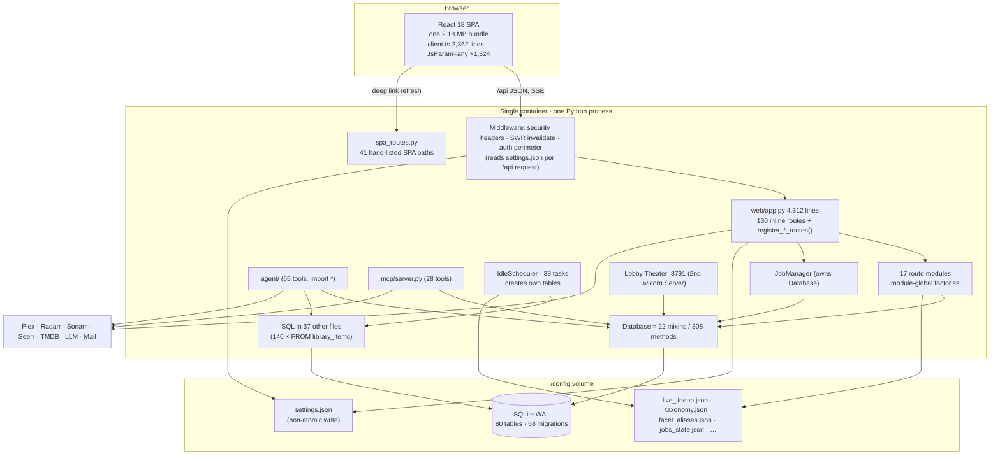
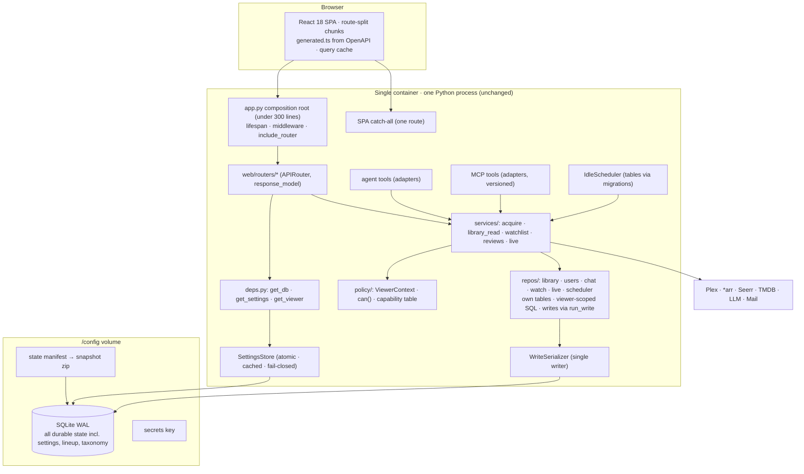

# 08 · Senior Architecture Team (ARCH) — run 2026-10-28-2

Commit reviewed: **`94fcd3f`** (`origin/main`, 1.37.72 + PR #188). All `path:line` citations are from that commit (`git show 94fcd3f:path`, `git grep -n … 94fcd3f`), not the laptop working tree, which is 36 commits behind. Live probes were read-only `GET` requests against QA `http://10.10.1.202:8792` (health `{"status":"ok","version":"1.37.72"}`, Path A image of `94fcd3f`, **not** CA/prod proof). Prod `:8788`, smartmap `:8790`, prod theater `:8791`, and the VIP CDN were not touched.

---

# Part A — Conclusions & findings

## 1. Bottom line

**Grade: C+.** Projectionist sits on the right foundations for a household self-hosted product. It is a modular monolith in one container on SQLite WAL, with a dedicated write serializer, numbered migrations, an idle scheduler with a watchdog, and well-kept CSS tokens (ARCH-001, ARCH-002, ARCH-003, ARCH-004). None of the big technology choices should change. What drags the grade down is the layer above those foundations. Quality gates run but do not block merges, so `main` has been red for days (ARCH-007). Configuration and authorization fail *open* because they are spread across files and call sites instead of living in one place (ARCH-008, ARCH-015). The schema does not record who owns which rows, so account deletion is incomplete (ARCH-009). **The single most important fix** is to make CI and Lint required checks and get `main` green (ARCH-007), because every other fix in this document depends on a gate that actually stops regressions. **The single most important thing to protect** is the single-container SQLite WAL + write-serializer core (ARCH-001). It is the reason a homelab owner can run, back up, and upgrade this app without operating a database.

## 2. Key conclusions

1. **The technology stack has earned "Keep"; the cost lives in structure, not in the choice of tools.**
   FastAPI, SQLite WAL, React 18 + Vite, and in-process jobs each fit a one-household Unraid app (ARCH-001, ARCH-003). Switching any of them is XL work with no user-visible gain: Postgres or Redis would add containers that Unraid owners must run, and a frontend rewrite would mean redoing about 95k lines. The prior architecture letter reached the same verdict ("modular monolith on SQLite", `docs/reviews/2026-07-architecture-code-review.md:258-269`), and the team already keeps written reopen gates, such as the 10k-title embedding threshold (ARCH-006). The roadmap should spend nothing on migrating the stack and everything on boundaries, contracts, and gates.

2. **The safety net exists, but it is not connected to the merge button.**
   There are 2,696 backend test functions with a 76.74% coverage gate, 23 Playwright specs on an isolated port, and a Docker smoke job (ARCH-005). Even so, the **CI** and **Lint** workflows have failed on every `main` commit since 2026-10-27, and CI has failed since 2026-10-24. PR #188, the commit under review, merged with `test` and `Backend (ruff + mypy)` both failing. The repository ruleset has no required status checks (ARCH-007). The root cause is release pressure: 155 version bumps and 614 commits in 90 days, against a ruleset that only blocks deletion and force-push. Type checking skips the packages that change most (ARCH-017), and a 15–25 minute CI loop makes "merge and fix later" tempting (ARCH-023). Required checks have to come first. Without them, every later refactor is unprotected.

3. **Configuration and policy fail open because each is assembled per call site instead of owned by one module.**
   `settings.json` is rewritten in place without a temp-file-and-rename step. It is then re-read and decrypted on every `/api` request, and a parse failure silently falls back to defaults. The default is `multi_user_enabled = False`, which means "no login, everyone is owner" (ARCH-008). Authorization works the same way. 61 owner and 58 any-user dependencies are hand-placed across `app.py`. The youth gate shows up 240 times across 32 files, plus a post-filter that guesses which lists are title lists from their shape. `/api/actions/propose` and `/api/actions/confirm` let any signed-in user trigger Radarr/Sonarr adds, while the MCP text says that is owner-only (ARCH-015, ARCH-022). These are the same root cause: no single policy or config module that every entry point must go through. The fix is an atomic, cached, fail-closed settings store and one `policy` module shared by REST, the agent, and MCP.

4. **The schema does not model who owns what, so deletion and backup are best-effort.**
   Six tables carry `user_id` with no foreign key to `users`. I ran `Database.delete_user` from the reviewed commit against a temp database: it left rows behind in `user_title_reviews`, `pending_actions`, `llm_usage`, `rating_prompt_queue`, and `user_memory_events` (ARCH-009). Durable state is also split across SQLite and at least five JSON files, and the admin snapshot zip only includes `settings.json` and the database (ARCH-014). The scheduler creates five tables outside the migration list. 140 `FROM library_items` queries live outside the DB package, against 47 inside it (ARCH-024). Comments still claim foreign keys are off when they are on (ARCH-018). The data model is good at the table level (ARCH-002) but has no aggregate boundaries. The fix: add foreign keys or an ownership registry, put all state under one manifest, and move SQL into repositories.

5. **The contract between Python and the SPA is unwritten, and it fails in visible ways.**
   Only 28 of about 350 API routes declare a `response_model`. On the SPA side, `JsParam` is an alias for `any` and is used 1,324 times, and 263 of 274 `api()` calls in `client.ts` are untyped (ARCH-020, ARCH-021). Routing is listed twice: React Router has one table and FastAPI keeps its own hand-written SPA allow-list. As a result, refreshing `/whisper`, `/explore/related`, `/lists`, or `/collections` on QA returns `{"detail":"Not Found"}` JSON instead of the app (ARCH-010). TypeScript `strict: true` is effectively decorative. Generating the client from OpenAPI, plus a single SPA fallback route, turns these runtime surprises into compile errors.

6. **Friction is concentrated in five files, and they grow faster than they are split.**
   The friction files are `projectionist/web/app.py` (4,312 lines, 130 routes, 91 commits in 90 days), `frontend/src/api/client.ts` (2,352 lines, 289 exports, 55 commits), `frontend/src/pages/ConfigPage.tsx` (2,053 lines, 38 `useState`, 56 commits), the `projectionist/agent/tools/` star-import package (733 F405 lint errors), and `projectionist/config_store.py` plus `settings.json` (183 `_settings()` call sites in `web/`) (ARCH-019, ARCH-016, ARCH-017, ARCH-008). Extraction has started (`register_*_routes`, DB mixins, the `publish.py` split in #188), but new features still land in the god files. The next quarter should freeze growth in those five files with lint-enforced size budgets (ARCH-025) and pull out one bounded context per sprint.

7. **The frontend has a strong styling foundation and a weak delivery foundation.**
   Tokens are well kept: 3,480 `var(--…)` uses and only 7 raw hex values outside `01-tokens.css` (ARCH-004). That means the Design Director's token system can land without a rewrite. However, every surface, including `/login`, downloads one 2.18 MB JavaScript bundle. It would be about 646 KB gzipped, but QA serves it uncompressed (PERF-007). There are zero `React.lazy` boundaries, and Help and Privacy markdown are inlined into the main chunk (ARCH-012). There is no shared data layer, just 1,016 `useState` and 272 `useEffect` calls with per-page fetches (ARCH-016). There are no component tests (ARCH-026). Route-level splitting and a typed query cache are cheap and fit the current React 18 + Vite 5 stack.

## 3. Foundations challenged

| Assumption | Evidence for | Evidence against | Verdict | Cost of change | Rationale |
|---|---|---|---|---|---|
| **FastAPI** as the web framework | Pydantic models already used (89 `BaseModel` classes in `web/`); SSE via `sse-starlette`; OpenAPI built in (`app.py:438`) | Only 28 `response_model` declarations, so OpenAPI is barely used; 292 sync handlers share the default threadpool | **Keep** | Switching (Litestar/Django): XL, about 390 routes | The framework is not the problem; under-using its contract features is (ARCH-021). |
| **SQLite WAL, single file, no Postgres** | Write serializer (`_schema.py:36-68`), 58 recorded migrations, FKs on (`_users.py:770`); 5,391 titles on QA; TECH-DEBT reopen gate is measured | 169 `connect()` calls outside the DB package; scheduler writes bypass `run_write` | **Keep** | Postgres: XL (80 tables, 308 DB methods, every install must migrate, single-file backup lost) | Fits the household scale and the backup story; tighten the boundary instead (ARCH-024). |
| **No Redis / no queue product** | In-process `IdleScheduler` with heartbeat and quarantine (`scheduler/engine.py:1-37`); one process, no `workers` | 22 module-level caches and an in-memory rate limiter assume exactly one process | **Keep** | Redis + RQ/Celery: L, plus a second container per install | A second container is a real cost for Unraid owners; one process is a feature. Document "exactly one worker" as an invariant. |
| **In-process background jobs** | 33 task modules, sequential runs avoid write contention, quarantine after 3 failures | Quarantine state is memory-only (prior M6 still open); 5 scheduler tables live outside migrations | **Keep, harden** | Move tables into migrations: S | (ARCH-003, ARCH-014) |
| **React 18 SPA + Vite 5** | 95k lines of TSX/TS/CSS; mature ecosystem; Vite builds fast | One 2.18 MB bundle; no lazy routes; Vite dev proxy points at `:8788` | **Keep** | Rewrite: XL. Route splitting: S | (ARCH-012, ARCH-011) |
| **TypeScript "strict"** | `tsconfig.json` has `strict`, `noImplicitAny` | `JsParam = any` (`api/types.ts:13`) used 1,324 times; `JsonObject` has an `any` index (`types.ts:7-10`) | **Change** | M–L, file by file | Strict mode that is aliased to `any` gives false confidence (ARCH-020). |
| **Global layered CSS + tokens** | 18 sheets imported once (`styles.css:5-…`); token discipline is excellent | 20,696 lines of global CSS; file names follow features, not components | **Keep tokens; Change scoping later** | Moving to CSS modules per component: L, incremental | (ARCH-004) |
| **`settings.json` as the config store** | Simple for env-plus-file merge; secrets encrypted at rest | Non-atomic write; re-read per request; fails open to defaults | **Change** | S (atomic write + cache + fail-closed), M (move to SQLite) | (ARCH-008) |
| **Per-route authorization decorators** | Simple and visible | REST vs MCP vs agent disagree on *arr write roles; youth gate in 32 files | **Change** | L | (ARCH-015, ARCH-022) |
| **Hub-first, release-per-PR cadence** | Fast feedback for one maintainer | 155 bumps in 90 days while CI and Lint are red | **Change** | XS (required checks) | (ARCH-007) |
| **`curatorx_*` cookie/DB twins** | Avoids a breaking CA change (`client.ts:33`, TECH-DEBT frozen list) | Minor naming confusion | **Keep** until a planned breaking minor | S | Low architectural cost; not worth a breaking change on its own. |
| **MCP SDK pinned `<2`** | `pyproject.toml` `mcp = ["mcp>=1.30.0,<2"]` | The v1 line will age out | **Investigate** | M | Plan the FastMCP move before v1 security fixes stop. |
| **Agent tool count frozen, no plugin framework** | TECH-DEBT frozen list | The tools package split via `import *` broke lint | **Keep the freeze; Change the packaging** | S | (ARCH-017) |
| **Lobby Theater on a second port in the same process** (added) | One deploy unit (`web/__main__.py:136-146`) | Shares the process, settings, and DB with the member app | **Keep** | — | Sensible for LAN; no findings beyond shared-settings risk (ARCH-008). |

## 4. If we built it today

Starting from zero with what we now know, Projectionist would still be **one Python process, one SQLite file, one React SPA**. The differences would be in seams:

- **One composition root of about 150 lines** that wires routers built with `APIRouter` plus FastAPI dependencies (`Depends(get_db)`, `Depends(get_settings)`), not module-global factories set by `register_*` functions.
- **A `services/` layer of capabilities** (acquire, library query, watchlist, reviews, live) that REST routes, agent tools, and MCP tools all call. Authorization and youth scoping happen once in a `policy` module through a `ViewerContext`.
- **Repositories per aggregate** (library, users, chat, watch, live) that own their tables and SQL. All writes go through `run_write`. Every table, including scheduler tables, comes from the migration list, and every user-owned table has `ON DELETE CASCADE` to `users`.
- **All durable state in SQLite.** `settings`, the live lineup, and the taxonomy overlay become tables. The only files left are the DB, the secrets key, and caches that are safe to delete.
- **A generated contract.** Pydantic response models produce `openapi.json`, which produces `frontend/src/api/generated.ts`, which a typed query hook layer consumes. The SPA fallback is one catch-all route.
- **Route-split SPA** with CSS co-located per feature on top of the existing tokens.
- **Required gates** (lint, types, unit, e2e smoke) at under 10 minutes, with nightly full e2e.

**The gap:** most of this is decomposition and wiring, not a rewrite. Closing it is worth doing in the order of Section 10. The safety items (ARCH-007, ARCH-008, ARCH-009, ARCH-010) are days of work. The structural items (ARCH-015, ARCH-019, ARCH-021, ARCH-022, ARCH-024) are a 2–3 quarter program that can ship continuously.

## 5. Findings by surface

**Public** (`/login`, `/join`, `/setup`, `/privacy`, `/about`, `/help`). These routes are all on the server's SPA allow-list, so deep links work. The architectural problems are inherited. A first-time visitor on `/login` downloads the whole bundle: 2.18 MB, because the origin does not compress it (PERF-007), or about 646 KB once gzip is enabled. That includes Help and Privacy markdown and `hls.js` (ARCH-012). The setup and auth decision depends on a `settings.json` read that fails open (ARCH-008). Priority: route splitting, then the settings fix. **Grade: C+** (ARCH-008, ARCH-012).

**Consumer** (chat, Explore, Play, Live, Inbox, Library, My Journey, settings). Real deep links fail: refreshing `/whisper` or `/explore/related` (linked from Help, `docs/HELP.md:22`) returns raw JSON on QA (ARCH-010). Youth safety depends on call-site discipline. The Explore slow rails, including Continue Watching, are built with no viewer context (`library/explore_hub.py:327-339`) and are then scrubbed by a post-filter that guesses list shape (`youth/apply.py:67-73`) (ARCH-015). Untyped payloads mean schema drift shows up as runtime blanks rather than compile errors (ARCH-020). Priority: the SPA fallback (XS), then a single viewer-scoped query layer. **Grade: C** (ARCH-010, ARCH-012, ARCH-015, ARCH-020).

**Owner** (Admin sections, *arr, Live Channels, Tasks, Health, Newsletters). The owner surface carries the most structural debt. `ConfigPage.tsx` renders eight admin sections from one component with 38 `useState` calls (ARCH-016). Saving settings is the non-atomic write that every request then re-reads (ARCH-008). The snapshot zip leaves out the Live lineup and taxonomy overlay (ARCH-014). *arr proposals are reachable through three separately implemented paths (ARCH-022). The idle scheduler is a strength (ARCH-003). **Grade: C** (ARCH-003, ARCH-008, ARCH-014, ARCH-016, ARCH-022).

**Admin.** There is no separate platform-admin role; the household owner is the admin (platform map §1). There are **no admin-only architecture findings** beyond the Owner ones above. The cross-cutting delivery findings, red gates (ARCH-007) and untyped core packages (ARCH-017), hit the maintainer acting as admin hardest. **Grade: C+** (ARCH-007, ARCH-017).

## 6. Findings by theme

- **Module boundaries.** Best: the DB package split into topic mixins plus the write serializer (ARCH-001). Worst: `app.py` as a 4,312-line composition root with 130 inline routes and 57 unused imports, plus three parallel capability entry points (ARCH-019, ARCH-022). Direction: services, then routers, with import-linter contracts (ARCH-025).
- **Data model.** Best: numbered migrations, FKs on, an orphan audit in migrations (ARCH-002). Worst: user ownership missing from six tables, so deletion leaves orphans (ARCH-009). State is split across JSON files (ARCH-014), and SQL is spread across 37 files (ARCH-024). Direction: cascade FKs, a state manifest, repositories.
- **API design.** Best: one consistent `{"detail": …}` error envelope that the SPA parses defensively (`lib/apiError.ts`). Worst: 28 response models across about 350 routes, an untyped `Dict` body on `/api/actions/propose` (`app.py:2462-2463`), no error codes (the SPA matches the text `"Thread not found"`, `hooks/useChatSession.ts:317`), and no pagination standard (ARCH-021). Direction: response models plus OpenAPI codegen; add `code` to error bodies.
- **Frontend architecture.** Best: token discipline (ARCH-004). Worst: a single bundle (ARCH-012), `any`-aliased types (ARCH-020), god components with no data layer (ARCH-016), and a duplicated route table (ARCH-010).
- **Testing & quality.** Best: a broad backend suite, isolated e2e, docker-smoke (ARCH-005). Worst: gates do not block (ARCH-007), there are zero component tests (ARCH-026), and CI takes 15–25 minutes serially (ARCH-023).
- **Developer experience.** Best: written architecture and tech-debt records with measured gates (ARCH-006). Worst: the Vite proxy targets `127.0.0.1:8788`, which on the maintainer's machine is often an SSH tunnel to prod (ARCH-011). There is no Python lockfile (ARCH-013), and mypy skips the core (ARCH-017).

## 7. Stop doing

1. **Stop merging on red.** No PR merges while `test` or `Backend (ruff + mypy)` fail. Make them required (ARCH-007).
2. **Stop adding routes to `projectionist/web/app.py`, functions to `frontend/src/api/client.ts`, or sections to `ConfigPage.tsx`.** New work goes into a domain router, a generated client, or a section component (ARCH-019, ARCH-020, ARCH-016).
3. **Stop writing `FROM library_items` outside `projectionist/library/`.** Add a repository method instead (ARCH-024).
4. **Stop creating tables outside `migrations.py`** (scheduler, anniversary, gap analysis, syllabus) (ARCH-014).
5. **Stop adding new JSON state files under `DATA_DIR`.** Use SQLite tables (ARCH-014).
6. **Stop splitting packages with `from … import *`.** Use explicit imports (ARCH-017).
7. **Stop expressing authorization in tool descriptions or docstrings** ("owner only") without a matching policy check in code (ARCH-015).
8. **Stop hand-maintaining the SPA path allow-list** in `spa_routes.py` (ARCH-010).
9. **Stop shipping a version bump for every merged PR** while gates are red. Batch releases when `main` is green (ARCH-007).

## 8. Strengths worth protecting

- **SQLite WAL + write serializer + lock-retry** (ARCH-001). Keep a single writer thread, short-lived reader connections, and `busy_timeout`. Do not add a second process.
- **Ordered, recorded migrations with FKs on** (ARCH-002). Every schema change gets a numbered migration. Never edit a shipped one.
- **Idle scheduler with heartbeat watchdog and quarantine** (ARCH-003). Keep tasks sequential and cooperative.
- **Token-first CSS** (ARCH-004). Raw hex stays inside `01-tokens.css`.
- **Broad backend suite, isolated e2e port, docker-smoke** (ARCH-005). Keep the coverage floor and port 8799.
- **Evidence-gated decisions** (ARCH-006). Keep "reopen only when measured" rules in TECH-DEBT.md.

## 9. Risks of inaction (6–12 months)

- **Unrecoverable `main`.** At about 1.7 releases per day with red gates, the failing e2e specs become "known flaky," real regressions hide among them, and a Hub tag ships a broken Explore or Live path to every CA install (ARCH-007).
- **Silent auth bypass after a crash.** A power cut during an admin settings save on Unraid leaves `settings.json` empty or truncated. The app then boots and serves every LAN client as owner with no login, and only logs a warning (ARCH-008).
- **Deletion that is not deletion.** A household removes a member, and reviews, pending actions, LLM usage, and memory events stay keyed to that member's id. This contradicts the Privacy page and any future export or erasure promise (ARCH-009).
- **Youth leaks from new features.** Each new rail or tool must remember the youth gate. One that forgets, or returns item shapes the post-filter does not recognize, shows R-rated titles to youth accounts (ARCH-015).
- **Restore that loses Live.** An owner restores from the Admin snapshot and finds the Live lineup and taxonomy overlay gone (ARCH-014).
- **Velocity collapse in the five god files.** Every feature touches `app.py`, `client.ts`, or `ConfigPage.tsx`, so merge conflicts and review cost keep rising (ARCH-019, ARCH-016, ARCH-020).

## 10. Recommended direction

**Strategy: harden first, then carve seams, then generate contracts.** Do not migrate the stack.

- **Weeks 0–2 (Now):** required checks and a green `main` (ARCH-007). Atomic, fail-closed settings with an mtime cache (ARCH-008). Cascade FKs and a complete `delete_user` (ARCH-009). SPA fallback (ARCH-010). Vite proxy on its own port (ARCH-011). Python lockfile (ARCH-013). Comment and CHECK drift (ARCH-018). Architecture fitness tests that freeze god-file growth (ARCH-025).
- **Weeks 2–6 (Next):** route-level code splitting (ARCH-012). A state manifest and full snapshot (ARCH-014). A `policy` module with `ViewerContext`, first for *arr and the youth gate (ARCH-015). mypy over `web/` and `agent/` (ARCH-017). Parallel CI (ARCH-023). Begin `ConfigPage` decomposition (ARCH-016).
- **6+ weeks (Later):** a capability service layer shared by REST, agent, and MCP (ARCH-022). `app.py` down to a composition root (ARCH-019). Response models plus a generated TypeScript client (ARCH-021, ARCH-020). Repositories (ARCH-024). Component tests (ARCH-026).

**90-day success indicators:** `main` green on 100% of merges for 30 consecutive days; `projectionist/web/app.py` under 2,000 lines; `JsParam` uses under 600; mypy covering `web/` and `agent/`; a CI wall clock under 12 minutes; zero orphaned `user_id` rows after `delete_user` in a regression test; zero JSON 404s for any `AppRoutes.tsx` path in a parity test.

## 11. Scorecard

Scale 1 (poor) – 5 (excellent).

| Surface | Modularity | Contract & types | Data integrity | Testability | Delivery safety | One-line reason |
|---|---|---|---|---|---|---|
| Public | 3 | 3 | 2 | 3 | 2 | Routes are fine; the bundle is shared, and auth depends on a fail-open settings read. |
| Consumer | 2 | 2 | 3 | 3 | 2 | Deep links 404, youth policy is spread out, payloads are `any`-typed. |
| Owner | 2 | 2 | 2 | 3 | 2 | ConfigPage god component, three *arr paths, incomplete snapshot. |
| Admin (= owner) | 2 | 2 | 2 | 3 | 2 | Same code as Owner; the maintainer bears the red-gate cost. |

---

# Part B — Detailed findings

## 12. Scope & method

**Reviewed:** backend `projectionist/` (about 117k Python lines across 337 files), frontend `frontend/src/` (about 95k non-test lines across 533 files), `tests/` (211 files, 2,696 test functions), `e2e/` (23 specs), `.github/workflows/`, `Dockerfile`, `pyproject.toml`, `frontend/package.json`, `frontend/vite.config.js`, `docs/ARCHITECTURE.md`, `docs/TECH-DEBT.md`, and `docs/reviews/2026-07-architecture-code-review.md` (the prior architecture letter, not a department file from this run).

**Methods:**
- Line counts and grep metrics on `git show 94fcd3f:…`.
- 90-day churn from `git log 94fcd3f --since=2026-07-29`.
- `ruff check` (local 0.15.22) on a `git archive` export of `94fcd3f` in `/tmp`.
- `Database(...)` from that export instantiated against a throwaway temp file to inspect the migrated schema (80 tables, 79 indexes, 60 FK clauses) and to run `delete_user` against seeded rows.
- GitHub Actions run history and failure logs, plus the repository ruleset, via `gh`.
- Read-only `curl GET` on QA `:8792` for the SPA bundle and deep-link status codes.

**Not reviewed / limits:**
- No runtime profiling or load testing; Performance owns those.
- The full test suite was not re-run locally; CI logs were used instead.
- No member-role write probes on QA. The member *arr propose/confirm path (ARCH-015) is from code reading only.
- N+1 queries were only scanned heuristically (none obvious).
- A browser screenshot attempt on QA failed (tool error), so no `arch_*.png` exists; deep-link evidence is `curl` output.
- Codegraph was not used for cites because it indexes the stale working tree.
- Live **On**, Play, and LLM-backed chat were not exercised.

## 13. Strengths

### ARCH-001: Protect the single-container SQLite WAL core with its dedicated write serializer

| Field | Value |
|---|---|
| Type | Strength |
| Surface | Cross-cutting |
| Persona(s) | New owner, established owner at scale, maintainer |
| Category | Data architecture / concurrency |
| Severity | High |
| Impact | 5 |
| Effort | XS |
| Confidence | Confirmed |
| Priority score | 15.0 |
| Verdict | Protect |
| Dependencies | Underpins ARCH-008, ARCH-014, ARCH-024 |
| Labels | sqlite, wal, concurrency, protect |

**Evidence:**
- `projectionist/library/db/_schema.py:36-68`: `WriteSerializer` on a dedicated thread; `run_write`/`try_run_write` wrap `run_with_db_lock_retry`.
- `projectionist/library/db/_users.py:754-771`: per-connection `busy_timeout`, `journal_mode=WAL`, `synchronous=NORMAL`, `foreign_keys=ON`.
- `projectionist/library/db/_schema.py:74-83`: WAL `PASSIVE` checkpoint on close.
- `docs/ARCHITECTURE.md` §"SQLite concurrency model".
- No second worker process (`projectionist/web/__main__.py:98-146`).

**Current state:** One file under `/config`, readers on short-lived WAL connections, writers funneled to one thread with retry. A 5,391-title library runs on it (QA overview).

**Root cause:** A deliberate choice to fit Unraid/homelab operations: one volume, no DBA, a trivially backed-up file.

**Recommendation:** Keep it. Codify the invariant "exactly one app process; all mutations via `run_write`" in `docs/ARCHITECTURE.md` and enforce it with a fitness test (ARCH-025) that flags `INSERT|UPDATE|DELETE` executed outside a `run_write` closure in new code.

**Rationale:** Postgres or Redis would make every Unraid owner run and upgrade more containers to gain concurrency a household never needs. **Protect this:** do not add `--workers`, multiprocessing, or a second writer path.

**User story:** As an established owner, I want my library to live in one file so that backup and upgrade are a single step.

**Acceptance criteria:**
- [ ] `docs/ARCHITECTURE.md` states the one-process / one-writer invariant.
- [ ] A fitness test fails when a new module issues a write outside `run_write` (allow-list for existing sites).

**Success metric:** Zero "database is locked" errors surfaced to users in Logs over 30 days on Automat prod.

**Validation:** `grep -c "database is locked"` in Admin → Logs export after a 30-day window.

### ARCH-002: Protect numbered, recorded schema migrations with foreign keys enforced

| Field | Value |
|---|---|
| Type | Strength |
| Surface | Cross-cutting |
| Persona(s) | Owner upgrading, maintainer |
| Category | Data model / migrations |
| Severity | High |
| Impact | 4 |
| Effort | XS |
| Confidence | Confirmed |
| Priority score | 12.0 |
| Verdict | Protect |
| Dependencies | Enables ARCH-009, ARCH-014 |
| Labels | migrations, schema_version, fk |

**Evidence:**
- `projectionist/library/db/migrations.py:255-316`: 58 ordered `(version, name, fn)` entries.
- `migrations.py:320`: `run_migrations` records each in `schema_version`.
- `migrations.py:54-75`: FK orphan cleanup as migration 34 before `PRAGMA foreign_keys=ON`.
- Temp-DB instantiation: `schema_version` max 58, count 58; init in 0.33 s on an empty DB.

**Current state:** Upgrades are deterministic and idempotent. Integrity steps are migrations, not ad-hoc boot calls.

**Root cause:** Prior review items M1/M2 were implemented properly.

**Recommendation:** Keep it. Require every new table, *including scheduler and task tables* (ARCH-014), to be added as a numbered migration. Never edit a shipped migration body. Add a CI test that builds a DB from migration 1 and compares it with `sqlite_master` from a fixture of the previous release.

**Rationale:** CA installs upgrade across many versions at once; ordered migrations are what make that safe. **Protect this:** no `CREATE TABLE` outside `migrations.py`-registered functions.

**User story:** As an owner who skips five releases, I want the upgrade to apply cleanly so that I never hand-edit the database.

**Acceptance criteria:**
- [ ] A test asserts `max(schema_version) == len(MIGRATIONS)` on a fresh DB.
- [ ] An upgrade test from the previous release fixture passes in CI.

**Success metric:** Zero upgrade-related issues filed per release.

**Validation:** Run the upgrade fixture test in CI on every PR.

### ARCH-003: Protect the idle scheduler's watchdog, sequential runs, and quarantine

| Field | Value |
|---|---|
| Type | Strength |
| Surface | Owner |
| Persona(s) | Established owner at scale |
| Category | Background jobs |
| Severity | Medium |
| Impact | 4 |
| Effort | XS |
| Confidence | Confirmed |
| Priority score | 8.0 |
| Verdict | Protect |
| Dependencies | ARCH-014 (its tables), ARCH-024 (its writes) |
| Labels | scheduler, watchdog, in-process |

**Evidence:**
- `projectionist/scheduler/engine.py:1-37`: idle-only, sequential, heartbeat-extended timeout, quarantine after `QUARANTINE_THRESHOLD`.
- `engine.py:161-242`: `IdleScheduler.register/record_activity/should_stop`.
- 33 task modules under `projectionist/scheduler/tasks/`.

**Current state:** Enrichment, embeddings, digests, and Live guide work run without a queue product and yield to chat.

**Root cause:** Designed for SQLite single-writer reality.

**Recommendation:** Keep it. Two hardening items: (1) move `scheduled_tasks`, `scheduled_task_runs`, `daily_anniversaries`, `cached_gap_analysis`, and `user_syllabus_sessions` into numbered migrations (ARCH-014); (2) route `engine.py` writes (`update_task` at `engine.py:528-550`, `retire_tasks` at `engine.py:877-885`) through `db.run_write`.

**Rationale:** This is the main reason "no Redis" stays true. **Protect this:** do not add a second scheduler or thread pool for tasks (TECH-DEBT already freezes this).

**User story:** As an owner, I want background enrichment to pause while my family is chatting so that the app stays responsive.

**Acceptance criteria:**
- [ ] Scheduler tables are created only via `MIGRATIONS`.
- [ ] `grep run_write projectionist/scheduler/engine.py` is non-zero.

**Success metric:** p95 chat first-token latency is unchanged while the scheduler is active (Performance to measure).

**Validation:** Existing scheduler tests plus a new migration-ownership test.

### ARCH-004: Protect token-first styling so the design system can land without a rewrite

| Field | Value |
|---|---|
| Type | Strength |
| Surface | Cross-cutting |
| Persona(s) | All UI personas; Design Director |
| Category | Frontend styling |
| Severity | Medium |
| Impact | 3 |
| Effort | XS |
| Confidence | Confirmed |
| Priority score | 6.0 |
| Verdict | Protect |
| Dependencies | — |
| Labels | css, tokens, theming |

**Evidence:**
- 3,480 `var(--…)` uses across `frontend/src/**/*.css`.
- Only 7 hex literals outside `frontend/src/styles/01-tokens.css`.
- 11 `!important` across 20,696 CSS lines.
- 34 inline `style={{` in TSX.
- Themes via `html[data-theme]` (platform map §1).

**Current state:** Changing a token re-themes the app. Lights Down and Lights Up are token swaps.

**Root cause:** Disciplined token layer from early on.

**Recommendation:** Keep it. Add a stylelint rule (`color-no-hex` with `01-tokens.css` exempt; `declaration-no-important`) to the `lint` script so the count stays at 7 and 11 or below.

**Rationale:** This is why the Design Director's proposed token set can be applied by editing one file. **Protect this:** no raw colors or spacing outside tokens.

**User story:** As a low-vision member, I want theme and size changes to apply everywhere so that no screen stays unreadable.

**Acceptance criteria:**
- [ ] Stylelint runs in `npm run lint` and fails on new hex outside tokens.

**Success metric:** Hex-outside-tokens count stays at 7 or below.

**Validation:** `git grep -E '#[0-9a-fA-F]{3,8}\b' -- 'frontend/src/styles/*.css' ':!…01-tokens.css' | wc -l`.

### ARCH-005: Protect the broad backend suite, isolated e2e port, and Docker smoke

| Field | Value |
|---|---|
| Type | Strength |
| Surface | Cross-cutting |
| Persona(s) | Maintainer |
| Category | Testing |
| Severity | High |
| Impact | 4 |
| Effort | S |
| Confidence | Confirmed |
| Priority score | 6.0 |
| Verdict | Protect |
| Dependencies | Only effective once ARCH-007 lands |
| Labels | pytest, playwright, docker-smoke, coverage |

**Evidence:**
- CI log for `94fcd3f`: "2749 passed, 43 skipped … Total coverage: 76.74%".
- `.github/workflows/ci.yml:48` (`--cov-fail-under=74`).
- `ci.yml` `docker-smoke` job builds the image and polls `/api/health`.
- 23 Playwright specs on port 8799 (AGENTS.md; `.cursor/rules/e2e-port-8788.mdc`).
- `tests/test_api_authz.py` clears the rate limiter between cases.

**Current state:** A strong backend net and a real container boot test.

**Root cause:** Sustained investment since the prior review (M9 / H6).

**Recommendation:** Keep it. Raise the coverage floor by 1 point per minor release to 80%. Keep e2e on 8799. Add an upgrade-fixture test (ARCH-002) and route-parity test (ARCH-010).

**Rationale:** This is what makes the refactors in this document safe, *once it blocks merges* (ARCH-007). **Protect this:** never lower `--cov-fail-under`; never point e2e at 8788.

**User story:** As the maintainer, I want a failing test to stop a bad merge so that households never receive a regression.

**Acceptance criteria:**
- [ ] Coverage floor is 75 or higher in `pyproject.toml` and `ci.yml` (kept in sync).
- [ ] The docker-smoke job stays required.

**Success metric:** Coverage at 80% or above within two minors.

**Validation:** CI summary line.

### ARCH-006: Protect evidence-gated technology decisions in TECH-DEBT.md

| Field | Value |
|---|---|
| Type | Strength |
| Surface | Cross-cutting |
| Persona(s) | Maintainer, contributors |
| Category | Developer experience / governance |
| Severity | Medium |
| Impact | 3 |
| Effort | XS |
| Confidence | Confirmed |
| Priority score | 6.0 |
| Verdict | Protect |
| Dependencies | — |
| Labels | adr, governance, tech-debt |

**Evidence:**
- `docs/TECH-DEBT.md` "Frozen" table: SQLite WAL reopen gate "only if write-lock warnings are measured and libraries routinely exceed ~10–20k"; embeddings measured at 5,426 rows / 0.87 s with a 10k revisit gate.
- `docs/reviews/2026-07-architecture-code-review.md:258-269` "Rewrite vs evolve".

**Current state:** Big decisions have written, measurable reopen conditions.

**Root cause:** Maintainer discipline.

**Recommendation:** Keep it. Add the new invariants from this review as frozen rows: one process; all state in SQLite; no SQL outside repositories; required checks.

**Rationale:** Prevents re-litigating Postgres or Redis every quarter. **Protect this:** every "switch" proposal must cite a measured gate.

**User story:** As a contributor, I want to know which decisions are settled so that I don't propose a rewrite that has already been ruled out.

**Acceptance criteria:**
- [ ] TECH-DEBT.md lists the four new invariants with reopen gates.

**Success metric:** No stack-migration PRs opened without a cited measurement.

**Validation:** Review TECH-DEBT.md in Batch 6 synthesis.

## 14. Weaknesses (sorted by priority score)

### ARCH-007: Make CI and Lint required checks and restore a green `main`

| Field | Value |
|---|---|
| Type | Weakness |
| Surface | Cross-cutting |
| Persona(s) | Maintainer; every household receiving Hub tags |
| Category | Testing & delivery gates |
| Severity | High |
| Impact | 5 |
| Effort | S |
| Confidence | Confirmed |
| Priority score | 7.5 |
| Verdict | Fix |
| Dependencies | Blocks the safety of every other ARCH item; relates to ARCH-017, ARCH-023 |
| Labels | ci, branch-protection, ruff, playwright, release |

**Evidence:**
- `gh run list --branch main`: **CI failure** on every main run on 2026-10-24 through 2026-10-29 (21 runs), including `94fcd3f`. **Lint failure** on every main run since 2026-10-27.
- `gh pr view 188` checks: `test FAILURE`, `Backend (ruff + mypy) FAILURE`, merged anyway.
- Ruleset 21060399 rules: `deletion`, `non_fast_forward`, and `pull_request` with `required_approving_review_count: 0`. **No `required_status_checks`.** `gh api …/branches/main/protection` returns "Branch not protected".
- CI failures at `94fcd3f`: `e2e/explore.spec.ts:10` ("loads feed rails, pulse, and Related titles hub") and `e2e/mobile-native.spec.ts:210`.
- Lint failure: 737 ruff errors, 733 of them F405 from `from projectionist.agent.tools._helpers import *` (`projectionist/agent/tools/library.py:5` and 9 siblings), plus F821 `Tuple` at `projectionist/live_channels/publish_programming.py:1182` and `ToolRegistry` at `agent/tools/_helpers.py:652`.
- 155 `_version.py` changes in 90 days.

**Current state:** The test and lint jobs run, report red, and nothing stops the merge or the Hub publish.

**Root cause:** Release-per-PR cadence plus a ruleset that never listed status checks. Red becomes normal once it is not blocking.

**Recommendation:**
1. Fix the two e2e specs and the lint errors on a single `fix/green-main` PR. Replace the star imports with explicit `from … import (…)` lists. Add `from typing import Tuple` at `publish_programming.py`. Move `ToolRegistry` references under `TYPE_CHECKING`.
2. Edit ruleset 21060399 to add `required_status_checks` with `strict: true` for the contexts `test`, `docker-smoke`, `Backend (ruff + mypy)`, and `Frontend (eslint + prettier)`.
3. Have `scripts/docker-release.sh` refuse to publish unless `gh run list --commit $(git rev-parse HEAD) --workflow CI --json conclusion` is `success`.

**Rationale:** Every other recommendation here is a refactor; refactors without a blocking gate cause regressions. Nightly-only or "advisory" checks were rejected because the last week shows advisory checks are ignored. Cost: about 1–2 days, plus the occasional blocked merge.

**User story:** As the maintainer, I want a failing test to block the merge so that a broken Explore never reaches a household's Hub update.

**Acceptance criteria:**
- [ ] `gh api repos/romwil/projectionist/rulesets/21060399` shows `required_status_checks` with the four contexts.
- [ ] `main` CI and Lint are green on the merge of the fix PR.
- [ ] `docker-release.sh` exits non-zero on a commit without green CI.

**Success metric:** 100% of merges to `main` have green required checks for 30 consecutive days.

**Validation:** `gh run list --branch main --limit 50 --json conclusion` shows all `success` after the fix date.

### ARCH-008: Write settings atomically, cache them in memory, and fail closed on parse errors

| Field | Value |
|---|---|
| Type | Weakness |
| Surface | Cross-cutting |
| Persona(s) | Owner, every household member, youth |
| Category | Configuration architecture |
| Severity | High |
| Impact | 5 |
| Effort | S |
| Confidence | Likely |
| Priority score | 6.0 |
| Verdict | Fix |
| Dependencies | Relates to ARCH-014, ARCH-015 |
| Labels | settings, atomic-write, fail-closed, auth |

**Evidence:**
- `projectionist/config_store.py:840-845`: `Settings.save` calls `path.write_text(...)`, which truncates and rewrites in place. No temp file, no `os.replace`, no fsync. 16 save call sites across 6 modules.
- `config_store.py:856-868`: `_load_settings_file_data` returns `{}` on `JSONDecodeError`, with only a warning log.
- `config_store.py:882-…`: `load_merged_settings` re-reads and decrypts on every call.
- `config_store.py:487`: default `multi_user_enabled: bool = False`. There is no env override for it in `ENV_TO_FIELD`.
- `projectionist/web/auth.py:88-89`: `_settings()` is `load_merged_settings`. `auth.py:497-504`: the auth middleware calls `_settings()` per `/api` request and passes through when multi-user is off. `auth.py:516-519`: `get_current_user` returns `bootstrap_owner(db)` when multi-user is off.
- `projectionist/web/app.py:936-937`: `_settings()` is the same; 183 `_settings()` call sites in `projectionist/web/`.
- Contrast: an atomic writer already exists at `projectionist/facets/overlay.py:83-93` (`mkstemp` + `os.replace`).

**Current state:** A reader that lands during a write, or a power loss mid-write, gets an empty or partial file. That parses as `{}`, which becomes `Settings()`, which means single-owner mode: every LAN request is treated as the owner with no login. The WAN interlock still blocks non-LAN requests.

**Root cause:** Settings are modeled as "a file we read whenever we need it" rather than a versioned, owned store.

**Recommendation:**
1. Implement `config_store._atomic_write_json(path, payload)`: write to `path.with_suffix(".json.tmp")`, `flush` + `os.fsync`, `os.replace`, `chmod 0o600`. Use it in `Settings.save` and `migrate_plaintext_settings_secrets` (`config_store.py:1035`).
2. Add `SettingsStore` with an in-memory cache keyed by `(st_mtime_ns, st_size)` and a `threading.Lock`; `load_merged_settings` returns the cached object while the stat is unchanged.
3. **Fail closed:** if `settings.json` exists but fails to parse or decrypt, raise `SettingsCorruptError`. The middleware then returns 503 `{"detail":"Settings unreadable; restore settings.json"}` for `/api/*` except `/api/health`. Never fall back to defaults when the file exists.
4. Later (ARCH-014): move settings into a SQLite `settings` table written through `run_write`.

**Rationale:** This is an availability and confidentiality risk created by structure, not by a bug in one route. A temp-file-and-rename is the standard fix and costs about 40 lines. A file lock alone was rejected (it does not survive power loss); moving straight to SQLite was rejected as the *first* step (M effort versus S).

**User story:** As an owner, I want a crash during "Save settings" to leave my household still requiring login so that a power blip never opens my library to everyone on the LAN.

**Acceptance criteria:**
- [ ] A unit test truncates `settings.json` to 0 bytes; `GET /api/auth/me` returns 503, not an owner payload.
- [ ] A unit test kills a writer mid-save (simulated via a partial tmp file); the original file is intact.
- [ ] `load_merged_settings` does at most one disk read per mtime change (counter test).

**Success metric:** `settings.json` reads per `/api` request drop from at least 1 to about 0 (measured by counter); zero fail-open paths in an authz test.

**Validation:** New tests in `tests/test_config_store_atomic.py`; manual: on QA `:8792`, `: > /config/settings.json`, then confirm 503 and no owner session.

### ARCH-009: Give every user-owned table a cascading foreign key and make `delete_user` complete

| Field | Value |
|---|---|
| Type | Weakness |
| Surface | Owner |
| Persona(s) | Owner removing a member; removed member |
| Category | Data model / integrity |
| Severity | High |
| Impact | 4 |
| Effort | S |
| Confidence | Confirmed |
| Priority score | 6.0 |
| Verdict | Fix |
| Dependencies | ARCH-002 (migration mechanism); relates to ARCH-018 |
| Labels | schema, foreign-keys, deletion, privacy |

**Evidence:**
- Migrated schema from `94fcd3f` (temp DB): 24 tables have `user_id`; 18 have an FK to `users`. **No FK:** `llm_usage`, `pending_actions`, `preference_facts`, `rating_prompt_queue`, `user_memory_events`, `user_title_reviews`.
- `projectionist/library/db/_users.py:186-193`: `delete_user` calls `purge_user_memory_and_chats` and then `DELETE FROM users`.
- `projectionist/library/db/_memory.py:282-…`: deletes chats, watch rows, saved pages, notes, and preference facts, but not reviews, pending actions, LLM usage, rating prompts, or memory events.
- **Reproduction** (temp DB, reviewed code): seeded one row each, called `db.delete_user(uid)`. Result after: `users 0`, `watchlist_pins 0` (cascade works), and `user_title_reviews 1`, `pending_actions 1`, `llm_usage 1`, `rating_prompt_queue 1`, `user_memory_events 2` (the purge itself added one).
- Stale comments: `_chat.py:250` and `_memory.py:285` say FKs are disabled; `_users.py:770` enables them.

**Current state:** Removing a member leaves their reviews, LLM usage, and memory events in the DB, keyed to a dead id.

**Root cause:** Ownership is enforced by a hand-maintained list in one purge function rather than by the schema.

**Recommendation:**
1. Migration 59 `user_owned_fk_cascade`: for each of the 6 tables, rebuild with `user_id TEXT REFERENCES users(id) ON DELETE CASCADE` (SQLite needs create-copy-drop-rename). Delete orphans first, as migration 34 did.
2. Have `user_memory_events` record the purge in an owner-scoped audit table (`account_purge_log(user_id_hash, purged_at, counts_json)`) instead of a row keyed to the deleted user.
3. Add a test that enumerates `sqlite_master` and asserts every column named `user_id` has an FK to `users` with `ON DELETE CASCADE` or `SET NULL`.

**Rationale:** Deletion must be real for household trust and for any Privacy page promise. A schema rule is cheaper to keep correct than a purge list that every new feature must remember. Soft-delete was rejected because the product has no restore story for members.

**User story:** As an owner, I want removing a household member to remove everything tied to them so that their reviews and chat-derived memory don't linger.

**Acceptance criteria:**
- [ ] Schema test: every `user_id` column has an FK action.
- [ ] Reproduction above returns 0 for all six tables.
- [ ] Comments at `_chat.py:250` and `_memory.py:285` are corrected.

**Success metric:** Orphaned `user_id` rows = 0 in an Automat DB copy after the migration.

**Validation:** SQL: `SELECT COUNT(*) FROM <t> WHERE user_id NOT IN (SELECT id FROM users)` for each table returns 0.

### ARCH-010: Serve the SPA for every non-API GET instead of a hand-written path list

| Field | Value |
|---|---|
| Type | Weakness |
| Surface | Consumer |
| Persona(s) | Returning consumer, power consumer (deep links, bookmarks, refresh) |
| Category | Routing / frontend–backend contract |
| Severity | Medium |
| Impact | 3 |
| Effort | XS |
| Confidence | Confirmed |
| Priority score | 6.0 |
| Verdict | Fix |
| Dependencies | — |
| Labels | spa, routing, deep-links |

**Evidence:**
- `projectionist/web/spa_routes.py:61-192`: 41 explicit `@router.get` SPA paths.
- `frontend/src/AppRoutes.tsx:87` (`/whisper`), `:92` (`/explore/related`), `:110` (`/lists`), `:112` (`/collections`) have no server counterpart.
- QA `:8792` `curl`: `/whisper` → `404 application/json`; `/explore/related` → `404 application/json` with body `{"detail":"Not Found"}`; `/lists` and `/collections` → 404 JSON. Control: `/explore/tags` → `200 text/html`.
- `/explore/related` is linked from `docs/HELP.md:22` and `:227`, `frontend/src/lib/backNav.ts:23`, and `lib/relationUx.ts:152-161`.

**Current state:** In-app navigation works through React Router, but refresh, a new tab, a bookmark, or a shared link to these pages shows raw JSON.

**Root cause:** Two route tables (React Router and FastAPI) maintained by hand.

**Recommendation:** In `register_spa_routes`, after the asset mounts, add one catch-all `@router.get("/{full_path:path}", include_in_schema=False)`. It returns `_serve_index()` when the path does not start with `api/`, `mcp`, `assets/`, or `static/` and the `Accept` header contains `text/html`, and otherwise raises 404. Register it **last** (after all API routers). Keep explicit legacy redirects such as `/tour`. Delete the 41 per-path decorators. Add a test that parses `AppRoutes.tsx` `path=` values, substitutes params, and asserts `200 text/html` for each.

**Rationale:** One source of truth removes a whole class of bugs. Generating the server list from `AppRoutes.tsx` at build time was rejected because a catch-all is simpler and standard for SPAs.

**User story:** As a member, I want a bookmarked Related titles page to open after a refresh so that I can share it with the household.

**Acceptance criteria:**
- [ ] `curl -H 'Accept: text/html' :8792/explore/related` returns `200 text/html`.
- [ ] `curl :8792/api/nonexistent` still returns 404 JSON.
- [ ] The route-parity test passes for every `AppRoutes.tsx` path.

**Success metric:** Zero JSON 404s for SPA paths (parity test).

**Validation:** Parity test plus manual refresh on QA.

### ARCH-011: Point the Vite dev proxy at a dedicated local port, never 8788

| Field | Value |
|---|---|
| Type | Weakness |
| Surface | Cross-cutting |
| Persona(s) | Maintainer, contributors |
| Category | Developer experience / environment safety |
| Severity | Medium |
| Impact | 3 |
| Effort | XS |
| Confidence | Likely |
| Priority score | 4.8 |
| Verdict | Fix |
| Dependencies | — |
| Labels | vite, dev-proxy, environments |

**Evidence:**
- `frontend/vite.config.js:29`: `"/api": "http://127.0.0.1:8788"`.
- Repo rule `.cursor/rules/automat-environments.mdc`: "Local `localhost:8788` is often an **SSH tunnel to prod**".
- `AGENTS.md` instructs running local dev on `PORT=8788`.

**Current state:** `npm run dev` on a machine with the prod tunnel open sends every SPA request, including mutations, to prod.

**Root cause:** The default port is shared by local dev, prod, and the tunnel convention.

**Recommendation:** Change the proxy to `process.env.PROJECTIONIST_DEV_API ?? "http://127.0.0.1:8798"`. Change `AGENTS.md`, `README.md`, and `TESTING.md` dev instructions to `PORT=8798`. Keep e2e on 8799. Add a startup log line in Vite that prints the proxy target.

**Rationale:** Prevents accidental writes to the household's prod library during frontend work. Cost: minutes.

**User story:** As the maintainer, I want `npm run dev` to never reach prod so that a UI experiment can't change my household's lists.

**Acceptance criteria:**
- [ ] `vite.config.js` contains no `8788`.
- [ ] Docs use 8798 for local dev.

**Success metric:** `git grep 8788 -- frontend/ AGENTS.md README.md TESTING.md` only matches prod references.

**Validation:** Run `npm run dev` with nothing on 8798 and confirm the proxy error instead of a prod response.

### ARCH-012: Split the SPA bundle by route and move docs and HLS out of the entry chunk

| Field | Value |
|---|---|
| Type | Weakness |
| Surface | Cross-cutting (worst on Public `/login` and mobile Consumer) |
| Persona(s) | First-time member, low-bandwidth mobile user |
| Category | Frontend architecture / bundle |
| Severity | Medium |
| Impact | 3 |
| Effort | S |
| Confidence | Confirmed |
| Priority score | 3.0 |
| Verdict | Fix |
| Dependencies | — |
| Labels | vite, code-splitting, bundle |

**Evidence:**
- QA `:8792/login` HTML references one script, `/assets/index-buFnxk8x.js`: **2,178,954 bytes raw / 647,373 gzip**, plus `/assets/index-DlGI-Pbi.css` at 344,428 raw / 56,968 gzip.
- 0 `lazy(` across `frontend/src`.
- `frontend/vite.config.js:20-23`: no `manualChunks`.
- `frontend/src/pages/HelpPage.tsx:5` and `PrivacyPage.tsx:5` import `@docs/*.md?raw` into the graph.
- `hls.js` string present in the entry bundle.

**Current state:** Every visitor, including a guest on `/login`, parses the whole app: admin, Live studio, player, and docs.

**Root cause:** Static imports for all 64 pages in `AppRoutes.tsx`.

**Recommendation:** In `AppRoutes.tsx`, convert page imports to `const X = lazy(() => import("./pages/X"))` for every route except `/login`, `/chat`, and `/explore`. Wrap `<Routes>` in `<Suspense fallback={<RouteSkeleton/>}>`. Load `hls.js` with dynamic `import("hls.js")` inside `LibraryPlayer`/`LivePlayer`. Add `build.rollupOptions.output.manualChunks: { react: ["react","react-dom","react-router-dom"], markdown: ["react-markdown","remark-gfm","rehype-sanitize"] }`. Budget: entry chunk under 250 KB gzip, enforced by a size check script in CI.

**Rationale:** Cheap, reversible, and fits the existing Vite 5 setup. An SSR framework was rejected because there is no SEO need and it would double the runtime model. Performance owns the measurement; architecture owns the structure.

**User story:** As a member on a phone, I want the sign-in page to load quickly so that I can get to tonight's pick.

**Acceptance criteria:**
- [ ] `vite build` emits at least 10 chunks; entry is under 250 KB gzip.
- [ ] `/login` network panel shows no `hls` or admin chunk.

**Success metric:** Entry JS gzip goes from 647 KB to under 250 KB.

**Validation:** `ls -la frontend/dist/assets` plus a size script in CI.

### ARCH-013: Lock Python dependencies for reproducible Hub images

| Field | Value |
|---|---|
| Type | Weakness |
| Surface | Cross-cutting |
| Persona(s) | Maintainer, every CA install |
| Category | Build reproducibility |
| Severity | Medium |
| Impact | 3 |
| Effort | S |
| Confidence | Confirmed |
| Priority score | 3.0 |
| Verdict | Fix |
| Dependencies | ARCH-007 |
| Labels | dependencies, lockfile, docker |

**Evidence:**
- `pyproject.toml` `[project.optional-dependencies]` uses floors only (`fastapi>=0.115.0`, `uvicorn[standard]>=0.32.0`, `pydantic>=2.0.0`, …).
- `Dockerfile:63`: `pip install ".[web,mcp]"`.
- No `requirements*.txt`, `uv.lock`, or `constraints` at the repo root.
- The CI log for `94fcd3f` resolved `fastapi-0.162.0 starlette-1.10.0 pydantic-2.14.1`.
- `requires-python = ">=3.10"` while Docker, CI, and mypy use 3.12 only.
- Frontend has `package-lock.json` (good).

**Current state:** Two builds of the same tag a week apart can ship different framework versions.

**Root cause:** Library-style packaging for an application.

**Recommendation:** Adopt `uv`. Commit `uv.lock` (or `pip-compile` → `requirements.lock` with hashes). Install in Docker with `pip install --require-hashes -r requirements.lock && pip install --no-deps .`. Set `requires-python = ">=3.12,<3.13"`. Let Dependabot bump the lock.

**Rationale:** A self-hosted image must be reproducible for "it worked yesterday" support. The cost is one file and a Dependabot config.

**User story:** As the maintainer, I want the same tag to always contain the same libraries so that I can reproduce a household's bug.

**Acceptance criteria:**
- [ ] A lockfile is committed; the Docker build uses it.
- [ ] `requires-python` matches the tested interpreter.

**Success metric:** Two rebuilds of one tag produce identical `pip freeze`.

**Validation:** Run `pip freeze` in two images built a day apart.

### ARCH-014: Put all durable state under one manifest and include it in the snapshot

| Field | Value |
|---|---|
| Type | Weakness |
| Surface | Owner |
| Persona(s) | Owner restoring from backup; established owner |
| Category | Data model / state management |
| Severity | Medium |
| Impact | 4 |
| Effort | M |
| Confidence | Confirmed |
| Priority score | 2.67 |
| Verdict | Rethink |
| Dependencies | ARCH-002, ARCH-008 |
| Labels | state, backup, json-files, migrations |

**Evidence:**
- JSON state files in `DATA_DIR`:
  - `settings.json` (`config_store.py`)
  - `live_lineup.json` (`live_channels/lineup_client.py:1`)
  - `taxonomy.json` and `facet_aliases.json` (`facets/overlay.py:41`, `facets/registry.py:575-576`)
  - `jobs_state.json` (`scheduler/engine.py` docstring)
  - `sonarr_missing_last.json` (`library/sonarr_missing.py:24`)
- `projectionist/web/backup.py:27-59`: the snapshot zip writes only `settings.json` and the DB.
- Tables created outside migrations: `scheduler/engine.py:720` (`scheduled_tasks`), `scheduler/run_history.py:41`, `scheduler/tasks/anniversary_scanner.py:38`, `scheduler/tasks/gap_analysis.py:55`, `syllabus/__init__.py:19`.
- 22 module-level `*CACHE*` globals across 14 modules.

**Current state:** Restoring the Admin snapshot loses Live channel lineup and taxonomy overlays. Schema ownership is split between `migrations.py` and five other modules.

**Root cause:** No rule for where durable state lives; features chose files or self-created tables case by case.

**Recommendation:**
1. Add `projectionist/state_manifest.py` listing every durable artifact: `{name, kind: sqlite|json|secret, path, required_for_restore}`.
2. `build_admin_snapshot_zip` iterates the manifest (DB backup API for SQLite; copy for JSON; never the secrets key) and writes `manifest.json` into the zip.
3. Migrations 60–64 adopt the 5 self-created tables (using `CREATE TABLE IF NOT EXISTS`, so existing installs are fine) and delete the `_ensure_table` code.
4. Next, move `live_lineup.json` and the taxonomy overlay into tables (`live_lineup(version, payload_json, updated_at)`).
5. A test asserts no `CREATE TABLE` outside registered migrations and no `DATA_DIR / "*.json"` write outside the manifest.

**Rationale:** Backup and restore is the owner's only disaster recovery. A manifest makes "what is state?" answerable in one file. Moving everything to SQLite in one step was rejected as too large; the manifest gives correctness now.

**User story:** As an owner, I want "Download snapshot" to restore my whole house, Live channels included, so that a dead disk doesn't cost me an evening of re-setup.

**Acceptance criteria:**
- [ ] The snapshot zip contains `manifest.json` and every `required_for_restore` artifact.
- [ ] A restore test: build zip, restore to empty `DATA_DIR`, and Live lineup and taxonomy match.
- [ ] No `CREATE TABLE` outside migrations (fitness test).

**Success metric:** Restore drill reports 0 missing artifacts.

**Validation:** Automated restore test in CI; manual drill on QA `:8792` with Live On.

### ARCH-015: Centralize authorization and youth scoping in one policy module used by every entry point

| Field | Value |
|---|---|
| Type | Weakness |
| Surface | Cross-cutting (Consumer youth, Owner *arr) |
| Persona(s) | Youth member, member, owner |
| Category | Module boundaries / authorization architecture |
| Severity | High |
| Impact | 5 |
| Effort | L |
| Confidence | Likely |
| Priority score | 2.4 |
| Verdict | Rethink |
| Dependencies | ARCH-022 (shared services), ARCH-024 (repositories) |
| Labels | authz, youth, policy, mcp, agent |

**Evidence:**
- Role checks are per-route decorators: `app.py` has 61 `require_role("owner")` and 58 `Depends(get_current_user_dep)`; `library_routes.py` 10/44; `chat_routes.py` 0/10 (counts from `git show 94fcd3f`).
- `projectionist/web/app.py:2462-2463`: `POST /api/actions/propose` takes an untyped `Dict` body with `user=Depends(get_current_user_dep)` (any signed-in user) and handles `add_radarr`/`add_sonarr`. `app.py:2636-2640`: `POST /api/actions/confirm` is likewise any-user. `agent/tools/confirmed.py:158-…`: `execute_confirmed_action` has no role check. By contrast, `mcp/server.py:898` text says "via POST /api/actions/confirm as an authenticated owner"; the platform map says *arr writes are owner-only.
- Youth: 240 references across 32 files outside `projectionist/youth/`.
- `library/explore_hub.py:327-339`: slow rails (`continue_watching`, `on_this_day`, `director_spotlight`, `genre_spotlight`, `seasonal_spotlight`) are built with no `user_id` and no `youth_max_rating`.
- `youth/apply.py:67-73`: the post-filter only filters lists whose items contain `content_rating` or `rating_key`; other shapes pass through unchanged.
- "owner only" appears in agent tool *descriptions* (`agent/tools/_definitions.py:474`, `:1239`, `:1257`).

**Current state:** Correctness depends on every route, rail, and tool author remembering the right check. Three entry points (REST, agent, MCP) express the same rule differently. Not exercised: a member `propose` + `confirm` of `add_radarr` on QA (no write probes were made). Confidence is Likely from code.

**Root cause:** No policy layer. Authorization is an attribute of the HTTP handler, not of the capability or the data query.

**Recommendation:**
1. Create `projectionist/policy/__init__.py` with a frozen `ViewerContext(user_id, role, is_youth, youth_max_rating, multi_user)` built once per request (FastAPI dependency) and once per agent or MCP call.
2. Define `can(viewer, capability: Capability) -> bool` with an explicit table: `ARR_ADD: owner`, `SEERR_REQUEST: member+`, `SEERR_APPROVE: owner`, `COLLECTION_PUBLISH: owner`, and so on.
3. `propose_action`, `confirm_action`, `ToolRegistry`, and MCP tools call `policy.require(viewer, cap)`, which raises a 403 / tool error.
4. Every library read goes through a repository method that takes a `ViewerContext` and applies the rating gate **in SQL** (`allowed_rating_labels`, `youth/rating_gate.py:103-…`). `explore_hub` slow rails receive the viewer.
5. Keep `filter_payload_for_youth` only as defense in depth. Make it fail closed: drop any list of mappings that has an `id`/`item_id`/`tmdb_id` but no `content_rating`.
6. Add a parametrized test: for every capability × role × youth, assert REST, agent, and MCP agree.

**Rationale:** The household threat model (youth safety, member versus owner *arr writes) is the product's trust promise. A single table is reviewable; 240 call sites are not. An OPA or Casbin engine was rejected as excess for about 20 capabilities.

**User story:** As a parent (owner), I want the youth rating limit and owner-only actions enforced in one place so that a new rail or chat tool can't accidentally bypass them.

**Acceptance criteria:**
- [ ] `policy.CAPABILITIES` table exists; `propose_action` and `confirm_action` call `policy.require`.
- [ ] A member `POST /api/actions/propose {"action":"add_radarr",…}` returns 403 (test).
- [ ] Explore slow rails take a `ViewerContext`; a youth fixture sees no TV-MA/R item in any rail (test).
- [ ] The REST/agent/MCP parity test passes.

**Success metric:** Youth-gate references outside `policy/` and repositories drop from 240 to under 40.

**Validation:** New tests; Interactive UI QA youth checklist on `:8792`.

### ARCH-016: Decompose `ConfigPage.tsx` and introduce a shared data layer for the SPA

| Field | Value |
|---|---|
| Type | Weakness |
| Surface | Owner |
| Persona(s) | New owner, established owner |
| Category | Frontend architecture / components & state |
| Severity | Medium |
| Impact | 3 |
| Effort | M |
| Confidence | Confirmed |
| Priority score | 2.0 |
| Verdict | Rethink |
| Dependencies | ARCH-020/ARCH-021 for typed hooks |
| Labels | react, god-component, state, data-fetching |

**Evidence:**
- `frontend/src/pages/ConfigPage.tsx`: 2,053 lines; `export default function ConfigPage()` at `:383`; 38 `useState`, 12 `useEffect`, 90 `JsParam`. It renders `overview`, `connections`, `libraries`, `persona`, `household`, `live-channels`, `seerr`, and `advanced` via `showSection` (`:389`). Routed as the catch-all `<Route path=":section" element={<ConfigPage />}>` (`AppRoutes.tsx:139`).
- 56 commits in 90 days (JSX + TSX).
- App-wide: 1,016 `useState`, 272 `useEffect`, 4 `createContext`, 0 query-cache library. `lib/authGate.ts` hand-rolls a module-level promise cache; 16 direct `getFeatures()` callers.

**Current state:** Every admin-section change edits one shared form state, which causes merge conflicts and re-renders and makes one section's bug break all eight.

**Root cause:** The admin surface grew inside one "settings blob" component; there is no data layer to share server state.

**Recommendation:**
1. Create `frontend/src/pages/admin/sections/{Overview,Connections,Libraries,Persona,Household,LiveChannels,Seerr,Advanced}Section.tsx`, each owning its fields and a `useSettingsSection(sectionKey)` hook that PATCHes only its keys.
2. Replace `:section → ConfigPage` with explicit `<Route path="connections" element={<ConnectionsSection/>}/>` and so on.
3. Adopt `@tanstack/react-query` v5 (about 13 KB gzip). Wrap `getFeatures`/`getAuthMe` in `useFeatures()`/`useAuthMe()` with `staleTime: 60_000`, and delete the hand-rolled promise cache in `authGate.ts`.
4. Budget: no component file over 600 lines (fitness test, ARCH-025).

**Rationale:** Isolated sections make owner fixes small and testable. Redux/Zustand were rejected because the state is server state, so a query cache fits. A big-bang rewrite was rejected; move one section per PR.

**User story:** As an owner, I want fixing the Seerr settings not to risk breaking my Plex connection settings.

**Acceptance criteria:**
- [ ] `ConfigPage.tsx` deleted or under 300 lines (shell only).
- [ ] Each section has its own route and file.
- [ ] `getFeatures()` is called only inside `useFeatures()`.

**Success metric:** Monthly commits touching the admin god file drop from about 19 to 0.

**Validation:** `git log --since=30.days -- frontend/src/pages/ConfigPage.tsx | wc -l`; e2e admin specs green.

### ARCH-017: Extend mypy to the core packages and replace star-import packaging in agent tools

| Field | Value |
|---|---|
| Type | Weakness |
| Surface | Cross-cutting |
| Persona(s) | Maintainer, contributors |
| Category | Type safety / developer experience |
| Severity | Medium |
| Impact | 3 |
| Effort | M |
| Confidence | Confirmed |
| Priority score | 2.0 |
| Verdict | Fix |
| Dependencies | ARCH-007 |
| Labels | mypy, ruff, typing, agent-tools |

**Evidence:**
- `pyproject.toml:158-…` mypy `files` covers only `_version.py`, `logging_config.py`, `config_store.py`, and `connectors`, `lists`, `memory`, `models`, `persona`, `privacy`, `reviews`, `telemetry`. It excludes `web/` (17.2k lines), `library/` (37.0k), `live_channels/` (15.4k), `agent/` (9.1k), and `scheduler/` (8.3k).
- `pyproject.toml:141`: `app.py` ignores `F401`, `E402`, `F821`. Ruff on `app.py` shows 57 unused imports (`app.py:187-206` re-exports from `web.setup`).
- `agent/tools/{acquire,confirmed,library,lists,memory,plex,prompt,registry,research,reviews}.py:5`: `from …_helpers import *`, which causes 733 F405 and the current Lint failure.
- 662 function-local `from projectionist.` imports (a cycle-avoidance symptom).

**Current state:** About 87k lines of the most-changed code have no static type checking. The tools package compiles only because of star imports.

**Root cause:** The type-checking baseline was scoped to what was already clean and never expanded; the tools split used `import *` as a shortcut.

**Recommendation:**
1. Replace each star import with explicit names (ruff `--fix` can generate them after removing `F403` from `noqa`).
2. Add `projectionist/web`, `projectionist/agent`, `projectionist/scheduler` to mypy `files` with `[[tool.mypy.overrides]] module = "projectionist.web.app" ; ignore_errors = true` as a temporary pin, burning down one module per PR.
3. Remove `F401` and `F821` from the `app.py` per-file ignores after deleting the dead imports.
4. Enable `ruff` rule `TID252` (relative imports) and `PLC0415` (import-outside-toplevel) as warnings to track the 662.

**Rationale:** Types are the cheapest guard for the refactors in ARCH-019, ARCH-022, and ARCH-024. Pyright was rejected in favor of staying on the existing mypy toolchain.

**User story:** As a contributor, I want a typo in a helper name to fail lint so that it doesn't fail at runtime in a household's chat.

**Acceptance criteria:**
- [ ] `ruff check .` passes with no `F403`/`F405`.
- [ ] mypy `files` includes `web`, `agent`, `scheduler`.

**Success metric:** mypy-covered lines go from about 15% to 60% of `projectionist/` within 2 quarters.

**Validation:** `python -m mypy` in the Lint job.

### ARCH-018: Fix schema and comment drift (FK comments, `guest` role CHECK)

| Field | Value |
|---|---|
| Type | Weakness |
| Surface | Cross-cutting |
| Persona(s) | Contributors |
| Category | Data model hygiene |
| Severity | Low |
| Impact | 2 |
| Effort | XS |
| Confidence | Confirmed |
| Priority score | 2.0 |
| Verdict | Fix |
| Dependencies | ARCH-009 |
| Labels | schema, docs-drift |

**Evidence:**
- `library/db/_chat.py:250` and `_memory.py:285` say `PRAGMA foreign_keys` is not enabled; `_users.py:770` enables it.
- `_schema.py:161`: `users.role CHECK (role IN ('owner','member','guest'))` and `_schema.py:1441`: `invites.role CHECK (role IN ('member','guest'))` remain after migration 48 `drop_guest_role` (`migrations.py:302`; `_schema.py:2091-2098` only rewrites rows).

**Current state:** Misleading comments lead contributors to write manual cascades. The schema still accepts the retired `guest` role.

**Root cause:** Migrations changed behavior without updating constraints or comments.

**Recommendation:** Fix both comments in the ARCH-009 PR. In the same table rebuild, tighten the CHECKs to `('owner','member')` and `('member')`.

**Rationale:** Keeps the "Guest is not a household role" decision enforced by the schema.

**User story:** As a contributor, I want comments and constraints to match runtime so that I don't write defensive code for a mode that no longer exists.

**Acceptance criteria:**
- [ ] `INSERT INTO users(role) VALUES ('guest')` fails.
- [ ] No comment claims FKs are off.

**Success metric:** n/a (hygiene).

**Validation:** Schema test.

### ARCH-019: Finish reducing `projectionist/web/app.py` to a composition root

| Field | Value |
|---|---|
| Type | Weakness |
| Surface | Cross-cutting |
| Persona(s) | Maintainer, contributors |
| Category | Module boundaries |
| Severity | Medium |
| Impact | 4 |
| Effort | L |
| Confidence | Confirmed |
| Priority score | 1.6 |
| Verdict | Rethink |
| Dependencies | ARCH-017, ARCH-022 |
| Labels | god-file, fastapi, routers, di |

**Evidence:**
- `projectionist/web/app.py`: 4,312 lines; 130 inline routes; 40 `BaseModel` payload classes defined inline (`app.py:621-916`); 91 commits in 90 days (the top non-version file).
- Router registration is interleaved with route definitions (`app.py:1149`, `:1294-1349`, `:4312`).
- 17 route modules use module-global factory injection (`_db_factory`, `_settings_factory`, `_fastapi_app`), for example `web/chat_routes.py:27-60`.
- `_db()` returns `get_job_manager().db` (`app.py:1080-1081`), so the job manager owns the DB handle.

**Current state:** Most backend features touch `app.py`; tests import it (70 test files reference `projectionist.web.app`).

**Root cause:** Extraction stopped at about a third. Dependency injection is hand-rolled with globals instead of FastAPI `Depends`.

**Recommendation:**
1. Create `projectionist/web/deps.py` with `get_db()`, `get_settings()` (ARCH-008 store), and `get_viewer()` (ARCH-015) as FastAPI dependencies, and an `AppContainer` on `app.state` that owns the `Database`, `JobManager`, and `IdleScheduler`. The DB is no longer an attribute of `JobManager`.
2. Move the remaining 130 routes into `web/routers/{admin,jobs,persona,engagement,notifications,actions,lenses,settings,mail,seerr}.py` as `APIRouter`s.
3. Move payload models to `projectionist/models/api/*.py`.
4. Target: `app.py` under 300 lines (lifespan + middleware + `include_router`).
5. Replace module-global factories with `Depends`, one module per PR, keeping `register_*` shims until tests migrate.

**Rationale:** This is the biggest merge-conflict and review-cost hotspot. Splitting into microservices was rejected; routers inside one process preserve ARCH-001.

**User story:** As a contributor, I want to add a Newsletter endpoint without opening a 4,000-line file.

**Acceptance criteria:**
- [ ] `wc -l projectionist/web/app.py` under 300.
- [ ] Zero `_db_factory`/`_settings_factory` globals in `projectionist/web/`.

**Success metric:** Monthly commits to `app.py` drop from about 30 to under 3.

**Validation:** Churn query; full test suite green.

### ARCH-020: Make TypeScript strictness real by retiring `JsParam` and `JsonObject[any]`

| Field | Value |
|---|---|
| Type | Weakness |
| Surface | Cross-cutting (Consumer and Owner UI) |
| Persona(s) | Contributors; indirectly every member |
| Category | Frontend type safety |
| Severity | Medium |
| Impact | 4 |
| Effort | L |
| Confidence | Confirmed |
| Priority score | 1.6 |
| Verdict | Fix |
| Dependencies | ARCH-021 (generated types) |
| Labels | typescript, any, client |

**Evidence:**
- `frontend/src/api/types.ts:7-10`: `JsonObject = { [key: string]: any }`. `types.ts:13`: `JsParam = any`.
- `JsParam` used 1,324 times across `frontend/src`; 75 explicit `: any`/`as any`.
- `frontend/src/api/client.ts`: 2,352 lines, 289 exported functions, 263 of 274 `api(` calls untyped (default `JsonObject`). `client.ts:44-57` casts `data as T` without validation. 55 commits in 90 days.
- `tsconfig.json` has `strict: true`, `noImplicitAny: true`.

**Current state:** The JS→TS conversion in 1.37.68 kept JS semantics. The compiler cannot catch a renamed backend field.

**Root cause:** Mechanical conversion with an escape hatch and no generated contract.

**Recommendation:**
1. Add ESLint `@typescript-eslint/no-explicit-any: "error"` with a baseline file (`eslint-baseline.json`) so the count can only go down.
2. Change `JsonObject` to `{ [key: string]: unknown }`, then fix compile errors per feature folder.
3. After ARCH-021, re-export generated types and delete hand-written ones in `types.ts`.
4. Split `client.ts` into `api/{chat,library,admin,live,auth}.ts` (each under 400 lines).

**Rationale:** Type errors are the cheapest place to catch schema drift between 117k lines of Python and 95k lines of TS. `zod` runtime validation of every response was rejected as too heavy; use it only at trust boundaries (auth, settings).

**User story:** As a contributor, I want renaming a backend field to fail the frontend build so that members never see a blank card.

**Acceptance criteria:**
- [ ] `JsParam` removed from `types.ts`.
- [ ] `no-explicit-any` enforced with a decreasing baseline.
- [ ] `client.ts` split into domain modules.

**Success metric:** `JsParam` uses go from 1,324 to under 600 in 90 days, and 0 in two quarters.

**Validation:** `git grep -c JsParam -- frontend/src`.

### ARCH-021: Publish a typed API contract: response models, error codes, pagination, generated client

| Field | Value |
|---|---|
| Type | Weakness |
| Surface | Cross-cutting |
| Persona(s) | Contributors; MCP/automation users |
| Category | API design |
| Severity | Medium |
| Impact | 4 |
| Effort | L |
| Confidence | Confirmed |
| Priority score | 1.6 |
| Verdict | Fix |
| Dependencies | ARCH-019 (routers), enables ARCH-020 |
| Labels | openapi, pydantic, errors, pagination |

**Evidence:**
- 28 `response_model=` across about 350 API routes (391 total route decorators, of which 41 are SPA and 6 theater).
- 98 routes in `app.py` return `Dict[str, Any]`.
- `app.py:2462-2463`: `propose_action(payload: Dict[str, Any], …)`.
- Errors are `{"detail": "<text>"}` (442 `HTTPException` in `web/`) with only 3 `"code":` fields; the SPA branches on text (`hooks/useChatSession.ts:317`, `:332`, `:363` match `"Thread not found"`).
- Pagination: 9 `offset: int` params, no cursor, no common envelope.
- No versioning (`/api/*` only), which is acceptable because the SPA ships with the server; MCP is the external client.
- `app.py:438`: `_openapi_exposed()` gate exists.

**Current state:** OpenAPI exists but describes mostly `object`. Error handling keys off English text.

**Root cause:** Routes grew as dict-returning handlers; there was no codegen consumer to demand types.

**Recommendation:**
1. Standard error body: `{"detail": str, "code": str}` via a `ProjectionistHTTPException(code=…)` subclass plus an exception handler; codes such as `thread_not_found`, `auth_required`, `youth_blocked`, `arr_not_configured`.
2. Require `response_model` on every new route (fitness test, ARCH-025) and backfill per router during ARCH-019.
3. Pagination envelope `Page[T] = {items: T[], total: int, next_offset: int|None}` for list endpoints.
4. CI: `python -m projectionist.web.export_openapi > frontend/src/api/openapi.json`, then `npx openapi-typescript openapi.json -o src/api/generated.ts`; the build fails if `generated.ts` is stale.
5. Keep `/api` unversioned for the SPA; version **MCP** tools instead (tool names are the external contract).

**Rationale:** One generated contract replaces three hand-maintained ones (Pydantic, `types.ts`, MCP docs). GraphQL and tRPC were rejected as excessive and not idiomatic for FastAPI.

**User story:** As a contributor, I want the frontend to know the exact shape of `/api/explore/hub` so that adding a rail is type-checked end to end.

**Acceptance criteria:**
- [ ] Error bodies include `code`; SPA checks `error.code === "thread_not_found"`.
- [ ] `openapi.json` + `generated.ts` are produced in CI and committed.
- [ ] Response-model coverage at 50% or above of API routes.

**Success metric:** Response-model coverage goes from 8% to 50% in two quarters.

**Validation:** Script counting routes with `response_model` in `app.routes`.

### ARCH-022: Route REST, agent tools, and MCP through one capability service layer

| Field | Value |
|---|---|
| Type | Weakness |
| Surface | Cross-cutting (Owner *arr / Seerr, Consumer chat) |
| Persona(s) | Owner, member, MCP user |
| Category | Module boundaries / duplication |
| Severity | Medium |
| Impact | 4 |
| Effort | L |
| Confidence | Confirmed |
| Priority score | 1.6 |
| Verdict | Rethink |
| Dependencies | ARCH-015 |
| Labels | duplication, services, mcp, agent |

**Evidence:**
- `save_pending_action(` is called from 7 modules: `web/app.py` (5), `agent/tools/acquire.py` (4), `mcp/server.py` (3), `agent/tools/plex.py` (2), `agent/tools/confirmed.py`, `acquire/__init__.py`, `syllabus/handoff.py`.
- `"add_radarr"` logic appears in `web/app.py` (3), `agent/tools/acquire.py` (3), `mcp/server.py` (2), `agent/tools/confirmed.py` (1).
- 65 agent tool definitions (`agent/tools/_definitions.py`) and 28 MCP tools (`mcp/server.py`) each wrap library/query code independently.
- `projectionist/acquire/__init__.py` shows a shared service has started (used by `agent/tools/acquire.py:138`, `agent/village.py:483`), but REST and MCP do not use it.

**Current state:** A rule change, for example acquisition exclusions, must be made in three or four places.

**Root cause:** Each entry point was built against lower-level modules rather than a shared capability API.

**Recommendation:** Create `projectionist/services/` with `acquire.py` (propose/confirm for radarr/sonarr/seerr), `library_read.py`, `watchlist.py`, `reviews.py`, and `collections.py`. Each function signature is `fn(ctx: ViewerContext, db, settings, **typed_args) -> TypedResult` and calls `policy.require`. REST routes, `ToolRegistry`, and MCP tools become 5–15 line adapters. Start with `acquire` (it fixes the ARCH-015 *arr gap); one service per sprint.

**Rationale:** The MCP "design thesis" (ARCHITECTURE.md) depends on parity between chat and MCP; a shared service guarantees it. A plugin framework was rejected (TECH-DEBT freeze).

**User story:** As an owner using MCP from my desktop, I want the same acquisition rules as in chat so that exclusions and confirms behave identically.

**Acceptance criteria:**
- [ ] `save_pending_action` is called only from `projectionist/services/`.
- [ ] REST/agent/MCP parity tests for acquire pass.

**Success metric:** Modules calling `save_pending_action` drop from 7 to 1.

**Validation:** `git grep -l save_pending_action -- projectionist`.

### ARCH-023: Parallelize CI and split fast gates from the full e2e run

| Field | Value |
|---|---|
| Type | Weakness |
| Surface | Cross-cutting |
| Persona(s) | Maintainer |
| Category | Testing / CI speed |
| Severity | Low |
| Impact | 3 |
| Effort | S |
| Confidence | Confirmed |
| Priority score | 1.5 |
| Verdict | Fix |
| Dependencies | ARCH-007 |
| Labels | ci, pytest-xdist, playwright |

**Evidence:**
- CI wall clock on main: 18.7, 21.6, 24.6 minutes (last three runs).
- pytest alone: "2749 passed … in 937.14s (0:15:37)".
- `.github/workflows/ci.yml:48-49`: pytest then `npm run test:e2e` serially in one step.
- No `pytest-xdist` in `[dev]` (`pyproject.toml` `dev`).

**Current state:** A 20-minute loop encourages merging before results arrive, which reinforces ARCH-007.

**Root cause:** One serial job.

**Recommendation:** Add `pytest-xdist` and run `pytest -n auto --dist loadfile` (tests already clear rate limits per test; fix any shared-`DATA_DIR` collisions by using `tmp_path`). Split into jobs `unit-py`, `unit-fe`, `e2e` (with Playwright `--shard=1/2`, `2/2`), and `docker-smoke`. Target under 10 minutes wall clock.

**Rationale:** Faster gates are what make required gates bearable.

**User story:** As the maintainer, I want CI to answer in under 10 minutes so that I wait for green before merging.

**Acceptance criteria:**
- [ ] CI wall clock under 10 minutes on main for 10 consecutive runs.

**Success metric:** Median CI duration under 10 minutes.

**Validation:** `gh run list --json createdAt,updatedAt`.

### ARCH-024: Bound SQL to repositories that own their tables

| Field | Value |
|---|---|
| Type | Weakness |
| Surface | Cross-cutting |
| Persona(s) | Contributors |
| Category | Data access layering |
| Severity | Medium |
| Impact | 3 |
| Effort | L |
| Confidence | Confirmed |
| Priority score | 1.2 |
| Verdict | Rethink |
| Dependencies | ARCH-015, ARCH-022 |
| Labels | repository, sql, coupling |

**Evidence:**
- `FROM library_items` appears 140 times in 37 files **outside** `projectionist/library/db/`, against 47 inside.
- 169 `.connect()` calls in 57 files outside the DB package.
- `Database` composes 22 mixins with 308 methods (`library/db/__init__.py`), despite TECH-DEBT "No new `Database` god methods".
- `scheduler/engine.py` contains 0 `run_write` while writing `scheduled_tasks` (`engine.py:528-550`, `:752-760`, `:877-885`).
- Domain modules import `projectionist.web.jobs` to get the DB (`library/sync.py`, `mcp/server.py:35`).

**Current state:** A column rename on `library_items` touches dozens of files. Youth and privacy filters cannot be enforced at a single query layer (ARCH-015).

**Root cause:** No aggregate ownership; `Database` is a connection plus a grab-bag.

**Recommendation:** Introduce `projectionist/repos/{library,users,chat,watch,live,scheduler}.py`, each owning its tables. Writes go through `db.run_write`; reads take an optional `ViewerContext`. Add an import-linter contract (ARCH-025): only `repos/` and `library/db/` may contain `FROM library_items`. Migrate the call sites with the most churn first (`library/feeds.py`, `library/query.py`, `live_channels/publish*.py`).

**Rationale:** Makes schema changes local and is the prerequisite for SQL-level policy. A full ORM (SQLAlchemy) was rejected because hand-written SQL is fine; ownership is the issue.

**User story:** As a contributor, I want to add a column to library items in one module.

**Acceptance criteria:**
- [ ] Import-linter contract exists and passes with a shrinking allow-list.
- [ ] `scheduler/engine.py` writes use `run_write`.

**Success metric:** Outside-package `FROM library_items` goes from 140 to under 40 in two quarters.

**Validation:** `git grep -c 'FROM library_items' -- projectionist ':!projectionist/repos' ':!projectionist/library/db'`.

## 15. Opportunities

### ARCH-025: Add architecture fitness tests that freeze god-file growth and enforce boundaries

| Field | Value |
|---|---|
| Type | Opportunity |
| Surface | Cross-cutting |
| Persona(s) | Maintainer, contributors |
| Category | Architecture governance |
| Severity | Medium |
| Impact | 4 |
| Effort | S |
| Confidence | Confirmed |
| Priority score | 4.0 |
| Verdict | Add |
| Dependencies | Supports ARCH-001, ARCH-010, ARCH-014, ARCH-019, ARCH-021, ARCH-024 |
| Labels | import-linter, fitness-functions, budgets |

**Evidence:** No import contracts, size budgets, or route-parity tests exist at `94fcd3f` (no `importlinter` config in `pyproject.toml`; no file-size checks in CI). The god files keep growing (Conclusion 6 churn data).

**Current state:** Boundaries are documented (TECH-DEBT "No new Database god methods") but not enforced.

**Root cause:** Rules live in prose.

**Recommendation:** Add `tests/test_architecture_fitness.py` and an `[tool.importlinter]` config:
1. `projectionist.library`, `projectionist.agent`, `projectionist.live_channels`, `projectionist.mcp` must not import `projectionist.web`.
2. File-size budget: fail if `web/app.py` grows past its current 4,312 lines (ratchet down each release); no new `.py` over 1,200 lines or `.tsx` over 600 lines without an allow-list entry.
3. No `CREATE TABLE` outside migration functions.
4. SPA route parity (ARCH-010).
5. New routes must declare `response_model`.

**Rationale:** Cheap, automatic, and stops regression while ARCH-019, ARCH-022, and ARCH-024 proceed over quarters.

**User story:** As the maintainer, I want the build to tell me when a change re-grows a god file so that the decomposition sticks.

**Acceptance criteria:**
- [ ] Fitness tests run in the required `test` job.
- [ ] Ratchet values are stored in `tests/fitness_budgets.json`.

**Success metric:** God-file line counts never increase release over release.

**Validation:** CI.

### ARCH-026: Add a component-test layer for the highest-risk UI modules

| Field | Value |
|---|---|
| Type | Opportunity |
| Surface | Consumer, Owner |
| Persona(s) | Contributors; members via fewer regressions |
| Category | Testing pyramid |
| Severity | Medium |
| Impact | 3 |
| Effort | M |
| Confidence | Confirmed |
| Priority score | 2.0 |
| Verdict | Add |
| Dependencies | ARCH-016 |
| Labels | vitest, testing-library, frontend-tests |

**Evidence:**
- `frontend/package.json` `test:unit`: `node --import tsx --test src/lib/*.test.mjs`. All 162 frontend test files are `lib/` logic.
- 0 component render tests across 122 components and 64 pages.
- 23 Playwright specs carry all UI behavior; the two failing ones (`explore.spec.ts:10`, `mobile-native.spec.ts:210`) are what is blocking CI now.

**Current state:** UI regressions are caught only by slow, flaky-prone e2e.

**Root cause:** The test runner choice (`node --test`) has no DOM.

**Recommendation:** Add `vitest` + `@testing-library/react` + `jsdom` and a `test:component` script. Start with `ChatWorkspace`, `TitleDetailContent`, `LibraryPlayer` controls, the decomposed admin sections (ARCH-016), and `ExplorePage` rail rendering. Target: 40 component tests, run in the required `test` job. Keep `lib/*.test.mjs` on `node --test`.

**Rationale:** Moves UI assertions down the pyramid: faster, more deterministic, and adversarial per `.cursor/rules/ui-testing-architecture.mdc`. Making Playwright component testing the main layer was rejected because it is still slower.

**User story:** As a contributor, I want to test the Explore rail renderer without booting a server.

**Acceptance criteria:**
- [ ] `npm run test:component` exists and runs in CI.
- [ ] At least 40 component tests.

**Success metric:** e2e failures caused by pure rendering logic drop to 0 over a quarter.

**Validation:** CI job output.

## 16. Remediation plan

### Now (0–2 weeks)

| ID | Title | Effort | Owner role | Dependencies |
|---|---|---|---|---|
| ARCH-007 | Required checks + green `main` | S | Maintainer | — |
| ARCH-008 | Atomic, cached, fail-closed settings | S | Backend | — |
| ARCH-009 | Cascade FKs; complete `delete_user` | S | Backend | ARCH-002 |
| ARCH-010 | SPA catch-all + route parity test | XS | Backend | — |
| ARCH-011 | Vite proxy off 8788 | XS | Frontend | — |
| ARCH-013 | Python lockfile | S | Maintainer | ARCH-007 |
| ARCH-018 | Schema/comment drift | XS | Backend | ARCH-009 |
| ARCH-025 | Fitness tests + ratchets | S | Maintainer | ARCH-007 |

**Why this order:** Gates first (ARCH-007), so every later change is protected. Then the three fail-open or data-loss items (ARCH-008, ARCH-009, ARCH-010). Then ratchets (ARCH-025) so god files stop growing before the decomposition starts.

### Next (2–6 weeks)

| ID | Title | Effort | Owner role | Dependencies |
|---|---|---|---|---|
| ARCH-012 | Route-level code splitting | S | Frontend | — |
| ARCH-014 | State manifest + full snapshot; adopt scheduler tables | M | Backend | ARCH-002, ARCH-008 |
| ARCH-015 | Policy module + ViewerContext (acquire + youth first) | L (start) | Backend | — (ARCH-022 builds on it) |
| ARCH-017 | Explicit imports; mypy on web/agent/scheduler | M | Backend | ARCH-007 |
| ARCH-023 | Parallel CI | S | Maintainer | ARCH-007 |
| ARCH-016 | ConfigPage decomposition + query cache (first 3 sections) | M | Frontend | — |

### Later (6+ weeks)

| ID | Title | Effort | Owner role | Dependencies |
|---|---|---|---|---|
| ARCH-022 | Capability service layer for REST/agent/MCP | L | Backend | ARCH-015 |
| ARCH-019 | `app.py` → composition root; `Depends` DI | L | Backend | ARCH-017, ARCH-022 |
| ARCH-021 | Response models, error codes, OpenAPI codegen | L | Full-stack | ARCH-019 |
| ARCH-020 | Retire `JsParam`; split `client.ts` | L | Frontend | ARCH-021 |
| ARCH-024 | Repositories; SQL ownership | L | Backend | ARCH-015, ARCH-022 |
| ARCH-026 | Component test layer | M | Frontend | ARCH-016 |

**Sequencing rationale:** Policy (ARCH-015) and services (ARCH-022) come before routers (ARCH-019) because moving routes first would just relocate the per-route checks. The contract (ARCH-021) comes after routers so models live next to their routers. TS cleanup (ARCH-020) rides on generated types instead of hand-typing 1,324 sites twice. The platform stays shippable throughout: each item is per-module PRs behind the ARCH-025 ratchets.

### Migration path (current → target)

```mermaid
flowchart LR
  subgraph P0["Phase 0 · Now: safety"]
    A1[Required checks<br/>ARCH-007]
    A2[Atomic fail-closed settings<br/>ARCH-008]
    A3[FK cascade + delete_user<br/>ARCH-009]
    A4[SPA catch-all<br/>ARCH-010]
    A5[Fitness ratchets<br/>ARCH-025]
  end
  subgraph P1["Phase 1 · Next: seams"]
    B1[policy + ViewerContext<br/>ARCH-015]
    B2[State manifest<br/>ARCH-014]
    B3[Route splitting<br/>ARCH-012]
    B4[mypy core<br/>ARCH-017]
  end
  subgraph P2["Phase 2 · Later: services and contracts"]
    C1[services/ shared by REST·agent·MCP<br/>ARCH-022]
    C2[routers + Depends DI<br/>ARCH-019]
    C3[repos/ own tables<br/>ARCH-024]
    C4[OpenAPI → generated TS<br/>ARCH-021 / ARCH-020]
  end
  P0 --> P1 --> P2
```

Every phase ends with a shippable Hub tag. No phase requires a data migration other than numbered SQLite migrations (ARCH-009, ARCH-014), which follow the existing ARCH-002 mechanism.

## Architecture diagrams

### Current state (`94fcd3f`)

### Target state (2–3 quarters)

### The five files or modules that cause the most friction

| Rank | File / module | Evidence at `94fcd3f` | Fix |
|---|---|---|---|
| 1 | `projectionist/web/app.py` | 4,312 lines; 130 routes; 91 commits in 90 days; 57 unused imports; F401/E402/F821 ignored (`pyproject.toml:141`) | ARCH-019 |
| 2 | `frontend/src/api/client.ts` (+ `api/types.ts`) | 2,352 lines; 289 exports; 263 of 274 untyped calls; 55 commits in 90 days; `JsParam = any` | ARCH-020, ARCH-021 |
| 3 | `frontend/src/pages/ConfigPage.tsx` | 2,053 lines; 38 `useState`; 8 admin sections; 56 commits in 90 days | ARCH-016 |
| 4 | `projectionist/agent/tools/` (`_helpers.py` + star imports) | 733 F405 errors breaking Lint; 65 tools duplicating REST/MCP capability code | ARCH-017, ARCH-022 |
| 5 | `projectionist/config_store.py` + `settings.json` | 183 `_settings()` call sites in `web/`; non-atomic write; fail-open defaults; 18 commits in 90 days | ARCH-008, ARCH-014 |

Runners-up: `projectionist/library/feeds.py` (2,408 lines, 22 commits), `projectionist/live_channels/publish.py` (1,902 lines, 34 commits; split started in #188), `projectionist/library/db/_schema.py` (2,194 lines).

## 17. Quick wins (high impact, XS–S)

| ID | Win | Effort | Score |
|---|---|---|---|
| ARCH-007 | Add required status checks; fix 2 e2e + star imports | S | 7.5 |
| ARCH-008 | Temp-file + `os.replace` for settings; fail closed on parse error | S | 6.0 |
| ARCH-009 | Migration 59 cascade FKs on 6 tables | S | 6.0 |
| ARCH-010 | One SPA catch-all route | XS | 6.0 |
| ARCH-011 | Vite proxy → 8798 | XS | 4.8 |
| ARCH-025 | Fitness ratchets | S | 4.0 |
| ARCH-012 | `React.lazy` for non-core routes; dynamic `hls.js` | S | 3.0 |
| ARCH-013 | Lockfile | S | 3.0 |

## 18. Open questions needing product/business input

1. **Corrupt-settings behavior.** When `settings.json` is unreadable, should the app return 503 for everything (recommended), or drop into `/setup` with the owner credential from env? Either choice must never fall back to "no login" (ARCH-008).
2. **Member *arr writes.** Is any non-owner path to Radarr/Sonarr intended, or is Seerr the only member acquisition path? The answer sets the `ARR_ADD` row in the policy table (ARCH-015).
3. **Release cadence.** Is about 1.7 Hub releases per day a goal? Would a batched train (for example, at most one release per day, only from green `main`) be acceptable to the household and CA users (ARCH-007)?
4. **Live Channels investment.** Live is about 15.4k backend + 11.5k frontend lines, roughly 13% of the codebase, with the highest churn after `app.py`. Is it a core pillar that deserves its own bounded context and tests, or a feature to keep contained?
5. **Supported Python range.** Can `requires-python` be narrowed to 3.12 to match Docker and CI (ARCH-013)?
6. **Snapshot scope.** Should the Admin snapshot include the secrets key (convenient, risky) or only document it (current)? This affects ARCH-014's manifest flags.
7. **MCP as an external contract.** Should MCP tool names and arguments be versioned and changelogged as a public API (ARCH-021)?

---

## Changelog

- 2026-10-30 (Chief Skeptic, Phase 4 red team): Key conclusion 7 and the Public surface paragraph said visitors download a "647 KB gzip bundle". QA `:8792` serves `/assets/index-buFnxk8x.js` as 2,178,954 bytes with no `Content-Encoding`, even when the request sends `Accept-Encoding: gzip, br` (re-checked 2026-10-30, matches PERF-007). Rewrote both sentences so 2.18 MB is the real transfer and about 646 KB is what gzip would give. ARCH-012's gzip-based success metric is unchanged. The grade is unchanged.
