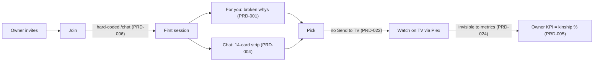

# 01 · Product strategy — Projectionist 360° review, run 2026-11-01

**Head of Product (`PRD`) · independent pass.** Code `05274cf` (tag `v1.38.0`), read from `/tmp/review360-05274cf`. Live survey on QA `http://10.10.1.202:8792` (1.38.0, Live on, LLM on) using the existing owner session, read-only, plus one chat prompt. Inputs: the shared platform map (`00_2026-11-01_platform-map.md`) and the run's handoff notes. No other department document was read.

---

# Part A — Conclusions & findings

## 1. Bottom line

Projectionist is a genuinely differentiated household product. It puts a library-grounded curator, a trustworthy "confirm before you grab" acquisition flow, and real local-first privacy on top of Plex. But its breadth now exceeds what one maintainer can keep correct, and the flaws are landing on its core promise. **Grade: C+.** The most important thing to fix is the **"why" engine on the first Explore rail**. The product's headline differentiator ("honest why") currently tells members that two titles "both turn on a took place" and that "adam McKay worked on both" (PRD-001). Next to it sit an acquisition rule that lets any member or youth account queue downloads on the owner's Radarr (PRD-002) and a Live feature that works but is hidden from every nav surface (PRD-003). The most important thing to protect is the **propose → confirm trust boundary and the honest, on-box pick→play attribution** (PRD-016, PRD-017). These are rare in this category and are the foundation for measuring whether the product works.

## 2. Key conclusions

1. **The core differentiator, explainable recommendations, is failing in public on the most prominent surface.** On QA, all 8 "For you" cards carry a reason. 5 of the 8 come from a single seed show, and 4 of the 8 are linguistically broken: "both stories turn on a spin off", "…a took place", "…a broadcasting company and a began airing", "…a primetime emmy". Creator names are lowercased ("brandon Christensen worked on both"). The root cause is a hand-tuned bigram heuristic with stoplists (`05274cf:projectionist/library/plot_kinship.py:553-612`). It runs on Wikipedia-style synopses, so production-history phrases ("took place", "began airing") pass as story motifs, and the clause join lowercases the first character of every link sentence (`05274cf:projectionist/notifications/recommendation_reasons.py:800`). It matters because "For you" was deliberately made the first Explore rail (`05274cf:docs/PRODUCT.md:73`), and a wrong reason is worse than no reason: it teaches members the product doesn't understand film. **Roadmap implication:** treat explanation quality as a release gate with a corpus test before any further rail work (PRD-001).

2. **Business rules for the household have gaps exactly where the money and the kids are.** The v1.38.0 promise is "only owners can run owner actions". In code, though, `add_radarr`/`add_sonarr` are neither owner-only tools nor owner-only pending actions (`05274cf:projectionist/agent/tools/_definitions.py:1629-1651`). `POST /api/actions/propose` has no role check (`05274cf:projectionist/web/app.py:2521-2580`), and the front end grants `canAdd` to any role whenever Seerr is off (`05274cf:frontend/src/lib/addActions.ts:57-75`). Seerr is off by default (`05274cf:projectionist/config_store.py:488`). Help tells members they only get "Request in Seerr" (`05274cf:docs/HELP.md:237-238`). So on a default install, a member, or a youth account, can confirm a download on the owner's indexers and disk with no approval and no limit. The root cause is that "who may acquire" was never decided as a product rule. It was inherited from the single-owner era. **Implication:** decide the rule now (PRD-002), and ship a native approval queue so households without Seerr aren't forced into an all-or-nothing choice (PRD-023).

3. **The product's own plumbing is hiding finished features from the people they're for.** Live has a native lineup (`05274cf:projectionist/live_channels/lineup_client.py:1-5`), and on QA `/live` renders a full guide with four programmed stations (`screenshots/prd_live-guide-no-nav_390.png`). Yet the nav "ready" flag still requires a Tunarr URL (`05274cf:projectionist/web/app.py:1233-1237`, `05274cf:projectionist/web/nav_bootstrap.py:12-16`). That is the engine PRODUCT.md says was removed in 1.37.51. So Live is missing from the top bar, drawer, and bottom nav, and Admin calls it "Warming — Finish Setup" (`05274cf:frontend/src/lib/householdHealth.ts:34-42`). Even when the flag is fixed, the phone bottom nav drops Live first for every role (`05274cf:frontend/src/lib/primaryNav.ts:179-186`), and Library/My list is not a primary peer at all for adults (`05274cf:frontend/src/lib/appNavItems.ts:17-26`). The root cause is stale gating semantics left over from an architecture change. **Implication:** this is the highest-scoring fix in this review, at XS effort (PRD-003, PRD-015).

4. **Chat, the front door, answers well but presents badly, and that undoes the "one good pick" job.** I asked "Family movie night with a 9-year-old, under 2 hours. One pick?" It took about 27 s. The final pick, *The Wild Robot*, was excellent and well argued. But the reply first narrated two abandoned attempts ("That pick doesn't quite land…", "Those are all excellent but they're TV series…"). It then rendered **14 cards**: the first was the rejected Godzilla film, several were TV series it had just ruled out, and the actual pick was ninth (`screenshots/prd_chat-one-pick-family_390.png`). The root cause is that the card strip is built from every card any tool surfaced during the turn (`registry.cards`, `05274cf:projectionist/agent/curator.py:173-207`), not from the titles the final answer names. **Implication:** make the visible answer contract "cards = titles named in the final answer, in that order" (PRD-004). This is cheaper and more valuable than any new curator capability.

5. **Investment is skewed toward the owner's hobby surfaces rather than members' nightly job.** Since 2026-08-01, Live Channels files absorbed about **26.3k changed lines**. The chat agent (`projectionist/agent`) absorbed about **14.8k**, and the whole repo about 206k (git numstat on `05274cf`). Live is about 15.4k lines of backend plus about 5k lines of UI and routes. Lobby Theater is another 2.8k lines plus an always-on second port. A 20-section Admin and a Monday pass keyed to "Named kinship %" round it out. Meanwhile there is no way to send a pick to the living-room TV (no Plex client remote-play anywhere in the code), and in-app Play is a browser player. The root cause is that the north star is an input metric (kinship coverage) rather than a household outcome (a pick that got watched). **Implication:** freeze Live to maintenance (PRD-007), make Lobby opt-in (PRD-013), re-point the owner KPI at pick→play (PRD-005, PRD-024), and spend the reclaimed capacity on "Send to TV" (PRD-022).

6. **Member onboarding ends at the door.** `JoinPage` hard-codes `navigate("/chat")` after both Plex and local redemption (`05274cf:frontend/src/pages/JoinPage.tsx:96,153`). That bypasses the BD-5 resolver the login page uses (`05274cf:frontend/src/lib/defaultHome.ts:17-29`), so a new member on a no-LLM install lands on a chat with nothing to say. "For you" is empty by design until the member finishes something tracked (`05274cf:docs/PRODUCT.md:73`). The one cold-start tool, a "Quick taste quiz", is buried in Settings → Taste preferences (`05274cf:frontend/src/pages/settings/TasteSettingsPage.tsx:135`). **Implication:** route Join through the resolver and put the quiz in a 60-second first run (PRD-006).

7. **Surface sprawl is now a correctness problem, not only a focus problem.** The product runs 8 comms streams: weekly digest, weekly letter, member newsletter, owner monthly curation, whispers, nudges, arrivals, and Year in Review. Whispers have their own route (`/whisper`), linked only from inside Chat (`05274cf:frontend/src/components/ChatWorkspace.tsx:471`), with no notification toggle. The owner inbox received two "letter about the house" items 4 days apart, both leading with "28,8xx hours … never been sat with". The engagement layer rewards "Chat days in a row" (`05274cf:frontend/src/pages/settings/ProfilePage.tsx:543-545`, `05274cf:projectionist/engagement/__init__.py:36-47`). Four page files are dead (Engagement, MyJourney, PlotLab, a 7-line MediaIssues stub). `docs/PRODUCT.md` is stale (it describes 1.37.59 and lists "My Journey" as a surface), and three positioning statements disagree. **Implication:** run a cut-and-consolidate pass (the Cut list below) before adding surfaces (PRD-008, PRD-009, PRD-010, PRD-012).

8. **The trust and measurement foundations are better than in most products of this size, and they are what make the fixes above measurable.** The propose → confirm flow with owner-only destructive kinds (PRD-016), server-verified pick→play attribution that refuses to infer from Plex history (PRD-017), a fail-closed youth rating gate (PRD-019), honest no-LLM landing (PRD-018), and a single "Needs attention" owner list (PRD-020) are all worth protecting. **Implication:** extend these patterns, for example by applying the same confirm and attribution discipline to TV plays (PRD-024). Do not replace them.

## 3. Foundations challenged

| Assumption | Evidence for | Evidence against | Verdict | Cost of change | Rationale |
|---|---|---|---|---|---|
| SC-01 Chat is the front door | Best-quality answers come from chat (PRD-021); BD-5 already falls back to Explore without an LLM | 27 s to a pick; card strip contradicts the answer (PRD-004); Join bypasses resolver (PRD-006) | **Keep**, with conditions | S | Keep Chat as default only when the answer contract (PRD-004) holds. Otherwise a fast "Tonight" pick on Explore wins the nightly job. |
| SC-02 The product is "the Curator" with personas and a village | Persona voice gives warmth; Help documents village handoffs | Names drift across surfaces: "I'm Curator" welcome, "The Professor" picker, Help's Professor/Host/Steward/Spark vs Scholar/Companion/Concierge/Enthusiast in `05274cf:frontend/src/lib/curatorCapabilities.ts:54` | **Change** | S | Keep one curator with one name per household, plus optional voices. Unify the nomenclature (PRD-012). |
| SC-03 One instance per household, one owner | Fits Unraid/homelab; privacy promise | No co-owner; the owner is also support | **Keep** | — | SaaS would break the privacy differentiator. Revisit co-owner later (Open questions). |
| SC-04 Owner/member plus youth flag is enough | Simple; matches household reality | Acquisition rights don't fit either role cleanly (PRD-002) | **Change** | M | Add one capability, "can request / can add", rather than a full permission matrix (PRD-002, PRD-023). |
| SC-07 LLM optional, experience designed around it | `llm_configured` drives honest landing (PRD-018) | Join ignores it (PRD-006) | **Keep** | XS | The principle is right; the implementation has one hole. |
| SC-08 BYO LLM (10+ providers) | Homelab expectation; local Ollama | Support matrix cost (Architecture/Ops to size) | **Keep** (product) | — | Choice is part of the value proposition; cost belongs to other departments. |
| SC-12 Deep library knowledge is worth it; Named kinship is the owner north star | Powers "why" and Related titles | The "why" output is broken (PRD-001); kinship is an input, not an outcome (PRD-005) | **Change** | M | Keep the knowledge work, but judge it by pick→play and by explanation-quality pass rate. |
| SC-13 Live channels belong in the product | Working native guide; delight for some households | ~13% of churn; hidden from nav; Weather channel and Youth Safe channel empty on QA; benchmarks say it isn't worth it for 1–2 person households | **Change** (freeze to maintenance) | S | Keep what works, fix the nav, stop expanding (PRD-007). |
| SC-14 In-browser Play should exist | Works on laptop/phone; enables attribution | Households watch on TVs through Plex apps; no Send-to-TV | **Change** (add, don't replace) | L | Add "Send to TV" as the primary living-room path (PRD-022). |
| SC-15 Owners can delete media from consumer surfaces | Fast for owner cleanup | Destructive action sits in the same toolbar as "Pin to watchlist" on shared pages (recon P-10) | **Change** | S | Move bulk Delete into an explicit owner "Manage" mode or Admin → Libraries (PRD-014). |
| SC-16 Gamification fits a household companion | Year in Review is a delight; review badges nudge ratings | "Chat days in a row" rewards the wrong behavior (PRD-008); dead Engagement/MyJourney pages | **Change** | XS | Keep YIR and rating badges; remove chat streaks. |
| SC-17 Weekly comms are welcome | Opt-in toggles; GRO-011 skips empty newsletters | 8 streams; separate whisper inbox; duplicate owner letters (PRD-009) | **Change** | M | One member digest, one owner digest, event alerts. |
| SC-18 On-box telemetry is enough to steer | Attribution is verified (PRD-017) | QA shows 0 usage; TV plays invisible (PRD-024) | **Keep**, extend | M | Local-first is right; widen what it can see, honestly labeled. |
| SC-24 MCP with a "full" mode is core | External agents are a homelab draw | Not a household member job; 1.4k lines | **Investigate** | — | Keep privacy mode. Ask whether full mode has users (Open questions). |
| **SC-27 (new)** Acquisition is available to anyone signed in when Seerr is off | Single-owner heritage | Contradicts Help and the 1.38.0 promise (PRD-002) | **Change** | S | The owner pays for disk and bandwidth, so the owner decides. |
| **SC-28 (new)** Every recommendation must show a "why" | Honesty principle | A broken why is worse than none (PRD-001) | **Change** | S | Show a why only when it passes the quality gate; otherwise show a plain, true fact (director, runtime). |
| **SC-29 (new)** Lobby Theater should run by default on a second port | Some houses use a wall display | Niche; PRODUCT.md says "park"; always-on unauthenticated LAN surface | **Change** (opt-in) | S | Default-off removes cost for households that don't use it (PRD-013). |

## 4. If we built it today

Starting from zero with today's knowledge, Projectionist would be built around a single household job: **"get the right thing playing on the TV tonight, for whoever is on the couch, in under a minute."** Everything else would serve that job or be optional.

- **Member surface:** one home with a "Who's watching?" chip row (which applies the youngest viewer's rating ceiling to the whole group) and a single "Tonight" pick with a true one-line reason. Chat sits behind it for open-ended asks, and Library/My list sits beside it. Each card's primary action is **Send to TV** (Plex client), with browser Play second.
- **Acquisition:** "Request" for members, which lands in an owner approval queue (native, or Seerr when present), with optional per-member weekly limits. "Add" is reserved for owners.
- **Owner surface:** one weekly "house report" with the outcome metric first (picks watched, requests waiting, things broken), and Admin reduced to Setup, Members, Health, and Advanced. Live, Lobby, Holidays, and MCP full mode are optional modules, off by default.
- **Comms:** one opt-in member digest, one owner digest, and event alerts (arrival of something you asked for). Everything lands in one Inbox.
- **Knowledge:** keep the local index, embeddings, and relations, but only surface an explanation when it passes a quality gate.

**The gap:** most of the substrate exists. What's missing is the TV hand-off, the group "who's watching" pick, the request queue, the outcome metric, and the cuts. Closing it is worth it. Apart from Send-to-TV (L), each step is S–M and reuses existing pieces: `tonight.py`, the youth gate, propose/confirm, and attribution. The cuts reduce maintenance rather than add to it.

## 5. Findings by surface

**Public (login, join, help, about, setup).** The login page states the value proposition clearly in one line ("your household's private movie and TV companion — chat for recommendations, browse the library, and watch together", `05274cf:frontend/src/lib/loginScreen.ts:29`). There is no marketing site, which is correct for a private app. The weaknesses are drift and the hand-off. The package description ("Agentic Plex collection curator…", `05274cf:pyproject.toml:8`), the README ("cinema intelligence engine… hardened multi-tenant roles"), and the login page describe three different products (PRD-012). Join drops new members onto Chat regardless of LLM or default page (PRD-006). Top priority: PRD-006. **Grade: C+** (PRD-006, PRD-012).

**Consumer (Chat, Explore, Search, Library, Title, Live, Inbox, Settings).** What works: library-grounded answers that are often excellent (PRD-021), honest no-LLM behavior (PRD-018), a fail-closed youth gate (PRD-019), and a rich title page. What doesn't: the first Explore rail's reasons are broken (PRD-001). Chat's card strip contradicts its own answer (PRD-004). Live is invisible (PRD-003), and Library isn't a primary peer (PRD-015). Members see the owner's indexing telemetry ("Vectors: local hash embeddings") at the bottom of Explore (PRD-011). Engagement rewards chatting rather than watching (PRD-008). There's no Send-to-TV (PRD-022) and no group pick (PRD-025). Top priorities: PRD-003, PRD-001, PRD-004. **Grade: C** (PRD-001, PRD-003, PRD-004, PRD-006, PRD-008, PRD-011, PRD-014, PRD-015, PRD-018, PRD-019, PRD-021, PRD-022, PRD-025).

**Owner (household admin).** What works: "Needs attention" and the Monday pass give the owner one list and a ritual (PRD-020). Propose → confirm protects destructive actions (PRD-016). What doesn't: acquisition rights leak to members and youth (PRD-002), there's no native request queue (PRD-023), and the KPI is an input metric (PRD-005). Live consumes a disproportionate share of effort (PRD-007), and comms are fragmented (PRD-009). Bulk Delete sits on shared consumer toolbars (PRD-014). Top priorities: PRD-002, PRD-005. **Grade: B−** (PRD-002, PRD-005, PRD-007, PRD-009, PRD-014, PRD-016, PRD-020, PRD-023, PRD-024).

**Admin / Ops (tasks, health, logs, advanced).** From a product lens the Admin console is complete, arguably over-complete, at 20 sections. The security log and verified attribution are strengths (PRD-017). The weaknesses are dead weight rather than missing tools: orphaned pages, a dead `guest_tour_enabled` flag, Tunarr settings and an image pin for a removed engine (PRD-010), Lobby always on (PRD-013), and a stale product map (PRD-012). Top priority: PRD-010 alongside PRD-003, which share the Tunarr root cause. **Grade: B−** (PRD-010, PRD-012, PRD-013, PRD-017).

## 6. Findings by theme

- **Value delivery on the core job.** At best, chat's single pick with a rationale (PRD-021). At worst, the 14-card strip led by the rejected title (PRD-004) and broken For-you reasons (PRD-001). Direction: every visible element of an answer must agree with the answer.
- **Business rules and policy.** At best, owner-only destructive kinds, re-checked at dispatch and at confirm (PRD-016). At worst, unrestricted member and youth acquisition when Seerr is off (PRD-002). Direction: write the household rules as one table (who may request, add, delete, approve) and enforce it server-side.
- **Feature portfolio and focus.** At best, a recent history of retiring things (guest tour, My Journey folded into Profile). At worst, Live's share of effort while it remains hidden (PRD-003, PRD-007). Direction: maintenance mode for Live and Lobby, and capacity moved to the TV hand-off (PRD-022).
- **Measurement.** At best, verified pick→play attribution (PRD-017). At worst, a KPI that can be at 100% while nobody watches anything (PRD-005), and TV plays that are invisible (PRD-024). Direction: one outcome north star.
- **Onboarding and activation.** At best, Plex-only setup can finish (CHANGELOG 1.38.0). At worst, Join's hard-coded `/chat` and an empty For-you at day 0 (PRD-006). Direction: a 60-second first run.
- **Comms and engagement.** At best, opt-in toggles and empty-week suppression. At worst, the separate whisper inbox, duplicate guilt-framed owner letters, and chat streaks (PRD-008, PRD-009). Direction: consolidate into two digests and one Inbox.
- **Coherence and debt.** At best, `primaryNav.ts` as the single source of truth for nav. At worst, three positioning statements, two persona naming schemes, and a stale PRODUCT.md (PRD-012). Direction: one living product map, updated in the same PR as each release's Highlights.

## 7. Stop doing

- **Stop expanding Live Channels.** Fix nav visibility (PRD-003), then hold Live to bug fixes only until pick→play data shows households use it (PRD-007).
- **Stop rewarding chat streaks** (PRD-008). Rewarding chatting as a habit conflicts with "get to the movie fast".
- **Stop shipping explanations without a quality gate** (PRD-001). Suppress any reason that fails the gate.
- **Stop running Lobby Theater by default** (PRD-013).
- **Stop adding comms streams.** Merge whispers into Inbox, and merge the weekly letter, weekly digest, and monthly curation into one owner digest (PRD-009).
- **Stop carrying dead routes, pages, and flags** (PRD-010): `EngagementPage.tsx`, `MyJourneyPage.tsx`, `PlotLabPage.tsx`, the `MediaIssuesPage.tsx` stub, `guest_tour_enabled`, and Tunarr image/URL settings.
- **Stop treating "Named kinship %" as the owner north star** (PRD-005).
- **Stop putting bulk Delete in consumer toolbars** (PRD-014).

## 8. Strengths worth protecting

- **Propose → confirm acquisition and destructive actions** (PRD-016). The model can only propose; humans confirm in the UI, and owner-only kinds are re-checked at confirm time (`05274cf:projectionist/agent/tools/confirmed.py:186`). This is the product's trust moat. Never let a tool execute *arr or Plex writes without a confirmation token.
- **Verified, on-box attribution** (PRD-017). A play only counts as "from a pick" when the server verifies that the stored recommendation actually surfaced that title to that viewer (`05274cf:projectionist/telemetry/attribution.py:1-7`). Keep "never inferred" as the default. Any widening (PRD-024) must be separately labeled.
- **Honest LLM-optional design** (PRD-018). `resolveDefaultHome` lands on Explore when no model is configured (`05274cf:frontend/src/lib/defaultHome.ts:17-29`).
- **Fail-closed youth gate and youth-blocked tools** (PRD-019).
- **One owner list and a weekly ritual** (PRD-020).
- **Library-grounded, specific curator prose** (PRD-021).

## 9. Risks of inaction (6–12 months)

- **Trust erosion on the first rail.** Members who see "both stories turn on a took place" every visit stop reading the reasons, and then stop using Explore. That loses the main differentiator versus Plex's own Discover (PRD-001). PRODUCT.md already names "couch breakage → just use Plex" as a threat.
- **An owner incident.** A youth or member account queues a download the owner didn't want (rating, disk, or a private tracker's ratio), and the owner loses confidence in inviting the household, which reverses the whole 1.38.0 invite launch (PRD-002).
- **Live stays invisible.** About 20k lines of code would keep absorbing maintenance while members never find the feature, so its value can't even be measured (PRD-003, PRD-007).
- **No evidence to steer by.** With TV plays invisible and the KPI an input metric, roadmap debates stay opinion-based (PRD-005, PRD-024).
- **Activation stalls.** Invited members who land on a dead chat or an empty For-you don't come back (PRD-006).

## 10. Recommended direction

**Sequence:** (1) correctness of the core promise, (2) household rules, (3) measurement, (4) the TV hand-off, (5) cuts in parallel.

- **Now (0–2 weeks):** PRD-003 (Live nav gate), PRD-001 (explanation quality gate), PRD-002 (acquisition rule), PRD-011 (owner telemetry off member Explore), PRD-008 (remove chat streak), PRD-006 (Join routing), PRD-012 (one positioning line and persona naming).
- **Next (2–6 weeks):** PRD-004 (answer contract), PRD-005 + PRD-024 (outcome north star, including TV plays), PRD-023 (native request queue), PRD-009 (comms consolidation), PRD-014, PRD-015, PRD-010, PRD-013, PRD-007 (Live freeze decision).
- **Later (6+ weeks):** PRD-022 (Send to TV), PRD-025 (Who's watching group pick).

**What success looks like in 90 days:**
- At least 95% of For-you reasons pass the explanation-quality corpus test, and 0 lowercased proper names (PRD-001).
- 0 non-owner `add_radarr`/`add_sonarr` confirmations without owner approval on any install (PRD-002).
- Live is reachable from nav on 100% of installs whose lineup has ≥1 programmed station (PRD-003).
- For a "one pick" ask, the first card equals the named pick in at least 95% of sampled turns (PRD-004).
- The owner Overview leads with "picks watched this week" (in-app plus TV, separately labeled), and the household median is ≥1 attributed watch per active member per week on the maintainer prod household (PRD-005, PRD-024).
- New-member day-7 return (any session on ≥2 distinct days in the first 7) is measurable on-box, with a target of ≥50% (PRD-006).

## 11. Scorecard (1–5)

| Surface | Value clarity | Core-job delivery | Feature focus | Rule coherence | Measurability | Reason |
|---|---|---|---|---|---|---|
| Public | 4 | 3 | 4 | 3 | 2 | Clear login value line; Join hand-off broken; positioning drift |
| Consumer | 3 | 3 | 2 | 3 | 3 | Strong chat answers undercut by broken whys, card strip, hidden Live |
| Owner | 3 | 3 | 2 | 2 | 3 | Good ritual; acquisition rule gap; input-metric KPI; Live sprawl |
| Admin | 3 | 4 | 2 | 4 | 4 | Complete and audited; dead weight and stale map |

---

# Part B — Detailed findings

## 12. Scope & method

- **Code:** `05274cf` read-only snapshot. I traced the feature inventory from `AppRoutes.tsx`, `AdminRoutes.tsx`, `primaryNav.ts`, `appNavItems.ts`, and `adminNav.ts`. I grepped for orphan pages and dead flags, read the acquisition path (agent tools, `/api/actions/propose`, `/api/actions/confirm`, `addActions.ts`), the explanation generator (`plot_kinship.py`, `recommendation_reasons.py`), Live gating (`app.py`, `nav_bootstrap.py`, `lineup_client.py`, `householdHealth.ts`), the engagement layer, and the comms tasks. Investment was measured with `git log --numstat` since 2026-08-01 on `05274cf`.
- **Live (QA `:8792`, owner session, read-only):** Explore (For-you reasons extracted from the DOM), Inbox, Live guide, and Chat. I sent **one** chat prompt, which created one thread. Screenshots at 390 px with deviceScaleFactor 1 (overrides cleared):
  - `screenshots/prd_explore-member-nav_390.png`: For-you rail and bottom nav without Live or Library.
  - `screenshots/prd_live-guide-no-nav_390.png`: working native guide with Live absent from nav.
  - `screenshots/prd_chat-one-pick-family_390.png`: "one pick" answer followed by a 14-card strip led by the rejected title.
- **Feature inventory (value vs cost, condensed):**

| Feature | Persona served | Value | Cost / complexity | Verdict |
|---|---|---|---|---|
| Chat curator (65 tools, personas, village) | Returning/power consumer | High | High (~15k churn) | Keep; fix contract (PRD-004) |
| Explore + For you + 13 rails | Returning consumer | High | Medium | Fix whys (PRD-001), trim footer (PRD-011) |
| Search + beyond-collection | All | High | Medium | Keep; acquisition rule (PRD-002) |
| Library (Shelves/Watchlist/Collections/Browse/Saved) | Power consumer | Medium–High | Medium | Promote My list (PRD-015) |
| In-app Play | Laptop/phone viewer | Medium | High | Keep; add Send to TV (PRD-022) |
| Live Channels (native lineup, Weather) | Some households | Low–Medium (unmeasured) | Very high (~20k LOC, ~26k churn) | Freeze (PRD-007) |
| Lobby Theater (:8791) | Houses with a wall display | Low | Medium (2.8k LOC, second port) | Opt-in (PRD-013) |
| Inbox + whispers + 8 comms streams | Member/owner | Medium | Medium | Consolidate (PRD-009) |
| Badges / streaks / courses / YIR | Engaged member | YIR high; streaks negative | Low–Medium | Remove streaks (PRD-008) |
| Admin (20 sections), Monday pass | Owner | High | High | Keep; re-point KPI (PRD-005) |
| Holidays, Seerr, Library knowledge | Owner | Medium | Medium | Keep |
| MCP privacy/full | External-agent owner | Low–Medium | Medium (1.4k LOC) | Investigate full mode |
| Engagement/MyJourney/PlotLab pages, guest tour flag, Tunarr settings | None (dead) | 0 | Low but nonzero | Remove (PRD-010) |

- **Jobs to be done (condensed):** "Pick something for tonight": *partly served* (PRD-001, PRD-004). "Pick for the whole family": *underserved* (PRD-025). "Put it on the TV": *unserved* (PRD-022). "Get a title we don't have": *served but unsafe* (PRD-002, PRD-023). "Keep the house healthy in 20 min a week": *well served* (PRD-020). "Know if this is working": *underserved* (PRD-005, PRD-024). "Find Live TV": *unserved by nav* (PRD-003).
- **Core loops:** acquisition happens via owner invite (works). Activation breaks at Join → Chat (PRD-006). Retention is undermined by the For-you quality (PRD-001) and the Chat contract (PRD-004). Referral, meaning household recommends and "Watch together" notes, exists but its value is unmeasured. For owners, activation (setup) works, and retention (the Monday pass) works but steers by an input metric (PRD-005).

- **Could not review:** signed-out anonymous view (I saw the public surface only in code and through the platform map); member and youth sessions (role behavior is from code, so youth acquisition exposure is **Likely**, not observed); Plex PIN/OIDC; invite redemption end-to-end; the setup wizard; Watch/Play and Live tuning (forbidden); Lobby `:8791`; MCP; actual mail. QA has 0 usage in the last 7 days, so no engagement data. All usage-based claims are therefore structural, not behavioral.

## 13. Strengths

### PRD-016: Protect the propose → confirm boundary for every write

| Field | Value |
|---|---|
| Type | Strength |
| Surface | Cross-cutting |
| Persona(s) | Owner, member, youth |
| Category | Trust & business rules |
| Severity | High |
| Impact | 5 |
| Effort | XS |
| Confidence | Confirmed |
| Priority score | 15.0 |
| Verdict | Protect |
| Dependencies | Extended by PRD-002, PRD-023 |
| Labels | trust, agent, acquisition |

**Evidence:** `05274cf:projectionist/agent/tools/acquire.py:65-80` (tool saves a pending action and returns a confirmation token); `05274cf:projectionist/agent/tools/_definitions.py:1629-1673` (owner-only tools hidden and dispatch-denied); `05274cf:projectionist/agent/tools/confirmed.py:186` (owner-only kinds rejected at confirm for non-owners); CHANGELOG 1.38.0 SEC-002.

**Current state:** The LLM can only propose. Writes happen only when a human confirms in the UI, and destructive kinds are re-checked server-side at confirm time.

**Root cause:** An early, deliberate design decision ("Confirm before you grab").

**Recommendation:** Keep it. Every new write tool must go through `save_pending_action` and a confirm route with a role check. Add a test that fails if any tool in `TOOL_DEFINITIONS` performs an external write without a pending action.

**Rationale:** This is the main reason an owner can safely give an LLM access to *arr and Plex. Competing "AI for Plex" tools rarely have it. **Protect this:** do not add "auto-confirm" shortcuts, including for owners, except behind an explicit, audited setting.

**User story:** As an owner, I want every add, remove, or collection write to need a human tap so that a model mistake never costs me disk or data.

**Acceptance criteria:**
- [ ] A registry test enumerates write-capable tools and asserts each returns a `confirmation_token`.
- [ ] The confirm route rejects owner-only kinds for non-owners (existing test kept green).

**Success metric:** 0 external writes without a matching confirmed pending action (security log audit).

**Validation:** Run the registry test; spot-check `security_audit_log` against `pending_actions`.

### PRD-017: Protect verified, never-inferred pick→play attribution

| Field | Value |
|---|---|
| Type | Strength |
| Surface | Admin |
| Persona(s) | Owner, maintainer |
| Category | Measurement |
| Severity | Medium |
| Impact | 4 |
| Effort | XS |
| Confidence | Confirmed |
| Priority score | 8.0 |
| Verdict | Protect |
| Dependencies | Basis for PRD-005, PRD-024 |
| Labels | metrics, privacy, attribution |

**Evidence:** `05274cf:projectionist/telemetry/attribution.py:1-7,41-60` (a claim counts only when the stored assistant card or household recommendation actually surfaced that rating key to that caller); live Admin Overview "last 7 days: 0 chat turns · 0 plays in Projectionist · 0 from a pick" (platform map §4.2).

**Current state:** On-box, honest attribution of in-app plays to chat picks and household shares.

**Root cause:** Deliberate GRO-014 design.

**Recommendation:** Keep the verified path as the "strict" metric. Any widening (PRD-024) is a separate, labeled "likely from a pick" metric and never overwrites strict counts.

**Rationale:** Without this, no product claim about the curator can be tested. Inferred attribution would inflate the numbers and destroy trust in them. **Protect this:** never infer attribution from Plex history in the strict metric.

**User story:** As an owner, I want to know how many picks actually got played so that I can tell whether the curator is worth its LLM cost.

**Acceptance criteria:**
- [ ] Strict and inferred metrics are stored in separate fields.
- [ ] The UI labels inferred counts "likely from a pick".

**Success metric:** Owner Overview shows both numbers on 100% of multi-user installs.

**Validation:** Unit tests on `parse_rec_claim` and the matcher; manual Play from a chat card on QA (when Play testing is permitted).

### PRD-018: Protect honest LLM-optional landing

| Field | Value |
|---|---|
| Type | Strength |
| Surface | Consumer |
| Persona(s) | Member on a no-LLM install |
| Category | Onboarding |
| Severity | Medium |
| Impact | 3 |
| Effort | XS |
| Confidence | Confirmed |
| Priority score | 6.0 |
| Verdict | Protect |
| Dependencies | PRD-006 extends it to Join |
| Labels | llm-optional, default-home |

**Evidence:** `05274cf:frontend/src/lib/defaultHome.ts:17-29`; `05274cf:projectionist/web/app.py:1245-1250` (`llm_configured`); `05274cf:frontend/src/components/ChatWorkspace.tsx:344`.

**Current state:** With no model configured, an unset default lands on Explore, and chat says so honestly.

**Root cause:** BD-5 decision.

**Recommendation:** Keep it, and apply it to every post-auth redirect (PRD-006).

**Rationale:** The honest fallback protects first impressions on budget or privacy installs. **Protect this:** never land a no-LLM member on a disabled composer.

**User story:** As a member of a household without an LLM, I want to land somewhere useful so that I don't think the app is broken.

**Acceptance criteria:**
- [ ] Every navigation after sign-in or join calls `resolveDefaultHome`.

**Success metric:** 0 post-auth landings on `/chat` when `llm_configured=false`.

**Validation:** Playwright test with mocked features `llm_configured:false`, for both join and login.

### PRD-019: Protect the fail-closed youth gate and youth-blocked tools

| Field | Value |
|---|---|
| Type | Strength |
| Surface | Consumer |
| Persona(s) | Youth member, owner (parent) |
| Category | Policy |
| Severity | High |
| Impact | 4 |
| Effort | XS |
| Confidence | Confirmed |
| Priority score | 12.0 |
| Verdict | Protect |
| Dependencies | PRD-002 must extend it to acquisition |
| Labels | youth, policy |

**Evidence:** `05274cf:projectionist/config_store.py:655-659` (PG-13 default; unrated blocked); `05274cf:projectionist/web/app.py:1176-1187` (`filter_payload_for_youth`, `apply_youth_gate_to_filters`); `05274cf:projectionist/agent/tools/_definitions.py:1641,1668-1670`; CHANGELOG 1.38.0 "Youth gate".

**Current state:** Library payloads and filters are gated by a rating ceiling that fails closed, and owner-only tools are hidden from youth.

**Root cause:** Phase 2 trust work.

**Recommendation:** Keep it, and add acquisition to the youth-blocked set (PRD-002). Apply `filter_payload_for_youth` to `/api/search/external` results, which today only pass `_sanitize_library_payload` (`05274cf:projectionist/web/library_routes.py:1486`).

**Rationale:** Parents only invite kids if the gate holds everywhere. **Protect this:** new surfaces must call the shared youth gate, not re-implement it.

**User story:** As a parent, I want my child's account to never surface or fetch above-ceiling titles so that I can hand them the app.

**Acceptance criteria:**
- [ ] Contract test: every route returning title cards applies the youth gate for youth callers.

**Success metric:** 0 above-ceiling titles in youth payloads across the route contract suite.

**Validation:** pytest contract over title-returning routes with a youth fixture.

### PRD-020: Protect "Needs attention" + Monday pass as the owner's single list

| Field | Value |
|---|---|
| Type | Strength |
| Surface | Owner |
| Persona(s) | Established owner |
| Category | Owner workflow |
| Severity | Medium |
| Impact | 4 |
| Effort | XS |
| Confidence | Confirmed |
| Priority score | 8.0 |
| Verdict | Protect |
| Dependencies | PRD-005 changes its headline metric |
| Labels | owner, ritual |

**Evidence:** `05274cf:projectionist/web/owner_ops.py` (551 lines); `05274cf:frontend/src/components/OwnerOpsOverview.tsx`; live Admin Overview (platform map §4.2): "5 things need attention", Monday pass, Setup & stewardship.

**Current state:** One list rolls up broken keys, failed tasks, setup steps, and the weekly pass.

**Root cause:** OPS-030 / UX-036 in 1.38.0.

**Recommendation:** Keep the structure. Change the first Monday-pass step from "Named kinship ≥ 50%" to "Review picks watched + requests waiting" (PRD-005, PRD-023).

**Rationale:** A ritual is the right shape for a household admin who spends about 20 minutes a week. **Protect this:** don't let it grow past 5 steps.

**User story:** As an owner, I want one weekly list so that I don't hunt through 20 Admin sections.

**Acceptance criteria:**
- [ ] Monday pass has ≤5 steps, each with one deep link.

**Success metric:** Monday pass completion ≥3 of 4 weeks on the maintainer prod household.

**Validation:** Inspect `owner_checklist_marks` per ISO week.

### PRD-021: Protect specific, library-grounded curator prose

| Field | Value |
|---|---|
| Type | Strength |
| Surface | Consumer |
| Persona(s) | Returning consumer, power consumer |
| Category | Core value |
| Severity | Medium |
| Impact | 4 |
| Effort | XS |
| Confidence | Confirmed |
| Priority score | 8.0 |
| Verdict | Protect |
| Dependencies | PRD-004 fixes its presentation |
| Labels | chat, quality |

**Evidence:** Live prompt "Family movie night with a 9-year-old, under 2 hours. One pick?" gave *The Wild Robot (2024) — 102 min · PG* with a specific, age-calibrated rationale and two in-library alternatives (`screenshots/prd_chat-one-pick-family_390.png`). The recon prompt gave a single 86-minute comedy with a rationale (platform map §4.2).

**Current state:** When the curator lands, it is specific, checks the library, and respects constraints like runtime and age.

**Root cause:** Library-grounded tools plus persona prompts.

**Recommendation:** Keep it. Add the two prompts above to an eval set (age plus runtime constraints, single pick) run before each release.

**Rationale:** This is the experience members can't get from Plex. **Protect this:** don't trade specificity for speed by dropping library checks.

**User story:** As a parent, I want one age-appropriate pick with a reason so that we can start the movie.

**Acceptance criteria:**
- [ ] The release eval includes ≥10 constrained single-pick prompts, with pass/fail on constraint adherence.

**Success metric:** ≥90% constraint adherence on the eval.

**Validation:** Run the eval against QA before tagging.

## 14. Weaknesses (sorted by priority score)

### PRD-003: Show Live in navigation when the native lineup has stations

| Field | Value |
|---|---|
| Type | Weakness |
| Surface | Consumer |
| Persona(s) | Returning consumer, youth, owner |
| Category | Feature discoverability / product debt |
| Severity | High |
| Impact | 4 |
| Effort | XS |
| Confidence | Confirmed |
| Priority score | 12.0 |
| Verdict | Fix |
| Dependencies | Shares root cause with PRD-010; informs PRD-007 |
| Labels | live, nav, tunarr-residue |

**Evidence:** `05274cf:projectionist/web/app.py:1233-1237` (`live_channels_ready` = enabled AND `settings.tunarr.url`); `05274cf:projectionist/web/nav_bootstrap.py:12-16` (same check); `05274cf:projectionist/live_channels/lineup_client.py:1-5` ("not an HTTP client… publish stores stations in Projectionist's own file"); `05274cf:projectionist/live_channels/publish.py:1841-1845`; `05274cf:docs/PRODUCT.md:12` (Tunarr removed 1.37.51+); `05274cf:frontend/src/lib/householdHealth.ts:34-42` ("Warming — Finish Setup"); live `/live` shows 5 rows with programs while the bottom nav is Search/Chat/Explore/Inbox/Settings (`screenshots/prd_live-guide-no-nav_390.png`); `05274cf:frontend/src/lib/primaryNav.ts:179-186` (bottom nav drops Live first).

**Current state:** Live works but is reachable only by URL, and the owner is told it isn't ready.

**Root cause:** The readiness flag kept its Tunarr-era meaning after the engine became native.

**Recommendation:** Define `live_channels_ready = live_channels_enabled AND native lineup has ≥1 station with ≥1 scheduled program in the next 24h`. Compute it in one helper (`projectionist/live_channels/status.py`) used by `_features_payload` and `nav_bootstrap`. Rename the Admin chip states to "On air (N stations)" / "No stations yet → Add a station" / "Off". On the phone bottom nav, when Live is ready for a member, drop Search instead of Live (Search remains on Explore and in the drawer).

**Rationale:** About 20k lines of shipped value are invisible, so nobody can learn whether Live is worth keeping (PRD-007). Rejected alternative: "add a Live tile to Explore only". It adds a second entry point without fixing the flag the Admin chip also lies about.

**User story:** As a household member, I want to see Live in the menu when there's something on so that I can find it without a URL.

**Acceptance criteria:**
- [ ] With Live enabled, a station published, and no Tunarr URL, `/api/features` returns `live_channels_ready: true`.
- [ ] The Admin chip reads "On air" with the station count in that state.
- [ ] Member bottom nav at 390 px includes Live when ready.

**Success metric:** Live sessions per active member per week become measurable and nonzero on prod within 2 weeks.

**Validation:** pytest on the helper; Playwright mobile spec with mocked features; QA check on `:8792`.

### PRD-001: Gate "why" explanations on quality; fix the For-you sentence builder

| Field | Value |
|---|---|
| Type | Weakness |
| Surface | Consumer |
| Persona(s) | Returning consumer, power consumer, non-native reader |
| Category | Core value / recommendation quality |
| Severity | High |
| Impact | 5 |
| Effort | S |
| Confidence | Confirmed |
| Priority score | 7.5 |
| Verdict | Fix |
| Dependencies | Blocks further rail work; relates to SC-12 |
| Labels | explainability, explore, for-you |

**Evidence:** Live `/explore` For-you reasons (DOM extract, 2026-11-02): "…both stories turn on a spin off" (×3), "…both stories turn on a took place" (×2), "…a broadcasting company and a began airing", "…a primetime emmy", "brandon Christensen worked on both"; 5 of 8 cards share one seed show (`screenshots/prd_explore-member-nav_390.png`). Inbox shows "adam McKay worked on both". Code: `05274cf:projectionist/library/plot_kinship.py:553-612` (bigram tokens, stoplist filters, `"Both stories turn on {a/an} {term}"`); `05274cf:projectionist/notifications/recommendation_reasons.py:800` (lowercases the first character of the clause, including proper names).

**Current state:** The first Explore rail, which the product made primary, shows grammatically and semantically broken reasons on most cards.

**Root cause:** (a) A phrase extractor without part-of-speech or semantic checks, fed by production-history prose. (b) Stoplist whack-a-mole as the only defense. (c) No seed diversity cap. (d) Naive case folding.

**Recommendation:**
1. Prefer phrases from the LLM `summary_motifs` / keyword tables when present. Use bigrams only when both tokens appear in a curated story-noun allowlist.
2. Add a reject list of production-history n-grams (`took place`, `began airing`, `spin off`, `primetime emmy`, `box office`, `filmed in`, `premiered on`, `was released`) plus a rule rejecting any bigram whose head is a verb form (`-ed`, `-ing`).
3. Lowercase only when the first word is "Both". Never lowercase a person-name clause.
4. Cap any single seed at 2 of 8 For-you cards.
5. If no reason passes, fall back to a true structured fact ("Same director: Adam McKay", "Also 96 min, also PG") rather than a template.
6. Add a golden corpus test of 200 sampled pairs from the QA library that asserts 0 matches against the reject list.

**Rationale:** A wrong explanation is actively harmful. It signals that the system doesn't understand film, which is the one thing the product claims. Rejected alternatives: "LLM-write every reason" (cost and latency at rail scale; the existing motif cache is enough) and "hide all reasons" (throws away the differentiator).

**User story:** As a member, I want each "For you" reason to be a true, readable sentence so that I trust the suggestion.

**Acceptance criteria:**
- [ ] Corpus test: 0 reasons contain a reject-list phrase; 0 lowercased capitalized names.
- [ ] No seed appears on more than 2 of 8 For-you cards.
- [ ] When no reason passes, the card shows a structured fact or no reason.

**Success metric:** At least 95% of sampled For-you reasons rated "true and readable" in a 50-card manual audit (baseline today: 4 of 8 broken).

**Validation:** pytest corpus; manual audit on `:8792` Explore.

### PRD-002: Decide and enforce who may acquire titles (members and youth can self-confirm *arr adds)

| Field | Value |
|---|---|
| Type | Weakness |
| Surface | Owner |
| Persona(s) | Owner, member, youth |
| Category | Business rules / policy |
| Severity | High |
| Impact | 5 |
| Effort | S |
| Confidence | Confirmed (member path); Likely (youth path, not walked) |
| Priority score | 7.5 |
| Verdict | Fix |
| Dependencies | PRD-023 (native queue); PRD-019; Security to rate exploitability |
| Labels | acquisition, roles, youth, policy |

**Evidence:**
- `05274cf:projectionist/agent/tools/_definitions.py:1629-1651`: `add_to_radarr`/`add_to_sonarr` are absent from `OWNER_ONLY_TOOL_NAMES`, and `add_radarr`/`add_sonarr` are absent from `OWNER_ONLY_PENDING_ACTIONS`. Youth-blocked equals owner-only.
- `05274cf:projectionist/web/app.py:2521-2580`: `POST /api/actions/propose` has no role check.
- `05274cf:frontend/src/lib/addActions.ts:57-75`: `canAdd: !useSeerr` for every role.
- `05274cf:projectionist/config_store.py:346-347,488`: the Seerr path applies only when Seerr is enabled, which is off by default.
- Contradicted by `05274cf:docs/HELP.md:237-238,549` ("Members get Request in Seerr") and the CHANGELOG 1.38.0 lead ("only owners can run owner actions").

**Current state:** On a default multi-user install without Seerr, any member, and likely any youth account, can confirm a Radarr/Sonarr add, and `search_for_movie` triggers a download.

**Root cause:** Acquisition rights were never written down as a household rule. The single-owner default ("everyone is owner") persisted into multi-user mode.

**Recommendation:** Adopt this rule table and enforce it server-side in `propose_action`, `execute_confirmed_action`, and the tool policy:

| Role | Seerr on | Seerr off |
|---|---|---|
| Owner | Add (direct) | Add (direct) |
| Member | Request (Seerr) | **Request → owner approval queue** (PRD-023); no direct add |
| Youth | Request only if owner enabled "youth may request" (default off), and title ≤ youth ceiling | Same |

Add `add_radarr`/`add_sonarr` to the owner-only pending kinds for non-owners. Make `resolveAddCapability` return `canAdd` only for owners. Update Help to match.

**Rationale:** The owner pays for disk, bandwidth, and indexer standing. An unapproved download by a child or guest is the kind of incident that makes owners revoke invites, which undoes the 1.38.0 launch. Rejected alternative: "require Seerr for multi-user". That forces a second app on every household.

**User story:** As an owner, I want members to request rather than add so that nothing downloads without my OK.

**Acceptance criteria:**
- [ ] A member `POST /api/actions/propose {action:add_radarr}` creates a *request*, not an add token. A member cannot confirm `add_radarr` (403).
- [ ] Youth propose is refused unless the owner setting is on, and it is always refused above the ceiling.
- [ ] Help text matches behavior for all three roles.

**Success metric:** 0 non-owner direct adds in `security_audit_log` and `pending_actions` after release.

**Validation:** pytest across the role × Seerr matrix; QA with a member fixture.

### PRD-011: Move owner indexing telemetry off the member Explore page

| Field | Value |
|---|---|
| Type | Weakness |
| Surface | Consumer |
| Persona(s) | Member, youth |
| Category | Audience fit |
| Severity | Medium |
| Impact | 3 |
| Effort | XS |
| Confidence | Confirmed |
| Priority score | 6.0 |
| Verdict | Fix |
| Dependencies | — |
| Labels | explore, owner-chrome, jargon |

**Evidence:** `05274cf:frontend/src/pages/ExplorePage.tsx:943-999`: Library Pulse and `KnowledgeCoverageCard variant="strip"` render for every role; `isOwner` only toggles chrome. `KnowledgeCoverageCard.tsx` has no role check. Live Explore footer text: "Vectors: local hash embeddings (no embedding API)".

**Current state:** Every member sees the owner's index-health metrics at the end of Explore.

**Root cause:** Owner ops telemetry was placed on a shared page for convenience.

**Recommendation:** Render `KnowledgeCoverageCard` and the knowledge parts of Library Pulse only when `isOwner`. For members, keep at most one friendly stat ("4,595 films · 797 shows"). The owner copy lives in Admin → Library knowledge.

**Rationale:** Jargon such as "hash embeddings" erodes the "cinema companion" feel. Rejected alternative: rewording the strip for members. Members have no action to take on it.

**User story:** As a member, I want Explore to be about films so that I'm not confused by system stats.

**Acceptance criteria:**
- [ ] A member/youth Explore DOM contains no "embedding", "kinship", or "coverage" strings.

**Success metric:** 0 owner-only terms on member Explore (Playwright grep).

**Validation:** Playwright with a member mock.

### PRD-004: Make the chat card strip match the final answer ("one pick" means one card first)

| Field | Value |
|---|---|
| Type | Weakness |
| Surface | Consumer |
| Persona(s) | Returning consumer, parent |
| Category | Core value / answer contract |
| Severity | High |
| Impact | 4 |
| Effort | M |
| Confidence | Confirmed |
| Priority score | 4.0 |
| Verdict | Fix |
| Dependencies | PRD-021 |
| Labels | chat, cards, latency |

**Evidence:** Live prompt (2026-11-02) took ~27 s to idle. The reply narrated two discarded attempts, then rendered "Expand 14 titles". Card 1 was the rejected *All Monsters Attack*, cards 2–6 were TV series the text had just ruled out, and the chosen pick was 9th (`screenshots/prd_chat-one-pick-family_390.png`). Code: `05274cf:projectionist/agent/curator.py:173-207`: outside recommendation context the strip is `_displayable_cards(registry.cards)`, meaning every card any tool returned this turn.

**Current state:** Visible cards reflect the search trace, not the answer.

**Root cause:** The card channel is fed from tool results, with no binding to the titles the final message names. Intermediate reasoning is streamed as user-facing text.

**Recommendation:**
1. After the final assistant text, resolve the titles it names (bold or linked `/title/...`) and emit them first, in mention order, as the primary card block.
2. Move other tool cards into a collapsed "Also considered (N)" block, or drop them.
3. When the user asks for "one", "a", or "single", emit exactly one primary card.
4. Instruct the model to keep exploratory narration out of the final text, or render pre-final text as a collapsible "How I looked" line.
5. Target p50 ≤12 s for single-pick asks by capping tool rounds at 3 for "one pick" intents.

**Rationale:** The UI should never contradict the answer. A rejected title shown first undoes good prose. Rejected alternative: "drop the strip". Cards carry Play, Pin, and Watch together.

**User story:** As a parent, I want the pick I was given to be the first card so that I can tap it and start.

**Acceptance criteria:**
- [ ] For single-pick intents, the first card's rating key equals the first title named in the final text, and only 1 primary card renders.
- [ ] Discarded candidates never appear before the pick.
- [ ] p50 turn duration for the single-pick eval is ≤12 s.

**Success metric:** At least 95% first-card-equals-pick on a 20-prompt eval; `chat_turn.duration` p50 ≤12 s.

**Validation:** Agent eval harness; `chat_turn` telemetry on prod.

### PRD-007: Freeze Live Channels to maintenance until usage justifies it

| Field | Value |
|---|---|
| Type | Weakness |
| Surface | Owner |
| Persona(s) | Owner, maintainer |
| Category | Portfolio / focus |
| Severity | Medium |
| Impact | 4 |
| Effort | S |
| Confidence | Confirmed |
| Priority score | 4.0 |
| Verdict | Rethink |
| Dependencies | PRD-003 first (to make usage measurable); PRD-005 |
| Labels | live, scope, cut-list |

**Evidence:** `wc -l` shows ~15.4k lines in `projectionist/live_channels/` and ~5.0k in Live UI/routes/CSS. `git log --numstat --since=2026-08-01 05274cf`: ~26.3k changed lines in Live paths vs ~14.8k in `projectionist/agent`, out of ~206k repo-wide. QA guide: Youth Safe station empty; Weather channel present; Admin says "Warming". Benchmarks (platform map §5): 24/7 channels are a permanent transcode tenant and "don't bother" for small households.

**Current state:** Live is the largest single investment area, and its value is unmeasured and hidden (PRD-003).

**Root cause:** Owner-delight work isn't held to a household-outcome metric.

**Recommendation:** After PRD-003 ships, declare Live **maintenance-only** for 90 days: bug fixes and security only, no new station types or studio features. At day 90, keep investing only if ≥20% of active members open `/live` weekly on the maintainer household. Otherwise move Live to an opt-in module and stop adding to it.

**Rationale:** Frees roughly 10–15% of engineering churn for the TV hand-off (PRD-022), which serves every household. Rejected alternative: removing Live now. It works, some houses like it, and there's no data yet.

**User story:** As the maintainer, I want effort to follow household usage so that I build what members use.

**Acceptance criteria:**
- [ ] PRODUCT.md lists Live as "maintenance" with the day-90 decision rule.
- [ ] No Live feature PRs merge in the window (bug and security fixes only).

**Success metric:** Live share of churn ≤5% in the next 90 days.

**Validation:** `git log --numstat` on Live paths at day 90.

### PRD-008: Remove "chat days in a row" streaks; reward watching and rating instead

| Field | Value |
|---|---|
| Type | Weakness |
| Surface | Consumer |
| Persona(s) | Member |
| Category | Engagement design |
| Severity | Medium |
| Impact | 2 |
| Effort | XS |
| Confidence | Confirmed |
| Priority score | 4.0 |
| Verdict | Remove |
| Dependencies | — |
| Labels | gamification, cut-list |

**Evidence:** `05274cf:projectionist/engagement/__init__.py:36-47` (`sync_chat_streak`, badges with `event: chat_streak`); `05274cf:frontend/src/pages/settings/ProfilePage.tsx:543-545,558` ("Chat days in a row", "keep a chat streak going"). Separately, `engagement_summary` reads `count_chat_sessions_last_days(30)` without a user scope (`engagement/__init__.py:57-60`), so that count is household-wide (Likely; verify).

**Current state:** The product rewards opening chat daily.

**Root cause:** A generic engagement pattern was copied in without testing it against the household job.

**Recommendation:** Delete the chat-streak badge criteria, the `sync_chat_streak` call sites, and the streak line on Profile. Keep review badges and Year in Review. Optionally replace streaks with "Watched N picks this month" from strict attribution (PRD-017).

**Rationale:** Members should spend less time choosing and more time watching, and a chat streak rewards the opposite. Rejected alternative: renaming the streak. The incentive itself is wrong.

**User story:** As a member, I want badges for watching and rating so that the app celebrates nights well spent.

**Acceptance criteria:**
- [ ] No `chat_streak` badge or streak UI remains; the migration leaves existing earned badges visible but inactive.

**Success metric:** No regression in review count after removal (rating badges kept).

**Validation:** Profile page unit test; DB migration test.

### PRD-006: Route Join through the default-home resolver and add a 60-second first run

| Field | Value |
|---|---|
| Type | Weakness |
| Surface | Public |
| Persona(s) | First-time visitor (invited member) |
| Category | Activation |
| Severity | Medium |
| Impact | 4 |
| Effort | S |
| Confidence | Likely (Join misroute Confirmed; cold-start emptiness Likely) |
| Priority score | 3.2 |
| Verdict | Fix |
| Dependencies | PRD-018, PRD-001 |
| Labels | onboarding, join, cold-start |

**Evidence:** `05274cf:frontend/src/pages/JoinPage.tsx:96,153` (`navigate("/chat")` after Plex and local redeem); `05274cf:frontend/src/pages/LoginPage.tsx:98,146` uses `postLoginDestination`; `05274cf:docs/PRODUCT.md:73` ("empty means no named link to something you finished"); `05274cf:frontend/src/pages/settings/TasteSettingsPage.tsx:135` ("Quick taste quiz", buried in Settings).

**Current state:** New members land on Chat, even on no-LLM installs, with an empty For-you and no prompt to seed taste.

**Root cause:** Join predates BD-5, and there is no first-run concept for members.

**Recommendation:** Replace both `navigate("/chat")` calls with `postLoginDestination()`. On first sign-in (no `user_taste_profile` row), show a 3-step sheet: (1) "Who are you?" (name/avatar, already in Profile); (2) the existing taste quiz (pick 5 titles you love from 12 popular in-library posters, youth-gated); (3) "Your first pick", one Tonight card from those seeds. Let the quiz seeds feed For you as `seed_kind="quiz"` until real watches exist.

**Rationale:** Day-0 is when invited members decide whether this beats opening Plex. Rejected alternative: a long onboarding wizard. Members didn't install the app; keep it ≤60 s and skippable.

**User story:** As a newly invited member, I want a first pick within a minute so that I see why my household uses this.

**Acceptance criteria:**
- [ ] Join on a no-LLM install lands on Explore.
- [ ] A first-run sheet appears once; Skip is always available.
- [ ] For you is non-empty after the quiz.

**Success metric:** New-member day-7 return ≥50%; ≥70% of new members complete or skip the sheet within 60 s.

**Validation:** Playwright join flow with mocked features; on-box `telemetry_events`.

### PRD-012: Unify positioning, persona names, and the living product map

| Field | Value |
|---|---|
| Type | Weakness |
| Surface | Cross-cutting |
| Persona(s) | New owner, member, maintainer |
| Category | Positioning / product debt |
| Severity | Medium |
| Impact | 3 |
| Effort | S |
| Confidence | Confirmed |
| Priority score | 3.0 |
| Verdict | Fix |
| Dependencies | — |
| Labels | positioning, naming, docs |

**Evidence:**
- Positioning: `05274cf:pyproject.toml:8` ("Agentic Plex collection curator…"); `05274cf:README.md:8-10` ("Cinema intelligence engine… hardened multi-tenant roles"); `05274cf:frontend/src/lib/loginScreen.ts:29` ("household's private movie and TV companion").
- Persona names: `05274cf:frontend/src/lib/curatorCapabilities.ts:54` (Scholar / Companion / Concierge / Enthusiast) vs `05274cf:projectionist/persona/presets.py:71-267` and `05274cf:docs/HELP.md:98` (The Steward / The Ledger / Spark / The Professor / The Host); live welcome "I'm Curator" vs picker "The Professor".
- `05274cf:docs/PRODUCT.md:1-31`: baseline 1.37.59; lists "My Journey" as a surface even though 1.38.0 folded it into Profile; last changed `bd095ca` (2026-10-23).

**Current state:** Three product definitions and two persona vocabularies. The product map is stale.

**Root cause:** Nothing ties PRODUCT.md and naming to the release checklist.

**Recommendation:** Adopt one line everywhere: **"Projectionist — your household's private movie and TV companion for Plex."** Use it in `pyproject` description, README H1 subline, login, and About. Adopt one persona vocabulary (the `presets.py` nicknames) and fix `curatorCapabilities.ts`. Add "PRODUCT.md updated" to the `docs/RELEASE.md` checklist, and refresh PRODUCT.md for 1.38.0 now.

**Rationale:** New owners decide from README and the Unraid CA listing, and a single description converts better. Rejected alternative: keeping the "cinema intelligence engine" framing for homelab SEO. It describes the machinery, not the benefit.

**User story:** As a prospective owner, I want one clear description so that I know what I'm installing.

**Acceptance criteria:**
- [ ] The same one-line description appears in pyproject, README, login, About, and the CA template.
- [ ] `rg -n "Scholar|Concierge" frontend/src` returns nothing in user copy.
- [ ] PRODUCT.md states 1.38.0 and drops My Journey.

**Success metric:** 0 positioning or persona mismatches in a grep audit at each release.

**Validation:** CI grep check.

### PRD-014: Move owner bulk Delete off shared consumer toolbars

| Field | Value |
|---|---|
| Type | Weakness |
| Surface | Owner |
| Persona(s) | Owner |
| Category | Two-sided balance / destructive actions |
| Severity | Medium |
| Impact | 3 |
| Effort | S |
| Confidence | Confirmed |
| Priority score | 3.0 |
| Verdict | Rethink |
| Dependencies | — |
| Labels | destructive, search, browse |

**Evidence:** Platform map P-10 (live `/search` owner toolbar: Select page / Pin to watchlist / **Delete**); `05274cf:projectionist/config_store.py:748-750` (typed-DELETE gate).

**Current state:** The owner's library-destroying action sits beside member actions on member pages.

**Root cause:** Owner tooling was added to the shared surface instead of to Admin.

**Recommendation:** Hide Delete by default on Search and Browse. Add a "Manage library" toggle in the toolbar for owners only, which reveals Delete and Mark bad, with a persistent amber "Manage mode" banner. Keep the typed-DELETE gate.

**Rationale:** It reduces accidental-delete risk when the owner is browsing for fun or on a shared couch device. Rejected alternative: moving delete entirely to Admin. Search is the fastest place to find what to remove.

**User story:** As an owner, I want delete tools only when I'm in manage mode so that I don't delete while picking a movie.

**Acceptance criteria:**
- [ ] Delete is not rendered until Manage mode is on, and Manage mode is never available to members.

**Success metric:** 0 support reports of accidental deletion; owner deletions continue (no drop in purge usage).

**Validation:** Playwright owner and member specs.

### PRD-015: Rebalance primary peers around household jobs (My list, Live)

| Field | Value |
|---|---|
| Type | Weakness |
| Surface | Consumer |
| Persona(s) | Returning consumer, youth |
| Category | Navigation / job fit |
| Severity | Medium |
| Impact | 3 |
| Effort | S |
| Confidence | Likely |
| Priority score | 2.4 |
| Verdict | Fix |
| Dependencies | PRD-003; UX owns the final IA |
| Labels | nav, watchlist |

**Evidence:** `05274cf:frontend/src/lib/primaryNav.ts:21-76,179-186` (peers: Search, Chat, Explore, Live, Inbox, Admin, Settings; bottom nav drops Live first); `05274cf:frontend/src/lib/appNavItems.ts:17-26` (adult Library only under More); live bottom nav at 390 px (`screenshots/prd_explore-member-nav_390.png`).

**Current state:** Settings, a low-frequency destination, holds a primary slot, while My list, a high-frequency household job, doesn't.

**Root cause:** Nav was modeled on app sections rather than on job frequency.

**Recommendation:** Member bottom nav (5 slots): **Home (Chat or Explore per BD-5) · Explore · My list · Live (when ready) · Inbox**. Move Search to a top-bar icon and Settings into the avatar menu. Owners keep Admin in the avatar menu. Exact IA is for UX to validate.

**Rationale:** "What was on my list?" is a nightly task. Rejected alternative: a 6-item bottom nav. It doesn't fit at 390 px.

**User story:** As a member on my phone, I want My list one tap away so that I can pick from what I saved.

**Acceptance criteria:**
- [ ] At 390 px, the member bottom nav contains My list.

**Success metric:** Watchlist opens per active member per week up ≥30% (on-box).

**Validation:** Playwright mobile spec.

### PRD-005: Replace "Named kinship %" with a household outcome as the owner north star

| Field | Value |
|---|---|
| Type | Weakness |
| Surface | Owner |
| Persona(s) | Owner, maintainer |
| Category | Measurement / strategy |
| Severity | Medium |
| Impact | 4 |
| Effort | M |
| Confidence | Likely |
| Priority score | 2.13 |
| Verdict | Rethink |
| Dependencies | PRD-017, PRD-024 |
| Labels | north-star, metrics |

**Evidence:** `05274cf:docs/PRODUCT.md:38,70` ("Named kinship as owner KPI"); README "Named kinship — owner KPI on Admin Monday pass"; CHANGELOG 1.38.0 OPS-030 (Monday pass step auto-completes at kinship ≥50%); live Overview "Named kinship 33%" next to "0 chat turns · 0 plays · 0 from a pick" (platform map §4.2).

**Current state:** The headline owner metric measures index completeness, not whether anyone watched a pick.

**Root cause:** The knowledge pipeline was the product's center of gravity, and its health became the goal.

**Recommendation:** North star: **"Picks watched per active member per week"**, where a pick is a chat card or household recommendation. Show the strict count (PRD-017) and a separately labeled "likely, on TV" count (PRD-024). Guardrails: median chat turn duration, explanation-quality pass rate (PRD-001), and requests waiting >7 days. Demote Named kinship to Admin → Library knowledge.

**Rationale:** An input metric can hit 100% while the household ignores the app. Rejected alternative: "chat turns". That rewards talking, not watching (see PRD-008).

**User story:** As an owner, I want to see whether my household actually watches what the app suggests so that I know it's worth running.

**Acceptance criteria:**
- [ ] The Overview hero leads with the north star (strict + likely) for the last 7 days.
- [ ] Named kinship no longer gates a Monday-pass step.

**Success metric:** The north star is visible on 100% of multi-user installs; trend reported in each release note's Highlights for the maintainer household.

**Validation:** `owner_ops.py` tests; QA Overview check.

### PRD-009: Consolidate eight comms streams into two digests and one Inbox

| Field | Value |
|---|---|
| Type | Weakness |
| Surface | Cross-cutting |
| Persona(s) | Member, owner |
| Category | Comms / focus |
| Severity | Medium |
| Impact | 3 |
| Effort | M |
| Confidence | Confirmed |
| Priority score | 2.0 |
| Verdict | Rethink |
| Dependencies | Growth owns cadence and copy |
| Labels | comms, inbox, cut-list |

**Evidence:**
- Tasks: `weekly_digest`, `weekly_letter`, `member_newsletter`, `owner_monthly_curation`, `whisper_inbox`, `enthusiast_nudge`, `arrival_notifications`, `year_in_review` (`05274cf:projectionist/scheduler/tasks/*.py`, headers).
- Whispers: their own route `/whisper` (`05274cf:frontend/src/AppRoutes.tsx:105`), linked only from Chat (`05274cf:frontend/src/components/ChatWorkspace.tsx:471`), and absent from Settings → Notifications toggles (`05274cf:frontend/src/pages/settings/NotificationsSettingsPage.tsx:313-338`).
- Live owner Inbox: "A letter about the house" on Oct 28 and again on Nov 1, both opening "There are 28,8xx hours of film and television that have never been sat with" (`05274cf:projectionist/notifications/weekly_letter.py:305`), plus monthly curation items in the same list.

**Current state:** Overlapping weekly and monthly outputs, a second inbox, and guilt framing.

**Root cause:** Each delight brief added its own channel.

**Recommendation:**
- **Member:** one opt-in weekly digest. Its sections, each omitted when empty: your picks, household recommendations, arrivals you asked for, and one whisper.
- **Owner:** one weekly house report that merges the weekly letter, weekly digest, and monthly curation. It leads with the north star (PRD-005) and replaces "never been sat with" with "N unwatched titles you might enjoy".
- Keep event alerts (arrivals, access requests). Fold `/whisper` into `/inbox` as a "Whisper" kind and redirect the route. Keep Year in Review as an annual event.

**Rationale:** Fewer, better messages raise open rates and reduce owner noise. Rejected alternative: per-stream toggles for everything. Settings would sprawl further.

**User story:** As a member, I want one weekly note so that I read it instead of ignoring many.

**Acceptance criteria:**
- [ ] ≤2 scheduled digest tasks remain (member, owner); `/whisper` redirects to `/inbox?kind=whisper`.
- [ ] No owner message uses the "never been sat with" framing.

**Success metric:** Inbox open rate per delivered item up ≥25%.

**Validation:** Task registry test; QA Inbox review.

### PRD-010: Delete orphaned pages, dead flags, and Tunarr-era settings

| Field | Value |
|---|---|
| Type | Weakness |
| Surface | Admin |
| Persona(s) | Maintainer |
| Category | Product debt |
| Severity | Low |
| Impact | 2 |
| Effort | S |
| Confidence | Confirmed |
| Priority score | 1.0 |
| Verdict | Remove |
| Dependencies | PRD-003 (replace the Tunarr URL check first) |
| Labels | dead-code, cut-list, tunarr-residue |

**Evidence:**
- Pages not imported anywhere: `05274cf:frontend/src/pages/EngagementPage.tsx` (225 lines), `MyJourneyPage.tsx` (395), `PlotLabPage.tsx` (609), and `MediaIssuesPage.tsx` (7-line stub). Verified by grep on `frontend/src`.
- `05274cf:projectionist/config_store.py:490,1083` (`guest_tour_enabled`, `resolve_guest_tour_enabled`) while `/tour` redirects to `/login` (`05274cf:frontend/src/AppRoutes.tsx:133`).
- `05274cf:projectionist/config_store.py:536-566` (Tunarr image pin `chrisbenincasa/tunarr:1.3.9`, URL).
- `TunarrClient`/`tunarr_client_from_settings` names in `05274cf:projectionist/live_channels/publish.py:1841-1866`.

**Current state:** Dead surfaces and settings for retired features remain and can mislead, as with PRD-003.

**Root cause:** Retirements were done at the route level only.

**Recommendation:** Delete the four page files and their CSS and tests. Remove `guest_tour_enabled` and its resolver. Migrate `settings.tunarr.*` fields still used by native Live (`station_meta`, `channel_number_base`, padding) to a `live` settings block, and drop `url` and `image_tag` after PRD-003. Rename `tunarr_client_from_settings` to `lineup_store_from_settings`.

**Rationale:** Less surface means less confusion and fewer stale gates. Rejected alternative: keeping them "just in case". Git history preserves them.

**User story:** As the maintainer, I want retired features fully gone so that no gate depends on them.

**Acceptance criteria:**
- [ ] `rg "EngagementPage|MyJourneyPage|PlotLabPage|guest_tour_enabled"` returns nothing.
- [ ] Settings migration preserves station metadata (test).

**Success metric:** Frontend LOC −1.2k; 0 references to a Tunarr URL in readiness logic.

**Validation:** CI grep; settings migration test.

### PRD-013: Make Lobby Theater opt-in instead of always-on

| Field | Value |
|---|---|
| Type | Weakness |
| Surface | Admin |
| Persona(s) | Owner |
| Category | Portfolio / defaults |
| Severity | Low |
| Impact | 2 |
| Effort | S |
| Confidence | Confirmed |
| Priority score | 1.0 |
| Verdict | Remove (from default) |
| Dependencies | Security/Ops to confirm exposure posture |
| Labels | lobby, defaults, cut-list |

**Evidence:** `05274cf:projectionist/web/__main__.py:35-42,109-140` (dual-serve theater app on `8791` unconditionally); `05274cf:projectionist/theater/` (~2.8k lines); `05274cf:docs/PRODUCT.md:31,95` ("park polish unless the house relies on it"); README advertises it as an "open-LAN kiosk".

**Current state:** Every install runs a second, open-LAN app for a niche use.

**Root cause:** The feature shipped default-on and was never revisited.

**Recommendation:** Add `features.lobby_enabled` (default **false**). Start the theater server only when it is true, and expose a toggle in Admin → Lobby. Existing installs with Lobby settings saved keep it on during migration.

**Rationale:** Cost and exposure fall to zero for the majority of households that don't use it. Rejected alternative: deleting Lobby. Some houses rely on it.

**User story:** As a new owner, I want optional modules off until I turn them on so that my install stays simple.

**Acceptance criteria:**
- [ ] A fresh install doesn't listen on 8791.
- [ ] Toggling on starts the theater after restart (documented).

**Success metric:** Lobby-enabled share of installs is known (on-box flag in the backup or health payload).

**Validation:** Container test checking the port isn't bound by default.

## 15. Opportunities

### PRD-022: Add "Send to TV" — play a pick on a household Plex client

| Field | Value |
|---|---|
| Type | Opportunity |
| Surface | Consumer |
| Persona(s) | Returning consumer, parent, older user |
| Category | Core job / TV hand-off |
| Severity | High |
| Impact | 5 |
| Effort | L |
| Confidence | Likely |
| Priority score | 2.4 |
| Verdict | Add |
| Dependencies | PRD-024 (attribution); PRD-007 frees capacity |
| Labels | plex, tv, core-loop |

**Evidence:** No Plex client remote-play exists (grep for `playMedia`, `/clients`, `plex_clients` in `projectionist/` finds only the in-browser player's `playMedia` prop, `05274cf:frontend/src/components/theater/TheaterPlayer.tsx:132`). The primary Play is the browser player (`05274cf:frontend/src/lib/titleLinks.ts:63-76`). Plex's active-sessions endpoint is already used (`05274cf:projectionist/connectors/plex.py:492`).

**Current state:** After a pick, the member must open the Plex app on the TV and search again, or watch in a browser.

**Root cause:** Play was built as a browser player first.

**Recommendation:** Add a "Send to TV" primary action on title and chat cards. List available Plex players on the member's account (`/clients` on PMS, plus plex.tv resources for Plex-linked members). Send `playback/playMedia` with the rating key and an optional offset, and remember the last-used TV per member. Fall back to "Open in Plex" deep links when no controllable client is found. Show browser Play as the secondary action.

**Rationale:** This closes the core loop where households actually watch, and it makes attribution possible through the session (PRD-024). Rejected alternative: casting via Chromecast SDK. That's browser-specific and misses Plex TV apps.

**User story:** As a member on the couch, I want to tap "Send to TV" on the pick so that it starts on the living-room TV.

**Acceptance criteria:**
- [ ] With a Plex client online, Send to TV starts playback within 5 s.
- [ ] With none, the button degrades to "Open in Plex".
- [ ] The youth gate applies to Send to TV.

**Success metric:** ≥40% of attributed plays use Send to TV within 60 days of launch.

**Validation:** Manual on a maintainer Plex client (not QA shared sessions); unit tests on client discovery.

### PRD-023: Add a native household request queue with owner approval and per-member limits

| Field | Value |
|---|---|
| Type | Opportunity |
| Surface | Owner |
| Persona(s) | Owner, member, youth |
| Category | Business rules / acquisition |
| Severity | Medium |
| Impact | 4 |
| Effort | M |
| Confidence | Confirmed |
| Priority score | 2.67 |
| Verdict | Add |
| Dependencies | PRD-002; PRD-020 (Monday pass step) |
| Labels | requests, approval, seerr-alternative |

**Evidence:** Without Seerr there is no approval path (PRD-002). Benchmark: Seerr per-user request limits and default permissions (platform map §5). The `pending_actions` and Inbox infrastructure already exist.

**Current state:** Approval exists only for households running Seerr.

**Root cause:** Requests were delegated to Seerr rather than modeled natively.

**Recommendation:** Add a `requests` table (`id, user_id, media_type, tmdb_id/tvdb_id, title, note, status {pending, approved, denied}, decided_by, decided_at`). Member Request creates a row and an owner Inbox item with Approve/Deny. Approve runs the existing `add_radarr`/`add_sonarr` confirm path as the owner. Add an optional `requests_per_member_per_week` (default 5) and a Monday-pass step "Requests waiting". When Seerr is enabled, route to Seerr as today.

**Rationale:** Makes the PRD-002 rule usable without a second app. Rejected alternative: making Seerr mandatory for multi-user.

**User story:** As a member, I want to request a movie and hear back so that I know whether it's coming.

**Acceptance criteria:**
- [ ] A member request creates a pending row and an owner Inbox item. Approve triggers the add; Deny notifies the member.
- [ ] The weekly limit is enforced with a friendly message.

**Success metric:** Median request decision time ≤48 h; ≥80% of requests decided within 7 days.

**Validation:** pytest on the request lifecycle; QA owner-side Inbox check.

### PRD-024: Count picks watched on TV, labeled separately from strict attribution

| Field | Value |
|---|---|
| Type | Opportunity |
| Surface | Admin |
| Persona(s) | Owner, maintainer |
| Category | Measurement |
| Severity | Medium |
| Impact | 4 |
| Effort | M |
| Confidence | Likely |
| Priority score | 2.13 |
| Verdict | Add |
| Dependencies | PRD-017, PRD-005; Privacy to review |
| Labels | metrics, attribution, plex-history |

**Evidence:** Strict attribution refuses Plex history by design (`05274cf:projectionist/telemetry/attribution.py:1-7`). `watch_history_ingest` already pulls per-member plays every 15 min while idle (platform map §1.5). Most household viewing happens in Plex TV apps (SC-14).

**Current state:** TV plays of picks are invisible, so the north star undercounts.

**Root cause:** The strict metric was built for honesty, and nothing was added for coverage.

**Recommendation:** Add a "likely from a pick" metric: a Plex play by member M of rating key K within 72 h after K was shown to M as a primary chat card (PRD-004) or a household recommendation addressed to M. Store it in a separate column, and never merge it into the strict count. Show it as "+N likely on TV" next to the strict number.

**Rationale:** You can't steer by a metric that misses most viewing. Rejected alternative: merging the two into one count. That would break PRD-017's honesty.

**User story:** As an owner, I want to know when picks were watched on the TV so that the metric reflects real nights.

**Acceptance criteria:**
- [ ] The likely metric is computed from ingest with the 72 h window and is labeled distinctly.
- [ ] Member data export includes the derived rows.

**Success metric:** Likely + strict counts become nonzero on the prod household within 2 weeks.

**Validation:** pytest with synthetic watch events.

### PRD-025: Add "Who's watching?" group picks that honor the youngest viewer's ceiling

| Field | Value |
|---|---|
| Type | Opportunity |
| Surface | Consumer |
| Persona(s) | Parent, household group, youth |
| Category | Core job / household |
| Severity | Medium |
| Impact | 4 |
| Effort | M |
| Confidence | Likely |
| Priority score | 2.13 |
| Verdict | Add |
| Dependencies | PRD-019, PRD-004 |
| Labels | family, tonight, youth |

**Evidence:** Today, family constraints must be typed into chat (live prompt "with a 9-year-old"). The youth ceiling exists per account (`05274cf:projectionist/config_store.py:655-659`). A tonight tool exists (`05274cf:projectionist/agent/tools/tonight.py`). "Watch together" is an asynchronous recommendation note, not a group pick (`05274cf:frontend/src/lib/householdSocial.ts:10-59`).

**Current state:** There is no way to pick for several household members at once.

**Root cause:** Personalization is per account, and the household is not a first-class audience.

**Recommendation:** Add a chip row "Who's watching?" (household avatars) on Home and in Chat. The selection applies the strictest rating ceiling among the selected members, blends their taste profiles (intersection first), excludes titles any of them has watched in the last 2 years, and returns one Tonight pick plus 2 alternates.

**Rationale:** Household companions should do what Plex can't: pick for the room. Rejected alternative: a "family mode" toggle. It's less precise and ignores adults-only nights.

**User story:** As a parent, I want to tap who's on the couch so that the pick suits all of us.

**Acceptance criteria:**
- [ ] Selecting a youth member caps results at that member's ceiling.
- [ ] Watched-by-any exclusion applies.
- [ ] One primary pick renders first.

**Success metric:** ≥25% of Tonight picks use a group selection in households with ≥3 members.

**Validation:** pytest on the blended filter; Playwright on the chip row.

## 16. Remediation plan

**Now (0–2 weeks)**

| ID | Title | Effort | Owner role | Dependencies |
|---|---|---|---|---|
| PRD-003 | Show Live in nav when lineup has stations | XS | Full-stack eng | — |
| PRD-001 | Explanation quality gate | S | Backend eng + PM | — |
| PRD-002 | Acquisition rule enforced | S | Backend eng + PM | Security review |
| PRD-011 | Owner telemetry off member Explore | XS | Frontend eng | — |
| PRD-008 | Remove chat streaks | XS | Full-stack eng | — |
| PRD-006 | Join → resolver (first-run sheet in Next) | S | Frontend eng | PRD-018 |
| PRD-012 | One positioning line, one persona vocabulary, PRODUCT.md refresh | S | PM + docs | — |

**Next (2–6 weeks)**

| ID | Title | Effort | Owner role | Dependencies |
|---|---|---|---|---|
| PRD-004 | Answer contract for card strip | M | Agent eng | PRD-021 |
| PRD-023 | Native request queue | M | Full-stack eng | PRD-002 |
| PRD-005 | Outcome north star | M | PM + backend eng | PRD-017 |
| PRD-024 | Likely-on-TV attribution | M | Backend eng | PRD-005, Privacy |
| PRD-009 | Comms consolidation | M | Growth + backend | — |
| PRD-014 | Manage mode for bulk Delete | S | Frontend eng | — |
| PRD-015 | Primary peers rebalance | S | UX + frontend | PRD-003 |
| PRD-010 | Dead pages, flags, Tunarr settings | S | Eng | PRD-003 |
| PRD-013 | Lobby opt-in | S | Backend eng | Ops |
| PRD-007 | Live maintenance-only decision | S | PM | PRD-003 |

**Later (6+ weeks)**

| ID | Title | Effort | Owner role | Dependencies |
|---|---|---|---|---|
| PRD-022 | Send to TV | L | Full-stack eng | PRD-024, PRD-007 |
| PRD-025 | Who's watching group pick | M | Agent + full-stack eng | PRD-004, PRD-019 |

**Sequencing rationale:** The first priority is to stop shipping wrong signals on the core surfaces (PRD-001, PRD-003, PRD-011) and to close the household-rule gap (PRD-002), since each is S or smaller. Measurement (PRD-005, PRD-024) comes before big bets, so that Send to TV (PRD-022) and the Live decision (PRD-007) are judged by data. Cuts (PRD-008, PRD-010, PRD-013) run in parallel because they reduce load.

## 17. Quick wins (high impact, XS–S)

- **PRD-003**: Live nav gate (XS, score 12.0).
- **PRD-001**: explanation reject list, seed cap, and case fix (S, 7.5).
- **PRD-002**: owner-only add kinds for non-owners (S, 7.5).
- **PRD-011**: hide coverage strip for members (XS, 6.0).
- **PRD-008**: remove chat streak (XS, 4.0).
- **PRD-006** (routing half): two-line Join fix (XS).

## 18. Open questions needing product/business input

1. **Youth requests:** may youth accounts request at all (default off is proposed), and does the owner want a per-child override? (PRD-002)
2. **Live's future:** what weekly-use threshold would justify continued Live investment? 20% of active members is proposed. (PRD-007)
3. **MCP full mode:** does any household use full-mode MCP? If not, should it become opt-in alongside Lobby? (SC-24)
4. **Courses / syllabus** (`CollectionsPage` "courses", `CourseAuthoringPanel`): are published courses used? QA can't tell (0 usage). Keep or fold into Collections?
5. **Persona count:** 6 presets plus "village" consults (extra LLM calls). Should the household default be a single curator with village off, to control cost and naming? (SC-02)
6. **Co-owner role:** do maintainers want a second owner (a partner) without full Advanced access? (SC-04)
7. **Request limits default:** is 5 per member per week right for most households? (PRD-023)
8. **Inferred attribution privacy:** is a 72 h window on Plex history acceptable under the privacy promise, and should members be able to opt out? (PRD-024, for Privacy)

---

## Phase 6 self-check (department level)

- [x] Opens with Part A; every key conclusion cites finding IDs.
- [x] Every High finding (PRD-001, 002, 003, 004, 016, 019, 022) appears in the narrative.
- [x] "Foundations challenged" table, "If we built it today", and "Stop doing" are present.
- [x] All four surfaces are covered with grades.
- [x] Strengths documented in full finding format (6) with "Protect this" notes.
- [x] Recommendations include exact specs (rule tables, thresholds, field names, nav slots).
- [x] Every finding has evidence, root cause, rationale, and acceptance criteria.
- [x] IDs PRD-001…PRD-025 are unique.
- [x] No application code modified; only this file and three `prd_` screenshots written.
- [x] Status file not edited (per handoff rule; the coordinator owns it).

**Cut list (Product owns):** PRD-008 (chat streaks, remove), PRD-010 (orphan pages, `guest_tour_enabled`, Tunarr settings, remove), PRD-013 (Lobby default-on, remove from default), PRD-009 (whisper inbox and three owner digests, consolidate), PRD-011 (owner telemetry on member Explore, remove from member view), PRD-014 (bulk Delete on consumer toolbars, move to Manage mode), PRD-007 (Live expansion, freeze).
