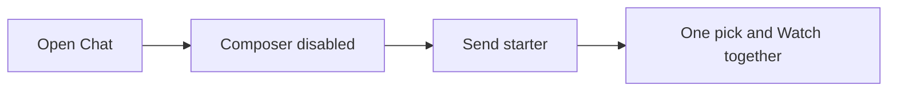
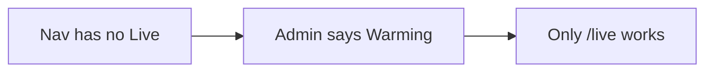

# 02 · UX — 2026-11-01

Reviewed `05274cf` (v1.38.0). Live notes are the run's owner walk on QA `:8792` recorded in `00_2026-11-01_platform-map.md` (screenshots `map_*`). This pass re-read the nav and route code and did not retune Live or send another chat. No member or youth session was available.

## Part A: Conclusions & findings

### 1. Bottom line

**Grade: C+.** A returning owner can ask for something to watch and get a pick: the walk sent one prompt and had a single in-library title, a rationale, and a Watch together card in about 7.7 seconds (`map_chat-reply-success_owner_1440.png`, UX-001). The single most important fix is Live. Stations are on the air, the guide shows start and end times, and the nav still hides Live because "ready" means "a Tunarr URL is saved" (UX-002). The single most important thing to protect is the primary nav's one source of truth: the same function builds the toolbar and the drawer, youth get different labels, and Admin waits until auth settles (UX-003).

### 2. Key conclusions

1. **The front door works when the model is configured.** Chat is `/`. Starters ("Tonight under 2h", "Continue watching"), a persona picker, and thumbs on the reply are all on the first screen. The composer sits disabled for a few seconds while auth settles, which reads as broken if you click immediately (UX-004, Nielsen #1).

2. **Live is a destination you can open and cannot find.** `primaryNavVisibleIds` inserts Live only when `liveChannelsReady` is true (`primaryNav.ts:106-109`). The server sets that flag only when the feature is on **and** `settings.tunarr.url` is non-empty (`app.py:1233-1237`). QA had `live_channels_enabled: true` and `live_channels_ready: false`, a populated `/live` guide, and an Admin tile that says "Warming". Members have no link (UX-002).

3. **Destructive power sits in the browsing toolbar.** Search results for an owner include Select page, Pin, and Delete next to sort and view controls (`map_search-results_owner_1440.png`). Delete is owner-only, which is necessary and not sufficient. The control is in the same row as "what should we watch" (UX-005, Nielsen #5).

4. **Names for the same thing drift by surface.** The rail says Members and the page title says Household. Chat says Curator, the picker says The Professor, and replies say CURATOR. Inbox's accessible name said 12 unread while the phone badge said 9+ (UX-006, UX-007).

5. **Empty, error, and deep-link states are uneven.** Shelves has a real empty state ("Create a shelf"). An invalid invite says "Invite not found" and offers Sign in. An unknown URL returns JSON, so the app's not-found page never mounts. Live at 390px flashed "Not on the air yet — ask the owner" before the guide arrived (UX-008, UX-009).

6. **Settings are already grouped; they are not yet a household control panel.** Profile holds identity, appearance, default page, text size, playback, badges, requests, Plex link, password, and sessions. Voice, taste, notifications, watchlist, and lists are siblings. What is missing for a member is a privacy section that matches the promises on `/privacy` (that gap is named here as findability, not as a legal finding) (UX-010).

7. **Role IA is clear in code and untested in a second session.** Youth labels are Ask and Browse. Admin is omitted for non-owners after auth settles. This pass could not click through as a member or a youth (UX-003).

### 3. Foundations challenged

| Assumption | Evidence for | Evidence against | Verdict | Cost of change | Rationale |
|---|---|---|---|---|---|
| SC-01 Chat is the front door | `/` is Chat; starters match "what should we watch"; one prompt succeeded | Composer dead for a few seconds; five "New conversation" threads from 75 days ago | Keep | S | Keep Chat as home. Fix the disabled state and thread titles (UX-001, UX-004). |
| SC-02 The product is "the Curator" | Persona picker is on the composer | Three names at once (UX-006) | Change | S | One name in the welcome, the picker, and the reply label. |
| SC-13 Live belongs in the product | Guide is populated and shows times | Hidden from every nav (UX-002) | Change | S | If it ships, it is a peer next to Explore. Hiding it is not a softer launch. |
| SC-15 Owners delete from consumer toolbars | Owner-only Delete is on Search | Same toolbar is how people browse (UX-005) | Change | S | Move Delete into a Manage mode. |
| SC-19 Dense Admin is what owners want | Overview, Monday pass, and Tasks are all one click from Admin | "5 things need attention" mixes secrets, backup, and a checklist with no order | Investigate | M | Keep density. Lead with the one action that unblocks the household. |
| SC-25 Phone-first consumer, desktop admin | Bottom nav exists; 390px chat and guide were captured | Guide cells clip times; login shows the bottom nav while signed in | Change | M | Phone nav should match session state (UX-009, UX-011). |

### 4. If we built it today

Five peers for everyone: Search, Chat, Explore, Live, Inbox. Admin and Settings stay owner or account, not peers competing with "what to watch". One product name. Destructive library actions live on an owner Manage screen. Unknown URLs boot the SPA. Settings has four groups: You, Playback, Notifications, Household (owner only).

The gap is small. The peers already exist. Closing it is a gating fix, a label pass, and moving Delete. It is worth it. A new navigation framework is not.

### 5. Findings by surface

**Public.** Login states the ask (username, password, need an invite) and the footer reaches Help, Privacy, and About. Join with a bad token is a clear error (`map_join-invalid-invite_390.png`). The same login screen paints for someone already signed in, and at 390px the member tab bar sits on top of it (UX-011). Unknown paths never reach the client (UX-008). Grade: **C+.**

**Consumer.** Chat, search, title, and explore are all reachable and the happy path produced a pick (UX-001). Explore's "why" sentences were garbled in the walk ("both stories turn on a spin off"), which is a content failure inside the browse journey (UX-012). Shelves empty state tells you what to do. Grade: **B-.**

**Owner.** Admin Overview is a real weekly desk: attention count, health tiles, Monday pass. Tasks is a scheduler console, not a checklist, which is fine for a maintainer and heavy for a Monday (UX-013). Bulk Delete on Search is the sharp edge (UX-005). Grade: **C+.**

**Admin.** Same surface as Owner in this product. The Members page is titled Household (UX-006). No separate support-agent UI. Grade: **C+.**

### 6. Findings by theme

**Navigation.** Best: one function, role labels, Admin withheld until auth. Worst: Live's flag. Direction: ready means "a member can open a guide", which on QA is true without a Tunarr URL (UX-002, UX-003).

**Journeys.** Chat-to-pick is short. Discovering Live is impossible from the chrome. Search-to-title is conventional and long on the title page (synopsis through shared cast). Direction: keep the chat path; add Live as a peer; do not add steps to search.

**Onboarding.** What's New covered the upgrade (`map_whats-new-modal_1440.png`). First-run setup was not walked. Join error state is good.

**Search.** Filters, sort, posters/list, and "beyond your collection" are the right tools. Export CSV and Delete in that toolbar are owner maintenance, not search (UX-005).

**Settings.** The side nav is already the proposed structure's skeleton. Add Household and Privacy as labels, and stop parking badges, password, and sessions in one scrolling Profile (UX-010).

**States.** Shelves and bad invites are designed. Live's first paint and the JSON 404 are not (UX-008, UX-009).

**Feedback.** Chat has thumbs and follow-up chips. Thread titles stay "New conversation". Inbox counts disagree with themselves (UX-007).

### 7. Stop doing

- Stop gating the Live peer on a Tunarr URL when the native guide is already populated (UX-002).
- Stop putting Delete and Export CSV in the default search toolbar (UX-005).
- Stop using Curator, The Professor, and CURATOR as if they were one label (UX-006).
- Stop rendering `/login` as a member screen for a signed-in session (UX-011).

### 8. Strengths worth protecting

- **One nav model** for toolbar and drawer, with youth labels and a delayed Admin icon (UX-003).
- **Chat starters that are tasks**, not slogans: "Tonight under 2h" is a job (UX-001).
- **Shelves empty copy** that says what is missing and what to do.
- **Join error** that does not blame the person and offers Sign in.
- **Default page** as a setting, so Chat does not have to be everyone's home forever (seen on Profile).

### 9. Risks of inaction

In six months Live will be "the feature nobody uses" because it is not in the nav, and the team will cut it after spending the 1.38.0 guide work. An owner will delete a page of titles from Search because Delete sits where Pin sits. Members will keep asking what the app is called. Phone users will keep seeing a sign-in form under a tab bar that proves they are already in.

### 10. Recommended direction

Now: show Live when `live_channels_enabled` and the guide has channels; redirect signed-in `/login` to Chat; boot the SPA for unknown paths. Next: Manage mode for Delete, one product name, inbox count from one number, thread titles from the first prompt. Later: settings regroup and a shorter title page. Ninety days: a new member can open Live from the bottom nav, and search has no Delete unless Manage is on.

### 11. Scorecard

| Surface | Findability | Task success | States | Consistency | Overall |
|---|---|---|---|---|---|
| Public | 3 — invite path exists; bad URLs do not | 3 — join error is clear | 2 — JSON 404; signed-in login | 3 | 3 |
| Consumer | 3 — Live missing | 4 — chat pick worked | 3 — shelves good, Live flash bad | 3 — three curator names | 3 |
| Owner | 4 — Admin is in the nav | 3 — Monday pass is a wall of tiles | 3 | 2 — Members/Household | 3 |
| Admin | 4 | 3 — Tasks is expert-only | 3 | 3 | 3 |

Scores are 1–5.

### Navigation trees

**Owner, current** (from `PRIMARY_NAV_ITEMS` plus the ready flag as QA computed it):

- Search
- Chat
- Explore
- Inbox
- Admin
- Settings

**Owner, proposed:**

- Search
- Chat
- Explore
- Live
- Inbox
- Admin
- Settings

**Member, current** (code: no Admin once auth settles; Live only if ready):

- Search
- Chat
- Explore
- Inbox
- Settings

**Member, proposed:**

- Search
- Chat
- Explore
- Live
- Inbox
- Settings

**Youth, proposed labels:**

- Search
- Ask
- Browse
- Live (only stations the rating gate allows; do not add a second nav)
- Inbox
- Settings

### Sitemaps

Current owner map, from the walk and `AppRoutes.tsx`: `/` Chat, `/search`, `/explore`, `/library` (Shelves, Watchlist, Collections, Browse), `/title/:type/:id`, `/live`, `/inbox`, `/settings/*`, `/admin/*`, `/help`, `/privacy`, `/about`. Proposed: same URLs. Change the links, not the paths.

### Journeys

**Tonight's pick (owner, walked).** Steps: open `/` (composer disabled), wait, type or use a starter, send, read one card. Clicks after load: 1 if they use a starter, 2 if they type. Decisions: persona (optional), which starter. Grade 4/5. Friction is the dead composer (UX-004), not the answer.

Proposed: composer shows "Getting your library ready…" and ignores taps without looking disabled, then the same card.

**Find Live (owner, walked).** Steps: scan top nav, scan Admin Overview ("Warming"), type `/live` or give up. Clicks from chrome: 0 that work. Grade 1/5.

Proposed: Live peer goes to the guide. Admin "Warming" is reserved for zero channels.

### Settings structure, proposed

- **You** — name, chat name, password, sessions, Plex link
- **Watching** — default page, text size, appearance, playback, subtitles preference
- **Notifications** — inbox, email, nudges, newsletter, year in review
- **Taste** — voice and persona, taste sliders
- **Household** (owner) — members, invites, youth, requests
- **Privacy** — export, delete my chats, what the household can see

Remove nothing that exists; move badges under You, and move password and sessions out of the middle of Profile.

---

## Part B: Detailed findings

### 12. Scope and method

Owner walk is the platform map's, same run, QA `:8792`, 1440 and 390, no Watch and no tune. Code cites are `05274cf`. Member and youth journeys are from `primaryNav.ts` only. One chat prompt was sent by recon, not by this pass.

### 13. Strengths

### UX-001: Protect the chat-to-one-pick path

| Field | Value |
|---|---|
| Type | Strength |
| Surface | Consumer |
| Persona(s) | Returning consumer, first-time visitor |
| Category | Journeys |
| Severity | High |
| Impact | 5 |
| Effort | S |
| Confidence | Confirmed |
| Priority score | 7.5 |
| Verdict | Protect |
| Dependencies | none |
| Labels | chat, heuristic-1 |

**Evidence:** Platform map §4.2 and `map_chat-reply-success_owner_1440.png`. Prompt: "One short comedy under 100 minutes for tonight?" Result: one in-library pick, rationale, Watch together, four follow-ups, thumbs. Idle again in about 7.7s. Starters include "Tonight under 2h".

**Current state:** The core job completes in one send when the model and the library agree.

**Root cause:** Chat is the home page and the starters are phrased as jobs.

**Recommendation:** Keep a single primary card when the person asked for one pick. Do not add a second row of "also consider" above that card. Keep the starter chips.

**Rationale:** This is the product. A gallery of fourteen cards would undo the sentence the person typed. Nielsen #1 (visibility of status) is met by the idle return; do not regress it.

**User story:** As a member, I want one title for tonight so I can press play instead of browsing.

**Acceptance criteria:**
- [ ] A "one pick" prompt still renders one primary title before any secondary list.
- [ ] Starter chips remain visible before the first send.

**Success metric:** A tester can name the pick without scrolling.

**Validation:** Repeat the prompt on QA and compare to `map_chat-reply-success_owner_1440.png`.

### UX-003: Protect the single primary-nav function

| Field | Value |
|---|---|
| Type | Strength |
| Surface | Cross-cutting |
| Persona(s) | Owner, member, youth |
| Category | Navigation |
| Severity | Medium |
| Impact | 4 |
| Effort | S |
| Confidence | Confirmed |
| Priority score | 4.0 |
| Verdict | Protect |
| Dependencies | none |
| Labels | nav, heuristic-4 |

**Evidence:** `05274cf:frontend/src/lib/primaryNav.ts:1-16` and `95-152`. `buildPrimaryNavItems` is the filter for both toolbar and drawer. Youth labels: Chat → Ask, Explore → Browse (lines 31-40). Admin is inserted only after `authReady` (lines 111-119). Public peers stay visible during a slow `/api/auth/me`.

**Current state:** Toolbar and drawer cannot drift. Members are not flashed an Admin icon while the session check runs.

**Root cause:** One list plus one visibility function, documented at the top of the file.

**Recommendation:** Any new peer is added to `PRIMARY_NAV_ITEMS` and `primaryNavVisibleIds` only. Do not add a second nav array in a layout.

**Rationale:** Nielsen #4 (consistency). A second list is how Live would show in the drawer and not the tab bar. Rejected: per-layout nav, which this file exists to prevent.

**User story:** As a youth, I want the same destinations on the phone and in the menu so I do not learn two apps.

**Acceptance criteria:**
- [ ] Drawer items are produced from `buildPrimaryNavItems`.
- [ ] A member session never includes Admin.
- [ ] Youth labels stay Ask and Browse.

**Success metric:** A nav unit test fails if drawer ids differ from toolbar ids.

**Validation:** `primaryNav` tests under `frontend/src/lib`.

### 14. Weaknesses

### UX-002: Show Live in the nav when the guide has stations

| Field | Value |
|---|---|
| Type | Weakness |
| Surface | Consumer |
| Persona(s) | Returning consumer, owner, youth |
| Category | Navigation |
| Severity | High |
| Impact | 5 |
| Effort | S |
| Confidence | Confirmed |
| Priority score | 7.5 |
| Verdict | Fix |
| Dependencies | none |
| Labels | live, heuristic-6 |

**Evidence:** `05274cf:frontend/src/lib/primaryNav.ts:106-109` adds `live` only if `liveChannelsReady`. `05274cf:projectionist/web/app.py:1230-1237` sets `live_channels_ready` to enabled **and** a non-empty Tunarr URL. The comment says "Ready for /live nav: feature on + Tunarr URL". QA walk: enabled true, ready false, `/live` showed five rows including timed cells (`map_live-guide_owner_1440.png`), Admin said "Warming". Nielsen #6: recognition rather than recall. The route is recalled only if you know the URL.

**Current state:** 1.38.0's guide work is invisible from the product's own navigation.

**Root cause:** The nav flag still means "external Tunarr is configured" after the app grew its own guide.

**Recommendation:** Set `live_channels_ready` true when the feature is on and at least one channel is published, regardless of `tunarr.url`. Keep the Warming tile for the zero-channel case. Place Live after Explore, which the splice already does.

**Rationale:** A hidden feature cannot be evaluated. Leaving the Tunarr check preserves an old setup wizard and hides a working guide. Effort is the condition, not a new information architecture.

**User story:** As a member, I want Live next to Explore so I can turn the TV on without asking for a URL.

**Acceptance criteria:**
- [ ] With stations on the guide and an empty Tunarr URL, the toolbar, drawer, and bottom nav include Live.
- [ ] With the feature off, Live is absent.
- [ ] With the feature on and zero channels, Live is absent and Admin still says Warming.

**Success metric:** A new member finds Live without being told the path.

**Validation:** Compare nav to `/api/features` on QA after the condition change.

### UX-005: Move bulk Delete out of the search toolbar

| Field | Value |
|---|---|
| Type | Weakness |
| Surface | Consumer |
| Persona(s) | Established owner |
| Category | Error prevention |
| Severity | High |
| Impact | 4 |
| Effort | S |
| Confidence | Confirmed |
| Priority score | 6.0 |
| Verdict | Fix |
| Dependencies | none |
| Labels | delete, heuristic-5 |

**Evidence:** Platform map §4.2 and P-10. `map_search-results_owner_1440.png`. Owner search toolbar includes Select page, Pin to watchlist, and Delete, beside sort and view. Nielsen #5 (error prevention): the dangerous control shares a row with ordinary browsing.

**Current state:** Delete is owner-only, so members are safe. The owner is not, because the control is where muscle memory for Pin lives.

**Root cause:** Library maintenance was added to the consumer results chrome instead of an owner mode.

**Recommendation:** Default toolbar: sort, filters, view, pin. A "Manage" toggle, owner-only, reveals Select page, Delete, and Export CSV. Delete still requires the existing typed confirmation.

**Rationale:** Owners do delete titles, and they should not do it from the same row as "show me comedies". A separate admin-only page would hide a tool people already found. A toggle keeps it one click away.

**User story:** As an owner, I want Delete out of the way until I mean to clean the library so I do not remove a page of results.

**Acceptance criteria:**
- [ ] Search and Browse toolbars have no Delete until Manage is on.
- [ ] Manage is not rendered for member or youth.
- [ ] Typed confirmation still gates the delete.

**Success metric:** A mis-tap on the results toolbar cannot start a delete.

**Validation:** Owner and a code-level role test. No member session was available here.

### UX-008: Boot the app for unknown URLs

| Field | Value |
|---|---|
| Type | Weakness |
| Surface | Public |
| Persona(s) | First-time visitor, returning consumer |
| Category | States |
| Severity | Medium |
| Impact | 3 |
| Effort | S |
| Confidence | Confirmed |
| Priority score | 3.0 |
| Verdict | Fix |
| Dependencies | none |
| Labels | 404, heuristic-9 |

**Evidence:** Walk: `/this-route-does-not-exist` returned `{"detail":"Not Found"}`. `spa_routes.py` lists HTML paths and has no fallback (see also the route table in the platform map). The client builds a `NotFoundPage` chunk. Nielsen #9: help users recognize and recover. JSON does not.

**Current state:** A bad link or a new client route without a server twin dumps the API error.

**Root cause:** Server HTML routes are an allow-list that drifted from the client router.

**Recommendation:** Non-API GET falls through to `index.html` with `Cache-Control: no-cache`. The existing not-found page does the rest. API 404s stay JSON.

**Rationale:** Recovery needs the app shell: nav, search, a sentence. Duplicating every client route on the server will drift again.

**User story:** As a member, I want a bad link to show me the app so I can get back to Chat.

**Acceptance criteria:**
- [ ] An unknown non-API path returns HTML and the shell.
- [ ] `/api/nope` stays JSON 404.

**Success metric:** The not-found page is what a tester sees.

**Validation:** curl the two paths.

### UX-004: Tell the truth while the composer is disabled

| Field | Value |
|---|---|
| Type | Weakness |
| Surface | Consumer |
| Persona(s) | Returning consumer |
| Category | Feedback |
| Severity | Medium |
| Impact | 3 |
| Effort | XS |
| Confidence | Confirmed |
| Priority score | 3.0 |
| Verdict | Fix |
| Dependencies | none |
| Labels | chat, heuristic-1 |

**Evidence:** Walk §4.2: composer disabled for a few seconds with placeholder "Describe what you're hunting for…", then enables. P-13. Nielsen #1.

**Current state:** The control looks ready to type and does not accept input. No status text explains the wait.

**Root cause:** Auth and session settle after first paint, and the disabled state reused the idle placeholder.

**Recommendation:** While disabled, placeholder "One moment — opening your library." Announce it with `aria-live="polite"`. Remove that text the moment the field enables.

**Rationale:** A few seconds is acceptable. A dead field with an invitation to type is not. A spinner alone fails Nielsen #1's "what is happening" test.

**User story:** As a member, I want the composer to say it is still opening so I do not tap twice.

**Acceptance criteria:**
- [ ] Disabled composer text is not the typing prompt.
- [ ] The typing prompt returns when the field enables.

**Success metric:** A first-load recording shows the status string before the field enables.

**Validation:** Reload `/` on QA.

### UX-006: Use one name for the assistant and one name for the people page

| Field | Value |
|---|---|
| Type | Weakness |
| Surface | Cross-cutting |
| Persona(s) | Returning consumer, owner |
| Category | Labels |
| Severity | Medium |
| Impact | 3 |
| Effort | S |
| Confidence | Confirmed |
| Priority score | 3.0 |
| Verdict | Fix |
| Dependencies | none |
| Labels | voice, heuristic-4 |

**Evidence:** Walk P-11. Welcome copy says Curator, persona picker says The Professor, replies are labelled CURATOR. Admin rail "Members", h1 "Household".

**Current state:** Three assistant names and two names for the household list.

**Root cause:** Persona, product, and role labels were added separately.

**Recommendation:** Product name stays Projectionist. The assistant's visible name is the selected persona ("The Professor") everywhere a reply is labelled. If no persona is selected, use "Projectionist". Rename the Admin rail item to "Household" so it matches the h1, or rename the h1 to "Members". Pick one and use it in the nav and the title.

**Rationale:** Nielsen #4. People cannot tell whether The Professor is a mode or a different product. Rejected: removing personas, which the picker is built around.

**User story:** As a member, I want one name on the replies so I know who I am talking to.

**Acceptance criteria:**
- [ ] Reply label equals the persona name.
- [ ] Admin destination and page h1 share one word, Household or Members.

**Success metric:** A reader can point to a single assistant name on Chat.

**Validation:** Screenshots of welcome, picker, reply, and the household page.

### UX-007: Drive the inbox badge from one count

| Field | Value |
|---|---|
| Type | Weakness |
| Surface | Consumer |
| Persona(s) | Returning consumer |
| Category | Feedback |
| Severity | Medium |
| Impact | 2 |
| Effort | S |
| Confidence | Confirmed |
| Priority score | 2.0 |
| Verdict | Fix |
| Dependencies | none |
| Labels | inbox, heuristic-1 |

**Evidence:** Walk P-4. Accessible name "Inbox, 12 unread"; desktop badge 12; bottom nav "9+".

**Current state:** Two badges and the screen reader disagree.

**Root cause:** The phone badge caps at 9+ while the desktop badge and the accessible name use the raw count, or they read different sources. The walk shows they were not the same number.

**Recommendation:** One function returns the unread count. Desktop shows the number up to 99, then "99+". Phone shows the same string. The accessible name uses that string.

**Rationale:** A badge is a promise. 12 versus 9+ on the same session teaches people to ignore it.

**User story:** As a member, I want the phone badge to match the desktop badge so I know whether I have read everything.

**Acceptance criteria:**
- [ ] Toolbar, bottom nav, and accessible name share one integer.
- [ ] The cap, if any, is identical on both bars.

**Success metric:** The three representations never diverge in a unit test.

**Validation:** Render with 12 unread items at 1440 and 390.

### UX-009: Do not say Live is off while the guide is loading

| Field | Value |
|---|---|
| Type | Weakness |
| Surface | Consumer |
| Persona(s) | Low-bandwidth mobile user |
| Category | States |
| Severity | Medium |
| Impact | 3 |
| Effort | XS |
| Confidence | Likely |
| Priority score | 2.4 |
| Verdict | Fix |
| Dependencies | UX-002 |
| Labels | live, heuristic-1 |

**Evidence:** Walk §4.2 and P-6. At 390px, before data, the page showed "Not on the air yet — Ask the household owner to enable Live Channels in Admin." Then five rows appeared. Seen once, so Likely.

**Current state:** The empty copy is the loading copy.

**Root cause:** The empty state is rendered before the guide request resolves.

**Recommendation:** Loading: "Loading the guide…" and a skeleton row. Empty, only after a successful empty response: the ask-the-owner sentence. Error: "The guide didn't load. Try again."

**Rationale:** The current sentence tells a member to bother the owner for a feature that is already on. Nielsen #1.

**User story:** As a member on a phone, I want a loading guide to look like loading so I do not think Live is broken.

**Acceptance criteria:**
- [ ] The enable-Live sentence is not in the DOM until the request returns empty.
- [ ] A delayed response shows the loading sentence.

**Success metric:** A throttled reload never shows the enable sentence before rows.

**Validation:** Slow-3G reload of `/live` at 390px.

### UX-011: Send a signed-in person away from the login form

| Field | Value |
|---|---|
| Type | Weakness |
| Surface | Public |
| Persona(s) | Returning consumer |
| Category | Navigation |
| Severity | Medium |
| Impact | 2 |
| Effort | XS |
| Confidence | Confirmed |
| Priority score | 2.0 |
| Verdict | Fix |
| Dependencies | none |
| Labels | login, heuristic-4 |

**Evidence:** `map_login_signed-in-session_1440.png` and `_390.png`. P-5. The form renders, and at 390px the bottom nav (proof of a session) sits above it.

**Current state:** `/login` does not notice the session.

**Root cause:** The route is public and the shell still mounts member chrome when a session exists.

**Recommendation:** If the session is authenticated, redirect `/login` to the user's default page (Chat unless they changed it). Do not show the bottom nav on the login route.

**Rationale:** A sign-in form under a tab bar is two products at once. Redirect is the usual fix and matches "default page" already being a setting.

**User story:** As a member who bookmarks Sign in, I want to land in the app so I am not asked for a password I already gave.

**Acceptance criteria:**
- [ ] Authenticated `GET /login` in the client ends on the default page.
- [ ] Logged-out `/login` has no bottom nav.

**Success metric:** The signed-in screenshot cannot be repeated.

**Validation:** Open `/login` in the owner session.

### UX-012: Show a "why" sentence only when it is a sentence

| Field | Value |
|---|---|
| Type | Weakness |
| Surface | Consumer |
| Persona(s) | Returning consumer |
| Category | Content in the journey |
| Severity | Medium |
| Impact | 3 |
| Effort | S |
| Confidence | Confirmed |
| Priority score | 3.0 |
| Verdict | Fix |
| Dependencies | none |
| Labels | explore, heuristic-2 |

**Evidence:** Walk §4.2. Explore "For you" rail: "You watched X; Y — both stories turn on a spin off." `map_explore_owner_1440.png`. Nielsen #2: the system's language should be the user's.

**Current state:** The reason line is a template filled with a fragment that is not a reason.

**Root cause:** A motif or keyword was inserted into a sentence frame that assumes a noun phrase.

**Recommendation:** If the fragment fails a small check (ends with a preposition, or is shorter than three words), omit the "both stories…" clause and show "Because you watched {title}." Never show a broken clause.

**Rationale:** A wrong reason is worse than none. It makes the rail look random. Rewriting the whole recommender is out of scope for the sentence.

**User story:** As a member, I want the reason line to make sense so I trust the rail.

**Acceptance criteria:**
- [ ] A fixture motif "spin off" does not produce "turn on a spin off".
- [ ] The fallback sentence is grammatical.

**Success metric:** None of the eight visible reasons on Explore fail a read-aloud check.

**Validation:** Reload Explore after the template change.

### UX-013: Make the Monday pass the first thing on Admin Overview

| Field | Value |
|---|---|
| Type | Weakness |
| Surface | Owner |
| Persona(s) | Established owner |
| Category | Owner efficiency |
| Severity | Low |
| Impact | 2 |
| Effort | S |
| Confidence | Confirmed |
| Priority score | 1.0 |
| Verdict | Fix |
| Dependencies | none |
| Labels | admin, heuristic-8 |

**Evidence:** Walk §4.2. Overview order: "5 things need attention", household health, Monday pass, metrics, setup. `map_admin-overview_owner_1440.png`. Tasks is a full scheduler (`map_admin-tasks_owner_1440.png`). Nielsen #8: aesthetic and minimalist. The Monday job is buried under status tiles.

**Current state:** The page is a dashboard of dashboards. The checklist the owner came to finish is not first.

**Root cause:** Each subsystem added a tile to the top.

**Recommendation:** First region: Monday pass, with the five attention items as its rows when they are the same work (secrets key, backup, Radarr key). Health tiles move below. Tasks stays a separate expert page.

**Rationale:** The owner has one weekly visit. The current order optimizes for scanning, not finishing. Rejected: deleting Tasks. Operators still need the scheduler table.

**User story:** As an owner on Monday, I want the checklist first so I can leave Admin in one pass.

**Acceptance criteria:**
- [ ] Monday pass is the first region below the page title.
- [ ] Tasks is still linked, not inlined.

**Success metric:** The five attention items are completable without scrolling past health tiles on a 1440px screen.

**Validation:** Screenshot after the reorder.

### 15. Opportunities

### UX-010: Add Privacy and Household groups to settings

| Field | Value |
|---|---|
| Type | Opportunity |
| Surface | Owner |
| Persona(s) | Member, owner |
| Category | Settings |
| Severity | Medium |
| Impact | 3 |
| Effort | M |
| Confidence | Confirmed |
| Priority score | 2.0 |
| Verdict | Add |
| Dependencies | none |
| Labels | settings, heuristic-6 |

**Evidence:** Walk §4.2 lists Profile's sections: Identity through Sessions, all on one page. Side nav: Profile, Voice & persona, Taste, Notifications, Watchlist, Lists. No Privacy group. Export and delete are described on `/privacy`, not next to Password.

**Current state:** Account security and appearance share a scroll. The privacy actions live in a document.

**Root cause:** Settings grew by appending sections to Profile.

**Recommendation:** Use the six groups in section 5. Do not add new preferences in this change. Move existing controls.

**Rationale:** Nielsen #6. People look for "delete my chats" next to the password, not in a policy page. A new settings framework is unnecessary.

**User story:** As a member, I want export and delete beside my password so I can find them without reading the privacy essay.

**Acceptance criteria:**
- [ ] Password and sessions are not between text size and badges.
- [ ] A Privacy group links to the existing export and delete actions.
- [ ] No new setting is invented in the move.

**Success metric:** A tester finds "password" and "delete my data" without `/privacy`.

**Validation:** Walk Settings at 1440 and 390.

### 16. Remediation plan

| Horizon | ID | Title | Effort | Owner | Dependencies |
|---|---|---|---|---|---|
| Now | UX-002 | Live in the nav when stations exist | S | Frontend | none |
| Now | UX-011 | Redirect signed-in /login | XS | Frontend | none |
| Now | UX-004 | Composer waiting copy | XS | Frontend | none |
| Now | UX-009 | Live loading versus empty | XS | Frontend | UX-002 |
| Next | UX-005 | Manage mode for Delete | S | Frontend | none |
| Next | UX-008 | SPA fallback for unknown URLs | S | Backend | none |
| Next | UX-006 | One assistant name; one household label | S | Design | none |
| Next | UX-007 | One inbox count | S | Frontend | none |
| Next | UX-012 | Grammatical "why" or omit it | S | Backend | none |
| Later | UX-010 | Settings groups | M | Frontend | none |
| Later | UX-013 | Monday pass first | S | Frontend | none |

### 17. Quick wins

UX-011, UX-004, UX-009, and the Live flag in UX-002.

### 18. Open questions

- Should youth see Live at all, or only a filtered guide? The nav can show the peer; the guide must still apply the rating gate. This pass had no youth session.
- Is "Household" or "Members" the word owners use? Pick before the label change in UX-006.

### Phase 6 self-check

- [x] Part A first; conclusions cite IDs.
- [x] High findings UX-002 and UX-005 are in the narrative. UX-001 is a High strength and is the bottom line.
- [x] Foundations, "If we built it today", and "Stop doing" are present.
- [x] All four surfaces are in section 5.
- [x] Strengths use the full finding format.
- [x] Nav trees, sitemaps, journeys with Mermaid, settings structure, and a Nielsen citation on each finding are included.
- [x] IDs UX-001 through UX-013 are unique. UX-003 is a strength.
- [x] No application code was modified.
