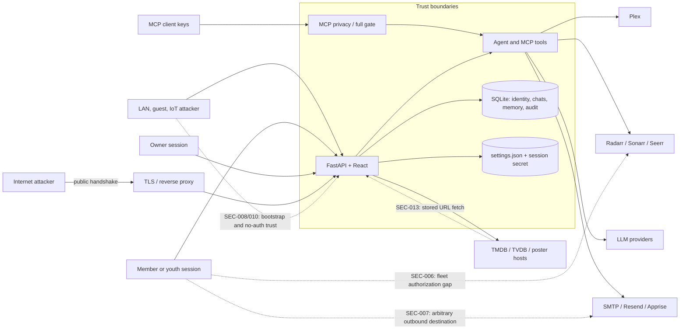

# 06 · Senior Security Team — 360° review, 2026-11-01

## Part A: Conclusions & findings

### 1. Bottom line

Projectionist earns a **D** for security at `05274cf` (v1.38.0): it has unusually thoughtful household-scale defenses—an explicit public handshake, strong session signing, atomic invites, object-scoped chat/list/watchlist routes, youth filtering, encrypted secrets, and confirmation-gated automation—but five confirmed privilege or network-boundary weaknesses remain exploitable by a household member or LAN peer (SEC-006–SEC-010). The single most important fix is to make the REST and agent authorization policy identical: members and youth must never reach owner Radarr/Sonarr credentials, even through a confirmation token (SEC-006). The single most important thing to protect is the fail-closed perimeter and object-scoping work introduced before this release (SEC-001, SEC-003). No Critical issue was confirmed, but the concentration of High issues means this release should not be treated as hardened for a hostile household LAN.

### 2. Key conclusions

1. **The perimeter is explicit and fail-closed, but authorization behind it is still route- and tool-specific.** Authentication middleware permits only an enumerated method/path handshake and returns uniform 401 responses in QA; owner dependencies cover the sampled admin routes (SEC-001). Once authenticated, however, role rules are duplicated across REST handlers, tool-definition filtering, tool execution, and pending-action redemption, which allowed a member/youth path to owner *arr credentials (SEC-006, SEC-015).

2. **The new invite flow is cryptographically and transactionally sound, but first-owner bootstrap remains raceable when the recommended seed is omitted.** Invite tokens use strong randomness, HMAC verification, a hash at rest, expiry/revocation checks, method restrictions, and atomic identity creation/redemption (SEC-002). In contrast, Plex or OIDC still promotes the first real identity to owner when no env-seeded owner exists, explicitly preserving a legacy trusted-LAN behavior (SEC-008).

3. **Object-level controls are mostly strong, with one important agent/REST parity failure.** Chat threads, saved pages, lists, watchlists, notifications, pending actions, reviews over REST, and youth memory are scoped to the caller or owner (SEC-003). The chat tool `get_user_reviews` omits `user_id`, so an ordinary member can ask the model to retrieve household-wide review text even though the equivalent REST route is scoped (SEC-009).

4. **A self-service notification feature creates a direct authenticated SSRF primitive.** Any member can save and test an arbitrary Apprise URL; no scheme, DNS, IP-range, redirect, or destination policy is applied, and tests explicitly bless `json://localhost/...` (SEC-007). This is more dangerous than a generic integration misconfiguration because it crosses the member-to-server trust boundary and can target services reachable only from the container.

5. **Single-owner mode is a convenience mode, not a safe default on a mixed-trust LAN.** The container binds all interfaces, multi-user auth defaults off, and the runtime interlock deliberately allows private and Docker-bridge peers; any compromised TV, IoT device, guest, or neighbor on the routed LAN therefore receives owner-equivalent API access (SEC-010). Keep the mode only as an explicit, warned local-lab choice.

6. **Credential and software-integrity foundations are materially better than the average self-hosted app.** Sessions use a generated 48-byte secret and HMAC; passwords use PBKDF2-SHA256 at 600,000 iterations; settings secrets are authenticated-encrypted; runtime Python packages are version/hash locked; and the image drops root (SEC-004). The frontend lock still contains a moderate React Router advisory, and npm auditing is absent from CI (SEC-014).

7. **Detection is an owner-visible ledger, not yet an incident-response system.** Security events scrub secret values and cover sign-ins, invites, account changes, settings, key operations, and backups, but omit source IP class, session identifiers, MCP authentication failures, most owner mutations, destructive media actions, export, and alerts (SEC-012). An attacker who obtains a session or full MCP key can operate with limited forensic trace.

8. **Browser defenses are solid but authentication assurance is below the sensitivity of the owner account.** QA returned CSP, frame denial, nosniff, referrer and permissions policies; cookies are HttpOnly/SameSite Lax and Secure/HSTS under trusted HTTPS (SEC-001). Owner authentication still permits an eight-character password, has no MFA/passkey or step-up for secret reveal and destructive actions, and issues a 30-day non-rotating session (SEC-011, SEC-016).

### 3. Foundations challenged

| Assumption | Evidence for | Evidence against | Verdict (Keep / Change / Remove / Investigate) | Cost of change | Rationale |
|---|---|---|---|---|---|
| SC-04: owner/member plus youth flag is enough | Simple household model; owner dependencies and youth gates are understandable | Member and youth share too broad a base capability; no co-admin/read-only operator role; *arr parity defect | **Change** | M | Keep the data model, but define capabilities (`library.read`, `request.create`, `fleet.mutate`, `household.admin`) centrally rather than inferring every decision from two roles. |
| SC-05: no-login single-owner mode should be default | Frictionless local setup; WAN interlock blocks visible public clients | Default all-interface bind gives every routed private peer owner power | **Change** | M | Make authenticated household mode the production default; retain no-login only behind loopback or an explicit unsafe-LAN acknowledgment. |
| SC-06: seven-day bearer invites are right | Strong token, hash at rest, atomic redemption, expiry/revoke | URL token can appear in browser/proxy history; emailed identity is not a hard identity binding unless expected IDs are set | **Keep** | S | Household bearer invitations are proportionate if HTTPS is required and logs/referrers remain controlled; add optional identity binding and shorter custom TTLs. |
| SC-15: destructive owner actions belong on consumer surfaces | Owner may act while browsing | Increases accidental-action and session-theft blast radius | **Change** | S | Preserve discovery context, but require owner step-up and move execution to an admin confirmation surface. |
| SC-23: secrets encrypted under the session secret are adequate | Authenticated encryption, 0600 files, dedicated-key option, secret masking | Backup plus session secret decrypts integration fleet; SMB may not preserve mode | **Keep** | S | Sound for self-hosting if the dedicated key is strongly recommended and backup guidance remains explicit. |
| SC-24: full MCP is a core feature | Distinct constant-time key, privacy/full modes, confirmation scope | Long-lived bearer key has owner-scale reach and sparse audit attribution | **Change** | M | Keep privacy MCP; require expiry, scopes, rotation metadata, and event-level audit before calling full mode production-grade. |
| Confirmation tokens are authorization | Tokens ensure intent and bind to `user_id` | A member can confirm their own owner-impacting proposal where the action kind is not owner-only | **Remove** | S | Confirmation is consent, never privilege. Check capability before proposal and again before execution. |
| Local notification endpoints are safe for members | Useful self-service delivery channel | Apprise supports server-side network destinations, including localhost | **Change** | M | Use owner-approved destinations or an outbound allowlist; do not accept arbitrary member URLs. |

### 4. If we built it today

We would begin with authenticated household mode, a capability matrix shared by FastAPI dependencies, the agent registry, pending-action execution, MCP scopes, and UI affordances. Every resource query would take a required actor context; every external write would pass a policy decision and append an immutable audit event. Outbound requests would use one SSRF-safe client with scheme and DNS/IP validation on every redirect. Owner sign-in would support passkeys/TOTP and step-up for secret reveal, role change, backup, deletion, and fleet actions. The current architecture is close on cryptographic primitives but far from that single policy plane; closing the gap is worth it because SEC-006, SEC-007, and SEC-009 all stem from duplicated boundaries rather than missing point checks.

#### Lightweight threat model

**Assets:** owner session, household identities and youth status, chats/memory/reviews, integration credentials, Plex library and playback identifiers, media files and *arr queues, LLM spend, full MCP key, backups, and the audit ledger.  
**Actors:** anonymous WAN caller, malicious/compromised LAN device, invited member, youth member, stolen owner session, compromised MCP client, malicious metadata source, and dependency maintainer compromise.  
**Primary trust boundaries:** browser↔FastAPI, public handshake↔authenticated API, member↔owner capability, agent/MCP↔REST policy, app↔outbound integrations, and container↔config/media volumes.

### 5. Findings by surface

**Public.** The public API is intentionally small, method-specific, rate-limited on sensitive handshakes, and uniform on unauthenticated errors; QA confirmed the login headers and 401 shape (SEC-001). Invites are strong and atomic (SEC-002), but an unseeded first Plex/OIDC identity can still claim owner and no-login mode trusts private peers too broadly (SEC-008, SEC-010). **Grade: 3/5.**

**Consumer.** Personal REST resources are generally object-scoped, and youth content filtering is fail-closed (SEC-003). Consumer trust breaks where server-side integrations are exposed: member/youth users can reach direct *arr proposal/confirmation, arbitrary Apprise destinations, and household-wide review retrieval through the agent (SEC-006, SEC-007, SEC-009). **Grade: 2/5.**

**Owner.** Owner endpoints sampled in settings, members, backups, tasks, logs, Live, and security audit require owner role. Secrets are masked/encrypted and sensitive mutations often require confirmation (SEC-004, SEC-005). Owner assurance is weakened by eight-character credentials, no MFA/step-up, 30-day sessions, and incomplete action telemetry (SEC-011, SEC-012). **Grade: 3/5.**

**Admin.** The admin control plane benefits from non-root packaging, hidden OpenAPI, security headers, and a local audit page (SEC-001, SEC-004). It lacks a central authorization inventory, outbound-request policy, alerting, and complete audit coverage; the dependency gate is stronger for Python than JavaScript (SEC-012–SEC-015). **Grade: 2/5.**

### 6. Findings by theme

**Authentication and session security.** Strong HMAC sessions, revocation, session epochs, constant-time password verification, generic login failures, and rate limits form a sound base. The residual risks are bootstrap ownership, weak minimum password requirements, long sessions, and absent MFA/step-up (SEC-001, SEC-008, SEC-011, SEC-016).

**Authorization and IDOR.** Most sampled personal routes bind queries and mutations to `user.id`, and owner routes use server-side dependencies rather than relying on SPA guards. The worst failures appear where the same operation exists on multiple planes: *arr and reviews diverge between REST, agent definitions, execution, and pending actions (SEC-003, SEC-006, SEC-009, SEC-015).

**Input handling, injection, and SSRF.** Pydantic bounds public inputs, public JSON bodies are capped, SQL filters use parameterized values, markdown is sanitized, uploads use size/magic checks, and no shell execution with user text was found. Outbound destination validation is inconsistent: Apprise accepts localhost by design and the poster proxy accepts unknown absolute hosts and follows redirects (SEC-007, SEC-013).

**Secrets, transport, and headers.** Secrets are masked, encrypted with integrity, and saved mode 0600; the image runs as UID 1000. QA showed CSP, DENY framing, nosniff, strict-origin referrer policy, and no permissive CORS preflight. HSTS is correctly omitted on the HTTP-only LAN host and conditionally enabled for trusted HTTPS (SEC-001, SEC-004).

**Abuse resistance.** Public login/PIN/invite/access-request and chat routes have in-process per-IP limits, with forwarded addresses trusted only when configured. Limits reset on restart and do not aggregate across replicas; no account lock, device-risk signal, or owner alert exists. Those gaps matter less than the direct authenticated SSRF and role bypass (SEC-007, SEC-011, SEC-012).

**Supply chain.** Runtime Python dependencies are exact and hash-pinned and CI runs `pip-audit`; Docker uses pinned Tunarr version and a non-root final process. The frontend resolves React Router 6.30.6 with two moderate advisories reported by `npm audit`, npm audit is not a CI gate, and GitHub Actions use movable major tags (SEC-004, SEC-014).

**Detection and response.** Audit values are scrubbed and capped, but coverage and context are insufficient for incident reconstruction, and there is no alert path or concise compromise playbook (SEC-012). Security should emit actor, coarse source, auth/session method, request correlation, target, action, and outcome without storing secrets.

### 7. Stop doing

- Stop treating a confirmation token as proof of authorization; it proves user intent only (SEC-006).
- Stop accepting arbitrary server-side notification URLs from non-owners (SEC-007).
- Stop preserving “first identity becomes owner” as a silent compatibility path (SEC-008).
- Stop shipping no-login/all-interface mode as the default production posture (SEC-010).
- Stop implementing role and object rules separately in REST, agent tools, MCP, and UI (SEC-015).
- Stop calling the audit page an incident-response capability until it records complete security-relevant actions and can alert (SEC-012).

### 8. Strengths worth protecting

- Keep the exact public method/path allowlist and generic unauthenticated response contract (SEC-001).
- Keep invite HMAC verification before lookup, token hashing at rest, and atomic redemption (SEC-002).
- Keep `user_id` in database predicates—not post-query filtering—and fail with 404 for foreign objects (SEC-003).
- Keep generated session secrets, authenticated settings encryption, hash-locked Python runtime, and non-root execution (SEC-004).
- Keep double enforcement for owner tool visibility/execution and confirm-gated external writes; extend it rather than replacing it with prompt-only rules (SEC-005).

### 9. Risks of inaction

Within 6–12 months, an ordinary household account could bypass the intended Seerr request workflow and queue downloads directly, filling storage or acquiring prohibited content (SEC-006). A compromised member session could use Apprise to scan or invoke internal HTTP services from the container network (SEC-007), while an unseeded reinstall could hand ownership to the first LAN/OIDC/Plex claimant (SEC-008). Private review text could leak through natural-language chat (SEC-009). If any of those incidents occur, the current ledger may show the login or account but not the network source, pending-action lifecycle, MCP activity, or destructive operation needed to determine scope (SEC-012).

### 10. Recommended direction

In the first two weeks, close the member-to-owner paths: centralize action capabilities, mark all direct *arr actions owner-only, keep members on Seerr, block arbitrary Apprise destinations, scope agent reviews, and remove first-login ownership. In weeks 2–6, make authenticated mode the safe default, add outbound request validation, expand audit coverage/context, and upgrade React Router. Within 90 days, ship passkey/TOTP step-up and a generated route/tool authorization manifest enforced in tests. Success means zero member-accessible owner capabilities, zero arbitrary private-network fetches, 100% of security-sensitive actions in the audit ledger, all production dependency audits green, and an owner alerted within five minutes of repeated auth or MCP failures.

### 11. Scorecard

| Surface | Authentication | Authorization / IDOR | Input / outbound safety | Detection / response | Overall |
|---|---:|---:|---:|---:|---:|
| Public | 4/5 — explicit handshake and generic 401s | 3/5 — bootstrap owner race remains | 4/5 — capped/rate-limited public bodies | 2/5 — no source context or alerts | **3/5** |
| Consumer | 4/5 — session gate is consistent | 2/5 — *arr and review tool parity failures | 1/5 — arbitrary Apprise SSRF | 2/5 — member actions sparsely audited | **2/5** |
| Owner | 2/5 — no MFA/step-up, long session | 4/5 — sampled admin routes server-gated | 3/5 — settings tests hardened; poster gap remains | 3/5 — useful local ledger | **3/5** |
| Admin | 3/5 — strong session primitives | 2/5 — policy is scattered | 3/5 — secrets and headers strong | 2/5 — incomplete telemetry/runbook | **2/5** |

---

## Part B: Detailed findings

### 12. Scope & method

Reviewed commit `05274cf` from `/tmp/review360-05274cf`, focusing on authentication, authorization/IDOR for read and mutate routes, owner/member/youth boundaries, agent-tool/REST parity, v1.38.0 invites, input handling, SSRF, secrets/config, transport and headers, abuse controls, supply chain, and detection/response. I statically inspected the 394-route FastAPI surface with deeper reads of auth, chat, lists/watchlists/reviews, saved library, settings, admin, webhook, agent, MCP, secrets, notification, poster, backup, and audit code. I compared role and object checks across REST, agent tools, pending actions, and MCP.

Allowed live checks were limited to unauthenticated read-only requests on QA `:8792`: `/login` returned the documented browser headers; `/api/auth/me` and `/api/admin/security-audit` returned the same 401 body; a hostile-origin CORS preflight received 401 and no allow-origin header. No exploit payload, mutation, login, account switch, chat prompt, playback, Live tuning, or production host was used.

Supply-chain method: copied only `frontend/package.json` and `frontend/package-lock.json` to `/tmp/review360-sec-audit/` and ran `npm audit --omit=dev --json --prefix /tmp/review360-sec-audit`; it reported two moderate React Router advisory entries, zero high/critical. `pip-audit` was not installed locally, so it was not installed or run; Python assurance was assessed from the exact hash lock and the CI `pypa/gh-action-pip-audit` gate.

Could not review: member/youth behavior live; Plex PIN, OIDC, invite redemption, mail delivery, MCP transport, webhook delivery, password recovery under real providers, TLS/proxy/HSTS on a public deployment, Docker/Unraid host hardening, third-party service security, production logs/data, or dynamic exploitability of SSRF and role gaps. No secrets files were read.

### 13. Strengths

### SEC-001: Protect the explicit fail-closed API perimeter

| Field | Value |
|---|---|
| Type | Strength |
| Surface | Cross-cutting |
| Persona(s) | all users, owner |
| Category | Authentication / transport |
| Severity | High |
| Impact | 5 |
| Effort | S |
| Confidence | Confirmed |
| Priority score | 7.50 |
| Verdict | Protect |
| Dependencies | None |
| Labels | authn, perimeter, headers, cors |

**Evidence:** `05274cf:projectionist/web/auth.py:52-69,400-410,458-533`; `05274cf:projectionist/web/app.py:483-534`; QA `GET /api/auth/me` and `GET /api/admin/security-audit` → 401 `{"detail":"Authentication required"}`; hostile-origin preflight had no CORS grant.

**Current state:** Multi-user mode authenticates every API route except an exact method/path handshake; setup and corrupt-settings states fail closed. Browser responses include CSP, frame denial, nosniff, referrer and permissions policies.

**Root cause:** Security was designed as a perimeter contract rather than a naming-prefix convention.

**Recommendation:** Protect the exact allowlist, generic error shape, header middleware, disabled OpenAPI default, and authz regression suite. Require a security review for every allowlist change.

**Rationale:** This sharply reduces accidental public exposure and reconnaissance. Prefix-based alternatives were rejected because they previously exposed too much under `/api/auth/*`.

**User story:** As an owner, I want unauthenticated callers limited to the minimum login/join handshake so that my household control plane stays private.

**Acceptance criteria:**
- [ ] CI enumerates every unauthenticated method/path and fails on additions.
- [ ] All non-allowlisted API routes return a uniform 401 without a session.

**Success metric:** 100% of unauthenticated route probes match the committed allowlist.

**Validation:** Run the authz test matrix and read-only perimeter harness against a temporary instance.

### SEC-002: Protect atomic, hashed household invitations

| Field | Value |
|---|---|
| Type | Strength |
| Surface | Public |
| Persona(s) | invited member, youth, owner |
| Category | Invite security |
| Severity | Medium |
| Impact | 5 |
| Effort | S |
| Confidence | Confirmed |
| Priority score | 5.00 |
| Verdict | Protect |
| Dependencies | None |
| Labels | invites, hmac, replay, atomicity |

**Evidence:** `05274cf:projectionist/invites.py:24-51,83-143,146-163,183-217,220-265`; `05274cf:projectionist/web/auth_routes.py:569-615,691-764`.

**Current state:** Invites use 32-byte URL-safe randomness, HMAC-bound ID/token, SHA-256 token hashes at rest, expiry/revocation/method checks, and atomic user creation plus redemption.

**Root cause:** The invite launch treated links as security credentials and transaction races as part of the design.

**Recommendation:** Protect these invariants; add optional expected-email/subject binding and avoid logging query strings at every proxy.

**Rationale:** The implementation prevents offline database token use, tampering, and double redemption. Stateful plaintext-token storage or multi-write redemption would be weaker.

**User story:** As an owner, I want each invite to work once for the intended joining flow so that a forwarded or replayed link cannot create multiple accounts.

**Acceptance criteria:**
- [ ] Concurrent redemption produces one account and one redeemed invite.
- [ ] Invalid HMAC tokens fail before database lookup.

**Success metric:** Zero duplicate redemptions and zero raw invite tokens stored.

**Validation:** Keep concurrency, revoke, expiry, method, and malformed-token tests.

### SEC-003: Protect actor-bound object queries

| Field | Value |
|---|---|
| Type | Strength |
| Surface | Consumer |
| Persona(s) | member, youth, owner |
| Category | Authorization / IDOR |
| Severity | Medium |
| Impact | 5 |
| Effort | M |
| Confidence | Confirmed |
| Priority score | 3.33 |
| Verdict | Protect |
| Dependencies | SEC-015 |
| Labels | idor, tenancy, youth, privacy |

**Evidence:** `05274cf:projectionist/web/chat_routes.py:64-85,217-386`; `05274cf:projectionist/web/library_routes.py:1851-1959`; `05274cf:projectionist/web/app.py:3343-3688,3832-4047,4141-4185`; `05274cf:projectionist/web/auth_routes.py:70-143`.

**Current state:** Personal resources normally put `user_id` into database reads and writes; foreign chat/list/saved-page objects return 404. Owner youth-memory access goes through a role-aware service.

**Root cause:** The strongest modules make actor scope an input to storage operations.

**Recommendation:** Protect this pattern and make actor context mandatory at API boundaries; eliminate optional `user_id` from multi-user code paths.

**Rationale:** Query-time scoping prevents both read and mutation IDOR and avoids leakage through post-filtering. UI-only guards were correctly rejected.

**User story:** As a household member, I want my chats, lists, reviews, watchlist, and notifications isolated so that another member cannot read or change them.

**Acceptance criteria:**
- [ ] Every personal-object read/mutation has same-user, foreign-user, owner, youth, and missing-object tests.
- [ ] Foreign and missing objects are indistinguishable.

**Success metric:** 100% object-authz matrix coverage for personal routes.

**Validation:** Generate cross-user IDs in API tests and assert 404/no side effects.

### SEC-004: Protect secrets and runtime integrity controls

| Field | Value |
|---|---|
| Type | Strength |
| Surface | Admin |
| Persona(s) | owner, operator |
| Category | Secrets / supply chain |
| Severity | Medium |
| Impact | 5 |
| Effort | M |
| Confidence | Confirmed |
| Priority score | 3.33 |
| Verdict | Protect |
| Dependencies | None |
| Labels | secrets, crypto, lockfile, container |

**Evidence:** `05274cf:projectionist/secrets_crypto.py:26-55,59-132,137-168`; `05274cf:projectionist/web/session_tokens.py:43-105,123-173`; `05274cf:projectionist/web/auth.py:1088-1130`; `05274cf:Dockerfile:55-76`; `05274cf:.github/workflows/ci.yml:10-31`.

**Current state:** Settings secrets use nonce-based encryption plus HMAC integrity; session secrets are generated/persisted mode 0600; passwords use PBKDF2-SHA256/600k; Python runtime packages are exact/hash pinned and audited in CI; the container drops root.

**Root cause:** The release pipeline treats secrets-at-rest and artifact reproducibility as first-class controls.

**Recommendation:** Protect these controls, prefer a dedicated secrets key, and add restore drills that prove ciphertext and key backups match.

**Rationale:** These controls reduce casual config theft and package substitution. They do not replace host-volume protection, which the docs correctly state.

**User story:** As an operator, I want stolen settings or a tampered package source to be insufficient for silently taking over my integrations.

**Acceptance criteria:**
- [ ] Runtime installs fail on hash mismatch.
- [ ] Backup/restore tests prove secrets decrypt only with the expected key.

**Success metric:** 100% release images use the hash lock and non-root runtime.

**Validation:** Inspect image user, attempt a lock hash mismatch in CI, and run encrypted backup restore tests.

### SEC-005: Protect prompt-injection fencing and confirmation gates

| Field | Value |
|---|---|
| Type | Strength |
| Surface | Cross-cutting |
| Persona(s) | member, youth, owner, MCP client |
| Category | Agent security |
| Severity | Medium |
| Impact | 5 |
| Effort | M |
| Confidence | Confirmed |
| Priority score | 3.33 |
| Verdict | Protect |
| Dependencies | SEC-006, SEC-015 |
| Labels | agent, prompt-injection, confirmation, mcp |

**Evidence:** `05274cf:projectionist/agent/tools/_helpers.py:179-196`; `05274cf:projectionist/agent/tools/registry.py:240-270`; `05274cf:projectionist/agent/tools/_definitions.py:1626-1704`; `05274cf:projectionist/agent/tools/confirmed.py:178-191`; `05274cf:projectionist/mcp/mode.py:19-27,64-94,103-134`.

**Current state:** Untrusted memory is fenced as data, owner-only tools are hidden and rechecked at execution, pending actions are user-bound, and MCP privacy/full keys are distinct and constant-time compared.

**Root cause:** The agent is treated as untrusted orchestration rather than an authorization authority.

**Recommendation:** Keep double enforcement and confirmation, but make capability checks shared with REST and pending-action kinds.

**Rationale:** Prompt instructions alone are bypassable; deterministic code checks contain model mistakes. Confirmation should remain a second control, not replace authorization.

**User story:** As an owner, I want the model unable to grant itself permissions or silently mutate external systems.

**Acceptance criteria:**
- [ ] Every mutating tool has deterministic role, object, and confirmation tests.
- [ ] Untrusted stored text cannot expand the exposed tool set.

**Success metric:** Zero tool/REST policy mismatches in the generated capability matrix.

**Validation:** Run prompt-injection tests plus direct registry calls for every role.

### 14. Weaknesses

### SEC-006: Restrict direct Radarr and Sonarr actions to owners

| Field | Value |
|---|---|
| Type | Weakness |
| Surface | Cross-cutting |
| Persona(s) | owner, member, youth |
| Category | Authorization / agent parity |
| Severity | High |
| Impact | 5 |
| Effort | S |
| Confidence | Confirmed |
| Priority score | 7.50 |
| Verdict | Fix |
| Dependencies | SEC-015 |
| Labels | authz, privilege-escalation, agent, arr |

**Evidence:** `05274cf:projectionist/web/app.py:2521-2622,2695-2722`; `05274cf:projectionist/agent/tools/acquire.py:35-119`; `05274cf:projectionist/agent/tools/_definitions.py:1626-1652`; `05274cf:projectionist/config_store.py:346-347`; `05274cf:tests/test_phase2_trust_core.py:170-181,243-267`.

**Current state:** Any authenticated user can call `/api/actions/propose` for `add_radarr`/`add_sonarr`, and those pending-action kinds are not owner-only. The agent similarly exposes and executes direct add tools for members/youth; only prompt guidance says members should use Seerr.

**Root cause:** `OWNER_ONLY_TOOL_NAMES` and `OWNER_ONLY_PENDING_ACTIONS` cover destructive actions but omit direct acquisition, while REST proposal routes have no role dependency.

**Recommendation:** Make `add_radarr` and `add_sonarr` owner-only in all three layers: REST proposal, agent policy, and pending-action redemption. For non-owners expose only `propose_acquire_path`/`request_via_seerr` with linked-user attribution and Seerr policy. Add youth denial regardless of Seerr.

**Rationale:** **Attack scenario:** an invited member or youth calls the proposal endpoint (or asks chat for a direct add), receives a token bound to their own user ID, and confirms it; Projectionist then uses the owner's Radarr/Sonarr API key to queue arbitrary downloads, bypassing request approval and potentially consuming storage or obtaining prohibited content. Hiding buttons or relying on the system prompt was rejected because direct REST and tool calls bypass both.

**User story:** As an owner, I want only owners to use my *arr credentials directly so that members must follow the household request policy.

**Acceptance criteria:**
- [ ] Member/youth direct add proposal and confirmation return 403 with no external call.
- [ ] Owner add remains confirmation-gated; members can request only through Seerr.

**Success metric:** 100% parity for fleet-mutation role tests across REST, agent, and MCP.

**Validation:** Mock *arr clients and test owner/member/youth propose and confirm paths on every plane.

### SEC-007: Block member-controlled Apprise SSRF

| Field | Value |
|---|---|
| Type | Weakness |
| Surface | Consumer |
| Persona(s) | member, youth, owner |
| Category | SSRF / outbound access |
| Severity | High |
| Impact | 5 |
| Effort | S |
| Confidence | Confirmed |
| Priority score | 7.50 |
| Verdict | Fix |
| Dependencies | SEC-015 |
| Labels | ssrf, apprise, network, member |

**Evidence:** `05274cf:projectionist/web/auth_routes.py:164-179,252-296`; `05274cf:projectionist/notifications/apprise_transport.py:28-47,70-110,113-169`; `05274cf:tests/test_notifications_mail.py:154-195`.

**Current state:** Members may store arbitrary `apprise_urls` and invoke a test send. Projectionist passes the URL directly to Apprise without scheme allowlisting, DNS/IP checks, redirect checks, or owner approval; tests explicitly accept `json://localhost/...`.

**Root cause:** Apprise destinations are modeled as a user preference even though they cause privileged server-side network activity.

**Recommendation:** Immediately disable member-supplied raw URLs. Let owners create named destinations from an allowlisted set of public schemes/hosts, then let members opt into destination IDs. If custom webhooks remain, resolve every hop and reject loopback, link-local, RFC1918/ULA, metadata ranges, credentials in URLs, and non-HTTPS destinations; add egress firewalling.

**Rationale:** **Attack scenario:** a compromised member account submits an Apprise JSON webhook targeting `localhost`, a Docker sibling, NAS admin API, or cloud metadata endpoint; the container sends attacker-controlled requests from a trusted network position and may trigger actions or disclose response-dependent behavior. Rate limiting to 10/minute does not remove the primitive. Merely blocking the literal string `localhost` was rejected because DNS rebinding, IPv6, redirects, and private aliases bypass it.

**User story:** As an owner, I want member notification settings unable to reach internal services so that an account compromise cannot become a network pivot.

**Acceptance criteria:**
- [ ] Non-owners cannot submit raw Apprise URLs.
- [ ] The shared outbound validator blocks private/link-local/metadata targets before connect and after every redirect.

**Success metric:** Zero non-owner-controlled outbound destinations; 100% SSRF corpus blocked.

**Validation:** Unit-test canonical IPv4/IPv6, alternate encodings, DNS rebinding simulation, and redirects without sending exploit traffic to QA.

### SEC-008: Eliminate first-login owner claiming

| Field | Value |
|---|---|
| Type | Weakness |
| Surface | Public |
| Persona(s) | new owner, LAN attacker |
| Category | Authentication / bootstrap |
| Severity | High |
| Impact | 5 |
| Effort | M |
| Confidence | Confirmed |
| Priority score | 5.00 |
| Verdict | Fix |
| Dependencies | None |
| Labels | bootstrap, account-takeover, plex, oidc |

**Evidence:** `05274cf:projectionist/web/auth.py:250-299,948-953,1424-1433`; `05274cf:tests/test_owner_seeding.py:197-212`; `05274cf:projectionist/web/setup_routes.py:221-229`.

**Current state:** An env password safely seeds an owner, but if omitted the first real Plex or OIDC identity is promoted to owner regardless of invite-only policy; the code calls this preserved “legacy trusted-LAN” behavior.

**Root cause:** Backward-compatible recovery was prioritized over a closed bootstrap ceremony.

**Recommendation:** Require owner creation during setup using a one-time bootstrap secret displayed in container logs/Unraid UI, an env-injected credential, or a loopback-only setup session. After setup, never infer owner from absence. Recovery must be a separate explicit offline flow.

**Rationale:** **Attack scenario:** after a fresh install, restored database failure, or auth-mode transition without the seed, a faster LAN neighbor or attacker with access to the configured OIDC/Plex login completes authentication first and becomes owner, gaining settings, secrets, backup, members, MCP keys, and media automation. Documentation and warnings do not close a race. Keeping first-login ownership for convenience was rejected because ownership is the highest-value state transition.

**User story:** As a new owner, I want ownership bound during setup so that another reachable identity cannot claim my server.

**Acceptance criteria:**
- [ ] No Plex/OIDC/local login can create an owner after setup begins without bootstrap proof.
- [ ] Missing owner state fails closed with an explicit recovery instruction.

**Success metric:** Zero code paths assign owner based only on owner count.

**Validation:** Test first logins from each auth method with and without valid bootstrap proof.

### SEC-009: Scope agent review retrieval to the caller

| Field | Value |
|---|---|
| Type | Weakness |
| Surface | Consumer |
| Persona(s) | member, youth, owner |
| Category | Authorization / privacy |
| Severity | High |
| Impact | 4 |
| Effort | S |
| Confidence | Confirmed |
| Priority score | 6.00 |
| Verdict | Fix |
| Dependencies | SEC-015 |
| Labels | idor, agent, reviews, privacy |

**Evidence:** `05274cf:projectionist/agent/tools/reviews.py:81-92`; `05274cf:projectionist/reviews/store.py:554-600`; REST comparison `05274cf:projectionist/web/app.py:4141-4160`.

**Current state:** REST passes `_scoped_user_id(user)` to `get_reviews`; the agent tool calls the same function without `user_id`, causing the query to omit the ownership predicate and return household-wide review text.

**Root cause:** Optional scope parameters permit a caller to accidentally select single-user semantics inside multi-user execution.

**Recommendation:** Pass `self.user_id` from the tool and make unscoped reads impossible when multi-user mode is enabled. Add a storage API that requires an actor context instead of optional `user_id`.

**Rationale:** **Attack scenario:** a member asks chat to “show every review mentioning family/relationships” and the model calls `get_user_reviews`; private text written by other members is returned to the model and may be quoted in the answer. Prompt instructions against cross-user disclosure cannot repair data already supplied to the model. Post-response scrubbing was rejected; the data must not enter context.

**User story:** As a member, I want the agent to retrieve only my reviews so that personal commentary is not exposed to my household.

**Acceptance criteria:**
- [ ] Agent review retrieval always includes the caller's user ID in multi-user mode.
- [ ] Cross-user seeded review text never appears in tool output or LLM input.

**Success metric:** 100% agent personal-data tools pass actor scope.

**Validation:** Seed distinctive reviews for owner/member/youth and invoke the registry directly for each.

### SEC-010: Make authenticated mode the safe deployment default

| Field | Value |
|---|---|
| Type | Weakness |
| Surface | Cross-cutting |
| Persona(s) | owner, household, LAN attacker |
| Category | Network trust |
| Severity | High |
| Impact | 5 |
| Effort | M |
| Confidence | Confirmed |
| Priority score | 5.00 |
| Verdict | Rethink |
| Dependencies | SEC-008 |
| Labels | default, lan, no-auth, deployment |

**Evidence:** `05274cf:projectionist/config_store.py:487`; `05274cf:projectionist/web/__main__.py:20-31,54-90`; `05274cf:projectionist/web/auth.py:514-525`; `05274cf:projectionist/web/ingress.py:306-332`; `05274cf:docker-compose.yml:7-18`.

**Current state:** Multi-user authentication defaults off and the container binds `0.0.0.0`. The WAN interlock blocks visible public clients but intentionally trusts RFC1918/ULA/loopback/CGNAT and Docker-bridge traffic.

**Root cause:** “Household LAN” is treated as one trusted principal, despite modern mixed-trust home networks.

**Recommendation:** Default new installs to authenticated household mode. Permit no-login only on loopback or after an explicit unsafe-LAN acknowledgment that names reachable interfaces. Provide migration that seeds the current owner before enabling auth.

**Rationale:** **Attack scenario:** malware on a TV, guest phone, IoT device, or compromised Docker sibling reaches the mapped port from a private address; because auth is disabled, it can read chats/library and execute owner admin/media operations. The WAN interlock behaves as designed and does not help. A warning-only approach was rejected because secure defaults should survive overlooked documentation.

**User story:** As an owner, I want a fresh install safe on a mixed-trust home network without mastering network segmentation.

**Acceptance criteria:**
- [ ] New installs require authentication unless bound to loopback.
- [ ] No-login on a non-loopback bind requires explicit acknowledgment and persistent warning.

**Success metric:** 100% new non-loopback installs have an owner credential before active mode.

**Validation:** Test setup profiles across loopback, LAN, Docker bridge, CGNAT, and public peers.

### SEC-011: Strengthen owner authentication and session assurance

| Field | Value |
|---|---|
| Type | Weakness |
| Surface | Owner |
| Persona(s) | owner |
| Category | Authentication |
| Severity | Medium |
| Impact | 5 |
| Effort | L |
| Confidence | Confirmed |
| Priority score | 2.00 |
| Verdict | Fix |
| Dependencies | SEC-016 |
| Labels | mfa, password, session, step-up |

**Evidence:** `05274cf:projectionist/web/auth.py:262-314,1088-1130,1150-1174,1196-1224`; `05274cf:projectionist/web/session_tokens.py:16-18,123-173`; `05274cf:projectionist/web/auth_routes.py:477-520`.

**Current state:** Passwords may be eight characters; no compromised-password check, MFA/passkey, device view, idle timeout, or step-up exists. Sessions last 30 days and are reissued only on sign-in/password/session-epoch operations.

**Root cause:** Authentication optimizes for low-friction self-hosting while the owner account accumulated secrets, backups, media deletion, and full MCP control.

**Recommendation:** Raise new-password minimum to 12 characters, check a local compromised-password corpus or k-anonymity API, add WebAuthn/passkeys and TOTP recovery codes, rotate session ID after authentication/step-up, enforce a 12-hour owner idle timeout, and require a ≤10-minute step-up for secret reveal, backup, role changes, key rotation, and destructive media actions.

**Rationale:** **Attack scenario:** credential stuffing or a stolen 30-day owner cookie yields durable control over every integration and household account; no second factor or sensitive-action challenge limits the takeover. Complexity rules were rejected in favor of length plus breach screening; very short global sessions were rejected because they punish household use without protecting sensitive actions as well as step-up.

**User story:** As an owner, I want stronger proof for sensitive actions so that one reused password or old cookie cannot expose my whole stack.

**Acceptance criteria:**
- [ ] Owner can enroll at least one phishing-resistant factor and recovery method.
- [ ] Sensitive endpoints reject sessions without recent step-up.

**Success metric:** ≥80% of multi-user owners enroll MFA; 100% sensitive actions require recent assurance.

**Validation:** Test factor enrollment/recovery, session rotation, idle expiry, and stale/fresh step-up matrices.

### SEC-012: Expand the audit trail into incident detection

| Field | Value |
|---|---|
| Type | Weakness |
| Surface | Admin |
| Persona(s) | owner, operator |
| Category | Detection / response |
| Severity | Medium |
| Impact | 4 |
| Effort | M |
| Confidence | Confirmed |
| Priority score | 2.67 |
| Verdict | Fix |
| Dependencies | None |
| Labels | audit, alerting, incident-response |

**Evidence:** `05274cf:projectionist/security_audit.py:12-58,79-98`; `05274cf:projectionist/library/db/_owner_ops.py:13-64`; call-site inventory `05274cf:projectionist/web/auth_routes.py:332-891`, `05274cf:projectionist/web/setup_routes.py:152-333`.

**Current state:** The local ledger scrubs secret-like fields and records identity/config events, but not source class, request/session correlation, MCP failures/tool use, pending proposals/confirms, library deletion, Live/Tunarr actions, task runs, exports, notification destination changes, or most admin operations. There are no alerts.

**Root cause:** Audit events were added around the invite release rather than derived from a complete security-event taxonomy.

**Recommendation:** Define an event catalog and middleware/helper requiring actor, auth method, hashed session ID, coarse source class, request ID, target, action, outcome, and safe changed-field names. Alert owners on repeated failures, new owner/MFA, role changes, secret/key operations, full MCP use, SSRF denials, and destructive actions. Add a one-page contain/rotate/review/recover runbook.

**Rationale:** **Attack scenario:** an attacker with a member SSRF path, owner cookie, or full MCP key performs internal probes and fleet changes; the owner sees no alert and later cannot correlate the actions to a session or source. Raw IP retention was rejected for household privacy; coarse network class plus hashed session and request correlation is sufficient.

**User story:** As an owner, I want timely, privacy-conscious evidence of security-sensitive activity so that I can contain and understand an incident.

**Acceptance criteria:**
- [ ] Every sensitive endpoint/tool emits a documented success/denial event.
- [ ] Alert rules notify the owner within five minutes without including secrets.

**Success metric:** 100% event-catalog coverage; alert delivery p95 <5 minutes.

**Validation:** Exercise synthetic events in tests and verify ledger fields, scrubbing, retention, and alert deduplication.

### SEC-013: Enforce one SSRF-safe policy for poster fetching

| Field | Value |
|---|---|
| Type | Weakness |
| Surface | Cross-cutting |
| Persona(s) | member, owner |
| Category | SSRF / input handling |
| Severity | Medium |
| Impact | 4 |
| Effort | M |
| Confidence | Likely |
| Priority score | 2.13 |
| Verdict | Fix |
| Dependencies | SEC-007 |
| Labels | ssrf, posters, redirects, metadata |

**Evidence:** `05274cf:projectionist/theater/poster.py:22-39,60-84,88-117`; `05274cf:projectionist/web/avatars.py:136-154`; contrast `05274cf:projectionist/connectors/http.py:52-94`.

**Current state:** Known poster CDNs are allowed, Plex-looking/local domains are partially blocked, but any other absolute HTTP(S) host is fetched and redirects are followed without validating resolved addresses or each hop. Avatar caching has the same redirect behavior for Plex-provided URLs.

**Root cause:** Outbound fetchers implement ad hoc hostname checks instead of using the existing IP-aware connector policy.

**Recommendation:** Route all untrusted outbound URLs through a shared validator; for posters use a strict CDN allowlist, block credentials and non-default schemes, cap body/type, resolve and pin public IPs, and revalidate redirects. Do not permit “unknown but not named Plex” hosts.

**Rationale:** **Attack scenario:** a compromised metadata source or poisoned stored poster URL points to a public redirector that resolves/redirects to an internal service; any authenticated user who loads the poster causes the server to fetch it. Confidence is Likely because no safe live exploit was attempted and write provenance of poster URLs varies. A suffix/name blacklist was rejected as incomplete.

**User story:** As an owner, I want media artwork fetching constrained to known public sources so that metadata cannot pivot into my LAN.

**Acceptance criteria:**
- [ ] Poster/avatar fetches reject private, link-local, metadata, and non-allowlisted destinations at every hop.
- [ ] Responses are size- and image-type bounded before caching.

**Success metric:** 100% SSRF corpus blocked; zero unknown poster hosts fetched.

**Validation:** Use mocked DNS/redirect clients and controlled fixtures, not live internal targets.

### SEC-014: Clear the frontend dependency advisory and gate npm audit

| Field | Value |
|---|---|
| Type | Weakness |
| Surface | Cross-cutting |
| Persona(s) | all users, maintainer |
| Category | Supply chain |
| Severity | Low |
| Impact | 3 |
| Effort | S |
| Confidence | Confirmed |
| Priority score | 1.50 |
| Verdict | Fix |
| Dependencies | None |
| Labels | dependencies, npm, react-router, ci |

**Evidence:** `05274cf:frontend/package.json:18-30`; `05274cf:frontend/package-lock.json:6201-6204`; lockfile-only `npm audit --omit=dev --json` on 2026-11-02 reported 2 moderate entries for React Router (GHSA-wrjc-x8rr-h8h6 and GHSA-337j-9hxr-rhxg), 0 high/critical; `05274cf:.github/workflows/ci.yml:10-70`.

**Current state:** React Router resolves to 6.30.6, within advisory ranges reported by npm. Python has an audit gate; frontend CI installs/builds/tests but does not run `npm audit`.

**Root cause:** Dependency security gates were added for the new Python runtime lock but not mirrored for npm.

**Recommendation:** Assess exploitability (the SSR hydration advisory likely does not apply to this CSR SPA), upgrade to a fixed compatible release or document temporary acceptance, and add a production-only npm audit gate with an explicit time-bounded allowlist. Pin third-party GitHub Actions by commit SHA.

**Rationale:** **Attack scenario:** an attacker crafts a navigation value exploiting the affected router behavior to redirect a user, or a future unreviewed production advisory ships because CI has no npm gate. Immediate forced major upgrade without compatibility testing was rejected because npm currently advertises a v7 semver-major fix and one advisory is SSR-specific.

**User story:** As a maintainer, I want production dependency advisories to fail CI or have explicit expiry so that known risk cannot silently ship.

**Acceptance criteria:**
- [ ] Production npm audit is green or every exception has owner, rationale, and expiry.
- [ ] React Router is upgraded or the non-applicability decision is documented and retested.

**Success metric:** Zero unexpired production advisories at release.

**Validation:** Run lockfile-only audit in CI and the full frontend/e2e suite after upgrade.

### 15. Opportunities

### SEC-015: Generate and enforce one authorization capability matrix

| Field | Value |
|---|---|
| Type | Opportunity |
| Surface | Cross-cutting |
| Persona(s) | maintainer, owner, member, youth |
| Category | Authorization architecture |
| Severity | Low |
| Impact | 5 |
| Effort | L |
| Confidence | Confirmed |
| Priority score | 1.00 |
| Verdict | Add |
| Dependencies | SEC-006, SEC-009 |
| Labels | policy, authz, testing, defense-in-depth |

**Evidence:** Role checks are distributed across `05274cf:projectionist/web/auth.py:561-571`, `05274cf:projectionist/agent/tools/_definitions.py:1626-1704`, `05274cf:projectionist/agent/tools/registry.py:240-270`, `05274cf:projectionist/agent/tools/confirmed.py:178-191`, and hundreds of route signatures.

**Current state:** There is no machine-readable inventory mapping each REST route, agent tool, MCP tool, object scope, role/youth policy, confirmation requirement, and audit event.

**Root cause:** Features evolved plane by plane.

**Recommendation:** Define capabilities and resource scopes once, expose decorators/helpers for REST and tools, generate a manifest, and run a matrix test across anonymous/member/youth/owner/privacy-MCP/full-MCP.

**Rationale:** This prevents policy drift such as SEC-006 and SEC-009 and makes every new route reviewable. A naming-only `/api/admin` rule was rejected because object authorization and agent parity still need explicit policy.

**User story:** As a maintainer, I want one executable policy map so that adding a route or tool cannot accidentally create a privilege gap.

**Acceptance criteria:**
- [ ] Every API/tool appears exactly once in the generated manifest.
- [ ] CI fails for missing role, object-scope, confirmation, or audit metadata.

**Success metric:** 100% route/tool inventory coverage and zero parity exceptions.

**Validation:** Compare runtime route/tool enumeration to the manifest and execute the role matrix.

### SEC-016: Add phishing-resistant owner MFA and recovery

| Field | Value |
|---|---|
| Type | Opportunity |
| Surface | Owner |
| Persona(s) | owner |
| Category | Authentication |
| Severity | Medium |
| Impact | 5 |
| Effort | L |
| Confidence | Confirmed |
| Priority score | 2.00 |
| Verdict | Add |
| Dependencies | SEC-011 |
| Labels | webauthn, totp, recovery, step-up |

**Evidence:** Auth methods are Plex/local/OIDC only (`05274cf:projectionist/web/auth.py:1-11,1256-1467`); sensitive owner routes rely on the same base session (`05274cf:projectionist/web/setup_routes.py:146-173,271-333`).

**Current state:** No first-party second factor or recent-auth assertion exists.

**Root cause:** The app delegates identity but still supports local passwords and owner-critical operations without an assurance layer.

**Recommendation:** Add WebAuthn/passkeys first, TOTP as fallback, single-use recovery codes encrypted at rest, and a recent-auth claim for sensitive operations. OIDC deployments may satisfy MFA through validated `acr`/`amr` policy, but must not silently assume it.

**Rationale:** This reduces owner account takeover without forcing every consumer interaction through MFA. SMS was rejected due to self-hosting complexity and weaker phishing resistance.

**User story:** As an owner, I want a phishing-resistant factor and recoverable step-up so that a password leak does not expose household administration.

**Acceptance criteria:**
- [ ] Owner can enroll, use, revoke, and recover a passkey/TOTP factor.
- [ ] Recovery and factor changes generate audit events and invalidate old sessions.

**Success metric:** ≥80% owner MFA enrollment and zero sensitive actions accepted below required assurance.

**Validation:** Test normal, lost-device, replay, cloned-session, and OIDC assurance paths.

### 16. Remediation plan

| Horizon | ID | Title | Effort | Owner role | Dependencies |
|---|---|---|---|---|---|
| Now (0–2 weeks) | SEC-006 | Restrict direct Radarr and Sonarr actions to owners | S | Backend/security | SEC-015 design |
| Now (0–2 weeks) | SEC-007 | Block member-controlled Apprise SSRF | S | Backend/security | outbound validator |
| Now (0–2 weeks) | SEC-009 | Scope agent review retrieval to the caller | S | Agent/backend | SEC-015 design |
| Now (0–2 weeks) | SEC-008 | Eliminate first-login owner claiming | M | Auth/backend | recovery decision |
| Now (0–2 weeks) | SEC-014 | Clear frontend advisory and gate npm audit | S | Frontend/release | None |
| Next (2–6 weeks) | SEC-010 | Make authenticated mode the safe default | M | Product/auth/ops | SEC-008 |
| Next (2–6 weeks) | SEC-013 | Enforce one SSRF-safe poster policy | M | Backend/security | SEC-007 validator |
| Next (2–6 weeks) | SEC-012 | Expand audit trail into incident detection | M | Security/ops | event catalog |
| Next (2–6 weeks) | SEC-015 | Generate one authorization capability matrix | L | Architecture/security | SEC-006, SEC-009 |
| Later (6+ weeks) | SEC-011 | Strengthen owner authentication/session assurance | L | Auth/security | SEC-016 |
| Later (6+ weeks) | SEC-016 | Add phishing-resistant owner MFA and recovery | L | Auth/frontend | SEC-011 |

**Sequencing rationale:** Close confirmed low-effort privilege and SSRF paths first. Remove bootstrap ambiguity before changing the default auth posture. Reuse one outbound validator for Apprise and posters. Use the discovered parity defects to define the capability manifest, then build MFA/step-up on top of the stabilized auth/session model. Preserve SEC-001–SEC-005 throughout.

### 17. Quick wins

- **SEC-006:** add two action kinds/tool names to owner-only policy and owner-gate REST proposals; add role matrix tests.
- **SEC-009:** pass `self.user_id` to `get_reviews` and fail closed on missing scope in multi-user mode.
- **SEC-007:** disable raw member Apprise URLs immediately while the approved-destination design is built.
- **SEC-014:** add `npm audit --omit=dev` to CI and open a time-bounded router upgrade task.
- **SEC-012:** add pending-action confirmation, MCP auth failure, and destructive deletion events using the existing scrubber.

### 18. Open questions needing product/business input

1. Is no-login mode a supported production posture or only a local demo/lab mode?
2. May ordinary members ever direct Radarr/Sonarr, or must all non-owner acquisition go through Seerr approval/limits?
3. Should youth accounts be categorically unable to request acquisition, even through Seerr?
4. Are title reviews private to the author, household-visible by choice, or owner-visible for moderation?
5. Which Apprise providers are truly required for members, and can owners pre-approve destinations?
6. Is full MCP intended for unattended automation? If yes, what scopes, expiry, attribution, and alert expectations apply?
7. Must Plex/OIDC MFA satisfy owner step-up, or should Projectionist always require its own passkey?
8. What retention and export policy should apply to security events, especially source/session correlation?
9. What is the supported recovery ceremony when the last owner loses all factors?
10. Is HTTPS required for any deployment outside loopback, including household LAN hostnames?
