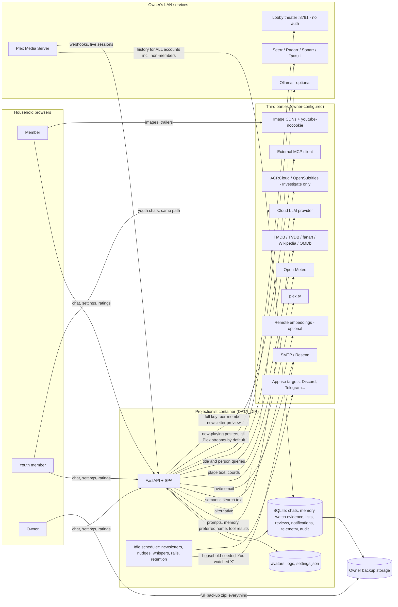

# 07 · Privacy & Compliance — Projectionist 360° review, run 2026-11-01

**Privacy & Compliance Lead (`PRIV`)** · independent pass · code `05274cf` (tag `v1.38.0`) · live QA `http://10.10.1.202:8792` (1.38.0, owner session, read-only)

Lens: *collect less, keep less, show less, and be able to prove it.* I assume GDPR/CCPA-style obligations wherever the household could be in scope, and flag where a lawyer must decide (see §18 and the "Legal review" label on findings).

---

# Part A — Conclusions & findings

## 1. Bottom line

Projectionist has unusually good privacy *instincts* and an unreliable privacy *promise*. **Grade: C.** The foundations are rare in this category: no analytics, no phone-home, self-hosted fonts, a tight CSP, telemetry that stores counts instead of words, communications that are opt-in by default, and agent writes to personal data that are off by default in household mode (PRIV-016 to PRIV-022). But the public Privacy page tells members they can "download a full copy" or "permanently delete" their data, that nothing is "left behind after a purge", and that invites are never emailed. None of that is true at `05274cf` (PRIV-002, PRIV-005, PRIV-006). Worse, a member's weekly newsletter can tell them "You watched *X*" when *X* was watched by someone else in the household, or by a Plex friend who never joined (PRIV-001, PRIV-009). **The single most important fix:** stop presenting household viewing evidence as the member's own, in every channel (PRIV-001). **The single most important thing to protect:** the no-tracking, counts-only, opt-in-by-default posture (PRIV-016, PRIV-017, PRIV-018).

## 2. Key conclusions

1. **The privacy claims are hand-written prose with no contract against the code, so they have drifted from behavior.** `docs/PRIVACY.md` is rendered at `/privacy` without login, so it is the household's notice. It still says export and purge are "verified in `projectionist/library/db.py`", a file that no longer exists. It says invites are never emailed, but the invite route emails them. It says lists can be "household or link-based", but code allows only private or published. It describes research memory as "sanitized", but nothing sanitizes it. It never mentions newsletters, email transport (SMTP/Resend), Apprise, local passwords, OIDC, or remote embeddings (PRIV-002). The root cause is that no test checks any claim. The roadmap implication is a **personal-data registry plus doc contract tests** (PRIV-024), not another rewrite of the doc.

2. **Data-subject rights exist in the API, not in the product, and they cover less than they claim.** Members have no export or delete control anywhere in Settings. The page sends them to `GET/DELETE /api/me/memory`, or tells them to "ask your server owner, who can run it for your account". No such owner action exists; the owner can only remove the whole account (PRIV-005). Export covers 9 of roughly 38 person-linked stores. Self-purge leaves the watchlist, lists, reviews, taste profile, notifications, badges, recommendations, and Year in Review untouched. Removing an account still leaves free-text reviews, rating prompts, pending actions, LLM usage rows, memory audit rows, issue reports, access-request name/email/message, invite email, the avatar file, unattributed "repository insights", and deleted rows recoverable in SQLite free pages and in owner backups (PRIV-006). The fix is one **"My data" page** backed by the same registry (PRIV-023, PRIV-024).

3. **The household boundary leaks through personalization, not through the API.** Object-level scoping on chats, memory, lists, and watch evidence is solid (PRIV-019, PRIV-021). The leak comes from a convenience fallback: when a member has too little evidence, `watched_library_rows` tops up seeds from *every* account's completions, including unmapped Plex accounts. `watched_bridge` then writes "You watched {seed}". That sentence goes into the emailed weekly newsletter, inbox nudges and whispers, For you rails, and chat tool results sent to the LLM (PRIV-001). Nudges also copy the server's three most recently viewed titles into every opted-in member's notification payload. This is the most user-visible privacy harm in the product: it can reveal what a partner, parent, or teenager watched, and it misattributes viewing. The fix is small (Effort S): own-evidence only, or neutral copy ("Popular in your household") with no named seed.

4. **The owner is trusted with everything. That is defensible in a household, but the app should not pretend otherwise or widen the gap silently.** The Privacy page says, honestly, that backups and host access expose everything (PRIV-022). But some in-app paths go further than the page admits. A single click on "Set Youth mode" turns any adult's private memory into owner-readable memory, with no confirmation and no notice to the member (PRIV-003). The owner user API returns every member's Apprise push URLs (which often embed bot tokens), notification email, saved coordinates, and last sign-in (PRIV-008). Per-member play rows are available at `/api/admin/telemetry/events`, despite "the owner sees only household totals" (PRIV-013). A full-mode MCP key can pull any member's personalized newsletter, with name and watch-derived lines, into an external AI client (PRIV-004). Keep the model; make every widening explicit, confirmed, and visible to the person affected.

5. **Children's data gets content-rating protection, not data protection.** Youth mode is a solid, fail-closed content gate. But a youth account's chats, preferred name, and memory go to whichever cloud LLM the owner configured. There is no per-youth "local model only" or "chat off" option, and the youth guardrail prompt says nothing about not eliciting or storing a child's personal details (PRIV-007). Projectionist collects no age or date of birth, which is good minimization. That also means it cannot know whether a youth account is under 13 (COPPA) or under the GDPR Art. 8 age. **Legal review needed**, together with the LLM providers' own age terms. The direction is a youth data policy: route youth chat to a local model or disable it, keep memory off for youth by default, and add a guardrail against personal-detail capture (PRIV-025).

6. **Retention is designed for disk space, not for privacy.** Only telemetry, LLM usage, and interaction rows (90 days), anniversaries, and task runs are pruned. Chats, private memory, watch evidence (including non-members'), notifications, access requests (with denied applicants' email and message), invite emails, reviews, and the security log (20,000 rows with no time limit) are kept forever (PRIV-011, PRIV-009). Purges never VACUUM, and `secure_delete` is off. Set a retention schedule per data class, enforce it in `data_retention`, and disclose it.

7. **The default install is the least private configuration.** With `multi_user_enabled=False`, everyone on the LAN is one identity: one shared chat history, one memory, and one set of watch evidence, all sent to the LLM as "the user" (PRIV-012). That suits a single person. For a family it is privacy-by-default inverted. Setup should ask "Will more than one person use this?" and turn on household mode when the answer is yes.

## 3. Foundations challenged

| Assumption | Evidence for | Evidence against | Verdict | Cost of change | Rationale |
|---|---|---|---|---|---|
| **SC-05** Single-owner, no-login mode is the default | Zero-friction first run; correct for a solo homelabber (`05274cf:projectionist/config_store.py:487`) | All household chats, memory, and watch history merge into one identity sent to the LLM (`05274cf:projectionist/web/auth.py:535-569`) | **Change** | M | Ask about household size in setup; default to multi-user for 2+ people (PRIV-012). |
| **SC-18** Telemetry stays on the box and is enough | Counts-only payloads; 90-day prune; no analytics SDK (PRIV-016, PRIV-017) | Owner API exposes per-member play rows (PRIV-013) | **Keep** | XS | Correct posture; aggregate at the API boundary. |
| **SC-17** Weekly comms are welcome, opt-in per channel | Every opt-in defaults to off; owner pushes respect it (PRIV-018) | Content of those comms leaks household viewing (PRIV-001) | **Keep** (fix content) | S | The consent model is right; the payload is wrong. |
| **SC-16** Gamification fits a household companion | Per-user scoped; Year in Review is explicitly "this account, not the household" | Badges, streaks, and YIR snapshots are never retained-limited and not in export (PRIV-005, PRIV-011) | **Keep** | S | Low sensitivity; include in export/retention. |
| **SC-24** MCP "full" mode is core | Separate key; privacy schema strips identity | `weekly_newsletter_preview(user_id)` exports per-member data (PRIV-004) | **Change** | XS | Full mode is for library automation; no per-person tools. |
| **SC-04** Two roles plus a youth flag are enough | Simple; matches household reality | The youth flag doubles as an owner "read this person's memory" grant (PRIV-003) | **Change** | S | Separate "content gate" from "moderation access"; confirm and notify. |
| **SC-07/08** Bring-your-own LLM; LLM optional | Owner can choose Ollama (nothing leaves the LAN) | No per-role routing; youth chats go to a cloud provider by default (PRIV-007) | **Keep** + add per-role routing | M | BYO is the strongest privacy feature; extend it to youth. |
| *(added)* The Privacy page is a hand-maintained markdown doc | Plain-language, public, has exposure matrices | At least 10 claims drifted (PRIV-002) | **Change** | M | Generate the inventory sections from a registry; contract-test the rest (PRIV-024). |
| *(added)* Household watch evidence is fair game as a personalization seed | More rails and letters render for new members | Discloses and misattributes other people's viewing (PRIV-001) | **Change** | S | Own evidence only, or anonymous household phrasing. |
| *(added)* Personal data is kept until explicitly purged | Simplest; supports Year in Review | No retention for chats, memory, watch evidence, or applicants (PRIV-011) | **Change** | M | Default schedule per class with owner override. |
| *(added)* Plex history is ingested for every Plex account on the server | Owner-side completeness; later mapping | People who never joined get a profile of their viewing (PRIV-009) | **Change** | S | Ingest only mapped household accounts (the Tautulli and backfill paths already do). |
| *(added)* The owner can read everything, so in-app limits don't matter | Backups and host access are unavoidable | In-app widening without notice erodes the trust the page promises (PRIV-003, PRIV-008) | **Keep** (with transparency) | S | Make owner access visible to the member ("Account activity"). |

## 4. If we built it today

A zero-based design would start from a **personal-data registry**. Each store declares its subject column, its data class, whether it appears in export, what deletion does (delete, anonymize, or keep with a reason), and a retention period. Export, purge, account removal, the retention job, the Privacy page tables, and a CI test would all read that one list. Members would get a **"My data" page** with three things: what the curator remembers about me (each note viewable and deletable), download everything, and delete my data or my account. Personalization would use only the signed-in person's evidence. The Plex ingest would collect only mapped household accounts. Youth accounts would default to a local model or no chat, with memory off. The default install would ask whether more than one person uses it. Owner actions that widen access (Youth on, backup download, password reset) would appear in the affected member's own activity log.

The gap is mostly **plumbing, not architecture**. Storage is already per-user, the audit log exists, the export/purge pair exists, and the Privacy page exists. Closing the gap is worth it. The registry and the "My data" page are about two to three weeks of work, and they turn the existing public promise into one the project can actually defend.

## 5. Findings by surface

**Public** (`/privacy`, `/login`, `/join`, anonymous API). The anonymous surface is excellent. A signed-out visitor learns the version, two feature flags, and the sign-in methods, and nothing else. Invite validation returns a generic "Invite not found", and every other `/api/*` route returns 401 (live curl, PRIV-021). The CSP limits browser third parties to three artwork CDNs and `youtube-nocookie.com` (PRIV-016). The weakness is the notice itself: `/privacy` is public, persuasive, and wrong in ways that matter (PRIV-002). It shows members raw API endpoints (`priv_privacy-page-export-howto.png`), which breaks the project's own docs standard. **Grade: B−** (anonymous exposure A; notice accuracy D). IDs: PRIV-002, PRIV-016, PRIV-021.

**Consumer** (member and youth). Scoping of chats, memory, lists, and watch evidence is correct, and the agent cannot write personal data without owner opt-in (PRIV-019). The household peers directory exposes only name, avatar, and role. But members have no privacy controls beyond per-thread chat delete and notification opt-ins (PRIV-005). Their newsletters and inbox can disclose other people's viewing (PRIV-001), and youth chats reach a cloud LLM with no data-specific safeguards (PRIV-007). **Grade: C−.** IDs: PRIV-001, PRIV-005, PRIV-007, PRIV-010, PRIV-018, PRIV-019.

**Owner** (Admin → Members, Youth, Overview). The backup flow is a model of honest disclosure: a checkbox acknowledgement, plain copy that the zip contains everyone's chats and memory, and an audit row (PRIV-022). Against that, the Youth toggle silently widens memory access (PRIV-003). The user API over-returns member secrets and contact details (PRIV-008). "Remove from household" says "cannot be undone" but does not say what remains, and does not offer the member an export first (PRIV-006). **Grade: C.** IDs: PRIV-003, PRIV-006, PRIV-008, PRIV-022.

**Admin / Ops** (Tasks, Logs, Health, MCP, theater). Logs rotate and redact `token=`, and the security audit drops secret-named fields (PRIV-020). Retention covers telemetry only (PRIV-011). The watch-history ingest records non-members (PRIV-009). Full MCP exposes per-member newsletters (PRIV-004). The lobby theater shows every Plex stream by default (PRIV-014), and failed sign-ins store the attempted username (PRIV-015). **Grade: C+.** IDs: PRIV-004, PRIV-009, PRIV-011, PRIV-013, PRIV-014, PRIV-015, PRIV-020.

## 6. Findings by theme

- **Transparency and notice accuracy.** The best example is the backup acknowledgement copy (PRIV-022). The worst is "We do not … email household invites", which sits next to a route that emails them (PRIV-002). Direction: generate the data tables from code, and contract-test the remaining claims (PRIV-024, PRIV-026).
- **Rights (access, export, correction, deletion).** The best example is that export and purge share one implementation and record audit events. The worst is that no member UI exists, export covers about a quarter of person-linked stores, and the Markdown export drops chat transcripts (PRIV-005, PRIV-006). Direction: a "My data" page backed by the registry (PRIV-023).
- **Intra-household exposure.** The best example is the sanitized peers directory and per-user scoping (PRIV-021). The worst is "You watched X" built from someone else's viewing (PRIV-001). Direction: own-evidence-only personalization, plus confirm-and-notify on owner widening (PRIV-003).
- **Minimization.** The best examples are counts-only telemetry, no IP or user-agent on sessions, no raw Plex payloads, no user ID sent to the LLM, and no age collection (PRIV-017, PRIV-020). The worst are non-member viewing history (PRIV-009) and Apprise URLs returned to the owner client (PRIV-008). Direction: ingest only mapped accounts; strip secrets at the API boundary.
- **Retention.** The best example is the 90-day telemetry and LLM-usage prune. The worst is that everything personal is kept indefinitely (PRIV-011). Direction: a schedule per class (§14, PRIV-011).
- **Third parties.** Fonts are self-hosted, there is no analytics SDK, and the LLM is BYO, including local (PRIV-016). The notice omits mail transport, Apprise targets, and remote embeddings (PRIV-002), and youth data reaches the cloud LLM (PRIV-007). Direction: a live, per-install "What leaves this server" panel (PRIV-026).
- **Children.** The content gate is fail-closed. There is no data policy for youth accounts (PRIV-007, PRIV-025). Legal review needed.

## 7. Stop doing

1. **Stop seeding personalization from other people's viewing** and labelling it "You watched" (PRIV-001).
2. **Stop telling members to call API endpoints** on a member-facing page. Ship the button or say plainly that it does not exist yet (PRIV-002, PRIV-005).
3. **Stop ingesting Plex history for accounts that are not household members** (PRIV-009).
4. **Remove `weekly_newsletter_preview` from MCP full mode.** Per-person content does not belong on an automation key (PRIV-004).
5. **Stop returning `apprise_urls` and other member-owned secrets in owner list responses** (PRIV-008).
6. **Stop using the Youth flag as an implicit moderation-access grant** without confirmation or notice (PRIV-003).
7. **Stop claiming verification that isn't automated.** "Verified in db.py" should become a CI test or be deleted (PRIV-002, PRIV-024).

## 8. Strengths worth protecting

- **No tracking, no phone-home, a tight CSP, self-hosted fonts, and `youtube-nocookie` trailers** (PRIV-016). Any new SDK, font, or embed must go through the CSP allowlist and a Privacy page update.
- **Telemetry is counts-only.** Prompt and message text is stripped from LLM usage rows, rows are pruned at 90 days, and no user identifier is sent to the LLM provider (PRIV-017).
- **Communications are opt-in by default**, owner pushes respect the opt-in, and youth accounts are excluded from nudges (PRIV-018).
- **Agent writes to personal data are gated off in household mode**, and only the caller's own memory is injected into the prompt, wrapped as untrusted data (PRIV-019).
- **Minimization in the watch tracker and sessions:** no raw payload, no client IP, a one-way client hash, no IP or user-agent on sessions, log redaction, and secret-name scrubbing in the audit log (PRIV-020).
- **A minimal anonymous surface and a sanitized peers directory** (PRIV-021).
- **Honest backup disclosure**, with an acknowledgement checkbox and an audit row (PRIV-022).

## 9. Risks of inaction (6–12 months)

- **A household trust incident.** A member's newsletter tells them they watched a title their partner or teenager watched, or a title a Plex friend streamed (PRIV-001, PRIV-009). In a family product that is the kind of story that ends adoption in a household, and it gets told on r/selfhosted and r/PleX.
- **A deceptive-claims exposure.** The public Privacy page promises full export and complete deletion that the code does not deliver (PRIV-002, PRIV-006). If any operator runs Projectionist for people outside a purely personal household (an extended family across homes, or a shared server for friends), those claims become that operator's representations, and the project's docs are the source. **Legal review.**
- **Children's data at a cloud provider.** Youth chats accumulate at the LLM provider under terms the owner may not meet (PRIV-007). This is unrecoverable once sent.
- **Unbounded personal archives.** Years of chats, memory, and watch evidence accumulate in the database and every downloaded backup. No purge reaches the backups (PRIV-006, PRIV-011).
- **Regression by addition.** Each new per-user table (81 tables today) will silently fall outside export and purge, because nothing enforces registration (PRIV-024).

## 10. Recommended direction

**Sequence:**
1. **Stop the leaks** (Now, about 1 week). Use own-evidence-only seeds, remove the MCP per-member preview, strip secrets from the owner user list, add confirm-and-notify to the Youth toggle, and correct the Privacy page's false statements (PRIV-001, PRIV-002, PRIV-003, PRIV-004, PRIV-008).
2. **Make rights real** (Next, 2–6 weeks). Build the personal-data registry and contract test, complete export and purge, add the "My data" page, and VACUUM after purge (PRIV-023, PRIV-024, PRIV-005, PRIV-006).
3. **Policy and defaults** (Later). Add a youth LLM policy, a retention schedule, a household-mode prompt in setup, a mapped-only Plex ingest, and a live "What leaves this server" panel (PRIV-007, PRIV-009, PRIV-011, PRIV-012, PRIV-025, PRIV-026).

**What success looks like in 90 days:**
- 0 member-facing strings say "You watched" for evidence not owned by that member (test-enforced).
- 100% of tables with a person-linked column are registered, and CI fails on an unregistered one.
- A member can export and delete their data in at most 3 clicks from Settings.
- After account removal, `SELECT` across all registered tables for the user ID returns 0 rows, apart from documented, anonymized audit rows.
- 0 false statements on `/privacy`, verified by the contract test.
- Youth accounts default to "chat uses local model or is off" on new installs.

## 11. Scorecard

Scored 1–5 (5 = exemplary).

| Surface | Minimization | Transparency accuracy | User control / rights | Intra-household exposure | Third-party flow | Retention |
|---|---|---|---|---|---|---|
| Public | 5: anonymous routes disclose only version, flags, and methods | 2: public page contains false claims | n/a | n/a | 5: CSP allowlist; no trackers | n/a |
| Consumer | 4: no age, IP, or UA; counts-only telemetry | 2: newsletters and memory not explained | 1: no export or delete UI | 2: household seeds shown as "You watched" | 3: BYO LLM, but youth goes to cloud | 1: chats and memory kept forever |
| Owner | 3: user API over-returns secrets | 3: backup copy is honest; youth toggle copy is not | 3: can remove an account, but removal is incomplete | 2: silent Youth-flip read access | 4: mail and Apprise owner-configured | 2: no schedule |
| Admin / Ops | 3: non-member viewing ingested | 3: log viewer warns about sensitivity | 2: no purge reaches backups or free pages | 3: per-member telemetry rows via API | 3: full MCP per-member tool | 2: telemetry only; audit log row-capped |

---

# Part B — Detailed findings

## 12. Scope & method

**Code.** Read-only snapshot `/tmp/review360-05274cf` (= `05274cf`, tag `v1.38.0`). Reviewed:
- the schema (`library/db/_schema.py`, `_shared.py`, and the `syllabus` and scheduler tables), enumerating every table with a person-linked column and its foreign-key behavior;
- the export, purge, and account-delete paths (`_memory.py`, `_users.py`, `auth_routes.py`);
- retention (`scheduler/tasks/data_retention.py`) and backups (`web/backup.py`);
- the chat system prompt and memory and agent gating (`agent/tools/prompt.py`, `registry.py`, `memory.py`);
- personalization and comms (`notifications/recommendation_reasons.py`, `newsletters.py`, `nudges.py`, `whisper.py`, `taste/__init__.py`, `year_in_review/`);
- the watch tracker ingest (`watch_tracker/store.py`, `plex_history.py`);
- telemetry (`telemetry/ingestion.py`), the security audit, logging, MCP (`mcp/server.py`), the theater, avatars, invites and access requests, and youth (`youth/*`);
- the frontend Settings, Admin Household, Youth review, Privacy page, and API client.

**Live (QA `:8792`, owner session, my own tab).**
- Viewed `/privacy`, `/settings/notifications`, and `/admin/household`, collecting text and labels only and no member names.
- Ran unauthenticated `curl` GETs on `/api/health`, `/api/features`, `/api/invites/validate`, `/api/auth/me`, `/api/household/peers`, and the `/login` headers.
- Took one screenshot: `screenshots/priv_privacy-page-export-howto.png` (no personal data; the tab rendered at about 1024px wide).
- Sent **no chat prompt** (0 of the 1 allowed) and saved no settings.
- Did **not** call `GET /api/me/memory`, because it writes an audit row (`05274cf:projectionist/library/db/_memory.py:281-284`), so it is not read-only.

**Couldn't review:**
- member and youth sessions (role behavior is from code only);
- actual newsletter, nudge, or whisper output on QA (no sends or job triggers);
- forensic recoverability of purged rows in the SQLite file, WAL, and backups (marked Likely; validation steps given);
- LLM provider retention and age terms (not verified against current provider policies);
- lobby theater `:8791` (off-limits; reviewed from code);
- the MCP server live; Plex PIN and OIDC flows; production data volumes;
- the deployment jurisdiction of any household, and therefore which law applies. Legal questions are flagged rather than answered.

### 12.1 Data inventory

Roles: **Self** is the signed-in member. **Peers** are other members. **Owner UI** and **Owner API** are what the owner's client receives. **Host** means anyone with backup or `/config` access, which sees everything. **LLM** is the configured chat provider. **MCP-F** is the full-mode MCP key. **Out** means other outbound flows.

| # | Personal-data category | Stored in | Self | Peers | Owner UI / API | LLM | MCP-F | Out / third parties | Retention today | Export / purge / account delete |
|---|---|---|---|---|---|---|---|---|---|---|
| 1 | Identity: display name, username, email, Plex user ID, OIDC sub, password hash (PBKDF2), avatar | `users`; avatar files `DATA_DIR/avatars/<id>.*` | Profile | Name, avatar, role (`/api/household/peers`) | Name/email table; API returns full row incl. `plex_user_id`, `last_login_at` | Preferred name (addressing) | No | Seerr lookup on link; invite email via SMTP/Resend | Until account delete | Not in export; row deleted; **avatar file kept** |
| 2 | Profile preferences: preferred name, theme, text size, default page, **weather place + lat/lon**, notification email, **Apprise URLs**, opt-ins | `users` | Settings | No | **API returns all**, incl. Apprise URLs (PRIV-008) | Preferred name | No | Weather coords → Open-Meteo; Apprise → Discord/Telegram etc. | Until delete | Not in export; deleted with row |
| 3 | Plex account token (encrypted) | `users.plex_token_enc` | No | No | `has_plex_token` only | No | No | plex.tv (Discover sync) | Until delete | Deleted with row |
| 4 | Chat threads and transcripts | `chat_sessions`, `chat_messages` | Own | No | Not in UI; orphan pre-multi-user threads visible to owner | **Full context** | No | LLM provider | **Forever** | Export ✓ · purge ✓ · delete ✓ |
| 5 | Message feedback (with excerpt) | `message_feedback` | Own | No | No | No | No | — | Forever | Not exported; cascades with messages |
| 6 | Pending confirm actions | `pending_actions` | Own | No | No | Token flow | No | — | Expires | Not exported; **survives delete** |
| 7 | Private memory notes; memory audit events | `user_memory_notes`, `user_memory_events` | Own (via chat only; no UI list) | No | **Youth accounts only** (PRIV-003) | Up to 8 notes per turn | No | LLM | Forever | Notes ✓/✓/✓; events **survive delete** |
| 8 | Preference facts; taste profile | `preference_facts`, `user_taste_profile` | Own | No | No | Preference context | No | LLM | Forever | Facts ✓/✓/✓; taste profile **not exported, not purged**; cascades on delete |
| 9 | Shared repository insights (may contain personal text) | `memory_insights`, `memory_entities` | Via curator | **Via curator** (PRIV-010) | Library knowledge | Yes | Possibly | LLM | Forever | Unattributed; **never removable per person** |
| 10 | Watch evidence: events, sessions, completions, identities (incl. **non-members** with display names) | `watch_events`, `watch_sessions`, `watch_session_events`, `watch_completions`, `watch_source_identities` | Own summaries | **Via household seeds** (PRIV-001) | Aggregate status only | Tool results | Affinity tools | Newsletter email, Apprise | **Forever** | Export ✓ (events/sessions/completions); purge ✓; delete ✓; **unmapped rows never** |
| 11 | Server-level viewing (`last_viewed_at`, `view_count`) | `library_items` | Watch badges | **Yes**: nudge payload `recently_watched` | Yes | Yes | Yes | — | Overwritten by sync | n/a (server account) |
| 12 | Watchlist, lists, list items | `watchlist_pins`, `curated_lists`, `curated_list_items` | Own | Published lists | Own | Tools | Owner pins only | plex.tv Lists publish | Forever | **Not exported; not purged**; cascades on delete |
| 13 | Reviews / ratings (free text), rating prompts | `user_title_reviews`, `rating_prompt_queue` | Own | No | No | Tools | No | — | Forever | **Not exported; not purged; survive delete** |
| 14 | Recommendations sent/received (with message) | `user_recommendations` | Own | Recipient sees sender name and message | No | No | No | Email/Apprise to recipient | Forever | Not exported; cascades on delete |
| 15 | Notifications / inbox (payloads incl. household seeds) | `user_notifications` | Own | No | No | No | No | Email via SMTP/Resend; Apprise | Forever | **Not exported; not purged**; cascades |
| 16 | Engagement: badges, streaks, challenges, courses, syllabus, Year in Review snapshots | `user_badges`, `user_streaks`, `user_challenge_progress`, `user_course_progress`, `user_syllabus_sessions`, `year_in_review_snapshots`, `user_weekly_rails` | Own | No | No | No | No | YIR email if opted in | Forever | **Not exported; not purged**; cascades |
| 17 | Activity telemetry (chat-turn counts, play starts with title key and pick) | `system_telemetry_stream` | Export | No | Totals in UI; **per-row via API** (PRIV-013) | No | No | — | 90 days | ✓/✓/✓ |
| 18 | LLM usage (tokens, model, session, user ID) | `llm_usage` | No | No | Usage BI | — | No | — | 90 days | **Not exported; survives delete** (until prune) |
| 19 | Security audit (actor, target, event, scrubbed detail; failed username) | `security_audit_log` | No | No | Health → Security log | No | No | — | 20,000 rows (no time limit) | Kept by design (disclosed) |
| 20 | Access requests (name, email, free-text message) | `access_requests` | No | No | Access | No | No | Owner email/Apprise notification | **Forever** (incl. denied) | Not covered |
| 21 | Invites (invitee email, expected Plex/OIDC ID) | `invites` | Join page shows own email | No | Access | No | No | Invite email via SMTP/Resend | **Forever** | Not covered |
| 22 | Media issue reports (reporter, text) | `media_issues` | Own | No | Issues | No | No | — | Forever | Reporter set NULL; text kept |
| 23 | Application logs (user IDs, titles, job phases) | `DATA_DIR` rotating log file | No | No | Admin → Logs | No | No | — | Size-rotated | Not covered |
| 24 | Backups (everything above + `settings.json`) | Owner-downloaded zip | No | No | Download (acknowledged, audited) | No | No | Wherever the owner stores it | Owner-controlled | **No purge propagation** |
| 25 | Voice input | Browser/OS speech service; transcript as chat | Own | No | No | As chat | No | Browser vendor STT (disclosed) | As chat | As chat |
| 26 | Browser storage (theme, What's New seen) | `localStorage` | Own | No | No | No | No | — | Device | n/a (functional; no consent banner needed) |

Counted: about **38 stores** hold person-linked data. Export covers **9**. Self-purge removes **12**. Account removal removes about **28** (the purge set plus FK cascades). About **10** remain after account removal, not counting the SQLite free pages, WAL, backups, and LLM provider copies.

### 12.2 Data flow map



## 13. Strengths

### PRIV-016: Protect the no-tracking, self-hosted browser surface

| Field | Value |
|---|---|
| Type | Strength |
| Surface | Cross-cutting |
| Persona(s) | All |
| Category | Third parties |
| Severity | High |
| Impact | 5 |
| Effort | XS |
| Confidence | Confirmed |
| Priority score | 15.0 |
| Verdict | Protect |
| Dependencies | PRIV-026 |
| Labels | csp, fonts, analytics, third-party |

**Evidence:** The live `/login` header is `content-security-policy: default-src 'self'; img-src 'self' https://image.tmdb.org https://artworks.thetvdb.com https://assets.fanart.tv data:; … connect-src 'self'; … frame-src https://www.youtube.com https://www.youtube-nocookie.com; frame-ancestors 'none'`, with `permissions-policy: camera=(), microphone=(self), geolocation=()`. Self-hosted fonts are noted at `05274cf:frontend/index.html:11`. Trailers use `youtube-nocookie.com` (`05274cf:frontend/src/pages/TitleDetailPage.tsx:174`, `05274cf:frontend/src/components/PosterOverlayControls.tsx:187`). No analytics SDK is in `frontend/package.json`.

**Current state:** A signed-in browser can contact only artwork CDNs and a no-cookie YouTube domain. There is nothing to consent to, so no cookie banner is needed.

**Root cause:** Deliberate design ("PRIV-009" fonts work in an earlier cycle), enforced by `connect-src 'self'`.

**Recommendation:** Protect this. Add a CI check that fails if the CSP gains an origin without a matching row in the Privacy page's browser third-party table.

**Rationale:** This is the strongest privacy property of the product, and it can be lost with a single dependency.

**User story:** As a member, I want the app not to tell anyone else what I browse, so that using it is as private as using Plex locally.

**Acceptance criteria:**
- [ ] The CSP origin list is snapshot-tested.
- [ ] Any new origin requires a Privacy page table update in the same PR.

**Success metric:** 0 undisclosed browser origins (snapshot test green).

**Validation:** `curl -sI /login | grep -i content-security-policy` matches the snapshot.

### PRIV-017: Protect counts-only telemetry and identifier-free LLM calls

| Field | Value |
|---|---|
| Type | Strength |
| Surface | Cross-cutting |
| Persona(s) | All members |
| Category | Minimization |
| Severity | Medium |
| Impact | 3 |
| Effort | XS |
| Confidence | Confirmed |
| Priority score | 6.0 |
| Verdict | Protect |
| Dependencies | PRIV-013 |
| Labels | telemetry, llm, minimization |

**Evidence:** `record_chat_turn` stores "Counts only — no message text" (`05274cf:projectionist/telemetry/ingestion.py:216-244`). LLM usage strips `prompt`, `messages`, `content`, and `text` from meta (`:331-335`). The 90-day prune is at `05274cf:projectionist/scheduler/tasks/data_retention.py:36-38`. The provider module sends no `user` or `metadata` identifier (grep of `05274cf:projectionist/agent/providers/__init__.py` found no user field).

**Current state:** On-box activity metrics cannot reconstruct what anyone said, and the LLM provider cannot link calls to a household member.

**Root cause:** The telemetry design treats content as out of scope.

**Recommendation:** Protect this. Add a unit test asserting that no telemetry payload key outside an allowlist is ever written.

**Rationale:** Prevents a future "just log the prompt for debugging" regression.

**User story:** As a member, I want usage stats about me to contain no words I typed, so that the owner's dashboard can't become surveillance.

**Acceptance criteria:**
- [ ] A payload key allowlist test exists for each `EVENT_*`.
- [ ] A test asserts that the LLM provider request body has no user identifier.

**Success metric:** Allowlist test green on every PR.

**Validation:** Run the telemetry unit tests.

### PRIV-018: Protect opt-in-by-default communications

| Field | Value |
|---|---|
| Type | Strength |
| Surface | Consumer |
| Persona(s) | Returning consumer, youth member |
| Category | Consent |
| Severity | High |
| Impact | 4 |
| Effort | XS |
| Confidence | Confirmed |
| Priority score | 12.0 |
| Verdict | Protect |
| Dependencies | PRIV-001 |
| Labels | consent, newsletter, nudges, defaults |

**Evidence:** The `newsletter_opt_in`, `nudge_opt_in`, `year_in_review_opt_in`, `notify_channel_email`, and `notify_channel_apprise` defaults are false (`05274cf:projectionist/library/db/_users.py:597-611`, `05274cf:projectionist/library/db/_schema.py:1004`). Owner bulk sends skip non-opted members (`05274cf:projectionist/notifications/newsletters.py:266-268`), and youth accounts are skipped for nudges (`05274cf:projectionist/notifications/nudges.py:157-159`). Live `/settings/notifications` shows every toggle off except the in-app inbox.

**Current state:** No member receives email, push, or a newsletter without opting in.

**Root cause:** Consent-first product decision.

**Recommendation:** Protect this. Keep owner push from overriding the opt-in. Add an unsubscribe link to every email that flips the matching opt-in.

**Rationale:** This is the right consent model; PRIV-001 is about content, not consent.

**User story:** As a member, I want no mail unless I ask for it, so that joining the household doesn't put me on a list.

**Acceptance criteria:**
- [ ] Default-off is asserted in tests.
- [ ] Every email has a one-click unsubscribe.

**Success metric:** 0 sends to members who have not opted in.

**Validation:** Generate a newsletter with one opted-in and one opted-out member; only the first receives it.

### PRIV-019: Protect personal-write gating and own-memory-only prompt injection

| Field | Value |
|---|---|
| Type | Strength |
| Surface | Consumer |
| Persona(s) | Member, youth member |
| Category | Minimization / exposure |
| Severity | High |
| Impact | 4 |
| Effort | XS |
| Confidence | Confirmed |
| Priority score | 12.0 |
| Verdict | Protect |
| Dependencies | PRIV-010 |
| Labels | agent, memory, llm |

**Evidence:** `_deny_personal_mutation_if_gated` blocks `remember_about_user`, `remember_preference`, watchlist, list, and review writes in multi-user mode unless `agent_may_mutate_personal_data` is on, which defaults to false (`05274cf:projectionist/agent/tools/registry.py:80-99`, `05274cf:projectionist/config_store.py:509`, `05274cf:projectionist/agent/tools/memory.py:115-136`). The prompt injects only the caller's notes, wrapped as untrusted data (`05274cf:projectionist/agent/tools/prompt.py:56-106`).

**Current state:** The curator does not silently build a dossier in household mode, and one member's memory is never placed in another's prompt.

**Root cause:** Phase 2 "trust core" work.

**Recommendation:** Protect this. Extend the same gate to `save_repo_insight` (PRIV-010).

**Rationale:** Prevents covert profiling and cross-user prompt bleed.

**User story:** As a member, I want the curator to remember things only if my household allows it, so that chatting doesn't build a profile I didn't agree to.

**Acceptance criteria:**
- [ ] A regression test exists for each gated tool.
- [ ] `save_repo_insight` is added to the gated set.

**Success metric:** 0 personal writes via chat when the gate is off.

**Validation:** `tests/test_phase2_trust_core.py` plus a new case for repository insights.

### PRIV-020: Protect minimization in the watch tracker, sessions, logs, and audit

| Field | Value |
|---|---|
| Type | Strength |
| Surface | Admin |
| Persona(s) | Platform admin, members |
| Category | Minimization |
| Severity | Medium |
| Impact | 3 |
| Effort | XS |
| Confidence | Confirmed |
| Priority score | 6.0 |
| Verdict | Protect |
| Dependencies | — |
| Labels | watch-tracker, logs, audit |

**Evidence:**
- Watch events keep normalized IDs, times, and progress, plus a payload hash; no raw payload or IP (`05274cf:projectionist/watch_tracker/store.py:154-188`; `docs/PRIVACY.md:180-191`).
- No IP or user-agent is stored with sessions (grep of `web/session_tokens.py`, `auth.py`, `auth_routes.py`).
- The log redaction filter for `token=` is at `05274cf:projectionist/logging_config.py:28-44`.
- The audit drops secret-named fields (`05274cf:projectionist/security_audit.py:59-76`).

**Current state:** Operational data is useful without being invasive.

**Root cause:** Deliberate design.

**Recommendation:** Protect this. Add `username` to the audit scrub for failed sign-ins (PRIV-015).

**Rationale:** Keeps logs and backups less dangerous.

**User story:** As a member, I want the server to keep only what it needs about my viewing, so that a leaked backup reveals less.

**Acceptance criteria:**
- [ ] A test asserts the watch-event columns contain no IP or device name.
- [ ] A redaction test exists for `token=`.

**Success metric:** Tests green.

**Validation:** Inspect a `watch_events` row after a webhook fixture.

### PRIV-021: Protect the minimal anonymous surface and sanitized peers directory

| Field | Value |
|---|---|
| Type | Strength |
| Surface | Public |
| Persona(s) | First-time visitor, member |
| Category | Exposure |
| Severity | Medium |
| Impact | 3 |
| Effort | XS |
| Confidence | Confirmed |
| Priority score | 6.0 |
| Verdict | Protect |
| Dependencies | — |
| Labels | anonymous, enumeration, peers |

**Evidence:**
- Live anonymous curl: `/api/health` returns `{"status":"ok","version":"1.38.0"}`; `/api/features` returns only `multi_user_enabled`, `access_requests_enabled`, and `auth_methods`.
- `/api/invites/validate?token=x` returns 400 `Invite not found`; `/api/auth/me` and `/api/household/peers` return 401.
- Peers are limited to `id`, `display_name`, `avatar_url`, and `role` (`05274cf:projectionist/web/app.py:3810-3829`).

**Current state:** An outsider can't enumerate household members. Members see only names and avatars of each other, not email or youth status.

**Root cause:** Allowlist middleware (`05274cf:projectionist/web/auth.py:52-69`).

**Recommendation:** Protect this. Snapshot-test the anonymous response bodies.

**Rationale:** Household identities are the most sensitive public-facing data.

**User story:** As a member, I want strangers on the network not to learn who lives here.

**Acceptance criteria:**
- [ ] A contract test exists for each allowlisted route body.

**Success metric:** No new fields added without review.

**Validation:** Run the curl set above.

### PRIV-022: Protect honest, acknowledged, audited household backups

| Field | Value |
|---|---|
| Type | Strength |
| Surface | Owner |
| Persona(s) | Established owner |
| Category | Transparency |
| Severity | Medium |
| Impact | 3 |
| Effort | XS |
| Confidence | Confirmed |
| Priority score | 6.0 |
| Verdict | Protect |
| Dependencies | PRIV-006 |
| Labels | backup, transparency, audit |

**Evidence:**
- The backup panel copy says "This zip contains everyone's chats, memory, and watch history", and the download is gated by an acknowledgement checkbox (`05274cf:frontend/src/pages/admin/OverviewSection.tsx:182-204`).
- Each download is audited (`05274cf:projectionist/web/backup.py:87-101`).
- The Youth review page repeats that backups contain everything (`05274cf:frontend/src/pages/YouthReviewPage.tsx:72-78`).

**Current state:** The owner is told exactly what they're taking.

**Root cause:** Good disclosure design.

**Recommendation:** Protect this. Add: "Backups are not updated when someone deletes their data; delete old backups after a removal" (ties to PRIV-006).

**Rationale:** Honest copy is the pattern the rest of the product should follow.

**User story:** As an owner, I want to know what a backup exposes, so that I store it responsibly.

**Acceptance criteria:**
- [ ] Copy includes the deletion caveat.

**Success metric:** n/a.

**Validation:** Visual check of Admin → Overview.

## 14. Weaknesses (sorted by priority score)

### PRIV-001: Stop labelling other people's viewing as "You watched" in newsletters, inbox, rails, and chat

| Field | Value |
|---|---|
| Type | Weakness |
| Surface | Consumer |
| Persona(s) | Returning consumer, youth member, power consumer |
| Category | Intra-household exposure |
| Severity | High |
| Impact | 5 |
| Effort | S |
| Confidence | Confirmed |
| Priority score | 7.5 |
| Verdict | Fix |
| Dependencies | PRIV-009 |
| Labels | household, newsletter, nudges, email, misattribution, legal-review |

**Evidence:**
- `watched_library_rows(..., user_id, multi_user_enabled=True)` takes the member's own seeds, then "fall[s] back to the whole household" when there are fewer than `limit` (`05274cf:projectionist/notifications/recommendation_reasons.py:540-575`).
- The household scope query has **no user filter** and therefore includes other members and unmapped Plex accounts (`:264-274`).
- `watched_bridge` writes `f"You {verb} {seed_label}; {candidate_label} — {clause}"` (`:803`), and is "used for For you / inbox / newsletter" (`:776`).
- Consumers include the emailed weekly newsletter (`05274cf:projectionist/notifications/newsletters.py:173-175, 211-212`, delivered by email at `:274-287`), whispers (`05274cf:projectionist/notifications/whisper.py:128-130`), and nudges (`05274cf:projectionist/notifications/nudges.py:103`).
- The chat tool `find_similar_titles` also uses these seeds, so the result reaches the LLM (`05274cf:projectionist/agent/tools/library.py:145-148`).
- Nudges also copy household `library_items.last_viewed_at` titles into each member's notification `payload.recently_watched` (`05274cf:projectionist/notifications/nudges.py:45-85, 145, 186`), which the inbox API returns (`05274cf:projectionist/library/db/_notifications.py:392-406`).
- Live phrasing seen on QA Explore (platform map §4.2): "You watched X; Y — both stories turn on …".

**Current state:** A member with thin history, such as a new invitee, receives email and inbox copy asserting they watched titles that someone else in the household, or a non-member Plex friend, watched.

**Root cause:** A coverage-maximizing fallback was added without an attribution rule. The sentence template assumes the seed is the reader's.

**Recommendation:**
1. In `watched_library_rows`, when `multi_user_enabled` is true, **never** merge household-scope rows into a member's seed set. Return own-evidence only.
2. If a household fallback is kept for product reasons, tag those rows `seed_scope="household"` and have `watched_bridge` emit `"Popular in your household: {candidate_label} — {clause}"` with **no seed title named**.
3. Remove `recently_watched` from nudge payloads.
4. Youth accounts never receive household-scope seeds.

**Rationale:** This discloses one person's viewing to another, and it misstates facts about the reader. It is the most likely privacy harm to cause a real household conflict, and email makes it permanent. Rejected alternative: "just reword 'You watched'". Naming the seed title still discloses someone else's viewing.

**User story:** As a member, I want recommendations to cite only what I watched, so that my inbox never reveals or invents viewing history.

**Acceptance criteria:**
- [ ] With members A and B, where only B has completions, A's newsletter, nudge, whisper, and For you outputs never contain B's seed title.
- [ ] No notification payload contains `recently_watched`.
- [ ] A test asserts that every "You watched" sentence has a seed with `user_id == reader`.

**Success metric:** 0 cross-member seed titles in generated comms (test fixture); support reports of "I didn't watch that" go to 0.

**Validation:** Fixture with two members and one unmapped account. Run `build_member_newsletter`, `deliver_enthusiast_nudges`, and the whisper build, then grep the outputs for the other accounts' titles.

### PRIV-002: Make the public Privacy page accurate and keep it accurate

| Field | Value |
|---|---|
| Type | Weakness |
| Surface | Public |
| Persona(s) | All; especially first-time visitor (invited member) |
| Category | Transparency |
| Severity | High |
| Impact | 4 |
| Effort | S |
| Confidence | Confirmed |
| Priority score | 6.0 |
| Verdict | Fix |
| Dependencies | PRIV-024 |
| Labels | privacy-page, notice, docs, legal-review |

**Evidence:** (doc lines `05274cf:docs/PRIVACY.md:N`; live `/privacy` matches)
- **"Email household invites"** is listed under "We do not" (`:346`). But `create_invite_endpoint` passes `send_email=True` (`05274cf:projectionist/web/auth_routes.py:731`), and `create_household_invite` sends mail when an email is present and mail is configured (`05274cf:projectionist/invites.py:115-119`).
- **"every account can download a full copy of its own data or permanently delete it"** (`:11`) and **"Leave anything behind after a purge"** (`:349`). See PRIV-005 and PRIV-006.
- **"verified in `projectionist/library/db.py`"** (`:64`). That file is now a package. The verification is a claim, not a test.
- **"ask your server owner, who can run it for your account"** (`:81`). No owner endpoint runs another user's export or purge (`05274cf:projectionist/web/auth_routes.py:70-132` act only on `user.id`).
- **Lists "private, household, or link-based"** (`:146`). Code allows only `private` or `published` (`05274cf:projectionist/library/db/_curated_lists.py:405-406`).
- **"Shared, sanitized media research"** (`:76`). `save_repository_insight` stores the model's text verbatim (`05274cf:projectionist/library/db/_memory.py:618-644`).
- **"The owner sees only household totals"** (`:243`). See PRIV-013.
- **Omissions:**
  - newsletters, nudges, whispers, Year in Review, and their email (SMTP/Resend) and Apprise delivery (the live page text has no "newsletter", "SMTP", or "Resend");
  - local username/password accounts (PBKDF2 hash) and OIDC `sub`, since the page frames sign-in as Plex-only (`:31-38`);
  - remote embeddings receiving search text (`05274cf:projectionist/library/query.py:837`);
  - non-member Plex viewing (PRIV-009);
  - youth chats going to the LLM (PRIV-007);
  - access-request storage.
- The page shows members raw API paths (live: 2 occurrences of `/api/me/memory`; screenshot `priv_privacy-page-export-howto.png`), which breaks `05274cf:docs/DOCS_STYLE.md:44`.

**Current state:** The household's only privacy notice is persuasive and wrong in at least ten places.

**Root cause:** Hand-maintained prose with no contract against code (see PRIV-024).

**Recommendation:**
1. **Now:** delete the false claims; add sections for comms, local/OIDC sign-in, embeddings, and non-member viewing; replace the API instructions with "Export and delete are coming to Settings → Privacy; until then, ask the owner to remove your account", and say what removal leaves behind.
2. **Next:** generate the "What export and purge cover" and the exposure tables from the registry (PRIV-024).
3. Add `tests/test_privacy_claims.py`, which asserts each "We do not" bullet against code (for example, it fails if `send_email=True` exists while the bullet stands).

**Rationale:** A notice that over-promises is worse than none: members rely on it, and operators repeat it. Rejected alternative: a disclaimer such as "may be out of date", which shifts the burden to readers.

**User story:** As an invited member, I want the Privacy page to describe exactly what happens to my data, so that I can decide whether to join and what to share.

**Acceptance criteria:**
- [ ] Every "We do not" bullet has a passing code assertion.
- [ ] The member half contains no `/api/` strings.
- [ ] Comms, sign-in methods, embeddings, and non-member viewing are documented.

**Success metric:** 0 known false statements; the claims test runs in CI.

**Validation:** Run the claims test; grep `/privacy` innerText for `/api/`.

### PRIV-003: Require confirmation and notify the member when Youth mode grants owner memory access

| Field | Value |
|---|---|
| Type | Weakness |
| Surface | Owner |
| Persona(s) | Established owner, member |
| Category | Intra-household exposure |
| Severity | Medium |
| Impact | 3 |
| Effort | XS |
| Confidence | Confirmed |
| Priority score | 6.0 |
| Verdict | Fix |
| Dependencies | — |
| Labels | youth, memory, owner-access, consent |

**Evidence:**
- "Set Youth mode" calls `patchUserYouthMode` directly, with no confirm dialog (`05274cf:frontend/src/pages/ConfigPage.tsx:803-811`; live button on `/admin/household`).
- Server-side, `patch_user` only writes an audit row (`05274cf:projectionist/web/auth_routes.py:829-840`).
- The owner can then read that account's memory at `/api/users/{id}/memory` (`:135-143`) and in Admin → Youth (`05274cf:frontend/src/pages/YouthReviewPage.tsx:48-60`).
- The member sees only a static badge line in Profile (`05274cf:frontend/src/pages/settings/ProfilePage.tsx:336`).
- The Privacy page says, "In the app, an owner can read only Youth accounts' memory … This is not a consent toggle and does not apply to adult accounts" (`05274cf:docs/PRIVACY.md:60`).

**Current state:** An owner can flip an adult to Youth, read their memory, and flip them back. The only record is in the owner-readable security log.

**Root cause:** One flag carries two meanings: a content gate and moderation access.

**Recommendation:**
1. Show a confirm dialog: "Turning on Youth mode limits content to {rating} and lets owners read {name}'s curator memory. {name} will be notified."
2. Deliver an inbox notification to the member on every Youth change, and on every owner memory read (event `youth_memory_viewed`).
3. Preferably, split the setting into `content_gate` and `memory_review`, with `memory_review` allowed only while `content_gate` is on.

**Rationale:** This keeps household moderation possible without letting it become covert surveillance. Rejected alternative: removing owner review entirely, since parents legitimately need it.

**User story:** As an adult member, I want to know if anyone gains access to what the curator remembers about me, so that the privacy promise holds in practice.

**Acceptance criteria:**
- [ ] The toggle requires confirmation, with the copy above.
- [ ] The member receives an inbox item on any Youth change.
- [ ] Owner memory reads are audited and surfaced to the member.

**Success metric:** 100% of Youth flips produce a member notification.

**Validation:** As owner, toggle Youth for a test member; check that member's inbox.

### PRIV-004: Remove per-member newsletter preview from full-mode MCP

| Field | Value |
|---|---|
| Type | Weakness |
| Surface | Admin |
| Persona(s) | Platform admin, all members |
| Category | Third parties / exposure |
| Severity | Medium |
| Impact | 3 |
| Effort | XS |
| Confidence | Confirmed |
| Priority score | 6.0 |
| Verdict | Remove |
| Dependencies | — |
| Labels | mcp, per-member, external-ai |

**Evidence:** `weekly_newsletter_preview(user_id)` returns any member's subject (`"This week for you, {preferred}"`), body, and picks with watch-derived "why" lines (`05274cf:projectionist/mcp/server.py:1077-1109`). Its only guard is `_require_full_mode()`. The Privacy page describes full MCP as library and *arr automation (`05274cf:docs/PRIVACY.md:282-287`).

**Current state:** An external AI client holding the full key can enumerate members' names and viewing-derived content. That client's own LLM provider then receives it.

**Root cause:** The tool was added for owner convenience (NW-01) without a per-person data review.

**Recommendation:** Delete the tool. If owners need previews, keep them in the authenticated Admin UI, preview the owner's own letter only, or use a synthetic member.

**Rationale:** MCP keys are long-lived, are pasted into third-party tools, and leave the household boundary.

**User story:** As a member, I want my personal newsletter not to be readable by automation tools, so that my data stays in the app.

**Acceptance criteria:**
- [ ] The tool is absent from the MCP tool list.
- [ ] A test asserts that no MCP tool accepts a `user_id` parameter.

**Success metric:** 0 MCP tools with per-person parameters.

**Validation:** List the MCP tools and grep for `user_id`.

### PRIV-005: Give members in-app export, delete, and "what the curator remembers", and make export complete

| Field | Value |
|---|---|
| Type | Weakness |
| Surface | Consumer |
| Persona(s) | Member, youth member, power consumer |
| Category | Rights |
| Severity | High |
| Impact | 4 |
| Effort | M |
| Confidence | Confirmed |
| Priority score | 4.0 |
| Verdict | Fix |
| Dependencies | PRIV-023, PRIV-024 |
| Labels | dsar, export, deletion, settings, legal-review |

**Evidence:**
- No frontend code calls `/api/me/memory` (grep of `frontend/src`). The Settings routes are Profile, Voice, Taste, Notifications, Watchlist, and Lists, with no Privacy route (`05274cf:frontend/src/AppRoutes.tsx:142-149`).
- `DOCS_STYLE.md:44` promises "Settings → Privacy", which does not exist.
- There is no member UI to list or delete memory notes; only the owner Youth view exists (`05274cf:frontend/src/api/client.ts:1001-1003`).
- The export covers notes, chats, saved pages, preference facts, three watch tables, and telemetry (`05274cf:projectionist/library/db/_memory.py:166-298`). It omits the profile (email, weather location, Apprise), watchlist, lists, reviews and ratings, the taste profile, notifications, recommendations, badges, streaks, courses, Year in Review, rating prompts, and LLM usage.
- The Markdown export lists thread titles and message *counts* only, not transcripts (`05274cf:projectionist/web/auth_routes.py:102-111`).
- Per-thread chat delete exists (`05274cf:projectionist/web/chat_routes.py:288-296`).

**Current state:** Rights are available only to members who can run curl with a session cookie, and the export is about a quarter complete.

**Root cause:** Rights were built as an API for owners and power users, then documented as a member feature.

**Recommendation:** Add **Settings → Privacy** with:
- (a) "What the curator remembers": a list of `user_memory_notes` with per-note delete;
- (b) **Download my data** as JSON (complete per the registry) and readable Markdown that includes transcripts;
- (c) **Delete my data**, which purges everything except the account row, after typed confirmation;
- (d) **Ask to remove my account**, which notifies the owner and records an access request.

The export reads the registry from PRIV-024.

**Rationale:** Access and erasure are the two rights members will actually use. Without UI, the promise is empty. Rejected alternative: "owner runs it". That needs an owner endpoint that acts on another user, which widens owner power.

**User story:** As a member, I want to download or delete my data from Settings in a few clicks, so that I control my history without asking anyone.

**Acceptance criteria:**
- [ ] Settings → Privacy exists for members and youth.
- [ ] The export JSON includes every registry entry marked `export=true`.
- [ ] The Markdown export includes message text.
- [ ] Memory notes are individually deletable.

**Success metric:** Export covers 100% of registered person-linked stores; at most 3 clicks from Settings.

**Validation:** Seed a member with one row in each store; export; assert every store appears.

### PRIV-006: Make account removal and self-purge real deletion, including orphans, free pages, and backups disclosure

| Field | Value |
|---|---|
| Type | Weakness |
| Surface | Cross-cutting |
| Persona(s) | Member, established owner |
| Category | Rights / deletion |
| Severity | High |
| Impact | 4 |
| Effort | M |
| Confidence | Confirmed (orphans), Likely (free pages) |
| Priority score | 4.0 |
| Verdict | Fix |
| Dependencies | PRIV-024 |
| Labels | deletion, erasure, sqlite, backups, legal-review |

**Evidence:**
- `delete_user` = `purge_user_memory_and_chats` + `DELETE FROM users` (`05274cf:projectionist/library/db/_users.py:205-212`).
- Foreign keys are enforced (`PRAGMA foreign_keys=ON`, `:802`). That contradicts the purge docstring, which says cascades are "dormant" (`05274cf:projectionist/library/db/_memory.py:303-306`). As a result, `ON DELETE CASCADE` removes lists, pins, recommendations, notifications, taste profile, weekly rails, badges, streaks, challenges, courses, Year in Review, and syllabus rows (`05274cf:projectionist/library/db/_schema.py:590, 899, 986-987, 1040, 1126, 1140, 1160, 1171, 1193, 1214, 1861`; `syllabus/__init__.py:33`).
- **Survive account removal** (no foreign key):
  - `user_title_reviews` incl. `review_text` (`_schema.py:738-750, 547`);
  - `rating_prompt_queue` (`:761-771`);
  - `pending_actions` (`:544`);
  - `llm_usage.user_id` until the 90-day prune (`:1642-1656`);
  - `user_memory_events`, where the purge itself inserts a new row (`_memory.py:381-384`);
  - `media_issues` text, with the reporter set NULL (`:684-701`);
  - `access_requests` name/email/message (`:1407-1421`);
  - `invites.email` (`:1431-1452`);
  - the **avatar file**: `clear_local_avatar` runs only when a new avatar is saved (`05274cf:projectionist/web/avatars.py:72-80, 115`);
  - unattributed `memory_insights` (PRIV-010).
- **Self-purge** (`DELETE /api/me/memory`) also leaves every cascade-only store above.
- **Recoverability:** no `PRAGMA secure_delete` (`_users.py:785-803`). VACUUM runs only after at least 1,000 retention-pruned rows (`05274cf:projectionist/scheduler/tasks/data_retention.py:110-117`), never after a purge.
- Owner backups use the SQLite backup API (`05274cf:projectionist/web/backup.py:50-64`). Already-downloaded zips are never touched, and LLM provider copies are outside reach.
- The only deletion test covers watch-tracker identities (`tests/test_user_memory.py:174`).

**Current state:** "Remove from household … cannot be undone" leaves free-text reviews and several identifying rows behind. Deleted chat text likely stays readable in free pages and the WAL until overwritten.

**Root cause:** The deletion set is a hand-maintained list in one method, and there is no registry or test across all person-linked tables.

**Recommendation:**
1. Drive deletion from the registry (PRIV-024). Add the missing stores, and anonymize `access_requests`/`invites` (null the email, message, and name; keep status and timestamps).
2. Make `delete_user` call `clear_local_avatar`.
3. After any purge or account delete, run `PRAGMA wal_checkpoint(TRUNCATE)` followed by an off-loop `VACUUM`, or set `PRAGMA secure_delete=ON` at connection open.
4. Change the purge audit row to omit `user_id`, or hash it.
5. Add copy to the Remove dialog and the Privacy page: "Removal doesn't change backups you've already downloaded, or copies held by your LLM provider under its retention terms."
6. Fix the stale docstring.

**Rationale:** Erasure is the right users most expect to be real. Partial erasure under an unqualified "permanently" is a misrepresentation. Rejected alternative: keeping reviews for "household value". If needed, anonymize them; don't keep them attributed.

**User story:** As a member leaving the household, I want my data actually gone, so that the people who stay can't read it later.

**Acceptance criteria:**
- [ ] After `DELETE /api/users/{id}`, a query over every registry store for the ID returns 0 rows, except documented anonymized audit rows.
- [ ] The avatar file is removed.
- [ ] `strings projectionist.db | grep <unique chat marker>` finds nothing after purge.
- [ ] Removal copy names what is not covered.

**Success metric:** Registry-driven deletion test green; 0 orphan rows.

**Validation:**
1. Seed a unique marker in a chat, a review, and a memory note for a test user.
2. Remove the account.
3. Run SQL across all tables and `strings` on the DB and WAL.

### PRIV-007: Give youth accounts a data policy: LLM routing, memory default, and guardrails (legal review)

| Field | Value |
|---|---|
| Type | Weakness |
| Surface | Consumer |
| Persona(s) | Youth member, established owner |
| Category | Children's data |
| Severity | High |
| Impact | 4 |
| Effort | M |
| Confidence | Likely |
| Priority score | 3.2 |
| Verdict | Fix |
| Dependencies | PRIV-025 |
| Labels | youth, children, llm, coppa, gdpr-art8, legal-review |

**Evidence:**
- Youth settings contain only `max_content_rating` (`05274cf:projectionist/config_store.py:654-659`).
- A youth turn uses the same provider, memory block, and preference context, plus a content guardrail (`05274cf:projectionist/agent/tools/prompt.py:290-292`).
- The guardrail text covers ratings and tone, and says nothing about personal details (`05274cf:projectionist/youth/guardrails.py:7-21`).
- No age or date of birth is collected (users schema).
- The Privacy page never states that youth chats reach the configured provider.
- If an owner enables `agent_may_mutate_personal_data`, youth memory is captured too ("Keep memory notes mild", `guardrails.py:20`).

**Current state:** A child's free-text chats go to a commercial cloud LLM under the owner's API account. Nothing tells the owner or the child this specifically, and there is no "local only" or "off" option for youth.

**Root cause:** Youth was designed as a content-safety feature, not a data-protection feature.

**Recommendation:**
1. Add `youth.chat_policy` with the values `local_only` (require an Ollama or OpenAI-compatible LAN base URL), `cloud_allowed`, and `off`. Default new installs to `local_only` if a local model is configured, otherwise `off`, with an owner override that shows disclosure copy.
2. Force `remember_about_user` and `remember_preference` off for youth regardless of the household gate.
3. Append to the guardrail: "Do not ask for or repeat the child's full name, school, address, age, or contact details; if offered, don't store them."
4. Add a youth paragraph to `/privacy`.
5. Get legal input on COPPA (under 13), GDPR Art. 8, the UK Age Appropriate Design Code, the GDPR Art. 2(2)(c) household exemption for the owner, and provider minimum-age terms.

**Rationale:** Children's data has the highest regulatory and reputational weight, and once sent to a provider it can't be recalled. Rejected alternative: collecting age. That adds sensitive data. A policy per youth flag is enough.

**User story:** As a parent who runs the server, I want my child's chats to stay on my network unless I choose otherwise, so that I meet my own family's standard.

**Acceptance criteria:**
- [ ] `youth.chat_policy` exists, with a UI in Admin → Youth.
- [ ] A youth chat under `off` returns a friendly refusal and no provider call is made.
- [ ] Youth memory writes are blocked in tests.
- [ ] `/privacy` has a youth section.

**Success metric:** 0 cloud provider calls for youth on installs with `local_only` or `off` (LLM usage purpose and provider per youth user).

**Validation:** A youth fixture sends a chat; assert the provider stub is not called under `off`.

### PRIV-008: Strip member secrets and contact details from the owner user list

| Field | Value |
|---|---|
| Type | Weakness |
| Surface | Owner |
| Persona(s) | Established owner, member |
| Category | Minimization / exposure |
| Severity | Medium |
| Impact | 3 |
| Effort | S |
| Confidence | Confirmed |
| Priority score | 3.0 |
| Verdict | Fix |
| Dependencies | — |
| Labels | api, apprise, secrets, owner |

**Evidence:**
- `GET /api/users` returns `list_users()` → `_row_to_user` (`05274cf:projectionist/web/auth_routes.py:768-771`). That object includes `apprise_urls`, `notification_email`, `weather_place`/`lat`/`lon`, `plex_user_id`, `seerr_permissions`, `session_epoch`, and `last_login_at` (`05274cf:projectionist/library/db/_users.py:571-667`).
- Apprise URLs commonly embed webhook or bot tokens, and they are stored in plaintext (`:309-311`).
- The Household UI renders only Name, Email, Role, Youth, Seerr, and Status (live `/admin/household` headers).
- The Privacy matrix doesn't list these fields as owner-visible (`05274cf:docs/PRIVACY.md:300-327`).

**Current state:** Every owner page that lists users downloads members' push credentials and saved locations into the browser. Admin → Youth uses the same call.

**Root cause:** One `_row_to_user` serializer is used for both self and admin views.

**Recommendation:**
1. Add `_row_to_admin_user` with `id`, `display_name`, `preferred_name`, `email`, `role`, `is_youth`, `disabled`, `seerr_linked`, `auth_method`, `created_at`, and `avatar_url`.
2. Return `apprise_urls` only on `GET /api/auth/me` for the account itself. Encrypt it at rest using the settings secrets key.
3. Drop the weather coordinates from admin views.

**Rationale:** Least privilege at the API layer; Apprise URLs are credentials.

**User story:** As a member, I want my push-notification secrets visible only to me, so that my Discord or Telegram bot can't be hijacked from someone else's browser.

**Acceptance criteria:**
- [ ] The `/api/users` response omits `apprise_urls`, weather fields, `session_epoch`, and `notification_email`.
- [ ] `apprise_urls` is stored encrypted (`enc:v1:`).

**Success metric:** A contract test on the admin user schema.

**Validation:** As owner, `curl /api/users | jq '.items[0] | keys'`.

### PRIV-009: Ingest Plex watch history only for mapped household accounts

| Field | Value |
|---|---|
| Type | Weakness |
| Surface | Admin |
| Persona(s) | Platform admin; non-member Plex users (no persona today) |
| Category | Minimization / third parties |
| Severity | Medium |
| Impact | 3 |
| Effort | S |
| Confidence | Confirmed |
| Priority score | 3.0 |
| Verdict | Fix |
| Dependencies | — |
| Labels | watch-tracker, non-members, plex, legal-review |

**Evidence:**
- `ingest_watch_events` inserts every event with a `source_user_key`, mapped or not ("unmapped"). It upserts `watch_source_identities` with the account's `display_name` (`05274cf:projectionist/watch_tracker/store.py:118-141`), then correlates unmapped keys into sessions and completions (`:213-226`).
- The Plex history parse reads `accountID` for every account (`05274cf:projectionist/watch_tracker/plex_history.py:77`).
- By contrast, the Tautulli and year-backfill paths filter to an allowlist of mapped accounts (`05274cf:projectionist/watch_tracker/tautulli_history.py:126-128`, `year_backfill.py:62-67`).
- No retention applies.
- These rows feed household seeds (PRIV-001).

**Current state:** Friends and family who share the Plex server but never joined Projectionist get a durable, named viewing record they were never told about.

**Root cause:** The 15-minute Plex ingest is written for completeness, not consent.

**Recommendation:**
1. Apply the same `allowed = mapped source keys` filter to the Plex history, webhook, and live-session ingests.
2. Drop events from unmapped accounts at ingest. Keep only an aggregate count for the health panel.
3. Run a one-time migration deleting existing `user_id IS NULL` rows and `watch_source_identities` with no `user_id`, after owner confirmation.

**Rationale:** People outside the household have no notice and no rights path in the app. Rejected alternative: keep the data but hide it. It still ends up in backups and seeds.

**User story:** As a Plex friend of the owner, I want my viewing not recorded by apps I never signed up for.

**Acceptance criteria:**
- [ ] An ingest fixture with one mapped and one unmapped account stores only the mapped account's events.
- [ ] A migration removes existing unmapped rows.

**Success metric:** `SELECT COUNT(*) FROM watch_events WHERE user_id IS NULL` = 0 after migration.

**Validation:** Run the ingest fixture.

### PRIV-010: Gate and attribute shared repository insights so personal text can't cross accounts

| Field | Value |
|---|---|
| Type | Weakness |
| Surface | Consumer |
| Persona(s) | Member, youth member |
| Category | Intra-household exposure |
| Severity | Medium |
| Impact | 3 |
| Effort | S |
| Confidence | Likely |
| Priority score | 2.4 |
| Verdict | Fix |
| Dependencies | PRIV-019 |
| Labels | memory, llm, cross-user |

**Evidence:**
- `_tool_save_repo_insight` is **not** behind `_deny_personal_mutation_if_gated` and has no PII scrub (`05274cf:projectionist/agent/tools/memory.py:92-113`).
- `save_repository_insight` stores up to 4,000 characters verbatim, with no author (`05274cf:projectionist/library/db/_memory.py:618-644`).
- The system prompt acknowledges that repository memory "may contain text saved while assisting other users" (`05274cf:projectionist/agent/tools/prompt.py:232-234`).
- The Privacy page calls it "sanitized" (`05274cf:docs/PRIVACY.md:76`).

**Current state:** If a member says "my sister and I always rewatch *X* on her birthday", the model may save that as an insight on *X*. Another member's curator can later recall it, and purge can't find it.

**Root cause:** Shared knowledge was assumed to be impersonal, but its source is a personal conversation.

**Recommendation:**
1. Gate `save_repo_insight` behind the personal-write gate in multi-user mode, or restrict it to research-tool output that has citations.
2. Store `created_by_user_id` (nullable), and include those rows in purge.
3. Add a heuristic scrub that rejects insights containing first-person or relationship words ("my", "I", "wife", "son") or email/phone patterns.

**Rationale:** This closes the only path by which one member's words can reach another member's curator.

**User story:** As a member, I want things I tell the curator to stay mine, so that other members' curators never repeat them.

**Acceptance criteria:**
- [ ] Insights are blocked when the gate is off.
- [ ] Insights record their author and are purged with the account.
- [ ] Scrub tests pass.

**Success metric:** 0 insights containing first-person text (periodic SQL check).

**Validation:** Unit test with a personal sentence; expect a rejection.

### PRIV-011: Set and enforce a retention schedule for personal data

| Field | Value |
|---|---|
| Type | Weakness |
| Surface | Cross-cutting |
| Persona(s) | All |
| Category | Retention |
| Severity | Medium |
| Impact | 3 |
| Effort | M |
| Confidence | Confirmed |
| Priority score | 2.0 |
| Verdict | Fix |
| Dependencies | PRIV-024 |
| Labels | retention, purge, scheduler |

**Evidence:**
- `data_retention` prunes only `system_telemetry_stream`, `interaction_telemetry`, `llm_usage`, `daily_anniversaries`, and `scheduled_task_runs` (`05274cf:projectionist/scheduler/tasks/data_retention.py:7-12, 36-39`).
- The security log is capped by rows, not time (`05274cf:projectionist/library/db/_owner_ops.py:14`).
- Access requests, including denied ones, keep the applicant's name, email, and message (`_schema.py:1407-1421`).

**Current state:** Chats, memory, watch evidence, notifications, invites, and applicants' data are kept forever.

**Root cause:** Retention exists to bound disk use, not to limit privacy exposure.

**Recommendation:** Default schedule, owner-overridable in Admin → Advanced and disclosed on `/privacy`:

| Data | Proposed default |
|---|---|
| Denied/expired access requests | 30 days |
| Redeemed or expired invites: email field | Nulled at redemption or expiry + 30 days |
| Notifications (read or dismissed) | 180 days |
| Chat threads untouched | 24 months (warn the member 30 days before) |
| Unmapped watch evidence | 0 (PRIV-009) |
| Security log | 400 days or 20k rows, whichever is first |
| Year in Review snapshots | Keep (member-deletable) |

**Rationale:** Storage limitation reduces breach and backup blast radius. The table gives defaults an owner can accept without research.

**User story:** As a member, I want old data to expire automatically, so that the archive about me doesn't grow forever.

**Acceptance criteria:**
- [ ] Each registry entry has `retention_days` (nullable = keep).
- [ ] `data_retention` enforces them.
- [ ] `/privacy` lists the schedule.

**Success metric:** 100% of registry entries carry an explicit retention decision.

**Validation:** Time-travel fixture; run `data_retention`; assert the prunes.

### PRIV-012: Make household mode the default when more than one person will use the server

| Field | Value |
|---|---|
| Type | Weakness |
| Surface | Owner |
| Persona(s) | New owner, household members |
| Category | Privacy by default |
| Severity | Medium |
| Impact | 3 |
| Effort | M |
| Confidence | Confirmed |
| Priority score | 2.0 |
| Verdict | Rethink |
| Dependencies | — |
| Labels | defaults, setup, multi-user, sc-05 |

**Evidence:**
- `multi_user_enabled=False` is the default (`05274cf:projectionist/config_store.py:487`). In that mode every request is the bootstrap owner (`05274cf:projectionist/web/auth.py:535-569`).
- The Privacy page concedes that "anyone on the trusted network … is effectively an admin" (`05274cf:docs/PRIVACY.md:24`).

**Current state:** A family that installs and starts chatting shares one chat history and one memory, and every member's chats are sent as one identity's context.

**Root cause:** The defaults were optimized for a solo homelabber.

**Recommendation:** Add one setup-wizard question: "Who will use Projectionist? ◯ Just me ◯ My household". Choosing household sets `multi_user_enabled=True` and `invite_only=True` and creates the owner login. Admin Overview shows a "Needs attention" item when multi-user is off and more than one Plex account has played in the last 30 days.

**Rationale:** Privacy by default for the common family case, without burdening solo users.

**User story:** As a new owner setting this up for my family, I want separate private spaces by default, so that I don't accidentally pool everyone's chats.

**Acceptance criteria:**
- [ ] The wizard asks the question.
- [ ] The household path enables multi-user mode.
- [ ] The Needs attention heuristic exists.

**Success metric:** Share of installs with more than one Plex viewer that run with multi-user on (on-box only; no telemetry export).

**Validation:** Walk the setup wizard both ways.

### PRIV-013: Aggregate per-member telemetry at the owner API boundary

| Field | Value |
|---|---|
| Type | Weakness |
| Surface | Admin |
| Persona(s) | Platform admin, members |
| Category | Exposure |
| Severity | Low |
| Impact | 2 |
| Effort | XS |
| Confidence | Confirmed |
| Priority score | 2.0 |
| Verdict | Fix |
| Dependencies | — |
| Labels | telemetry, owner-api |

**Evidence:**
- `GET /api/admin/telemetry/events` returns raw `system_telemetry_stream` rows (`05274cf:projectionist/web/app.py:1792-1802`, `05274cf:projectionist/library/db/_telemetry.py:89-107`), including `user_id`, `rating_key`, and `rec_id` for play starts (`05274cf:projectionist/telemetry/ingestion.py:246-266`).
- No frontend caller exists (grep).
- The Privacy page says, "The owner sees only household totals" (`05274cf:docs/PRIVACY.md:243`).

**Current state:** A per-member play log is one API call away for the owner, contrary to the page.

**Root cause:** A debug endpoint survived the "household totals" decision.

**Recommendation:** Strip `user_id` and `session_id` from that endpoint's payloads, or remove the endpoint; keep `/telemetry/summary`.

**Rationale:** It aligns behavior with the promise at XS cost.

**User story:** As a member, I want the owner's dashboard to show household totals, not my personal play log.

**Acceptance criteria:**
- [ ] The response contains no `user_id` key.

**Success metric:** Contract test.

**Validation:** As owner, `curl /api/admin/telemetry/events | grep user_id` returns nothing.

### PRIV-014: Default the lobby theater to household-only sessions

| Field | Value |
|---|---|
| Type | Weakness |
| Surface | Admin |
| Persona(s) | Established owner, Plex friends |
| Category | Exposure |
| Severity | Low |
| Impact | 2 |
| Effort | XS |
| Confidence | Confirmed |
| Priority score | 2.0 |
| Verdict | Fix |
| Dependencies | — |
| Labels | theater, kiosk, defaults |

**Evidence:**
- `audience` defaults to `"everyone"` (`05274cf:projectionist/theater/normalize.py:55-57`).
- The snapshot filters to household keys only when `audience == "household"` (`05274cf:projectionist/theater/snapshot.py:243-250`).
- The board shows a poster and progress with an opaque ID (`:200-210`) on the unauthenticated theater port.

**Current state:** When the theater is enabled, the lobby screen shows what any Plex user, including remote friends, is streaming right now.

**Root cause:** A display-first default.

**Recommendation:** Default `audience="household"`, and say on the Lobby admin page: "Shows posters of what household members are playing now to anyone who can see this screen."

**Rationale:** Real-time viewing is sensitive in shared spaces.

**User story:** As a Plex friend, I want my streams not to appear on someone's lobby TV.

**Acceptance criteria:**
- [ ] The default is household.
- [ ] Disclosure copy is present.

**Success metric:** n/a.

**Validation:** Unit test on `normalize_theater_settings({})`.

### PRIV-015: Stop storing attempted usernames on failed sign-in

| Field | Value |
|---|---|
| Type | Weakness |
| Surface | Admin |
| Persona(s) | Member |
| Category | Minimization |
| Severity | Low |
| Impact | 1 |
| Effort | XS |
| Confidence | Confirmed |
| Priority score | 1.0 |
| Verdict | Fix |
| Dependencies | — |
| Labels | audit, auth |

**Evidence:** `sa.audit(..., SIGN_IN_FAILED, username=str(payload.username)[:64])` (`05274cf:projectionist/web/auth_routes.py:423-430`). The log is kept up to 20,000 rows (`05274cf:projectionist/library/db/_owner_ops.py:14`).

**Current state:** A password typed into the username field persists in the owner-readable security log.

**Root cause:** A common audit pattern.

**Recommendation:** Store `username_hash = sha256(lower(username))[:12]` plus a `known_user: bool` flag.

**Rationale:** This keeps brute-force pattern visibility without storing a possible secret.

**User story:** As a member who fat-fingered a login, I want my password never written to a log.

**Acceptance criteria:**
- [ ] No plaintext username in `SIGN_IN_FAILED` detail.

**Success metric:** n/a.

**Validation:** Failed-login fixture; inspect `detail_json`.

## 15. Opportunities

### PRIV-023: Add a member "My data" page (Settings → Privacy) with an owner-access activity log

| Field | Value |
|---|---|
| Type | Opportunity |
| Surface | Consumer |
| Persona(s) | Member, youth member, power consumer |
| Category | Rights / transparency |
| Severity | High |
| Impact | 5 |
| Effort | M |
| Confidence | Confirmed |
| Priority score | 5.0 |
| Verdict | Add |
| Dependencies | PRIV-024; resolves PRIV-005, part of PRIV-003 |
| Labels | settings, dsar, transparency |

**Evidence:** There is no privacy route in Settings (`05274cf:frontend/src/AppRoutes.tsx:142-149`). The docs standard already names it (`05274cf:docs/DOCS_STYLE.md:44`).

**Current state:** Absent.

**Root cause:** Rights were shipped as an API, without a product surface.

**Recommendation:** Settings → Privacy, in this order:

```text
Settings → Privacy
├─ What the curator remembers   [list of notes · Delete each · Delete all]
├─ Your data                    [Download (JSON) · Download (readable) · Delete my data…]
├─ Who can see what             [plain matrix: you / other members / owner / LLM provider "<provider name>"]
├─ Account activity             [Youth changes, owner memory reviews, password resets, backup downloads (date only)]
└─ Leave this household         [Ask owner to remove my account]
```

The "LLM provider" line shows the actually configured provider name, or "Local (stays on your network)".

**Rationale:** A single trustworthy place turns the Privacy page's promises into controls.

**User story:** As a member, I want one page that shows and controls my data, so that I trust the household app.

**Acceptance criteria:**
- [ ] All five sections render for members; youth see sections 1, 2, and 5, with copy for a younger audience.
- [ ] The activity log lists owner actions targeting the member.

**Success metric:** At most 3 clicks to export or delete; 0 support requests for "how do I delete my data".

**Validation:** e2e spec `settings-privacy.spec.ts` on the mocked server.

### PRIV-024: Build a personal-data registry and contract tests that export, purge, retention, and the Privacy page all use

| Field | Value |
|---|---|
| Type | Opportunity |
| Surface | Cross-cutting |
| Persona(s) | All; engineers |
| Category | Accountability |
| Severity | High |
| Impact | 4 |
| Effort | M |
| Confidence | Confirmed |
| Priority score | 4.0 |
| Verdict | Add |
| Dependencies | Unblocks PRIV-002, PRIV-005, PRIV-006, PRIV-011 |
| Labels | registry, tests, ci, gdpr-art30 |

**Evidence:** There are 81 tables (platform map §1.8), and the export and purge sets are hand-listed (`05274cf:projectionist/library/db/_memory.py:166-396`). No test enumerates person-linked columns.

**Current state:** Every new per-user table is invisible to rights handling by default.

**Root cause:** No single source of truth.

**Recommendation:** Create `projectionist/privacy/registry.py`:

```python
PersonalStore(
    table="user_title_reviews",
    subject_col="user_id",
    data_class="ratings_reviews",
    export=True,
    on_delete="delete",          # delete | anonymize | keep
    keep_reason=None,            # required when on_delete="keep"
    retention_days=None,         # None = keep until deleted
    visible_to=("self",),        # self | peers | owner | llm | mcp_full
)
```

- A CI test introspects `sqlite_master` after migrations and fails if any column matches `(^|_)(user|owner|actor|reporter|recipient|created_by)(_id)?$|email|plex_user_id|source_user_key` and is not registered.
- `export_user_memory`, `purge_user_memory_and_chats`, `delete_user`, and `data_retention` iterate the registry.
- A docs build step renders the "What export and purge cover" table and the retention table into `docs/PRIVACY.md`.

**Rationale:** This fixes the root cause behind PRIV-002, PRIV-005, PRIV-006, and PRIV-011 at once. It also doubles as a GDPR Art. 30-style record of processing an owner could hand to a lawyer.

**User story:** As an engineer adding a feature, I want CI to tell me when I've created personal data that export and delete don't know about.

**Acceptance criteria:**
- [ ] The registry covers every person-linked store (about 38 today).
- [ ] The CI test fails on an unregistered column.
- [ ] The Privacy tables are generated.

**Success metric:** 100% coverage; 0 manual edits to the generated tables.

**Validation:** Add a dummy `user_id` column in a branch; CI fails.

### PRIV-025: Add a youth data policy (chat routing, memory off, age-appropriate notice)

| Field | Value |
|---|---|
| Type | Opportunity |
| Surface | Owner |
| Persona(s) | Youth member, established owner |
| Category | Children's data |
| Severity | Medium |
| Impact | 4 |
| Effort | M |
| Confidence | Likely |
| Priority score | 2.1 |
| Verdict | Add |
| Dependencies | PRIV-007 |
| Labels | youth, llm-routing, legal-review |

**Evidence:** See PRIV-007. The BYO-provider plumbing already supports Ollama and OpenAI-compatible LAN endpoints (`05274cf:projectionist/config_store.py:54-108`).

**Current state:** One provider for everyone.

**Root cause:** Provider choice is per install, not per role.

**Recommendation:** Admin → Youth gets a "Youth chat" setting with three options: Off / Local model only / Same as household. An optional second provider is configured as `youth_llm_base_url` and `youth_llm_model`. A short youth notice appears on first chat: "Your questions go to {provider}. Don't share your full name, school, or address."

**Rationale:** Uses existing BYO strength to solve the hardest compliance case.

**User story:** As a parent, I want my kid's chat to use our home model, so that their questions don't leave the house.

**Acceptance criteria:**
- [ ] The setting exists; chat routes by the youth flag.
- [ ] The first-chat notice is shown once per youth account.

**Success metric:** Share of youth chat turns served locally (on-box `llm_usage.provider`).

**Validation:** Fixture with youth and local provider stubs.

### PRIV-026: Show a live, per-install "What leaves this server" panel

| Field | Value |
|---|---|
| Type | Opportunity |
| Surface | Cross-cutting |
| Persona(s) | Member, new owner |
| Category | Transparency |
| Severity | Medium |
| Impact | 3 |
| Effort | M |
| Confidence | Confirmed |
| Priority score | 2.0 |
| Verdict | Add |
| Dependencies | PRIV-024 |
| Labels | transparency, third-parties, privacy-page |

**Evidence:** `/privacy` is static and generic. It can't say whether this household uses Anthropic or Ollama, Resend or SMTP, or remote or local embeddings (`05274cf:docs/PRIVACY.md:10`). The configuration is known server-side (`05274cf:projectionist/config_store.py`).

**Current state:** Members must guess which processors receive their data.

**Root cause:** The notice is compiled into the SPA at build time.

**Recommendation:** A `GET /api/privacy/flows` endpoint (signed-in; names and hostnames only, no keys) feeds a table at the top of `/privacy` and in Settings → Privacy:

| Destination | What it receives | Status here |
|---|---|---|
| Chat model | Your messages, curator memory, tool results | **Anthropic (cloud)** |
| Email | Newsletter, invites, alerts | **Resend** or **SMTP host** or Off |
| Push | Notification text | **Apprise (your targets)** or Off |
| Embeddings | Search phrases | **Local** or **OpenAI** |
| Weather | Place name, coordinates | **Open-Meteo** or Off |
| Investigate | Up to 5 frames, 12 s audio, file hash | **ACRCloud / OpenSubtitles** or Off |

**Rationale:** Per-install truth beats generic prose, and it answers the cross-border transfer question concretely for each household.

**User story:** As a member, I want to see exactly which companies get my data on this server.

**Acceptance criteria:**
- [ ] The panel reflects the current settings.
- [ ] No secrets are exposed.
- [ ] Each row links to the matching Privacy section.

**Success metric:** The panel matches the configured integrations (contract test).

**Validation:** Toggle mail transport in a fixture; the panel updates.

## 16. Remediation plan

**Now (0–2 weeks): stop the leaks and the false claims**

| ID | Title | Effort | Owner role | Dependencies |
|---|---|---|---|---|
| PRIV-001 | Own-evidence-only seeds; neutral household copy; drop `recently_watched` | S | Backend engineer | — |
| PRIV-002 | Correct `/privacy` (invite email, export/purge claims, lists, research, comms, sign-in, embeddings) | S | Docs owner + PM | — |
| PRIV-004 | Remove MCP `weekly_newsletter_preview` | XS | Backend engineer | — |
| PRIV-003 | Confirm + notify on Youth toggle and memory reads | XS | Full-stack engineer | — |
| PRIV-008 | Admin user serializer; encrypt Apprise URLs | S | Backend engineer | — |
| PRIV-013 | Strip `user_id` from telemetry events endpoint | XS | Backend engineer | — |
| PRIV-014 | Theater default `audience="household"` | XS | Backend engineer | — |
| PRIV-015 | Hash failed-sign-in usernames | XS | Backend engineer | — |

**Next (2–6 weeks): make rights real**

| ID | Title | Effort | Owner role | Dependencies |
|---|---|---|---|---|
| PRIV-024 | Personal-data registry + CI contract test + generated Privacy tables | M | Tech lead | — |
| PRIV-006 | Registry-driven deletion; avatar cleanup; VACUUM/secure_delete; removal copy | M | Backend engineer | PRIV-024 |
| PRIV-005 / PRIV-023 | Settings → Privacy (memory list, complete export, delete, activity, leave) | M | Full-stack + designer | PRIV-024 |
| PRIV-009 | Mapped-only Plex ingest + cleanup migration | S | Backend engineer | — |
| PRIV-010 | Gate, attribute, and scrub repository insights | S | Backend engineer | PRIV-024 |

**Later (6+ weeks): policy and defaults**

| ID | Title | Effort | Owner role | Dependencies |
|---|---|---|---|---|
| PRIV-007 / PRIV-025 | Youth data policy (routing, memory off, notice) | M | PM + backend + legal | Legal review |
| PRIV-011 | Retention schedule enforced and disclosed | M | Backend engineer + PM | PRIV-024 |
| PRIV-012 | Setup "Just me / My household" default | M | Full-stack + UX | — |
| PRIV-026 | Live "What leaves this server" panel | M | Full-stack | PRIV-024 |

**Sequencing rationale:** Now items are each XS–S, need no new architecture, and remove active harms or false statements. The registry (PRIV-024) comes first in Next because deletion, export, retention, and generated docs all read from it; building the UI before it would hard-code another incomplete list. Youth policy waits for legal input on age thresholds and provider terms, but the guardrail text and youth memory block in PRIV-007 can ship in Now if legal review is slow.

## 17. Quick wins (high impact, XS–S effort)

1. **PRIV-001**: remove household seed fallback in `watched_library_rows` (S, score 7.5).
2. **PRIV-002**: delete the "Email household invites" bullet and the "verified in db.py" and "owner can run it for you" sentences; add comms and sign-in sections (S, 6.0).
3. **PRIV-004**: delete one MCP tool (XS, 6.0).
4. **PRIV-003**: confirm dialog plus `deliver_notification` on Youth change (XS, 6.0).
5. **PRIV-008**: a separate admin serializer (S, 3.0).
6. **PRIV-013**, **PRIV-014**, **PRIV-015**: one-line changes each (XS).
7. **PRIV-006** (partial): call `clear_local_avatar` in `delete_user`, and fix the stale "foreign keys not enabled" docstring (XS).

## 18. Open questions needing product, business, or legal input

1. **Legal:** Does the GDPR Art. 2(2)(c) household exemption cover the owner when members live in different homes, or when the Plex server is shared with friends? Does the project, as a distributor of AGPL software with a public Privacy page, carry any representation risk (for example, FTC Act §5 "deceptive" claims) for statements in that page?
2. **Legal:** For youth accounts, what thresholds should the docs reference (COPPA under 13; GDPR Art. 8 at 13–16 by member state; UK AADC)? Do the major LLM providers' API terms permit minors' content under the owner's account, and with what safeguards?
3. **Legal:** Cross-border transfer. Should `/privacy` tell EU households that cloud LLM, Resend, and embeddings providers may process data in the US, and point to the provider DPAs?
4. **Product:** Is any household-level personalization wanted ("popular in your household")? If yes, may it name titles at all, or only counts and genres?
5. **Product:** Should owners keep the ability to review youth memory once youth can see an activity log, or should review require a visible "under review" state?
6. **Product:** When a member is removed, should their published lists and reviews be deleted or anonymized ("A former member")?
7. **Product:** Which retention defaults in PRIV-011 are acceptable for Year in Review, which needs a year of watch evidence?
8. **Ops:** Should the backup zip exclude or encrypt per-member chat transcripts by default (an "operational backup" vs "full household backup" split), so routine backups carry less personal data?

---

## Phase 6 self-check

- [x] Part A at top; every key conclusion cites finding IDs.
- [x] Every High finding (PRIV-001, -002, -005, -006, -007) appears in the narrative (§1, §2, §5).
- [x] Foundations challenged table, "If we built it today", and "Stop doing" are present.
- [x] All four surfaces covered (§5), each graded.
- [x] Strengths documented in full finding format (7) with "Protect" notes.
- [x] Recommendations have exact specs (registry schema, retention table, Settings tree, copy strings, serializer fields).
- [x] Every finding has evidence, root cause, rationale, and acceptance criteria.
- [x] IDs unique: PRIV-001 to PRIV-026.
- [x] No application code modified. Only this document and `screenshots/priv_privacy-page-export-howto.png` were written. `_status.md` was not edited, per instructions (the coordinator updates it).
- [x] No household member names, usernames, emails, watch histories, or tokens are recorded.

**Counts:** Weakness 15 · Strength 7 · Opportunity 4 (26 total). Severity: Critical 0 · High 10 (W: 001, 002, 005, 006, 007; S: 016, 018, 019; O: 023, 024) · Medium 13 · Low 3.
