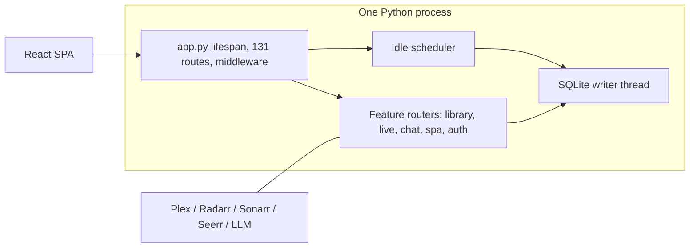
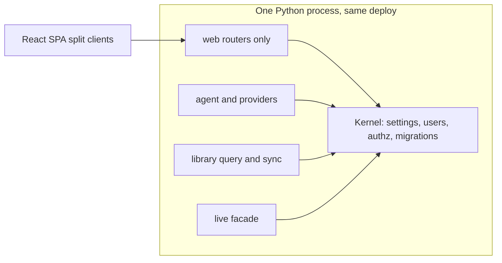

# 08 · Architecture — 2026-11-01

Reviewed `05274cf` (tag `v1.38.0`). Code was read from the extracted snapshot `/tmp/review360-05274cf`. The laptop working tree was not used as truth. No application code was changed.

## Part A: Conclusions & findings

### 1. Bottom line

**Grade: B-.** Projectionist can keep shipping for the next two years if the team finishes the extraction it has already started, and it will bog down if new features keep landing in the files that are already too big. The single most important fix is to stop adding routes to `projectionist/web/app.py` (4,378 lines, 131 handlers still inline) and give Admin, chat-adjacent owner actions, and Live a real package boundary (ARCH-005, ARCH-007). The single most important thing to protect is the data-plane work that already landed: a dedicated SQLite writer, atomic `settings.json` writes that fail closed when the file is corrupt, foreign keys turned on, and a numbered 60-step migration registry (ARCH-001, ARCH-002).

### 2. Key conclusions

1. **The backend is mid-migration from a god module to routers, and the migration stalled in the middle.** Eighteen route modules now call `include_router`, including library (54 routes), Live (31), and SPA HTML (41). `app.py` still owns 131 handlers and the process lifespan. Every new feature that touches "the app" still has a gravity well (ARCH-005, ARCH-013).

2. **The storage engine is ahead of the comments written about it.** Connections set `PRAGMA foreign_keys=ON`, WAL, a 30s busy timeout, and `synchronous=NORMAL`, and mutations are supposed to go through `WriteSerializer.run_write` (`05274cf:projectionist/library/db/_schema.py:51-61`, `_users.py:785-803`). Two purge paths still say the pragma is off and delete children by hand (`_chat.py:254-256`, `_memory.py:300-307`). That drift will cause the next deletion change to either double-delete or trust a cascade that is not declared on every `user_id` column (ARCH-009).

3. **Type safety and frontend tests cover the calm parts of the tree.** mypy's `files` list is a short allow-list (`pyproject.toml:158-170`) that excludes `web`, `library`, `agent`, `live_channels`, and `scheduler`. Frontend `npm run test:unit` runs `src/lib/*.test.mjs` only (`frontend/package.json:11`). `frontend/src/api/client.ts` is 2,401 lines and `ConfigPage.tsx` is 2,098, with no component test beside them (ARCH-006, ARCH-008).

4. **Live channels are a second product compiled into the first.** `guide.py`, `filler.py`, `publish.py`, `publish_programming.py`, and `plex_attach.py` are each over 1,000 lines, and `live_channels_routes.py` is 1,723. They share the process, the SQLite file, and the release cadence with chat and the library (ARCH-007, SC-13, SC-09).

5. **The test gate is real and was re-run for this commit.** A disposable copy of `05274cf` ran `.venv` pytest: **2,815 passed, 43 skipped, 44 subtests passed, 77.01% coverage** in 390s, above the 74% floor in `pyproject.toml` and `.github/workflows/ci.yml`. An earlier attempt died on `--timeout=600` because the plugin is not installed; that is a harness mistake, not a product failure (ARCH-003).

6. **Distribution and schema evolution are in good shape; local developer truth is not.** Runtime deps install with `--require-hashes`, CI builds the image and curls `/api/health`, and migrations are ordered in `schema_version`. Console scripts `curatorx-web` and `curatorx-mcp` still alias the new entry points, and backup resolution still looks for `curatorx.db` and `mediacurator.db` (ARCH-003, ARCH-011).

7. **Unknown URLs are a backend 404, not the SPA.** `spa_routes.py` registers an explicit list of HTML paths and has no catch-all. A path the list misses returns JSON `{"detail":"Not Found"}` (confirmed on QA `:8792` by recon, and visible in the route table). That is an architecture leak of the transport into the product (ARCH-010, SC-22).

### 3. Foundations challenged

| Assumption | Evidence for | Evidence against | Verdict | Cost of change | Rationale |
|---|---|---|---|---|---|
| SC-09 One Python process for web, scheduler, Live, and theater | `web/__main__.py` dual-serve; scheduler `off_loop` keeps heavy tasks off the loop; one SQLite file | Live publish + library sync + chat share a failure domain; `app.py` lifespan starts all of it | Keep | XL | Splitting processes now costs a supervisor and a second deploy. Finish in-process boundaries first (ARCH-007). |
| SC-10 SQLite WAL is enough | WAL + busy timeout + writer thread; 2,815 tests; household scale, not multi-tenant | 67 `CREATE TABLE` sites in `_schema.py`, 60 migrations, FK coverage is uneven | Keep | XL | A server database would not fix the god-module problem. Revisit only if one household's library writes block readers for seconds. |
| SC-13 Live belongs in this repo | Routes, scheduler task, and UI are shipped and on in 1.38.0 | Five modules over 1,000 lines plus a 1,723-line route file, sharing `app.py`'s release | Change | L | Keep the feature. Move `live_channels` behind a narrow interface so chat/library changes do not rebuild Live's risk (ARCH-007). |
| SC-21 Bespoke CSS instead of a component library | Styles live in `frontend/src/styles/`; no Tailwind/MUI in `package.json` | Tokens cannot be enforced by a library the app does not have; `client.ts` and pages own behavior and style together | Keep | L | Adopting a kit now would fight  the existing partials. Architecture can support tokens as CSS variables without a rewrite (ARCH-008). |
| SC-22 Hand-rolled SPA, FastAPI serves HTML, no SSR | Explicit HTML routes in `spa_routes.py`; Vite build is the client | Missing catch-all means the API's JSON 404 is the 404 page | Change | S | Add one SPA fallback for non-`/api` GET. Do not add SSR (ARCH-010). |
| SC-26 Hub-first Docker/Unraid is the only ship path | `docs/RELEASE.md`, CI `docker-smoke`, hashed `requirements/runtime.lock` | Laptop and CI both work from the same Dockerfile; no second artifact type to maintain | Keep | — | The constraint is a strength. Do not add a second packaging path. |
| SC-03 One instance, one owner | `BOOTSTRAP_OWNER_ID`, no tenant key on tables | Nothing in the schema is tenant-scoped | Keep | XL | Do not bolt on multi-household. It would cut across all 60 migrations. |
| SC-08 Many LLM providers | Provider package and `config_store.py` catalog | Each provider is another timeout and error shape in one agent | Keep | M | The seam (`agent/providers`) is the right one. Do not fold providers into `app.py`. |

### 4. If we built it today

A new codebase would be four packages with one SQLite file and one process: `web` (thin routers, no business rules), `library` (query and sync), `curator` (agent, tools, providers), and `live` (guide, publish, playback). Shared kernel: settings, users, authz, migrations. Frontend: a typed API client generated or hand-split by surface, pages that do not import the whole client, CSS variables as the only styling contract.

Today the kernel is real (`config_store.py`, `library/db`, `web/auth.py`) and the packages are half-extracted. Closing the gap is worth it, and it is a file-move program, not a rewrite. A framework swap (Django, Next, Postgres) would throw away the WAL writer, the migration registry, and the CI smoke test for no user-visible gain.

### 5. Findings by surface

**Public.** Health, features, login HTML, and privacy/about HTML are small and explicit. Unknown paths fall through to FastAPI's JSON 404 (ARCH-010). OpenAPI is off unless `EXPOSE_OPENAPI` is set (`app.py:451-473`), which is the right default. Grade: **B.**

**Consumer.** Library query, chat, playback, and Live routes live in their own modules. The library hot path already hops off the event loop with `run_db` (`library_routes.py:1436-1444`). Chat's async handler still does synchronous session writes before the first `await` (`chat_routes.py:163-167`). Grade: **B-.**

**Owner.** Settings persistence is the best-engineered part of the backend (ARCH-001). The owner UI is the worst-engineered part of the frontend: `ConfigPage.tsx` at 2,098 lines and a 2,401-line API client (ARCH-008). Grade: **C+.**

**Admin.** Tasks, logs, and a large share of admin handlers remain on `app.py` (ARCH-005). Scheduler task definitions are properly split under `scheduler/tasks/` with `off_loop=True` on the heavy ones. Grade: **C+.**

### 6. Findings by theme

**Module boundaries.** Best: `register_*_routes` functions and scheduler tasks as one file per job. Worst: `app.py` and `library/db/_schema.py` (2,242 lines) still knowing every table. Direction: no new route decorator in `app.py`; new tables get a mixin module, not another 200 lines in `_schema.py` (ARCH-005, ARCH-007, ARCH-013).

**Data model.** Best: `schema_version` with migrations 1–60, orphan cleanup at 34 and 37, `PRAGMA foreign_keys=ON`. Worst: comments and `purge_user_memory_and_chats` still describe a world where cascades are dormant, and `delete_user` commits the purge and the user row in two separate connections (`_users.py:205-212`). Direction: one transaction, one inventory of `user_id` columns, delete the stale comments (ARCH-002, ARCH-009).

**API design.** Best: library query has a single filter object and pagination (`offset`/`limit`). Worst: errors are ad hoc `HTTPException(detail=string)` with no shared error code, and SPA misses look like API misses (ARCH-010). Direction: a small error envelope for new routes only; do not boil the ocean.

**Frontend.** Best: route-level code splitting is already happening (the production build emits per-page chunks such as `LiveWatchPage` and `VoicePage`). Worst: the shell chunk and the API client are still monolithic, and unit tests never import a component (ARCH-008).

**Testing and CI.** Best: the coverage floor is enforced and this commit clears it at 77.01% with e2e in the same job and a Docker health smoke. Worst: mypy is green because it does not look at the dangerous packages, and ruff permanently ignores line length and import order (ARCH-003, ARCH-006, ARCH-012).

**Technology choices.** FastAPI, React 18, Vite 5, and SQLite remain the right set (see foundations). The compat shims are the choice that has expired (ARCH-011).

### 7. Stop doing

- Stop adding `@app.get` / `@app.post` handlers to `app.py`. New handlers go in a `*_routes.py` module (ARCH-005).
- Stop writing comments that say foreign keys are off. They are on (ARCH-009).
- Stop growing `curatorx-*` console scripts and legacy database filenames. Two releases of shim is the policy already written in `pyproject.toml:67`; 1.38.0 is past that if those lines shipped with the rename (ARCH-011).
- Stop treating a green mypy job as evidence that `web/` typechecks (ARCH-006).

### 8. Strengths worth protecting

- **Fail-closed settings.** `_atomic_write_json` uses a temp file, fsync, and `os.replace` (`config_store.py:851-871`). A corrupt file raises `SettingsCorruptError` instead of silently behaving as "no settings" (`config_store.py:848-894`, `app.py:479-481`). Do not "fix" a parse error by returning defaults.
- **One writer thread.** `run_write` / `try_run_write` keep `time.sleep` lock retries off the asyncio loop (`_schema.py:51-68`). New mutations go through it.
- **Ordered migrations.** `migrations.py:255-314` is the order. Do not add another `_migrate_*` call from boot that bypasses `schema_version`.
- **The CI bar.** Hashed runtime lock, pip-audit, pytest with `--cov-fail-under=74`, Playwright, and `docker-smoke` curling health (`ci.yml`). Do not split these into optional workflows.

### 9. Risks of inaction

In six to twelve months `app.py` and `ConfigPage.tsx` will be where every hotfix lands, review time will be dominated by merge conflicts, and a Live change will take the household app down with it because they share a process and a file. A wrong comment about foreign keys will ship a purge that either throws `IntegrityError` halfway through account deletion or leaves rows the privacy copy promised were gone. mypy will stay green while the untyped web layer grows.

### 10. Recommended direction

Sequence: (1) SPA fallback and the foreign-key comment/purge fix, both small; (2) freeze `app.py` and move the next admin feature out, not a big-bang split; (3) add `web` and `library` to mypy in slices; (4) only then draw a Live package boundary. Success in 90 days: `app.py` route count is lower than 131, `delete_user` is one transaction with a test that a referencing row cannot survive, and mypy's `files` list includes at least `projectionist/web/auth.py` and `projectionist/library/db/migrations.py`.

### 11. Scorecard

| Surface | Boundaries | Data model | API shape | Tests | Overall |
|---|---|---|---|---|---|
| Public | 4 — HTML routes are explicit | n/a | 3 — JSON 404 for unknown paths | 4 — health smoke in CI | 4 |
| Consumer | 4 — routers exist | 4 — query path is isolated | 4 — filter object + pagination | 3 — backend tests, thin UI tests | 4 |
| Owner | 2 — Config page and client are the seam | 5 — atomic settings, writer thread | 3 — mixed error strings | 2 — page untested | 3 |
| Admin | 2 — still hosted by `app.py` | 4 — scheduler tasks are modular | 3 — task trigger lives on the app | 3 — engine tested, UI not | 3 |

Scores are 1–5.

---

## Part B: Detailed findings

### 12. Scope and method

Read-only review of `05274cf`. Measurements: line counts, route-decorator counts, migration list, mypy `files`, CI workflow, and one full pytest of a disposable copy at `/tmp/review360-arch-run` using the laptop `.venv` (2,815 passed, 43 skipped, coverage 77.01%, 390s). The first pytest invocation in that work used `--timeout=600`; the timeout plugin is not installed, so that run died at collection. It is not a product defect.

Not reviewed: runtime behavior of Live publish under load, a real restore of a snapshot zip, and whether every `user_id` column has a foreign key (sampled, not exhaustively enumerated). No SSH, no prod, no application edits.

### 13. Strengths

### ARCH-001: Keep atomic settings writes and the fail-closed corrupt-file path

| Field | Value |
|---|---|
| Type | Strength |
| Surface | Owner |
| Persona(s) | Established owner, platform admin |
| Category | Data durability |
| Severity | High |
| Impact | 5 |
| Effort | S |
| Confidence | Confirmed |
| Priority score | 7.5 |
| Verdict | Protect |
| Dependencies | none |
| Labels | settings, durability |

**Evidence:** `05274cf:projectionist/config_store.py:844-894` (`_atomic_write_json`, `os.replace`, `SettingsCorruptError`). `05274cf:projectionist/web/app.py:479-481` maps that error to HTTP 503 with a restore message.

**Current state:** Settings, including encrypted secrets, are written via temp file plus `os.replace`. A file that exists but will not parse raises, and the app serves 503 instead of pretending the household has no configuration.

**Root cause:** This was built as a response to partial writes and "empty file means first run" being the same condition.

**Recommendation:** Keep the helper as the only writer. New persisted JSON (facets already has a second `_atomic_write_json` in `facets/overlay.py:83`) should call one shared function. Add a one-line comment at each call site pointing at it. Do not catch `SettingsCorruptError` and fall back to defaults.

**Rationale:** A fallback to defaults is how a truncated file becomes "login disabled" or, worse, a wide-open setup. The 503 is the safe behavior. Rejected: a database row for settings, because the file is also the backup unit operators already copy.

**User story:** As an owner, I want a failed settings write to leave the previous file intact so that a crash cannot wipe the household's keys.

**Acceptance criteria:**
- [ ] Every settings write goes through one atomic helper.
- [ ] A truncated `settings.json` returns 503 and does not create a new owner session.
- [ ] A unit test kills the writer between temp-file create and `os.replace` and asserts the previous bytes remain.

**Success metric:** Zero production incidents in 12 months where a restart after a crash comes up with default settings.

**Validation:** Unit test plus a manual truncate of a copy of `settings.json` in a disposable `DATA_DIR`.

### ARCH-002: Keep the numbered migration registry and foreign keys on

| Field | Value |
|---|---|
| Type | Strength |
| Surface | Cross-cutting |
| Persona(s) | Platform admin, established owner |
| Category | Data model |
| Severity | High |
| Impact | 5 |
| Effort | S |
| Confidence | Confirmed |
| Priority score | 7.5 |
| Verdict | Protect |
| Dependencies | none |
| Labels | sqlite, migrations |

**Evidence:** `05274cf:projectionist/library/db/migrations.py:1-7` and the registry at lines 255–314 (versions 1 through 60, including `fk_orphan_cleanup` at 34). `05274cf:projectionist/library/db/_users.py:801-802` executes `PRAGMA foreign_keys=ON` on every connection. `05274cf:projectionist/library/db/_schema.py:67` `CREATE TABLE` count is 67.

**Current state:** Boot applies missing versions in order and records them in `schema_version`. New integrity work is supposed to land as a numbered step, not an ad-hoc boot call. The pragma is on, so declared `ON DELETE CASCADE` clauses actually fire.

**Root cause:** Schema history used to be a pile of `_migrate_*` helpers. The registry is the correction.

**Recommendation:** Next schema change is version 61 in this list only. Do not open a second migration mechanism. When adding a `user_id` column, declare the foreign key in the same migration.

**Rationale:** Two migration systems will drift, and an undeclared `user_id` is how account deletion lies. Rejected: moving to Alembic, because the registry is 60 steps in and Alembic would be a second source of truth.

**User story:** As an owner upgrading a container, I want each version to apply once, in order, so a restart cannot half-apply a schema.

**Acceptance criteria:**
- [ ] `schema_version` reaches exactly the highest registry id after boot on an empty database and on a database already at version 60.
- [ ] A downgrade is a no-op (no version is removed).
- [ ] New columns that point at `users` ship with a foreign key.

**Success metric:** Every release's upgrade path is covered by a migration test from the previous version.

**Validation:** Existing migration tests plus a boot against a copy of a v1.37 database.

### ARCH-003: Keep the CI gate that actually runs the suite and the image

| Field | Value |
|---|---|
| Type | Strength |
| Surface | Cross-cutting |
| Persona(s) | Platform admin |
| Category | Testing |
| Severity | High |
| Impact | 4 |
| Effort | S |
| Confidence | Confirmed |
| Priority score | 6.0 |
| Verdict | Protect |
| Dependencies | none |
| Labels | ci, coverage |

**Evidence:** `05274cf:.github/workflows/ci.yml:22-30` (hashed pip install and pip-audit), lines 68–71 (`pytest` with `--cov-fail-under=74` and `npm run test:e2e`), lines 76–120 (`docker-smoke` on port 8788 inside CI, health grep). Local re-run of `05274cf`: 2,815 passed, 43 skipped, 77.01% coverage, 390.07s. Floor in `05274cf:pyproject.toml:71-72`.

**Current state:** A merge to `main` cannot go green without the runtime lock installing, the audit, the backend suite, the frontend unit suite, Playwright, and a container that answers `/api/health`.

**Root cause:** The project chose one workflow instead of a pile of optional checks.

**Recommendation:** Leave the floor at 74 until it has sat above 80 for a quarter, then raise it one point. Do not mark e2e or docker-smoke `continue-on-error`.

**Rationale:** This is the only automated proof that a Hub image can boot. Raising the floor immediately would freeze useful changes in the untyped core. Weakening it to "unit tests only" is how the Live stack would ship broken.

**User story:** As the maintainer, I want `main` to mean the image starts, so a tag is not the first time health fails.

**Acceptance criteria:**
- [ ] CI on `main` fails if coverage drops under 74, if e2e fails, or if the smoke container does not return `"status"`.
- [ ] The timeout plugin is not required for the default `pytest` invocation (it is not installed today).

**Success metric:** No release in the next two quarters is tagged from a red CI run.

**Validation:** Inspect the workflow file and the latest `main` run.

### ARCH-004: Keep library reads and health off the event-loop hot path

| Field | Value |
|---|---|
| Type | Strength |
| Surface | Consumer |
| Persona(s) | Returning consumer, platform admin |
| Category | Runtime boundaries |
| Severity | Medium |
| Impact | 4 |
| Effort | S |
| Confidence | Confirmed |
| Priority score | 4.0 |
| Verdict | Protect |
| Dependencies | none |
| Labels | asyncio, sqlite |

**Evidence:** `05274cf:projectionist/web/library_routes.py:1436-1444` (`run_db` around youth filters, `query_library`, and payload sanitize, with a comment that main and theater share one loop). `05274cf:projectionist/web/auth.py:465-469` skips SQLite for `GET /api/health` and non-API paths, citing a 30s busy timeout that used to stall first paint. `05274cf:projectionist/web/app.py:1322-1327` `/api/ready` does not read the movie library.

**Current state:** The two requests that must stay fast during a library write (health, and the browse query) have an explicit off-loop or skip-SQLite path.

**Root cause:** A shared loop plus a 30s busy timeout made an innocent page load wait on a writer.

**Recommendation:** Any new `async def` route that touches SQLite calls `run_db` or `run_in_threadpool`. Code review rejects a bare `db.` call before the first `await` on an async route. Chat is the known miss; that is ARCH-adjacent and owned as a defect in the performance pass, not a reason to undo this pattern.

**Rationale:** The pattern is the difference between "Live rebuild pauses the UI" and "Live rebuild pauses itself." Rejected: moving the whole app to async SQLite drivers, which would rewrite every test for a problem the thread pool already bounds.

**User story:** As a member opening the app while a sync runs, I want the shell to paint even if a query is slow.

**Acceptance criteria:**
- [ ] `/api/health` performs no SQLite call.
- [ ] `/api/library/query` does not call `query_library` on the event loop.
- [ ] A new async route template in the contributor docs shows `run_db`.

**Success metric:** A library sync no longer moves health latency (see the performance document's probe; do not regress the bypass).

**Validation:** Code inspection plus a request log during a sync.

### 14. Weaknesses

Sorted by priority score.

### ARCH-005: Stop adding routes to app.py and finish the extraction

| Field | Value |
|---|---|
| Type | Weakness |
| Surface | Admin |
| Persona(s) | Platform admin, established owner |
| Category | Module boundaries |
| Severity | High |
| Impact | 4 |
| Effort | L |
| Confidence | Confirmed |
| Priority score | 2.4 |
| Verdict | Fix |
| Dependencies | ARCH-013 |
| Labels | app.py, routers |

**Evidence:** `wc -l` on `05274cf` reports `projectionist/web/app.py` at 4,378 lines. Grep count of `@app.(get|post|put|patch|delete)` in that file is 131. Extracted routers already exist: `library_routes.py` 2,022 lines and 54 routes, `live_channels_routes.py` 1,723 lines and 31 routes, `spa_routes.py` 41 routes. Registration is a hand list at `app.py:1190` and `app.py:1350-1372`. The FastAPI instance itself is created at `app.py:467`.

**Current state:** The app is half a modular server and half a single module that still owns lifespan, health, features, admin logs, scheduled-task trigger, LLM model listing, and action confirmation (`app.py:1487`, `1659`, `1824`, `2696`).

**Root cause:** Extraction started as "move a feature when you touch it" and then features kept arriving in the file everyone already had open.

**Recommendation:** Freeze: a review rule that a PR adding a route decorator to `app.py` must move that route's neighbors with it. Next slice is the admin cluster (logs, task trigger, LLM models), into `admin_routes.py`, leaving lifespan and middleware in `app.py`. Do not attempt to split all 131 in one change.

**Rationale:** This file is the conflict magnet and the place authz bugs hide, because every dependency is imported at the top (the ruff ignore for F401 on this file is the smell, `pyproject.toml:141`). A big-bang move would break the CI smoke for no user gain. A freeze-plus-slice keeps `main` shippable.

**User story:** As a maintainer, I want an admin change to touch an admin module so I can review it without reading the whole server.

**Acceptance criteria:**
- [ ] `app.py` decorator count is below 131 after the admin slice.
- [ ] Lifespan, security headers, and health stay in `app.py`.
- [ ] CI docker-smoke still passes.

**Success metric:** Median PR touching the backend changes fewer than three unrelated sections of `app.py`.

**Validation:** `rg` count of route decorators in `app.py` before and after.

### ARCH-006: Make mypy look at the packages that can break a release

| Field | Value |
|---|---|
| Type | Weakness |
| Surface | Cross-cutting |
| Persona(s) | Platform admin |
| Category | Type safety |
| Severity | High |
| Impact | 3 |
| Effort | L |
| Confidence | Confirmed |
| Priority score | 1.8 |
| Verdict | Fix |
| Dependencies | none |
| Labels | mypy, ci |

**Evidence:** `05274cf:pyproject.toml:147-170`. The comment says the list is "packages that are already type-clean so `python -m mypy` is green today." The list includes `config_store`, `connectors`, `memory`, `models`, `persona`, `privacy`, `telemetry`. It does not include `web`, `library`, `agent`, `scheduler`, or `live_channels`. Lint workflow runs `python -m mypy` (`.github/workflows/lint.yml:28`).

**Current state:** The mypy job is green because it does not typecheck the HTTP layer, the agent, or Live. `ignore_missing_imports`, `follow_imports = silent`, and `warn_return_any = false` keep the allow-list quiet.

**Root cause:** A transitional baseline was frozen and then treated as the destination.

**Recommendation:** Each quarter, append one package that is already close (`projectionist/web/auth.py` first, then `library/db/migrations.py`) and fix only the errors that package produces. Do not flip the repo to strict. Do not drop `files` until the list covers `web` and `library`.

**Rationale:** The next auth or migration bug will be a wrong optional, and the current job cannot see it. A strict flip would stop the release train for a cleanup. Slicing matches how the baseline was meant to be burned down (`pyproject.toml:88-89`).

**User story:** As a maintainer, I want a type error in the login path to fail CI so it does not fail a household on Friday.

**Acceptance criteria:**
- [ ] `projectionist/web/auth.py` is in the mypy `files` list and `python -m mypy` exits 0.
- [ ] The lint workflow does not gain `continue-on-error`.

**Success metric:** Within two quarters, `web/` and `library/db/` are in the list.

**Validation:** CI lint job log shows those paths were checked.

### ARCH-007: Draw a boundary around Live and the schema mixin before they grow again

| Field | Value |
|---|---|
| Type | Weakness |
| Surface | Cross-cutting |
| Persona(s) | Established owner, platform admin |
| Category | Module boundaries |
| Severity | High |
| Impact | 4 |
| Effort | XL |
| Confidence | Confirmed |
| Priority score | 1.5 |
| Verdict | Rethink |
| Dependencies | ARCH-005 |
| Labels | live, schema |

**Evidence:** Line counts at `05274cf`: `live_channels/publish.py` 1,902, `plex_attach.py` 1,919, `publish_programming.py` 1,272, `filler.py` 1,111, `guide.py` 1,043, `web/live_channels_routes.py` 1,723, `library/db/_schema.py` 2,242, `library/feeds.py` 2,408, `library/query.py` 1,946. Scheduler engine is 1,372 lines and already knows how to run a task off-loop (`scheduler/engine.py:1022-1028`).

**Current state:** Live publishing, Plex DVR attach, filler, and the guide are in-process libraries with no documented public surface. The schema mixin is the other gravity well: tables, the writer, and bootstrap live together.

**Root cause:** Live shipped as a feature inside the household app (SC-13) faster than the module boundaries. Schema grew by appending to the file that already held `CREATE TABLE`.

**Recommendation:** Define a three-function Live facade (`guide_snapshot`, `publish`, `playback_url`) and ban imports of `plex_attach` from `web/` except through that facade. Split `_schema.py` by table family the next time a migration touches it, leaving `Database` as a thin composer. Do not extract Live into another container in this horizon.

**Rationale:** A second container doubles backup, ports, and the Unraid template (SC-26) before the code has a seam. A facade is reversible. Doing nothing means the next Live bug fix edits five 1,000-line files and the web app.

**User story:** As a maintainer, I want a Live change to be reviewable without reading the library schema so a guide fix cannot corrupt chat tables.

**Acceptance criteria:**
- [ ] `web/` imports Live only through one module.
- [ ] `_schema.py` stops growing; new tables land in a sibling module.
- [ ] CI stays green; no new service is added to the compose file.

**Success metric:** A Live-only PR touches no file under `library/db/`.

**Validation:** Import grep in review.

### ARCH-008: Split the frontend API client and test the pages that own owner workflows

| Field | Value |
|---|---|
| Type | Weakness |
| Surface | Owner |
| Persona(s) | Established owner, new owner |
| Category | Frontend architecture |
| Severity | Medium |
| Impact | 3 |
| Effort | M |
| Confidence | Confirmed |
| Priority score | 2.0 |
| Verdict | Fix |
| Dependencies | none |
| Labels | frontend, tests |

**Evidence:** `05274cf:frontend/src/api/client.ts` is 2,401 lines. `05274cf:frontend/src/pages/ConfigPage.tsx` is 2,098. `useChatSession.ts` is 1,337. `05274cf:frontend/package.json:11` runs `node --import tsx --test src/lib/*.test.mjs` only. All 168 `*.test.*` files under `frontend/src` are under `src/lib`. There is no React component test. Production build (full tree at `/tmp/review360-perf-root`, because a frontend-only copy cannot resolve `../../docs/PRIVACY.md`) does emit route chunks, so the bundler is not the whole problem.

**Current state:** Behavior for settings, chat, and admin is concentrated in files the unit runner never imports. Styling can carry CSS variables later; the blocker is that pages and the client are one pile, so a token migration has nowhere stable to land.

**Root cause:** The client grew by appending a function per endpoint. Tests were aimed at pure helpers, which are the easy part.

**Recommendation:** Split `client.ts` into `client/library.ts`, `client/chat.ts`, `client/admin.ts`, `client/live.ts`, re-exporting from `client.ts` so imports do not all break in one PR. Add one component test for the settings save path and one for the chat composer error state, using the existing node test runner or the e2e suite. Do not adopt a new test framework in the same change.

**Rationale:** Owner regressions today are caught by Playwright or by the household. A 2,000-line page will not be safely restyled. Rejected: generating the client from OpenAPI, because OpenAPI is intentionally unpublished (`app.py:451-465`) and the client already has household-specific error copy.

**User story:** As an owner, I want a settings tweak not to break chat, so a styling change stays inside the page that owns it.

**Acceptance criteria:**
- [ ] No single frontend file over 1,500 lines on the API path after the split.
- [ ] At least two tests import a page or a hook outside `src/lib`.
- [ ] Existing e2e still passes.

**Success metric:** A CSS-token PR does not need to edit `client.ts`.

**Validation:** Line counts and the unit test run.

### ARCH-009: Make account deletion one transaction and delete the stale foreign-key comments

| Field | Value |
|---|---|
| Type | Weakness |
| Surface | Admin |
| Persona(s) | Established owner, member |
| Category | Data model |
| Severity | Medium |
| Impact | 4 |
| Effort | S |
| Confidence | Likely |
| Priority score | 3.2 |
| Verdict | Fix |
| Dependencies | ARCH-002 |
| Labels | privacy, sqlite, fk |

**Evidence:** `05274cf:projectionist/library/db/_users.py:801-802` turns foreign keys on. `05274cf:projectionist/library/db/_users.py:205-212` `delete_user` checks the row, calls `purge_user_memory_and_chats`, then opens a second connection to `DELETE FROM users`. `05274cf:projectionist/library/db/_memory.py:300-307` and `_chat.py:254-256` both say the pragma is not enabled and cascades are dormant. Many later tables do declare `ON DELETE CASCADE` (for example `_schema.py:241`, `:590`, `:986-987`). Some `user_id` columns were added with `ALTER TABLE` and no foreign key (`_schema.py:544`, `:547`, `:550`).

**Current state:** The engine enforces the foreign keys that exist. The purge code does not believe that, and it does its work in a different transaction from the user-row delete. A crash between the two leaves a user with no chats, or a failed `DELETE` if some other table still references `users` without `ON DELETE`. Columns added by `ALTER` without a foreign key will not be cleaned by the pragma at all.

**Root cause:** The pragma was turned on after the purge was written, and nobody deleted the comments or unified the transaction.

**Recommendation:** One `run_write` transaction: explicit deletes for columns that have no foreign key, then `DELETE FROM users`, relying on cascade only where the `CREATE TABLE` shows `ON DELETE CASCADE`. Update both comments. Add a test that inserts a `pending_actions` row (no FK) and a cascaded child, deletes the user, and asserts both are gone and the user row is gone.

**Rationale:** Account deletion is a privacy promise. Two connections make it a best effort. Rewriting every table in one migration is more risk than listing the non-FK columns and deleting them explicitly.

**User story:** As an owner removing a member, I want their chats and their user row to disappear together so a retry cannot resurrect half an account.

**Acceptance criteria:**
- [ ] `delete_user` uses one write transaction.
- [ ] Comments in `_memory.py` and `_chat.py` match `PRAGMA foreign_keys=ON`.
- [ ] A test covers one cascaded table and one `user_id` column that has no foreign key.

**Success metric:** The deletion test is part of the default pytest run.

**Validation:** The new test, plus reading the pragma line.

### ARCH-010: Serve the SPA for unknown pages instead of a JSON 404

| Field | Value |
|---|---|
| Type | Weakness |
| Surface | Public |
| Persona(s) | First-time visitor, returning consumer |
| Category | Routing |
| Severity | Medium |
| Impact | 3 |
| Effort | S |
| Confidence | Confirmed |
| Priority score | 3.0 |
| Verdict | Fix |
| Dependencies | none |
| Labels | spa, 404 |

**Evidence:** `05274cf:projectionist/web/spa_routes.py:142-203` registers specific HTML paths (`/privacy`, `/about`, `/help`, `/admin`, `/settings`, and others) and has no `/{path:path}` fallback. QA `:8792` returns `{"detail":"Not Found"}` for an unknown path (recon, this run). API 404s use the same body.

**Current state:** A mistyped member URL, or a new client route that forgot a server twin, shows raw JSON. The client never boots, so its own not-found page cannot run.

**Root cause:** The server lists HTML routes so deep links work without a catch-all, and the list drifted from the client router.

**Recommendation:** After all API and asset mounts, add `GET /{full_path:path}` that returns `index.html` for requests that do not start with `/api`, `/assets`, `/static`, or `/mcp`, with `Cache-Control: no-cache`. Keep API 404s as JSON.

**Rationale:** The client already has a not-found page (the build emits `NotFoundPage-*.js`). The server should let it load. A catch-all in front of `/api` would hide real API bugs, so the order matters.

**User story:** As a member, I want a bad link to show the app's not-found page so I can get back to Chat.

**Acceptance criteria:**
- [ ] `GET /this-route-does-not-exist` returns `text/html` and the SPA shell.
- [ ] `GET /api/does-not-exist` still returns JSON 404.
- [ ] `/assets/*` cache headers are unchanged.

**Success metric:** No HTML response has `content-type: application/json` except the JSON endpoints.

**Validation:** curl the two paths on QA after the change.

### ARCH-011: Remove the CuratorX command names and legacy database filenames

| Field | Value |
|---|---|
| Type | Weakness |
| Surface | Cross-cutting |
| Persona(s) | Platform admin |
| Category | Compatibility shims |
| Severity | Low |
| Impact | 2 |
| Effort | S |
| Confidence | Confirmed |
| Priority score | 1.0 |
| Verdict | Remove |
| Dependencies | none |
| Labels | rename, cleanup |

**Evidence:** `05274cf:pyproject.toml:64-69` defines `projectionist-web` and `projectionist-mcp`, then "Compat shims (~2 releases)" `curatorx-web` and `curatorx-mcp`. `05274cf:projectionist/web/backup.py:17-28` still resolves `curatorx.db` and `mediacurator.db` ahead of a missing canonical file. `logging_config.py:1` still says "Central logging configuration for CuratorX".

**Current state:** The product name in the user interface is Projectionist. The packaging and backup path still understand two older names.

**Root cause:** A rename left a timed shim, and the timer was not tied to a version.

**Recommendation:** In the next release notes, state that `curatorx-web` and `curatorx-mcp` will be removed two tags after 1.38.0. Keep the legacy filename lookup until a startup log line has been available for those same two tags ("found legacy database name X, expected projectionist.db"). Then delete the shims.

**Rationale:** Silent fallback to an old database file is how an operator restores the wrong decade of data. Immediate deletion could break an Unraid template that still calls `curatorx-web`. A dated removal is the reversible path.

**User story:** As an owner upgrading, I want the app to tell me if it opened an old database file so I do not back up the wrong one.

**Acceptance criteria:**
- [ ] Startup logs a warning when the opened file is not `projectionist.db`.
- [ ] Release notes name the tag that drops `curatorx-*` scripts.
- [ ] After that tag, `pyproject.toml` has only the Projectionist scripts.

**Success metric:** New installs never create `curatorx.db`.

**Validation:** Boot with only `curatorx.db` present and read the log; grep the scripts out after the removal tag.

### ARCH-012: Treat the ruff baseline as debt with an owner, not as style

| Field | Value |
|---|---|
| Type | Weakness |
| Surface | Cross-cutting |
| Persona(s) | Platform admin |
| Category | Developer experience |
| Severity | Low |
| Impact | 2 |
| Effort | M |
| Confidence | Confirmed |
| Priority score | 0.7 |
| Verdict | Fix |
| Dependencies | ARCH-005 |
| Labels | ruff, lint |

**Evidence:** `05274cf:pyproject.toml:113-122` ignores E501 and I001 with a comment that fixing them would touch the whole tree. `pyproject.toml:141` silences F401, E402, and F821 on `projectionist/web/app.py`. `lint.yml:48-53` sets `continue-on-error: true` on Prettier.

**Current state:** Lint is green. Unused imports in `app.py` and unordered imports everywhere are invisible. Prettier cannot fail a PR.

**Root cause:** The toolchain was added as config-only so it would be green on day one, and the burn-down never got a milestone.

**Recommendation:** After ARCH-005 moves a slice out of `app.py`, delete the F401 ignore for that file if it is clean. Leave E501 ignored. Point Prettier at `frontend/src/lib` only and let that directory fail CI, instead of a repo-wide check that is allowed to fail.

**Rationale:** A warning that cannot fail teaches people to ignore the job. A narrow, failing check is worth more than a wide, optional one.

**User story:** As a maintainer, I want lint to fail only on rules we mean, so a red job is a real defect.

**Acceptance criteria:**
- [ ] Prettier either fails CI on a stated directory or is removed from the workflow.
- [ ] `app.py`'s F401 ignore is deleted or the file still needs it and the comment says why, with a date.

**Success metric:** The lint workflow has no `continue-on-error` except a comment with an expiry.

**Validation:** Read `lint.yml` and a run log.

### 15. Opportunities

### ARCH-013: Add a route-ownership map and enforce it in review

| Field | Value |
|---|---|
| Type | Opportunity |
| Surface | Cross-cutting |
| Persona(s) | Platform admin |
| Category | Module boundaries |
| Severity | Medium |
| Impact | 3 |
| Effort | S |
| Confidence | Confirmed |
| Priority score | 3.0 |
| Verdict | Add |
| Dependencies | ARCH-005 |
| Labels | docs, routers |

**Evidence:** Route registration is an imperative list in `app.py` (see ARCH-005). There is no module docstring that states which file owns which prefix.

**Current state:** Ownership is tribal. A new contributor greps for the path string.

**Root cause:** Extraction was mechanical and never produced a map.

**Recommendation:** A single markdown table in `docs/` (or a module docstring in `web/__init__.py`) with prefix, module, and auth dependency. PRs that add a route update the table. That is the whole tool; do not generate it until the freeze in ARCH-005 has held for a month.

**Rationale:** A generated map will rot the same way OpenAPI would, because the app builds routes imperatively. A table people must edit is enough at this size.

**User story:** As a new contributor, I want to know which file owns `/api/library` so I do not add a fifth copy in `app.py`.

**Acceptance criteria:**
- [ ] Every `/api` prefix in the repo appears once in the table.
- [ ] The table names the auth dependency (`get_current_user`, `require_role("owner")`, or public).

**Success metric:** The next two features land in an existing router module named by the table.

**Validation:** Diff the table against `rg '@router.'`.

### ARCH-014: Publish a one-page "where a change goes" for the four packages

| Field | Value |
|---|---|
| Type | Opportunity |
| Surface | Cross-cutting |
| Persona(s) | Platform admin |
| Category | Developer experience |
| Severity | Low |
| Impact | 2 |
| Effort | XS |
| Confidence | Confirmed |
| Priority score | 2.0 |
| Verdict | Add |
| Dependencies | ARCH-007 |
| Labels | docs, onboarding |

**Evidence:** Package layout is visible (`projectionist/agent`, `library`, `live_channels`, `web`, `scheduler`) but `AGENTS.md` describes how to run the app, not where a change belongs. `library/db/_schema.py` and `app.py` keep absorbing work because they are the obvious files.

**Current state:** Onboarding docs optimize for boot, not for seams.

**Root cause:** The seams are newer than the docs.

**Recommendation:** Ten lines in `AGENTS.md`: chat copy goes to `agent/`, library query to `library/query.py`, schema to a new migration version, HTTP to an existing router, Live only through the facade once ARCH-007 exists. No new doc site.

**Rationale:** The friction files are friction because they are famous. A pointer is cheaper than another review comment.

**User story:** As a contributor, I want a one-screen rule for where code goes so I do not enlarge `app.py` by habit.

**Acceptance criteria:**
- [ ] `AGENTS.md` names the four areas and the file each one should grow in.
- [ ] It tells the reader not to add routes to `app.py`.

**Success metric:** New contributors' first PRs do not add a route to `app.py`.

**Validation:** Read the doc.

### 16. Remediation plan

| Horizon | ID | Title | Effort | Owner | Dependencies |
|---|---|---|---|---|---|
| Now | ARCH-010 | SPA fallback for unknown pages | S | Backend | none |
| Now | ARCH-009 | One-transaction account deletion, fix FK comments | S | Backend | ARCH-002 |
| Now | ARCH-014 | "Where a change goes" in AGENTS.md | XS | Maintainer | none |
| Next | ARCH-005 | Freeze app.py; extract admin routes | L | Backend | ARCH-013 |
| Next | ARCH-013 | Route-ownership table | S | Backend | none |
| Next | ARCH-006 | mypy covers auth.py, then migrations | L | Backend | none |
| Next | ARCH-008 | Split client.ts; two UI tests | M | Frontend | none |
| Later | ARCH-007 | Live facade; split _schema.py | XL | Backend | ARCH-005 |
| Later | ARCH-011 | Remove curatorx scripts after the warned tags | S | Maintainer | none |
| Later | ARCH-012 | Narrow Prettier; expire app.py F401 ignore | M | Maintainer | ARCH-005 |

**Sequencing.** ARCH-010 and ARCH-009 are user-visible or data-correct and do not require a redesign. The freeze on `app.py` has to precede the Live facade or the facade will be imported from the god module anyway. mypy expansion is independent and should not block the route work.

### 17. Quick wins

- ARCH-010 (S): one catch-all route.
- ARCH-009 (S): one transaction and two comment edits, plus a test.
- ARCH-014 (XS): a short section in `AGENTS.md`.
- ARCH-001's "single atomic helper" note (S), while protecting the behavior.

### 18. Open questions

- Is any Unraid template or Community App still invoking `curatorx-web`? The answer sets the removal tag for ARCH-011. Do not guess; check the template in `templates/` before deleting the script.
- Should `/api/ready` be what the container healthcheck curls, instead of `/api/health`? Health is intentionally shallow. That is an operability choice for the performance/SRE pass to recommend; architecture should keep both endpoints.

### Current-state diagram

### Target-state diagram

Phased path: Now, fix fallback and deletion. Next, freeze `app.py` and extend mypy. Later, impose the Live facade and split the schema mixin. The container, the port, and the SQLite file stay as they are through every phase.

### Phase 6 self-check

- [x] Part A is first; conclusions cite finding IDs.
- [x] Every High finding (ARCH-005, ARCH-006, ARCH-007) appears in the narrative.
- [x] Foundations challenged, "If we built it today", and "Stop doing" are present.
- [x] All four surfaces are covered in section 5.
- [x] Strengths have the same finding format as weaknesses.
- [x] Every finding has evidence, root cause, rationale, and acceptance criteria.
- [x] IDs ARCH-001–ARCH-014 are unique.
- [x] No application code was modified.
