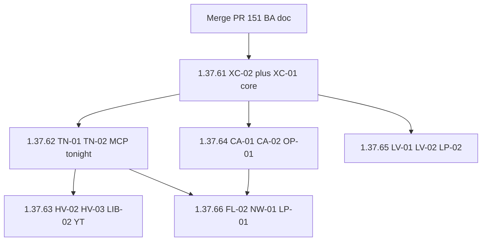

# Delight wishlist delivery (from BA briefs)

**Date:** 2026-10-23  
**Status:** Delivery series on Automat **1.37.60**. Docs-only briefs already live in [DELIGHT-WISHLIST.md](../../DELIGHT-WISHLIST.md). Do not Hub / Automat until asked.

**Source of briefs:** [docs/DELIGHT-WISHLIST.md](../../DELIGHT-WISHLIST.md). This plan **does not invent product** — each patch maps 1:1 to brief IDs. Keep that file as the brief; do not turn it back into slogans.

**Baseline:** Automat **1.37.60** already live (For you junk-copy refuse + iPad 2× selection).

Hard non-goals stay locked: no Tunarr, no HDHomeRun, no IdleScheduler rewrite, no Postgres, no “on Netflix,” no 2× on Live, no gift queue / trust diary. Spikes **RS-01–05** are not ship gates.

## Classify every brief

**New work (build):** XC-01, XC-02, HV-02, HV-03, YT-02, CA-01, CA-02, TN-01, TN-02, LIB-02, FL-02, NW-01, OP-01, LP-02, LV-01, LV-02, RA-02 (tests ride with the patches that need them).

**Mostly shipped — regression tests + copy, do not reopen as features:** HV-01 (except XC-02 display), HV-04, HV-05, YT-01, YT-03, CA-03 (except XC-01/02 sentence), CA-04, LV-03, LV-04, LB-01 (index-only idle; For you-idle blocked on RS-04), LIB-01, FL-01, LP-01 (policy: owned `library_query` only; no MCP publish), RA-01, XC-03 (rule + payload fields where tools already exist).

**Research only:** RS-01 closed-loop augment, RS-02 episode graph, RS-03 mood on MCP, RS-04 Lobby in daily use, RS-05 watch-together presence.

## Shared explanation object (every mouth)

XC-01’s object is the product. Callers today fork three ways:

| Mouth | Today | Target |
|-------|--------|--------|
| Explore For you | `feed_for_you` → `list_linked_unwatched` → `kind=watched_bridge` | Keep; XC-02 display fix |
| MCP `what_to_watch_tonight` | [`projectionist/mcp/server.py`](../../../projectionist/mcp/server.py) `query_library(..., query="watch tonight")` | Call `list_linked_unwatched`; return `{mode, empty, note, items[].explanation}` |
| In-app `_tool_what_to_watch_tonight` | `reason="Good pick for tonight"` | Same builder or stop claiming it is tonight |
| Chat cards | `set_recommendation_reasons` / sanitized pipeline strings | `explanation.sentence` or omit |
| Newsletter | already `specific_bridge`; must emit XC-01 sentence after XC-02 | Same object |

Honesty: no named link → omit. Never cosine, `"Good pick for tonight"`, `"Unwatched pick for you"`, or Wikipedia glue. Privacy MCP never gets tonight from TMDB.

## Patch series (Hub-first, one theme each)

Worktrees per patch. Tests at the brief Success lines. Version lockstep via `./scripts/patch-release.sh` only when asked to ship.

### 1.37.61 — Honest TV seed + one builder

- **XC-02:** Overlay stays on plot matching; display sentence names the **show** (year), not episode title as the watched work. Empty episode plot must not search the string `Not Cancer`. Evidence may still keep `episode_title`.
- **XC-01 (library + in-app callers):** One builder used by For you, inbox, `build_member_newsletter`. Chat/MCP wiring can wait until 1.37.62–63 if the object is already on `list_linked_unwatched` items.
- **HV-01 / CA-03 / RA-02:** House For you card never includes `Not Cancer` as watched title; newsletter body is `explanation.sentence` or the existing empty honest block; add those tests next to [`tests/test_household_bridges.py`](../../../tests/test_household_bridges.py) / plot kinship suites.
- **YT-01:** Youth filter on the same builder (skip adult seeds; empty rail is success). Confirm existing `filter_items_for_youth` on For you; add a House→R peer case.

### 1.37.62 — MCP tonight is For you

- **TN-01:** Rewrite `what_to_watch_tonight` to `list_linked_unwatched`. Keep the tool name. Full mode only. Drop FTS `"watch tonight"`. Payload as in the brief (cap 3–8). Align in-app agent tool to the same path.
- **TN-02:** Add sibling `continue: []` from `library_tv_progress` / on-deck — not `watched_bridge`.
- **XC-03:** Tonight items that claim playable have `in_library` + playable derived from `rating_key` (full). Rename/doc `upcoming_premieres` as recently added if copy still says “premiered.”

### 1.37.63 — Other mouths + privacy graph

- **HV-02:** Chat similar-title why = `explanation.sentence`. Empty For you → assistant uses For you `note`, not a cosine dump.
- **HV-03:** Why line only when arrival kind is a bridge (For you / inbox / More Like This from a watched seed). Browse Movies wall stays why-less.
- **YT-02:** Youth Pick for me: XC-01 sentence if youth-safe bridge, else **no why** (kill visible `"Unwatched pick for you"`).
- **LIB-02:** Privacy-sanitized MCP wraps of in-process `list_relations` / `walk_relations` (depth ≤ 2) / `titles_by_person` / `find_similar_titles(explainable_only=True)`. Empty note: cache not ready. No `rating_key` on privacy.
- **YT-03:** Confirm youth YIR is tracker + rating-gated; ticket only if adult memory leaks.

### 1.37.64 — Monday kinship you can name

- **CA-01:** `GET /api/library/knowledge-coverage` grows `with_explainable_neighbors_opened_pct` from `kinship_miss` keys (no new analytics plane). Hero quotes opened %, not Similar cache.
- **CA-02:** Owner `GET /api/library/kinship-miss?limit=50` — title, why queued, `hit_count`, last miss. No auto-repair.
- **OP-01:** Full-MCP wraps of those two GETs. Purge stays suggestions.

### 1.37.65 — Live honesty + lineup read

- **LV-01:** When playable pool is 1, Guide/Watch chrome says the station will repeat. Pool &gt; 1: no adjacent same `rating_key` after rebuild unless nonstop recipe.
- **LV-02:** If neither filler nor preroll exists, named slate (“Between programs — up next: …”) instead of black. Flex label stays flex.
- **LP-02:** Read-only MCP of native guide (`live_lineup.json`): now/next, flex vs programme, pool notice, `lineup_missing` if file gone. No publish. No tuner.
- **LV-03 / LV-04:** Regression only (pause prompt copy; Weather last channel, no fake soundtrack).

### 1.37.66 — Fleet gaps + newsletter draft + recipe policy

- **FL-02:** Pending *arr add must come from `discover_missing_titles` or an owner-named TMDB id; optional `source` on the token. Keep **FL-01** confirm-gate (no silent confirm).
- **NW-01:** Read-only `weekly_newsletter_preview` wrapping `build_member_newsletter` (do not send mail). Body must match Admin generate.
- **LP-01:** No MCP publish. Document + test that a programming assistant’s candidate list is owned `library_query` hits; refuse `discover_missing_titles` as programmes.
- **LIB-01 / RA-01:** Tool docstring + PRODUCT/MCP.md: `sample_owned_library` is not gaps; VIP is not version truth.

### Hold unless evidence

- **LB-01** extra For you-idle: only after **RS-04** (does `:8791` get used). Until then, test idle posters are `library_items` rows only.
- **CA-04** “because you finished” YIR chapter: only via XC-01; do not fork a graph. Default is keep tracker honesty.
- **HV-04 / HV-05:** living-room Play and shrink/resume stay regression (buffering, hold-2× not Live, one caption layer, Close means close).

## Docs and repo hygiene

- Merge PR #151; point PRODUCT “next delight” at the BA file + this delivery plan, not Phase 6.
- Wishlist baseline is **1.37.60 shipped**.
- Each patch: unit tests at Success lines; MCP tests for TN-01/LIB-02/OP-01/LP-02/NW-01; no Tunarr resurrection (RA-01).
- Interactive UI QA on `:8792` only if a patch changes Explore/Play/Live chrome. SSH Automat via `automat-tailscale` when remote.

## Ship order when asked

Hub-first: merge → `./scripts/patch-release.sh` → `./scripts/docker-release.sh X.Y.Z` → `ssh automat-tailscale 'cd /mnt/user/appdata/projectionist && ./rollout.sh X.Y.Z'` → `curl -s http://10.10.1.202:8788/api/health`. Never stop `:8790`. Docs-only #151 does not need a Hub pull by itself.
